# Microstructural Modulation through Process Control Leading to Ultrastrong Ductile Fe–10Al–15Mn–0.8C–5Ni wt% Low-Density Steel

Sadhan Ghosh\* and Sourav Das

The article involves synthesis, characterization, and mechanical property studies of Fe–10Al–15Mn–0.8C–5Ni wt% steel, prepared by hot rolling, cold rolling (CR), and annealing treatment. A partial substitution of iron (density, 7.8 g/cc) with a lighter element like Al (density, 2.7 g/cc) is strategic to fabricate the low density steel, following a thumb rule that 1 wt% Al additions in steel lead to the density reduction of roughly 1.2%. However, the sample processing imposes challenges, based on the microstructure that an excessive use of Al in the alloy chemistry results in 27% δ-ferrite during solidification-casting. The hot and CR transforms the δ into B2 stringer bands, that is, an Fe-Al-based intermetallic phase. A bamboo-like morphology of the B2-stringer after heat treatment causes a premature failure of the austenitic steel. With proper process control, the article finds a way to circumvent the issue. The outcome results in nearly 1 GPa yield strength, 28% total elongation, and over 1.7 kJ mol1 (or 238.4 J cm3) toughness, tantamount to the development of crack-resistant ultrahigh strength steel for the automotive body in white. The current article also analyzes intra- and intergranular precipitation of the B2 second-phase, tailoring the mechanical properties.

## 1. Introduction

The global warming and stringent pollution norms have set a goal for the automotive industries to look into lightweight materials for better sustainability at a competitive price.[1,2] Among the polymers, ceramics, composites, and other nonferrous materials, steel is the cheapest and most affordable, delivering the mechanical properties that no other material can provide in tonnage production. However, the drawback persists with steel in its weight through high density.[1,3] Thus, the material scientists thought that a partial substitution of iron with Al of up to 10% would be reasonable enough to renew the competitiveness of steel with other materials. At present, any technology that can bring down the component price by a minimum of \$2.00 per kilogram of weight reduction is viable for commercial use.[4] The acceptability lies in the fact that 60% mass of a car is based on iron and steel. A density reduction of 10% can reduce 10% 60% = 6% of the total mass. A modern lightweight automobile is roughly 1000 kg, so the net reduction in mass is 60 kg. The weight reduction of 1 kg is worth \$7 in the final price, and is thereby a total reduction of about \$420 in the selling price, plus pollution control, as an added advantage for a cleaner environment. The financial gains and social responsibilities have provided enough driving force for academic researchers to enter into synthesis, characterization, and mechanical property studies of low density steel.

The journey of low density steel began in the 1930s, as Korter and Ton[5] found the research potential in Fe–Mn–Al–C for the first time. Later, Ham and Carin[6] tried to redesign stainless steels with high Mn and Al by substituting costly alloying elements like Ni and Cr in the 1950s. In the 1980s and thereafter, attempts were made to fabricate Fe-aluminides for power plants as a possible replacement for Ni-based superalloys.[7,8] The active research in lightweight steel gained momentum in the 2000s, when Frommeyer and Brüx[9] reported the extraordinary strengthductility balance in Fe–Al–Mn–C alloys. The sample microstructure comprised austenite (γ) matrix, 5%–15% ferrite, and the dispersion of nanosized κ carbides (≤10 vol%). Since Al is a well-known ferrite stabilizer, the sample composition was modified with (18–28)Mn and (0.7–1.2)C in wt%, resulting in a γ-matrix, which could maintain a great deal of coherency with the L012-type perovskite structured κ-carbide precipitate.[10] In steel metallurgy, it is well known that high C leads to welding issues, and Mn tends to segregate during solidification casting in dendritic arms.[1–3,11] Thus, the research impetus necessitated an alloy modification, motivating Kim et al.[12] to develop an Fe–10Al–15Mn–0.8C–5Ni wt% steel in 2015, for a possible application of metal sheets in the automotive body in white. They have argued that Ni-addition catalyzes ordered-B2 (Fe-Al) as second-phase particles in the γ-matrix. A nonshearable nature of the intermetallic phase can increase yield strength (YS) to 1 GPa for enhanced passenger safety with crash worthiness.[12,13] Generally, κ-carbide [(Fe,Mn) AlC], as the known precipitation strengthener in low-density steel, may not be as strong as the B2 intermetallic, based on the report that it gets sheared by moving dislocations during a plastic deformation.[10,12]

On finding enough research potential, the present work intends to perform experiments in the same alloy composition, quantifying the effectiveness of B2-second phase on net precipitation strengthening in the alloy. Furthermore, the experimental work intends to carry out a detailed investigation into the fracture behavior of this steel. The variation of the process parameters is systematized to find a way out for a delayed tensile fracture, leading to the development of ultrastrong ductile low-density steel, with toughness equivalent to transformation-induced plasticity $\mathrm { ( T R I P ) } ^ { [ 1 4 ] }$ steel in the target.

## 2. Experimental and Computations

## 2.1. Materials and Methods

The chemical composition of the investigated steel in wt% is Fe–15Mn–10Al–0.8C–5Ni. The alloy was prepared by vacuum arc melting of individual elements at $1 0 ^ { - 5 }$ mbar pressure, backfilled with an argon gas atmosphere. The differential melting points of the elements were addressed by remelting the ingot 5–6 times inside the arc melter (AM500-Edmund Buhler GmbH, Germany) without breaking the vacuum, leading to better elemental intermixing. The sample fabrication was done in multistage, after homogenization of the alloy at $1 1 5 0 ^ { \circ } \mathrm { C }$ for 2 h in a muffle furnace. The hot rolling (HR) reduces the ingot thickness from 14 to 3 mm by nine passes at $1 0 5 0 ^ { \circ } \mathrm { C }$ in a 75-ton rolling mill, until the finish rolling temperature of $9 0 0 ^ { \circ } \mathrm { C } .$ . The air-cooled HR sheet was sectioned into smaller pieces to perform cold rolling (CR) at room temperature, reducing the plate thickness from 3 to 2 mm. The CR sheets were annealed at $9 0 0 ^ { \circ } \mathrm { C }$ for 5–30 min, followed by water quenching. The characterized samples have been denoted as A5, A10, A15, and A30 based on the annealing time throughout this work.

## 2.2. Characterization and Mechanical Testing

The HR, CR, and annealed sheets were ground to remove oxide traces on the surface. In the next stage, the emery paper polishing was done with various grades, and thereafter, a cloth polishing by using SiC abrasive, imparting the sample surface undulationfree and a mirror finish. The etching was done in 3% nital for optical microscopy (Leica – DM2700 M) and field emission gun scanning electron microscopy (FESEM, Apreo S). For transmission electron microscopy (TEM) in JEOL JEM 3200 FS operated at 300 kV, the sample thinning up to 0.075 mm was done by emery paper polishing. From the fabricated thin strips, multiple 3 mm diameter discs were punched out with a disc cutter for final stage thinning in a 10% perchloric acid and 90% ethanol electrolyte mixture in a STRUERS TenuPol-5 twin-jet polisher, operated $\mathrm { a t } - 3 5 ^ { \circ } \mathrm { C } .$ The electron back-scattered diffraction (EBSD) studies were performed in the FESEM, which contains a routine EBSD setup. The sample pieces were emery paper and cloth polished in the initial stage, and thereafter, final stage electropolishing in a 10% perchloric acid 90% acetic acid solution in a StruersLectroPol facility, operated at 20 V and $5 ^ { \circ } \mathrm { C } .$ . The EBSD raw data were analyzed with commercial software. The uniaxial tensile tests were performed on HR, CR, and annealed samples at room temperature in a 100 kN Instron 5982, attached with a 10 mm gauge extensometer. The tensile specimens were rough polished and machined as per the ASTM E8 standard in rolling direction (RD), having a gauge length of 12.5 mm, gauge width of 3 mm, and a thickness of 2 mm, for extracting the data at 1 mm min1 crosshead velocity, also during interrupted tensile tests. The microstructure analysis was done at the deformed tensile gauge near the crack tip, providing a key insight into crack nucleation for the mechanical property improvement. The software was employed to analyze sample microstructures and phase constituents throughout this work.

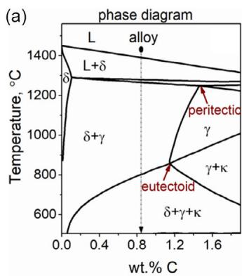

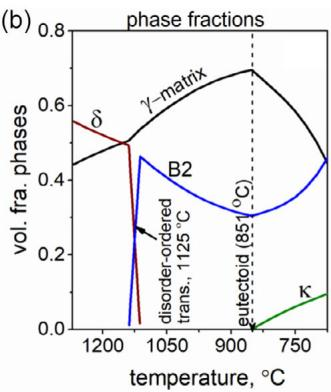

## 2.3. Computations

The experimental data were consolidated with thermodynamic calculations using the 7 database of - . The TCFE Thermo Calcphase diagram was calculated as a pseudo-binary for the multicomponent system, showing the onset of liquid to δ-ferrite, peri tectic, and eutectoid reactions at different temperatures, a. A change in the volume fraction of phases with tem-Figure 1peratures has been plotted in Figure 1b, indicating a reduction in δ-ferrite fractions on its way to B2 formation until the eutectoid reaction at $8 5 1 ^ { \circ } \mathrm { C } .$ The extension of eutectoid transformation near annealing temperature $( 9 0 0 ^ { \circ } \mathrm { C } )$ enables a fresh precipitation of B2 by reducing the γ phase fractions (Figure 1b). The γ to κ-carbide precipitation is limited in the system (Figure 1b). The thermodynamic calculations in Figure 1c,d further state that the solute-partitioning from γ enriches the alloying elements into B2 through a local equilibrium at the phase interface.

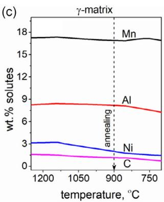

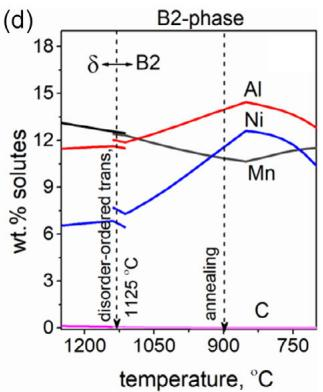  
Figure 1. a) Phase diagram, demonstrating liquid $( \mathsf { L } ) , \mathsf { \& } \gamma ,$ and κ-carbide formations in low density steel system. b) The phase fraction variations, showing the occurrence of an order-disordered transition from δ to B2 at $1 1 2 5 ^ { \circ } \mathsf { C } . \mathsf { c } , \mathsf { d } )$ The equilibrium distributions of solutes, showing elemental partitioning from γ-matrix to B2. The outputs are consistent with Ref. [15] for the same alloy composition.

## 3. Results and Discussion

The as-cast solidified microstructure has been demonstrated in a. The dendrite fractions appear to be significant, due to Figure 2a high concentration of Al as a ferrite stabilizer alloyed in the composition. The δ-ferrite nucleates directly from the liquid phase at a high temperature (Figure 1a). During the next stage, the liquid and δ-ferrite combine to form γ by peritectic reaction (Figure 1a).[2] It is most likely that the thickening of γ-solid at liquid/δ-ferrite phase interfaces blocks the solute exchange, thereby causing cessation of δ-ferrite decomposition by incomplete peritectic reaction.[2] Evidence is provided by 27% δ-ferrite remaining in the as-cast sample microstructure at room temperature by maintaining an equilibrium with γ-phase. The solutepartition into δ-ferrite from γ-matrix during homogenization treatment at 1150 °C for 2 h can transform the δ to B2 through order-disordered transition prevailing at 1125 °C in this alloy system (Figure 1b–d).[1,15] The solute-enrichment makes the dendrites strong.[12] As a result, the present work intends to perform HR to a higher degree and followed by a minimum CR at room temperature, restoring metal sheets free from cracking.

The execution of HR between 1050 and 900 °C transforms the dendrites into lamellar stringer bands, spanning over multiple austenite grains (Figure 2b). During the hot deformation, the aspect ratio of dendrites decreases in the normal direction by channeling mass in RD. In order to synchronize plastic flow, the γ-matrix also undergoes rigorous plastic deformation. The localization of strain in γ has been tracked with shear band formations inside the matrix phase (Figure 2d). Fine-scale B2 tends to nucleate at those shear bands, alleviating lattice strain. The repeated HR in nine stages causes shape deformation and a partial dissolution of dendrites, in accordance with the equilibrium diagram (Figure 1b). A rough estimation with - software reveals the reduction of dendrite fractions from 27% in the ascast microstructure to 19% after HR. In the next stage, the CR causes panacking of γ, a further thinning of B2 stringer bands, and a shape deformation of precipitated IG-B2 (Figure 2c). The lamellar shape morphology of B2 stringer bands through a repeated thickness reduction is an interesting observation pertaining to enhanced plasticity by an intermetallic phase shown in this work.[12] The insight demonstrates a future hope that the low density steel can be flattened and rolled with conventional metallurgy applied in commercial lines, leading to the fabrication of the bulk sample.

The cold working causes intense metal sheet deformation. The restoration desires annealing treatment, performed at 900 °C for 5–30 min. The representative sample microstructures are given in , revealing intra-(IG-B2) and intergranular (GB-B2) Figure 3precipitation of B2 second phase in this stage, additionally. The IG-B2 nucleates within unrecrystallized-γ (URE-γ), containing shear bands at large for their heterogeneous nucleation (Figure 3a–f ). The precipitation of IG-B2 at the grain body of fully recrystallized-γ (RE-γ) was negligible, given by the fact that intragranular precipitation of second-phase particles with a body centered cubic (BCC) crystal structure in face centered cubic (FCC)γ was difficult through high coherency strain or activation energy barrier involved in the solid-state precipitation reaction (Figure 3g).[16] The IG-B2 is finer in A5, and it tends to grow bigger into a needle shape through mutual coalescence in shear bands during annealing for 30 min (Figure 3d–f ). The GB-B2 is coarse, due to enhanced solute flux from the grain boundary

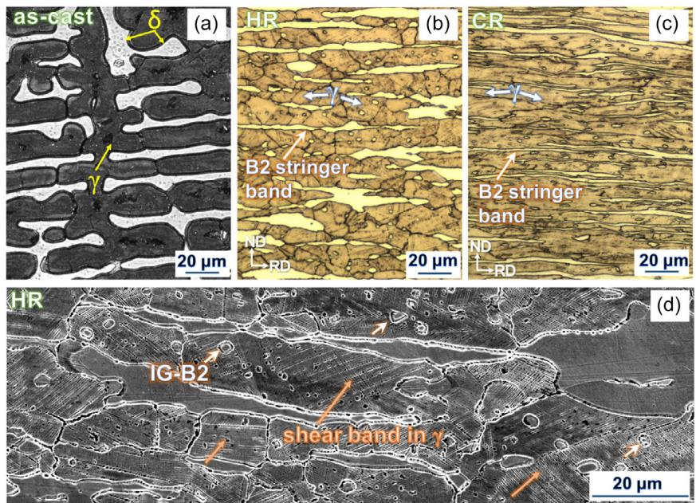  
Figure 2. a) Optical images, showing (a) δ-ferrite in austenite (γ) matrix of the as-cast sample, and the transformation of δ-ferrite into lamellar B2 stringer bands after b) HR and c) CR. d) The FESEM image, showing intragranular-B2 (IG-B2) precipitation at shear bands of HR-γ.

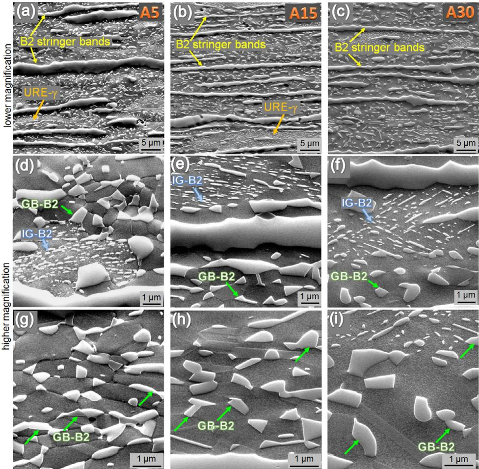  
Figure 3. FESEM images, showing intra-(IG-B2) and intergranular (GB-B2) precipitation at lower and higher magnification in samples annealed for a,d,g) 5 min, b,e,h) 15 min, and c,f,i) 30 min. The URE-γ is uncrystallized austenite grains maintaining a pancake structure.

regions (Figure 3g–i). The grain size of RE-γ increases with the annealing time. The URE-γ grains were coarse and elongated along prior RD by maintaining a pancake structure despite the annealing (Figure 3a–c). Nevertheless, the IG-B2, GB-B2, and B2 stringer bands were the three different microstructural morphologies of B2, retained after the annealing treatment.

A bright-field transmission electron micrograph of the longer annealed A30 in a reveals the microstructural information in finer details in association with the previous FE-SEM images. The GB-B2 appears to be irregular in shape, nucleating along prior austenite grain boundaries. The IG-B2 is needleshaped, and it nucleates mainly inside URE-γ, being left out in smaller numbers after the annealing treatment (Figure 3d and 4a). A specific reason for the presence of URE-γ is the B2 stringer bands, surrounding unrecrystallized grains in some regions of the sample microstructure (Figure 3d–f ). The B2 delays the recrystallization of γ, similar to a carbide, nitride, or carbonitride, controlling rate kinetics in different steels without dissolution.[17,18] The heat treatment releases residual stress by nucleating annealing twins sporadically inside the γ grains (Figure 4a). The twinned plates and boundaries were the heterogeneous nucleation sites for B2 precipitation, as shown in the inset of Figure 4a. The TEMenergy dispersive X-Ray (EDX)

analysis in Figure 4b–f reveals that the B2 is enriched in Fe, Mn, Al, and Ni, denoting the chemical formula to be Fe(Ni, Mn)Al. The solute partitioning from γ during homogenization and annealing treatment enriches those elements into B2, since volume diffusion of the substitutional elements may not be easy down to the annealing temperatures (Figure 1c,d). A negligible solid solubility of carbon in B2 confirms the precipitated phase as an intermetallic (Figure 1d and 4d). Interestingly, although Ni is a well-known γ-stabilizer, it is enriched in B2, without local-─ ─ izing in its designated place, γ (Figure 1c,d). The unusual trend─ ─ lies in the fact that the Ni-partition into B2 replaces some of the Fe Al with Ni Al bonds. The atomic scale ordering renders the B2 more stable, as Ni Al is stronger than the Fe Al bond.[19–21] A stronger atomic bond, making the B2 nonshearable, is often behind the active consideration of IG-B2 for precipitation hardening in the previous work.[12] The dislocation looping around B2 particles induces precipitation strengthening by the Ashby– Orowan equation[15,22,23]

$$
\sigma_ {\mathrm{IG-B2}} = (0. 5 3 8 G b \sqrt {f _ {\mathrm{IG-B2}}} / D _ {\mathrm{IG-B2}}) \ln \left(D _ {\mathrm{IG-B2}} / 2 b\right)\tag{1}
$$

where is the shear modulus $( 7 0 \mathrm { G P a } ) , ^ { [ 2 4 ] }$ is the Burgers vector $\mathrm { o f } \gamma ( 0 . 2 6 \mathrm { n m } ) , ^ { [ 2 4 ] } D _ { \mathrm { I G - B } 2 }$ bis the average size of IG-B2, and $f _ { \mathrm { I G - B } 2 }$ is the fractional distribution of IG-B2. The estimation of $D _ { \mathrm { I G - B } 2 }$ (0.29 μm) and $f _ { \mathrm { I G - B } 2 }$ (1.1%) within RE-γ (Figure 3a) provided $\sigma _ { \mathrm { { I C } - B 2 } }$ fof 23 MPa. The IG-B2 (0.2 μm) with a net phase fraction of 2.6% in $\mathrm { U R E - } \gamma$ provided the $\sigma _ { \mathrm { { I C - B 2 } } }$ of 43 MPa. Thereby, the total IG-B2 within RE-γ and URE-γ provided the precipitation strengthening of 66 MPa. The annealing over a longer duration coarsens IG-B2 and reduces $f _ { \mathrm { I G - B } 2 }$ for the precipitation strengthening to be feven lower. In order to understand the role of B2 stringer bands, the following section analyzes the mechanical properties.

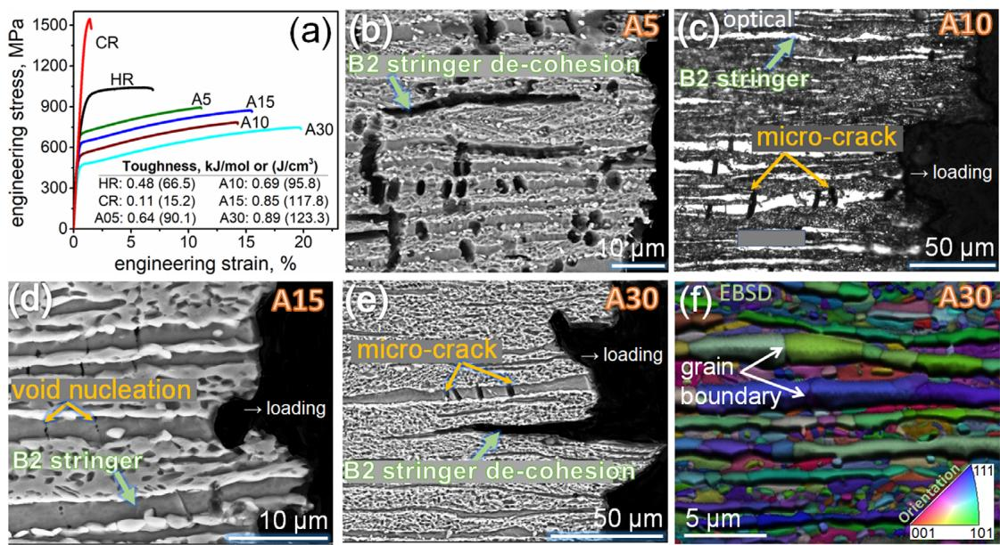

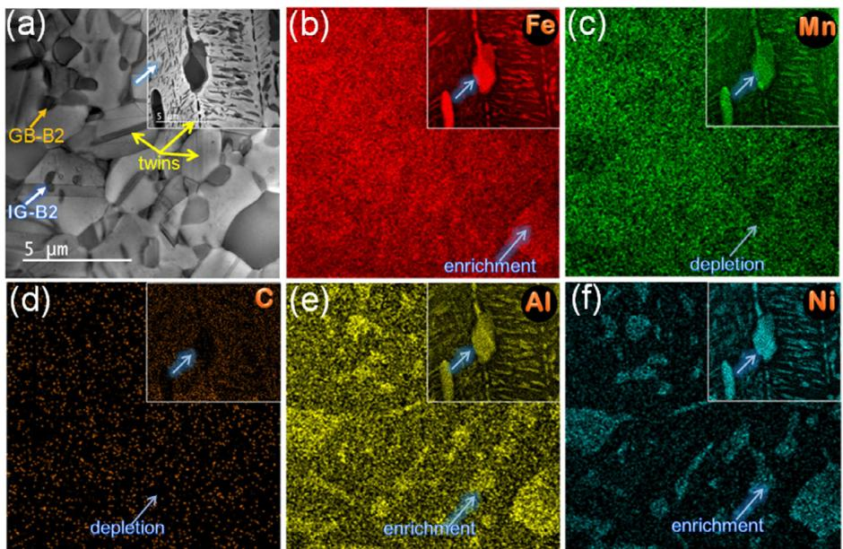  
Figure 4. a) Bright field TEM images of representative A30, demonstrating IG-B2, GB-B2, and annealing twins. b–f ) TEM-EDX spectra, showing solute distributions in B2 and austenite matrix. The precipitation of B2 at annealing twins has been shown in the inset through elemental mapping

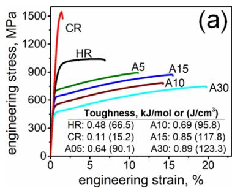  
Figure 5. a) Engineering stress-strain curves, showing strength-ductility and toughness variations in samples processed under HR. CR, and 5–30 mir annealing. Optical and SEM images, illustrating b,e) stringer band annihilation, c) crack formation, and d) microvoid nucleation at deformed tensile gauge. f ) EBSD phase map, revealing grain boundaries inside B2 stringer bands.

The engineering stress–strain curves of uniaxial tensile samples processed under HR, CR, and annealed conditions are shown in a. The HR condition exhibits nearly 6.8% duc-Figure 5tility, and CR reduces it even further; thus, adding extra attention to annealed conditions for tensile properties. The incorporation of annealing treatment increases ductility, but the strength– ductility balance varies inconsistently in different annealed conditions. For example, the tensile strength in A15 was higher than that of A10, and the ductility in A30 increased slightly despite a longer annealing. The energy absorbed before fracture, calculated from an integral area under the stress–strain curves, increases moderately as a function of annealing time of the samples (inset, Figure 5a). The unsatisfactory stress–strain response was subjected to verification by performing fracture analysis at the deformed tensile gauge.

As compared to conventional fractography, the microstructure analysis at the crack tip is qualitative (Figure 5b–e). A systematic study reveals that macrovoids nucleate inside B2 stringer bands. As the tensile strain increases, the macrovoid coalescence happens, triggering crack initiation in B2 stringer bands (Figure 5d). If a stringer band is thicker, the crack formation is higher inside the lamellar structure at a regular interval (Figure 5c,e). A key observation on top is the decohesion of a B2 stringer band in segments (Figure 5b). The merger of several microcracks into a bigger crack perpendicular to the load axis and the debonding of stringer band segments in the loading axis lead to biaxial failure of the tensile gauge by ultimately detaching a chunk of material from the deformed tensile gauge (Figure 5b,e). A statistical distribution of thicker stringer bands localized in a region would fast-track the microcrack merger, resulting in a catastrophic failure of an entire tensile gauge (Figure 5b). The escalating matter was thoroughly analyzed with an EBSD phase map in Figure 5f, pinpointing crack initiation at the grain boundaries of B2 stringer bands. A specific reason is that the B2 stringer bands undergo intense prior plastic deformation, and thereafter annealing treatment, leading to static recrystallization into a bamboo-like structure (Figure 5f ). As the B2 stringer is an intermetallic phase, the grain boundary decohesion was inevitable (see Figure 5d–f ). In the next course, the annhi lation of a B2 stringer band segment happens, based on the EBSD characterization that the static recrystallization of a B2 stringer band subdivides its polygonized structure into various grains or lamellar segments having different local orientations inherited from the prior plastic deformation, as shown by color mismatch in the orientation map (Figure 5f ). The statistical dominance of a particular color in a stringer band is considered the preferable orientation, leaving behind the minority grains to be debonded as an unpreferred orientation. The stress concentrations within the B2 stringer bands curtail the overall strength or ductility in the samples (Figure 5a).

In order to overcome the flow instability, a conservative idea could be the elimination of CR plus annealing treatment.

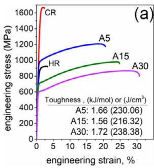

However, the approach incorporates a poor strength–ductility balance, as is evident in the sole HR sample (Figure 5a). Thus, a process control is rationale for a feasible solution. The execution applies a relatively high speed HR at the rate 10 rpm against a merely 1 rpm in the previous case, reducing the plate thickness from 14 2 mm (slightly more), followed by a 1 mm thickness reduction by CR. With annealing treatment similar to the previous experiments for 5–30 min, the YS increases to 1 GPa in a. The strength–ductility variations Figure 6also become consistent, as less annealed A5 exhibits higher strength, and longer annealed the best ductility, raising the toughness to $1 . 7 2 \mathrm { k J m o l } ^ { - 1 } ~ ( \mathrm { o r } ~ 2 3 8 \mathrm { J c m } ^ { - 3 } )$ in A30 (inset, Figure 6a). The overall magnitudes appear to be comparable with TRIP aided steel, having the toughness of nearly 0.5–1.5 kJ mol1 or $6 9 { - } 2 0 7 . 8 \mathrm { J } \mathrm { c m } ^ { - 3 } . ^ { [ 1 4 , 2 5 ] }$ The valuable contribution of microstructural modifications was attributed to the refinement of B2 stringer bands, bringing softer γ to the prominence by reducing the stringer band fractions from 16% to 11% in the sample microstructures. The enhanced austenite fraction in between the thinner stringer bands delays the crack propagation and stringer band decohesion, by absorbing the plastic strain preferentially (Figure 6c–f ). The residual dislocations left behind by high-speed HR may increase the YS of A5 to a higher level, as compared to longer annealed samples, annihilating the dislocation density significantly.

The strain partitioning between softer γ and harder B2 plays an important role in strain hardening, analyzed with Holloman’s plot to be in two stages, Figure 6b. The interpretation is based on the calculation of strain hardening exponent ( ) from true stress (σ)–true strain (ε) curves using the equation $\sigma = k \varepsilon ^ { n }$ in logarithmatic form, where is the strength coefficient. The value obtained from the best linear fits of lnσ versus lnε is initially low, due to yield point elongation (YPE), followed by a steady rise through a combined plastic deformation of γ and B2. The EBSD phase map, along with the Kernel average misorientation (KAM) map, proportional to dislocation density,[26] in a,b reveals Figure 7that both γ and B2 have sufficient capacity to undergo plastic deformation through a shape deformation. Since B2 is a harder phase, the strain concentration is higher in γ succumbing to more deformation (Figure 7b). The observation was compounded in the TEM investigation of A15 after an interrupted tensile test at engineering strain = 0.05, finding a higher dislocation density in γ than that in the B2, Figure 7c. The strain incompatibility between the phases results in YPE. Since B2 is an intermetallic and γ is solute-enriched, the magnitude of YPE is weak during the tensile deformation at the onset of yielding (Figure 5a and 6a). As the tensile deformation progresses, the dislocations released from softer γ tend to get localized around GB-B2 at the phase interfaces near γ grain boundaries, Figure 7d,e. The preferential localization of strain reduces the geometrically necessary dislocation density (GND) in bulk, containing 64% γ. As a result, the (γ B2) phase mixture reduces the magnitudes of the overall strain hardening exponent to 0.19–0.27 by a rule of mixture (Figure 6b). In order to augment -values beyond the current range, a uniform distribution of nGND inside γ is essential.[23] The current microstructural modulation rules out that possibility with 16% GB-B2 and 3.7% IG-B2, rather nonshearable in nature, blocking the mean-free paths of dislocations (Figure 7e).

(b)  
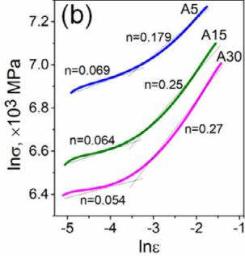

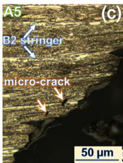

A15  
(d)  
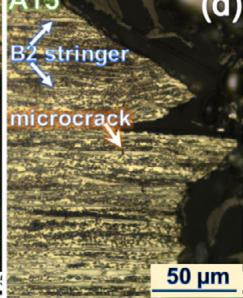

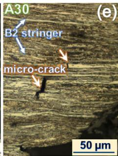  
Figure 6. a) Engineering stress–strain curves of the samples processed under modified HR, CR, and annealing for 5–30 mins. b) Holloman’s plot, demonstrating the strain hardening exponent (n) for various samples. Optical micrographs of the deformed tensile gauge, showing reduced crack susceptibility in the modified c) A5, d) A15, and e) A30.

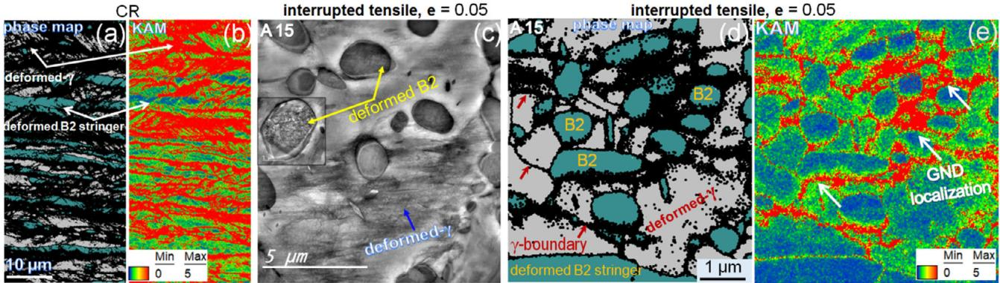  
Figure 7. (a) EBSD phase map, showing co-deformation of B2 stringer bands and , and b) a parallel EBSD KAM map, showing strain localization in the respective phases during CR. c) TEM bright field image post-interrupted tensile at plastic strain e = 0.05, showing deformed γ and B2 in A15. d,e) EBSD phase and KAM maps of A15 post-interrupted tensile at e = 0.05, showing strain localization at γ/B2 interface

## 4. Conclusions

The present work concerns the fabrication of a low-density Fe–10Al–15Mn–0.8C–5Ni wt% austenitic (γ) steel by HR, CR, and annealing treatment at 900 °C for 5–30 mins. The HR and CR refine δ-ferrite, induced by high Al-concentrations in the steel, into B2 stringer bands. The annealing treatment led to intra- (IG-B2) and intergranular (GB-B2) second-phase precipitation. The following conclusions are made on the microstructure– property correlations.

The IG-B2 was observed to be nucleated at shear bands of fewer URE-γ grains. The morphology was needle-shaped, 0.2 μm in size, and 2.6% in phase fractions. A spherical-type coarse IG-B2 (0.29 μm) was also observed with 1.1% in phase fractions inside RE-γ, incorporating a total of 66 MPa for precipitation strengthening in the alloy system.

An incomplete recrystallization of γ was caused by B2 stringer bands present in the sample microstructure by up to 16%. Highly enriched in Al, the B2 was characterized as Fe(Mn,Ni)Al. The aluminide phase delayed recrystallization kinetics similar to a carbide, nitride, or carbo-nitride, functioning in different steels without dissolution. It is not possible to get rid of B2 stringer bands in the current alloy system with 10 wt% Al, stabilizing

27% δ-ferrite during the solidification-casting stage. The intense HR and thereafter CR transform the δ into a lamellar B2 stringer band.

The annealing at 900 °C causes static recrystallization of the B2 stringer bands. Macrovoids tend to appear at the grain boundaries of B2 stringer bands, causing a premature failure.

The refinement of B2 stringer bands with high-speed HR set up a stage for softer γ to dominate the sample microstructure in the weighted average, absorbing the plastic strain preferably. The YS increases to 1 GPa with 30% elongation, as remarkable. The strain distribution between softer γ and harder B2, like a composite, results in the tensile toughness of 1.72 kJ mol1, similar to a TRIP steel or even better through a delayed fracture.

As compared to CR, the HR turns out to be the key for the refinement of B2 stringer bands without metal sheet cracking. A repeated deformation into a lamellar shape, followed by static recrystallization, suggests that microstructure modulation with B2 intermetallic in steel for strengthening may be a reality, not standing with the latter so-called hard-brittle characteristics.

A low strain hardening exponent of 0.18–0.27 was observed during the tensile deformation, due to the localization of strain at γ/B2 phase interfaces near grain boundary regions, depleting GND in the γ-matrix (64%) phase. Despite this heterogeneous strain distribution, the intergranular cracking was elusive in the present case.

## Acknowledgements

The authors acknowledge Dr. S. Bhan for the experiments and the Department of Science and Technology, Government of India, for the financial support (File Number CRG/2018/002432).

## Conflict of Interest

The authors declare no conflict of interest.

## Author Contributions

Sadhan Ghosh: conceptualization (lead); data curation (equal); funding— acquisition (lead); investigation (lead); supervision (lead); writing original draft (lead). Sourav Das: funding acquisition (supporting); writing review and editing (supporting).

## Data Availability Statement

The data that support the findings of this study are available from the corresponding author upon reasonable request.

## Keywords

B2 stringer bands, fracture, lighter steel, precipitation analysis, rolling

Received: October 19, 2025 Revised: December 1, 2025 Published online:

[1] S. Chen, R. Rana, A. Haldar, R. K. Ray, Prog. Mater. Sci. 2017, 89, 345.

[2] M. Sinha, S. Ahad, A. K. Chaudhry, S. Ghosh, Metall. Mater. Trans. A 2020, 51, 809.

[3] R. Rana, JOM 2014, 66, 1730.

[4] G. S. Cole, A. M. Sherman, Mater. Charact. 1995, 35, 3.

[5] W. Korter, W. Ton, Arch. Eisenhuettenwes 1933, 365, 7.

[6] J. L. Ham, J. R. Carin, Product. Eng. 1958, 29, 51.

[7] U. Prakash, R. A. Buckley, H. Jones, C. M. Sellars, ISIJ Int. 1991, 31, 111.

[8] P. Hanus, E. Bartsch, M. Palm, R. Krein, K. Bauer-Partenheimer, P. Janschek, Intermetallics 2010, 18, 1379.

[9] G. Frommeyer, U. Brüx, Steel Res. Int. 2006, 77, 627.

[10] M. J. Yao, E. Welsch, D. Ponge, S. M. H. Haghighat, S. Sandlöbes, P. Choi, M. Herbig, I. Bleskov, T. Hickel, M. Lipinska-Chwalek,

P. Shanthraj, C. Scheu, S. Zaefferer, B. Gault, D. Raabe, Acta Mater. 2017, 140, 258.

[11] H. Liu, J. Li, H. Huang, Z. Wu, Y. Ma, Y. Li, Y. Morisada, H. Fujii, J. Mater. Process. Technol. 2025, 339, 118824.

[12] S. H. Kim, H. Kim, N. J. Kim, Nature 2015, 518, 77.

[13] A. Bahadur, B. R. Kumar, O. N. Mohanty, J. Mater. Sci. 1995, 30, 3690.

[14] N. Bhowmik, S. Ghosh, S. Mandal, A. Haldar, P. P. Chattopadhyay, Calphad 2022, 77, 102425.

[15] S. Bhan, P. Rawat, S. Das, S. Ghosh, Metall. Mater. Trans. A 2023, 54, 4080.

[16] D. A. Porter, K. E. Easterling, Phase Transformations in Metals and Alloys, Vol. 2, Chapman & Hall, London, New York 1992.

[17] M. Sinha, A. Karmakar, B. Syed, S. Ghosh, Metall. Mater. Trans. A 2020, 51, 3435.

[18] H. K. D. H. Bhadeshia, R. W. K. Honeycomb, Steels Microstructure and Properties, Vol. 3, Elsevier Ltd, Oxford, UK 2006.

[19] B. G. Zhang, X. M. Zhang, H. T. Liu, Mater. Charact. 2021, 178, 111291.

[20] B. Mishra, R. Sarkar, V. Singh, A. Mukhopadhyay, R. T. Mathew, V. Madhu, M. J. N. V. Prasad, Materialia 2021, 20, 101198.

[21] A. Rahanama, H. Kotadia, S. Clark, V. Janik, S. Sridhar, Nat. Sci. Reports 2018, 8, 1.

[22] S. Hu, Z. Zheng, W. Yang, H. Yang, Steel Res. Int. 2022, 93, 1.

[23] S. Yadav, B. Syed, S. Ghosh, Materialia 2024, 36, 102158.

[24] E. Welsch, D. Ponge, S. M. H. Haghighat, S. Sandlöbes, P. Choi, M. Herbig, S. Zaefferer, D. Raabe, Acta Mater. 2016, 116, 188.

[25] Z. He, H. Liu, Z. Zhu, W. Zheng, Y. He, L. Li, Materials 2019, 12, 3781.

[26] M. Sinha, B. Syed, A. Karmakar, S. Ghosh, Mater. Sci. Eng. A 2020, 787, 139519.