# Melting, Processing, and Properties of Disordered Fe-Al and Fe-Al-C Based Alloys

V.V. SATYA PRASAD,1 SHIVKUMAR KHAPLE,1 and R.G. BALIGIDAD1,2

1.—Defence Metallurgical Research Laboratory, Kanchanbagh, Hyderabad 500058, India. 2.—e-mail rbaligidad@yahoo.com

This article presents a part of the research work conducted in our laboratory to develop lightweight steels based on Fe-Al alloys containing 7 wt.% and 9 wt.% aluminum for construction of advanced lightweight ground transportation systems, such as automotive vehicles and heavy-haul truck, and for civil engineering construction, such as bridges, tunnels, and buildings. The melting and casting of sound, porosity-free ingots of Fe-Al-based alloys was accomplished by a newly developed cost-effective technique. The technique consists of using a special flux cover and proprietary charging schedule during air induction melting. These alloys were also produced using a vacuum induction melting (VIM) process for comparison purposes. The effect of aluminum (7 wt.% and 9 wt.%) on melting, processing, and properties of disordered solid solution Fe-Al alloys has been studied in detail. Fe-7 wt.% Al alloy could be produced using air induction melting with a flux cover with the properties comparable to the alloy produced through the VIM route. This material could be further processed through hot and cold working to produce sheets and thin foils. The cold-rolled and annealed sheet exhibited excellent room-temperature ductility. The role of carbon in Fe-7 wt.% Al alloys has also been examined. The results indicate that Fe-Al and Fe-Al-C alloys containing about 7 wt.% Al are potential lightweight steels.

## INTRODUCTION

The iron-aluminum alloys containing 6–9 wt.% aluminum show a reduction in density of 10% and are popularly known as lightweight steels. These newly developed lightweight steels show promising physical, mechanical, and technological properties, such as high specific elastic stiffness and strength, excellent ductility and formability, and reduced specific weight. In view of the aforementioned attractive combination of properties, the lightweight steels show promise for the construction of advanced lightweight ground transportation systems, such as automotive vehicles and heavy-haul trucks. 1–6

The Defence Metallurgical Research Laboratory (DMRL) has carried out extensive studies on the development of ordered Fe-Al-C alloys containing 11 wt.% and 16 wt.% Al for the past two decades. DMRL’s main contribution has been in the development of the most economical melting route for bulk production of Fe-Al-C alloys by a combination of air induction melting (AIM) and electroslag refining (ESR).7–9 The AIM ingots exhibited extensive gas porosity that could be totally eliminated by the ESR process. Subsequently, a proprietary flux cover and a novel charging schedule were developed to produce sound ingots using the AIM process. We have exhaustively evaluated the role of Al and C contents in the Fe-Al-C system.9–14 It has been established that the addition of carbon to Fe-Al alloys containing 9–16 wt.% Al leads to improved strength, creep resistance, machinability, and resistance to environmental embrittlement. These improvements in the properties were attributed to the formation of perovskite-based $\mathrm { F e _ { 3 } A l C _ { 0 . 5 } }$ precipitates. The addition of carbon to the $\mathrm { F e _ { 3 } A l }$ alloy also allowed the use of low-cost processing techniques and cheap raw material such as steel scrap. Although Fe-16Al-1C alloy having $\mathrm { F e _ { 3 } A l }$ phase with $\mathrm { F e _ { 3 } A l C _ { 0 . 5 } }$ precipitates exhibit superior high-temperature strength and creep properties as compared with high-carbon Fe-(9–13 wt.%) Al alloys, it has poor room-temperature ductility. Fe-11Al-1C alloy having bcc $\alpha \ \mathrm { D O _ { 3 } }$ ordered $\mathrm { F e _ { 3 } A l }$ phases and L12 ordered $\mathrm { F e _ { 3 } A l C _ { 0 . 5 } }$ precipitates exhibit an excellent combination of properties such as good room-temperature ductility, high-temperature strength, and high-temperature resistance to oxidation and decarburization.

It has been reported that reduction in Al content results in enhanced room-temperature ductility.15,16 The improvement in ductility may be attributed to (i) a reduced susceptibility to environmental embrittlement and (ii) an absence of ordering. However, reported information on the development of low-density steels (Fe-6–9 wt.% Al) based on single-phase Fe-Al solid-solution-type alloys is scanty and inadequate.

DMRL has recently initiated a program on the development of low-density steels for lightweighting solutions based on the experience gained in the development of Fe-Al ordered intermetallic alloys. Disordered Fe-Al solid solution alloys containing 7 wt.% and 9 wt.% aluminum have been chosen for the study. Fe-7 wt.% Al alloy represents totally disordered solid solution alloy, while Fe-9 wt.% Al alloy is expected to exhibit short-range ordering. These alloys have been melted through air induction melting, vacuum induction melting (VIM), and air induction melting with a flux cover to understand the effect of the melting process. Furthermore, the effect of carbon on the structure and properties of Fe-7 wt.% Al alloy has been studied. The present article reports the salient findings of these studies.

## MELTING OF IRON-ALUMINUM ALLOYS

## Air Induction Melting of Fe-Al Alloys

AIM is the most economical melting route, and it is widely used for bulk production of steels containing nonreactive elements. Melting of iron-aluminum alloys containing a large amount aluminum requires consideration of the following factors during AIM: (i) large difference in melting points and density between Fe and Al, (ii) exothermic nature of the formation of $\mathrm { { A l } _ { 2 } \mathrm { { O } _ { 3 } , } }$ and (iii) oxidation of Al due to its high reactivity. Traditionally, Fe-Al alloys with higher aluminum levels are prone to develop extensive gas porosity when melted through air induction melting .17,18 The same phenomenon was observed in the present case of air induction melting of Fe-Al alloys containing 7 wt.% and 9 wt.% Al.

The formation of gas porosity in the ingots may be explained by the reaction of highly reactive aluminum with water vapor in the air:

$$
\mathrm{H} _ {2} \mathrm{O} (\mathrm{V}) + 2 / 3 \mathrm{Al} = 1 / 3 \mathrm{Al} _ {2} \mathrm{O} _ {3} + 2 \mathrm{H} (\text { in   Al })\tag{1}
$$

Moisture on the charge, refractories, and tools in the atmosphere may be a possible source of water vapor for the above reaction. The hydrogen gas liberated by this reaction dissolves into the liquid metal. As it cannot escape during solidification, it results in the formation of gas porosity. For a given concentration of hydrogen, the gas porosity in the unit volume of iron-aluminide ingot is very high compared with aluminum due to the relatively higher density (6.7 $\mathrm { g } / \mathrm { c m } ^ { 3 } )$ of iron-aluminum alloys. For example, only 8 ppm of hydrogen present in iron-aluminide ingot can result in formation of about $\mathrm { 5 0 ~ c m ^ { 3 } }$ of hydrogen gas porosity in 100 cm3 of iron-aluminide ingot at STP. Furthermore, the liquidus temperature of iron-aluminum alloys is considerably higher than that of aluminum. The Fe-Al alloy ingots containing 7 wt.% Al were free from hydrogen gas porosity, whereas alloys containing 9 wt.% aluminum showed gas porosity. The lower gas porosity in Fe-Al alloys containing lower levels of Al may be attributed to the presence of a low concentration of hydrogen in the liquid metal, which is well within the solubility limit. It may be argued that Fe-Al alloy with lower Al content is expected to liberate a low concentration of hydrogen compared with the Fe-Al alloy containing a higher content of Al. The Fe-7Al alloy ingots were also sound and free from microcracks.

## Vacuum Induction Melting of Fe-Al Alloys

The work on air induction melting of Fe-Al alloys showed that iron-aluminum alloys are process sensitive. Hence, an attempt was made to produce Fe-Al alloys through VIM wherein it may be possible to eliminate hydrogen gas porosity. Literature on processing of iron-aluminum alloys19,20 suggests that these alloys are generally melted under argon atmosphere or vacuum, which reduces the chances of hydrogen pick-up and, hence, gas porosity.

Alloys with the same composition using the same raw material were melted in a 50-kg capacity, 125- kW, medium-frequency chamber vacuum induction furnace from $^ { 6 6 } \mathrm { G . C . A } .$ . make’’ USA with a vacuum level of $1 0 ^ { - 4 }$ torr. The furnace consists of an alumina-lined crucible of approximately 150 mm diameter and 300 mm height. The soft iron pieces were charged at the bottom of the crucible with aluminum pieces on top of these iron pieces in an alumina-lined crucible. The furnace was evacuated to a vacuum level of $1 0 ^ { - 4 }$ torr, and power was switched on. When the temperature of the melt reaches 1893 K, the melt was poured into 80-mmdiameter split cast iron molds, which were kept inside the vacuum chamber. Both Fe-Al alloy ingots containing 7 wt.% and 9 wt.% Al were sound and completely free from microcracks as well as hydrogen gas porosity. Sikka19 reported that VIM of iron aluminides based on $\mathrm { F e _ { 3 } A l }$ containing about 16 wt.% Al ingots are totally free from gas porosity. Rishel and Brody20 have also reported a very low level of hydrogen (<1 ppm) in $\mathrm { F e _ { 3 } A l }$ alloys produced by VIM. The production of sound ingots totally free from gas porosity with a very low level of hydrogen was probably due to the combination of two factors:

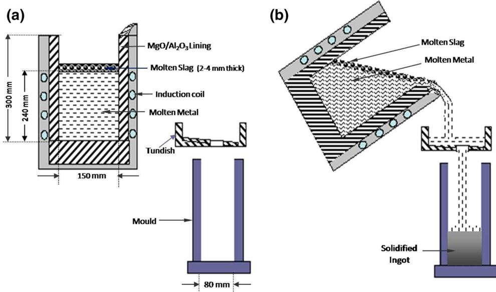  
Fig. 1. Schematic diagram of air induction melting with flux cover (a) during melting and (b) during pouring

(i) no moisture comes in contact with the melt and (ii) any trapped gas that might have been produced by aluminum and water vapor (present in the crucible and raw material) reaction is pumped out as the melting proceeds.

VIM provides better control of chemical composition and recovery of alloying additions. Very low levels of impurities could be achieved in VIM.

## Air Induction Melting of Fe-Al Alloys with Flux Cover

Although the VIM process is known to yield Fe-Al alloy ingots free from gas porosity, the process is expensive and not easily available. Hence, efforts have been put into develop an alternative costeffective melting process to produce Fe-Al alloys without gas porosity. The alternative process involves air induction melting using a protective flux cover and proprietary charging schedule. Sound, porosity-free Fe-Al alloys ingots containing 7 wt.% and 9 wt.% Al were successfully produced by this process (Fig. 1). The 30-kg heats of Fe-Al alloys containing 7 wt.% and 9 wt.% Al were prepared by Inductotherm medium-frequency AIM of 50-kg capacity. Commercial purity aluminum and iron were used as raw material. The iron charge was cleaned by pickling in dilute hydrochloric acid. The iron pieces were charged into an alumina-lined crucible. After melting the iron charge, preheated flux containing $\mathrm { { A l } _ { 2 } \mathrm { { O } _ { 3 } , } }$ CaO, MgO, and $\mathrm { \bar { C } a F _ { 2 } }$ was added to provide a protective cover to the melt and was allowed to melt. The cleaned and preheated aluminum pieces were then plunged into the molten iron bath. The bath was held at 1900 K for a very short time (2 min) to prevent aluminum losses. The melt was then top poured into split cast iron molds. The flux cover added after melting iron charge acts as a barrier between the aluminum in the melt and water vapor in the air and prevents the formation and pick-up of hydrogen by the reaction between aluminum in the melt and water vapor in the air. The composition of the flux cover was optimized carefully to ensure that it refines the liquid metal with respect to impurities and that it does not at tack the crucible lining. During AIM, the flux must be kept molten to allow charging of aluminum and to aid pouring into molds. The flux does not take part in the heat generation and is kept molten through the heat transfer from the molten metal beneath and by the heat released due to the highly exothermic reaction between iron and aluminum. Therefore, the flux charge had to be limited to an amount that is just sufficient to provide adequate protective cover during charging and melting of aluminum.

Selection of crucible lining material for melting iron aluminides is very critical in the above three processes. This is important for two reasons: (i) to have a long crucible life and (ii) to minimize impurity pick-up from the crucible lining. MgO is the most common choice for commercial steels and alloys containing a low level of aluminum. The standard free energy data (Fig. 2) show that Al in the melt can reduce MgO at temperatures of about 1873 K, which is very close to the melting point of iron aluminides.21 The reduction of MgO results in the pick-up of magnesium by the alloy and in erosion of the crucible. It has also been reported that high Mg levels especially when segregated can cause problems in hot working.19 Ingots of both Fe-7 wt.% and 9 wt.% Al alloy were completely free from gas porosity. The Fe-7Al alloy ingots were completely free from microcracks, whereas Fe-9Al alloy ingots exhibited microcracks. These microcracks are the result of hydrogen embrittlement due to the presence of a higher concentration of hydrogen (Table I) present in these alloys.

The recovery of aluminum is excellent (95–98%) during both AIMFC and VIM compared with AIM. The recovery of aluminum (95–98%) during AIMFC is comparable to the recovery of aluminum (96–98%) during VIM. The excellent recovery of aluminum during VIM is well understood, and the recovery of aluminum during AIMFC may be attributed to the flux cover and alumina present in the flux cover.

AIMFC ingots exhibit low levels of sulfur compared with AIM and VIM ingots (Table I), which may be attributed to the desulfuring action of CaO present in the flux. The sulfur removal takes place by the following slag–metal reaction:

$$
[ \mathbf {S} ] + (\mathbf {C a O}) = (\mathbf {C a S}) + [ \mathbf {O} ]
$$

The equilibrium constant K for this reaction is given by

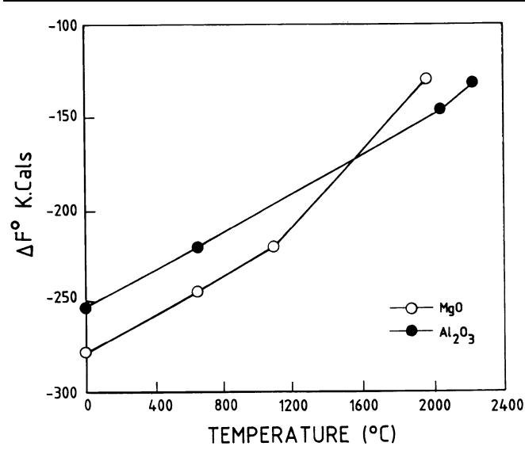  
Fig. 2. Standard free energy of formation as a function of tempera ture of MgO and $\mathsf { A l } _ { 2 } \mathsf { O } _ { 3 } .$ 2

$$
K = \frac {\alpha_ {[ \mathrm{O} ]} \alpha_ {(\mathrm{S} ^ {2 -})}}{\alpha_ {[ \mathrm{S} ]} \alpha_ {(\mathrm{O} ^ {2 -})}}
$$

$$
\frac {\alpha_ {[ \mathrm{S} ]}}{\alpha_ {(\mathrm{S} ^ {2 -})}} = \frac {1}{K} \frac {\alpha_ {[ \mathrm{O} ]}}{\alpha_ {(\mathrm{O} ^ {2 -})}}
$$

where $\alpha _ { [ \mathrm { S } ] } = \mathrm { a c t i v i t y }$ of sulfur in the melt, a[O] = activity of oxygen in the melt, $\alpha _ { ( \mathrm { S ) } } ^ { 2 - } = \mathrm { a c t i v i t y }$ of sulfur in the slag, $\overline { { \alpha _ { ( 0 ) } ^ { 2 - } } } = \mathrm { a c t i v i t y }$ of oxygen in the slag.

It can be observed that the sulfur content of the metal is directly proportional to the concentration of the oxygen in the metal and inversely proportional to the basicity of the slag. The flux used in the present work does not have any acid oxide component, and the major components taking part in the desulfurization reaction are CaO and MgO. The total concentration of CaO and MgO put together is approximately 40 wt.%, while the remaining components in the slag $( \mathrm { C a F _ { 2 } }$ and $\mathrm { { A l } _ { 2 } \mathrm { { O } _ { 3 } ) } }$ are neutral. The very low level of sulfur in the $\mathbf { A I M F C }$ ingot may be attributed to a (i) very low value of $\alpha _ { [ O ] }$ due to the presence of a high concentration of aluminum in the

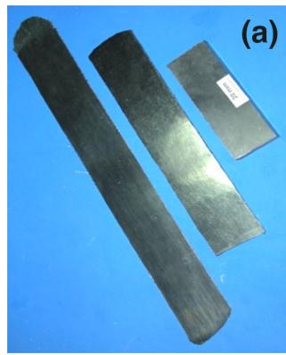

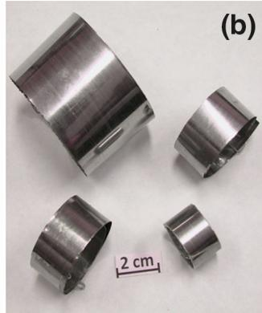  
Fig. 3. Cold-rolled Fe-7 wt.% Al alloy (a) plates and sheet and (b) foils produced by the AIMFC process.

Table I. Chemical composition of Fe-7 and 9 Al alloys processed by AIM, AIMFC, and VIM

<table><tr><td rowspan="2">Alloy</td><td rowspan="2">Process</td><td colspan="8">Alloy composition (wt.%)</td></tr><tr><td>Al</td><td>Si</td><td>Mn</td><td>S</td><td>C</td><td>O</td><td>H</td><td>N</td></tr><tr><td>Fe-7Al</td><td>AIM</td><td>7.22</td><td>0.20</td><td>0.056</td><td>0.0075</td><td>0.021</td><td>0.0200</td><td>0.0052</td><td>0.02</td></tr><tr><td>Fe-7Al</td><td>AIMFC</td><td>7.30</td><td>0.14</td><td>0.045</td><td>0.0016</td><td>0.019</td><td>0.0057</td><td>0.0023</td><td>0.0018</td></tr><tr><td>Fe-7Al</td><td>VIM</td><td>7.02</td><td>0.12</td><td>0.052</td><td>0.0028</td><td>0.015</td><td>0.0035</td><td>0.0020</td><td>&lt;0.001</td></tr><tr><td>Fe-9Al</td><td>AIMFC</td><td>9.20</td><td>0.16</td><td>0.046</td><td>0.0015</td><td>0.017</td><td>0.0050</td><td>0.0052</td><td>0.0015</td></tr><tr><td>Fe-9Al</td><td>VIM</td><td>9.10</td><td>0.11</td><td>0.042</td><td>0.0027</td><td>0.014</td><td>0.0023</td><td>0.0021</td><td>&lt;0.001</td></tr></table>

Since Fe-9Al alloy ingot produced by AIM exhibited a large amount of gas porosity, it was not analyzed. Hydrogen analysis was done by an RH-444 Leco Gas analyzer.

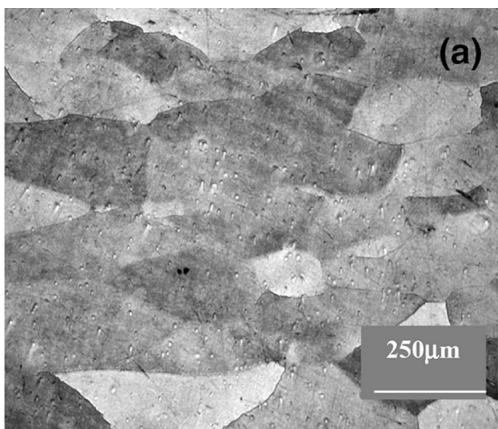

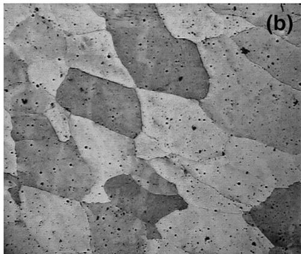

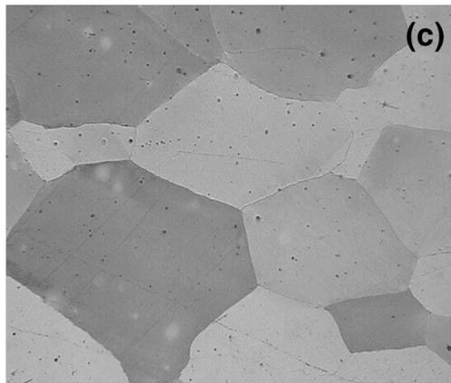

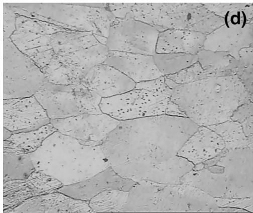

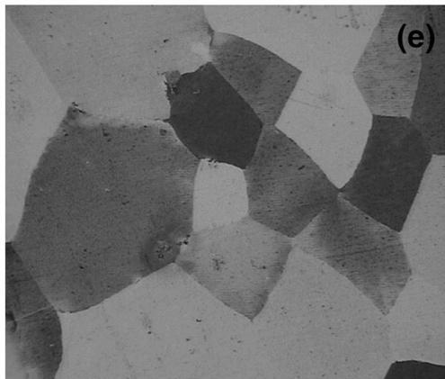  
Fig. 4. Optical micrographs of hot-rolled Fe-Al alloys containing (a) AIM 7 wt.% Al, (b) AIMFC 7 wt.% Al, (c) AIMFC 9 wt.% Al, (d) VIM 7 wt.% Al, and (e) VIM 9 wt.% Al.

alloy and (ii) very high sulfide capacity of the slag due to the presence of $\mathrm { \bar { C } a O }$ and $\bf { M g } \bar { O }$ in the slag. The oxygen level in the alloys produced by AIMFC is very low and comparable with VIM alloys. The presence of a slag cover prevents the melt from further oxidation. Consequently, a very low level of oxygen was achieved by AIMFC. It can also be observed from Table I that AIMFC ingots exhibited a higher concentration of hydrogen compared with VIM ingots. Although the flux cover during AIM did prevent the formation of hydrogen gas porosity, it could not totally prevent the pick-up of hydrogen as the melt was exposed to the atmosphere during pouring and its subsequent solidification. The reaction between highly reactive aluminum in the liquid metal with moisture in the air may be responsible for the formation of hydrogen. Furthermore, it has been observed that Fe-7 wt.% Al alloy produced by AIMFC exhibited a low level of hydrogen compared with the Fe-9 wt.% Al alloy produced by the same process. This implies that the extent of pick-up of hydrogen is very sensitively dependent on the aluminum level in the alloy when melted though the AIMFC process. During pouring of liquid metal into the mold, the liquid metal may get exposed to environmental moisture. The higher aluminum in the alloy might have contributed to greater hydrogen levels in Fe-9 wt.% Al alloy as per

Eq. 1. Furthermore, higher Al in Fe-9 wt.% Al alloy may have contributed to greater solubility of hydrogen in the liquid metal. However, this aspect is being studied in detail.

## Processing of Fe-Al Disordered Alloys

The 80-mm-diameter AIM, VIM, and AIMFC ingots of Fe-7 wt.% Al alloy and VIM and AIMFC ingots of 9 wt.% Al alloys were preheated in a hearth furnace at 1373 K for 1 h and hot-forged in a 1- tonne pneumatic forge hammer with die platens at room temperature. The 24-mm-thick sections of the forged billets were preheated at 1373 K for 1 h and hot rolled by 50% with 1-mm reduction in thickness per pass. The samples were reheated after every six rolling passes under similar conditions as in preheating. The final thickness of the hot-rolled plate was 12 mm. Ingots of Fe-7 wt.% Al alloys produced by all three processes exhibited excellent hot workability. The Fe-7 wt.% Al alloy by VIM and AIMFC could also be cold rolled to thin sheets and foils (Fig. 3). Due to the presence of gas porosity, AIM ingots containing 9 wt.% Al could not be thermomechanically processed. The hot-working response of Fe-9 wt.% Al alloy produced by AIMFC was poor. This is in contrast to the excellent hot workability of the same alloy produced by VIM. Microcracks were observed in hot-rolled plates. These cracks may be due to the presence of a high level of residual hydrogen in the as-cast ingots (Table I), and they may persist even after hot working. All alloys produced by the AIM, AIMFC, and VIM process exhibited an annealed microstructure with coarse grain size (Fig. 4). The grain size of all alloys produced by AIMFC is comparable with the grain size of alloys produced by the VIM process (Table II).

The Fe-7 wt.% Al alloy produced by the AIM process exhibited poor room-temperature tensile ductility compared with AIMFC and VIM alloys. The roomtemperature tensile ductility of Fe-7 wt.% Al alloy produced by AIMFC is comparable to the alloy produced by VIM. The poor room-temperature ductility of Fe-7 wt.% Al alloy produced by AIM may be attributed to hydrogen embrittlement due to the presence of a higher concentration of hydrogen present in the AIM ingots. The presence of a higher concentration of impurities such as oxygen and sulfur, hence nonmetallic inclusions based on these elements (oxides and sulfur), may also be considered responsible for the poor room-temperature ductility of the Fe-7 wt.% Al alloy produced by AIM. The Fe-9 wt.% Al alloy produced by AIMFC failed at very low stress levels during the tensile test without exhibiting any significant elongation, whereas the same alloy produced by VIM exhibited about 9% total elongation. The poor room-temperature ductility of the alloy produced by AIMFC may be attributed to the presence of microcracks in the alloy. These microcracks are a result of hydrogen embrittlement due to the presence of a high concentration of hydrogen (Table I) present in the alloys. Table III summarizes the room-temperature tensile property data of a cold-rolled and annealed sheet of 2-mm thickness of Fe-7Al alloy produced by the AIMFC process. It can be observed that the alloy exhibited excellent ductility values of about 40%.

The present study clearly demonstrates that the AIMFC process can be successfully used to produce low-carbon Fe-Al alloys when the aluminum is about 7 wt.% with properties comparable to the alloys produced by VIM. The AIMFC process is less expensive and more universally available. This lowcarbon Fe-7 wt.% Al can be cold rolled to thin sheets

## Properties of Fe-Al Disordered Alloys

The hardness and tensile properties of hot-rolled AIM, AIMFC, and VIM ingots of Fe-7 wt.% and hotrolled AIMFC and VIM ingots of Fe-9 wt.% Al alloy are summarized in Table II. Each hardness data point reported here represents an average of five measurements, and a tensile data point represents an average of three tests. The hardness data indicate that the melting process has no influence on the hardness of both Fe-7 wt.% and 9 wt.% Al alloys.

Table III. Room-temperature tensile properties of cold-rolled Fe-7Al alloy produced by AIMFC

<table><tr><td>Properties</td><td>UTS (MPa)</td><td>YS (MPa)</td><td>EL total (%)</td></tr><tr><td>Fe-7Al alloy (cold rolled and annealed)</td><td>467 ± 5.8</td><td>340 ± 8.1</td><td>40 ± 3.5</td></tr></table>

Table II. Room-temperature properties of hot-rolled Fe-7 and 9 Al alloys processed by AIM, AIMFC, and VIM

<table><tr><td>Alloy</td><td>Process</td><td>Grain size (μm)</td><td>Hardness (HV)</td><td>UTS (MPa)</td><td>YS (MPa)</td><td>EL total (%)</td></tr><tr><td>Fe-7Al</td><td>AIM</td><td>190</td><td>193 ± 7.9</td><td>472 ± 5.4</td><td>428 ± 6.5</td><td>8 ± 1.4</td></tr><tr><td>Fe-7Al</td><td>AIMFC</td><td>195</td><td>198 ± 9.1</td><td>467 ± 5.7</td><td>396 ± 8.1</td><td>18 ± 1.6</td></tr><tr><td>Fe-7Al</td><td>VIM</td><td>186</td><td>188 ± 7.8</td><td>445 ± 5.6</td><td>360 ± 7.5</td><td>20 ± 2.1</td></tr><tr><td>Fe-9Al</td><td>AIMFC</td><td>228</td><td>263 ± 8.9</td><td>349 ± 6.3</td><td>318 ± 8.0</td><td>0.1 ± 0.1</td></tr><tr><td>Fe-9Al</td><td>VIM</td><td>218</td><td>250 ± 9.8</td><td>568 ± 7.0</td><td>517 ± 9.0</td><td>09 ± 2.16</td></tr></table>

Since Fe-9Al alloy ingot produced by AIM exhibited a large amount of gas porosity, tests were not carried out.

Table IV. Chemical composition of alloys processed by AIMFC with a different carbon level

<table><tr><td rowspan="2">Sl. no.</td><td rowspan="2">Alloy</td><td colspan="5">Alloy composition</td></tr><tr><td>Al (wt.%)</td><td>Si (wt.%)</td><td>Mn (wt.%)</td><td>S (wt.%)</td><td>C (wt.%)</td></tr><tr><td>1</td><td>Fe-7Al-.002C</td><td>6.86</td><td>0.18</td><td>0.16</td><td>0.004</td><td>0.002</td></tr><tr><td>2</td><td>Fe-7Al-0.15C</td><td>6.92</td><td>0.17</td><td>0.18</td><td>0.005</td><td>0.15</td></tr><tr><td>3</td><td>Fe-7Al-0.35C</td><td>6.78</td><td>0.19</td><td>0.15</td><td>0.004</td><td>0.35</td></tr><tr><td>4</td><td>Fe-7Al-0.5C</td><td>6.95</td><td>0.15</td><td>0.12</td><td>0.004</td><td>0.50</td></tr><tr><td>5</td><td>Fe-7Al-1.0C</td><td>7.10</td><td>0.18</td><td>0.13</td><td>0.002</td><td>1.00</td></tr></table>

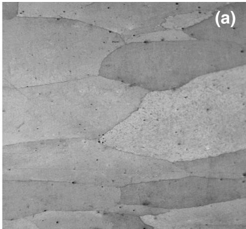

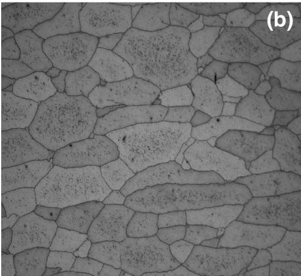

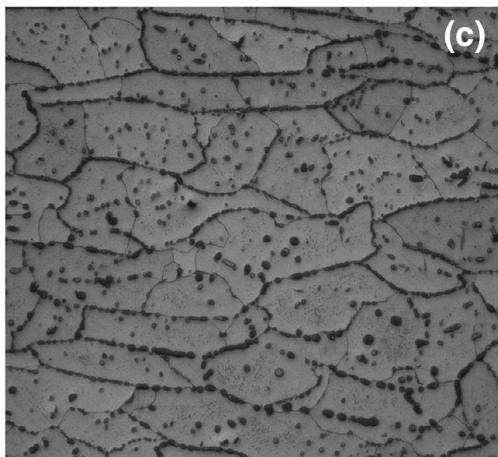

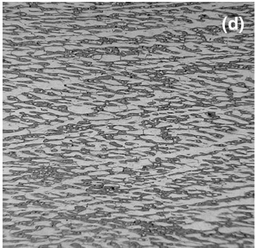

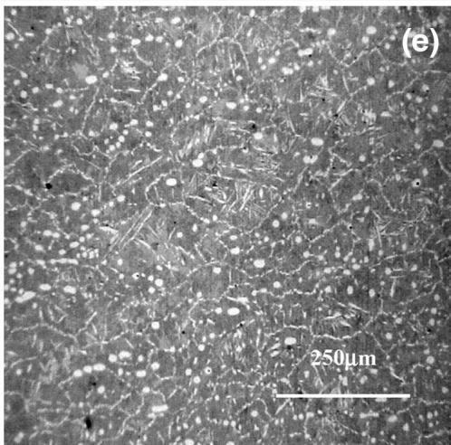  
Fig. 5. Optical micrographs showing the microstructure of hot-rolled AIM Fe-7 wt.% Al plates of (a) 0.012 wt.% C, (b) 0.15 wt.% C, (c) 0.35 wt.% C, (d) 0.5 wt.% C, and (e) 1.0 wt.% C.

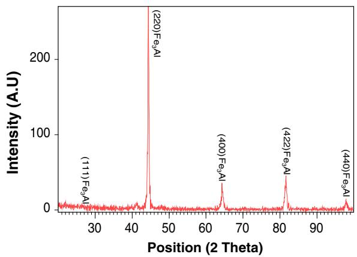

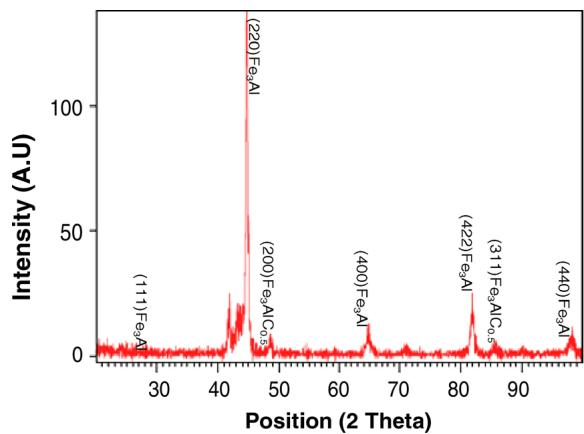  
Fig. 6. XRD traces using Cu-Ka radiation showing Fe3Al peaks in (a) Fe-7 wt.% Al-0.012 wt.% C; Fe3Al and $\mathsf { F e } _ { 3 } \mathsf { A l C } _ { 0 . 5 }$ peaks in (b) Fe-7 wt.% Al-0.15 wt.% C. Similar peaks were observed in three other alloys with carbon 0.35–1 wt.%.

Table V. Effect of carbon on room-temperature tensile properties of hot-rolled AIM Fe-7Al alloy

<table><tr><td rowspan="2">Sl. no.</td><td rowspan="2">Alloy composition (wt.%)</td><td rowspan="2">Bulk hardness (HV)</td><td colspan="3">Tensile properties (RT)</td></tr><tr><td>UTS (MPa)</td><td>YS (MPa)</td><td>EL (%)</td></tr><tr><td>1</td><td>Fe-7Al-.002C</td><td>193 ± 5.8</td><td>425 ± 4.5</td><td>382 ± 6.3</td><td>21 ± 2.2</td></tr><tr><td>2</td><td>Fe-7Al-0.15C</td><td>221 ± 6.9</td><td>481 ± 5.2</td><td>452 ± 6.8</td><td>16 ± 1.8</td></tr><tr><td>3</td><td>Fe-7Al-0.35C</td><td>248 ± 8.1</td><td>515 ± 5.6</td><td>480 ± 7.2</td><td>13 ± 1.5</td></tr><tr><td>4</td><td>Fe-7Al-0.5C</td><td>275 ± 9.2</td><td>928 ± 6.8</td><td>652 ± 7.5</td><td>08 ± 1.1</td></tr><tr><td>5</td><td>Fe-7Al-1.0C</td><td>338 ± 9.8</td><td>1120 ± 8.2</td><td>891 ± 9.2</td><td>1.5 ± 0.5</td></tr></table>

and foils. The cold-rolled and annealed alloy exhibit excellent (40%) room-temperature ductility.

## Effect of Carbon

It was reported earlier that carbon-containing ordered Fe-Al alloys with 16 wt.% Al exhibited improved room- and high-temperature strength, creep properties, machinability, resistance to environmental embrittlement, and room-temperature ductility due to the formation of hard $\mathrm { F e _ { 3 } A l C _ { 0 , 5 } }$ precipitates compared with carbon-free alloys. 22 Therefore, the effect of carbon (0.02–1.0 wt.%) on the microstructure and mechanical properties of Fe-7 wt.% Al has also been studied.

Forty-kilogram melts of five alloys with nominal compositions listed in Table IV were prepared by air induction melting with a flux cover.

The ingots were hot forged and hot rolled to 12 mm thickness. The microstructure of the alloy with 0.02 C (Fig. 5) showed a single-phase structure with no precipitates. On the contrary, alloy containing higher levels of carbon exhibited significant amounts of precipitates. These precipitates were confirmed to be $\mathrm { F i e _ { 3 } A l C _ { 0 . 5 } }$ by x-ray diffraction analysis (Fig. 6) using a Philips 3710 x-ray diffractometer. The volume fraction of these precipitates increases significantly with increasing carbon content. The room-temperature tensile properties with different carbon are given in Table V.

The increase in the bulk hardness values with the increase in carbon (Table V) suggests that precipitation hardening by hard $\mathrm { F e _ { 3 } A l C _ { 0 . 5 } }$ is the more predominant strengthening mechanism in these alloys. The addition of carbon to Fe-7 wt.% Al alloy resulted in significant improvement in room-temperature strength (396–610 MPa). However, the room-temperature tensile elongation decreases significantly (18–3%) with a increase in carbon content. Environmental embrittlement is a major cause for low ductility in carbon-free Fe-Al alloy containing a higher (9–16 wt.%) concentration of Al. It has been reported that carbon addition to these high aluminum Fe-Al alloys has resulted in significant improvement in room-temperature ductility.22 The presence of a high volume fraction of $\mathrm { F e _ { 3 } A l C _ { 0 . 5 } }$ precipitates in the alloy containing higher carbon is responsible for reducing the susceptibility to environmental embrittlement. The Fe-Al alloy containing 7 wt.% Al are not susceptible to environmental embrittlement, and the presence of hard and brittle $\mathrm { F e _ { 3 } A l C _ { 0 . 5 } }$ precipitate is also normally expected to lower the ductility. Therefore, the decrease in room-temperature ductility in the present study with increase in carbon content may be solely attributed to the increase in the volume fraction of $\mathrm { F e _ { 3 } A l C _ { 0 . 5 } }$ precipitates.

## CONCLUSION

A cost-effective ingot metallurgy route comprising air induction melting with a flux cover for production of clean and sound ingots of Fe-Al alloys containing 7 wt.% has been developed. Alloy produced by AIMFC exhibited superior properties compared with alloy produced by the AIM process. The properties of the alloy produced by AIMFC and VIM were comparable. Fe-9 wt.% Al alloy produced by AIM exhibited gas porosity, whereas alloy produced by AIMFC and VIM were free from gas porosity. However, the alloy produced by AIMFC still exhibited microcracks. It has been demonstrated that the alloy Fe-9 wt.% Al can be produced by VIM only. Increasing carbon in Fe-7 wt.% Al alloy resulted in significant improvement in strength but adversely affected ductility.

## ACKNOWLEDGEMENTS

The authors are grateful to the Defence Research and Development Organization, Ministry of Defence, New Delhi, for the financial support in carrying out this research work as well as to Dr. Amol A. Gokhale, Director, DMRL, for his interest and encouragement. The authors would like to thank fellow officers and staff of various groups of DMRL such as ERG (melting and casting), MBG (tensile and creep), SFAG (metallography, SEM, and EPMA), CDG (radiography, forging, and rolling), ACG (chemical analysis), and GMS (sample making).

## REFERENCES

1. G. Frommeyer, E.J. Drewes, and B. Engl, La Revue de Me´tallurgie-CIT (2000), vol. 1245.

2. R. Rana, C. Liu, and R.K. Ray, Scr. Mater. 68, 354 (2013).

3. C. Castan, F. Montheillet, and A. Perlad, Scr. Mater. 68, 360 (2013).

4. S.Y. Han, S.Y. Shin, H.-J. Lee, B.-J. Lee, S. Lee, N.J. Kim, and J.-H. Kwak, Metall. Mater. Trans. A 43A, 843 (2012).

5. S.Y. Han, S.Y. Shin, H.-J. Lee, B.-J. Lee, S. Lee, N.J. Kim, J.-H. Kwak, and K.-G. Chin, Metall. Mater. Trans. A 42A, 138 (2011).

6. J.A. Jime´nez and G. Frommeyer, J. Alloys Compd. 509, 2729 (2011).

7. R.G. Baligidad, U. Prakash, and A. Radhakrishna, Intermetallics 6, 765 (1998)

8. R.G. Baligidad, U. Prakash, A. Radhakrishna, V.R. Rao, P.K. Rao, and N.B. Ballal, ISIJ Int. 36, 1453 (1996).

9. R.G. Baligidad, U. Prakash, and A. Radhakrishna, Mater. Sci. Eng. A 231, 206 (1997).

10. R.G. Baligidad, U. Prakash, and A. Radhakrishna, Mater. Sci. Eng. A 269, 125 (1999).

11. R.G. Baligidad, U. Prakash, and A. Radhakrishna, Mater. Sci. Eng. A 249, 97 (1998).

12. R.G. Baligidad, U. Prakash, and A. Radhakrishna, Mater. Sci. Eng. A 281, 143 (2000).

13. R.G. Baligidad and A. Radhakrishna, Mater. Sci. Eng. A 83, 211 (2000).

14. V.K. Sikka, S. Viswanathan, and C.G. Mckamey, Structural Intermetallics, ed. R. Darolia, J.J. Lewandowsky, C.T. Liu, P.L. Martin, D.B. Miracle, and M.V. Nathal (Warrendale, PA: TMS, 1993), pp. 483–487.

15. V.K. Sikka, S. Viswanathan, and S. Vyas, High-Temperature Ordered Intermetallic Alloys I, ed. I. Baker, R. Darolia, J.D. Whittenberger, and M.H. Yoo, (Pittsburgh, PA: Materials Research Society, 1993), vol. 288, pp. 971–976.

16. J. Herrmann, G. Inden, and G. Sauthoff, Acta Mater. 51, 2847 (2003).

17. V.K. Sikka, High-Temperature Ordered Intermetallic Alloys II, Proc. Symp. (Pittsburgh PA: Materials Research Society, 1991), pp. 213–907.

18. N.S. Stolof and C.T. Liu, Intermetallics 2, 75 (1994).

19. V.K. Sikka, High Temperature Ordered Intermetallic Alloy IV, ed. L.A. Johnson, D.P. Pope, and J.O. Stiegler (Pittsburgh, PA: Materials Research Society, 1991), vol. 213, p. 907.

20. L.L. Rishel and H.D. Brody, Heat Resistant Material, Proc. First International Conf., ed. K. Natesan and D.J. Tillack, (Fontana, WI: ASM International, 1991), p. 149.

21. V.K. Sikka, Heat Resistant Materials, Proc. of the First Int. Conf. (Materials Park, OH: ASM International, 1991), p. 141.

22. R.G. Baligidad and V.V. Satya Prasad, Trans. Indian Inst. Metall. 60, 451 (2007).