CrossMark

# Properties of Fe–Mn–Al alloys with different Mn contents using density functional theory

Xiang Luo, Jing Feng , Ya-Hui Liu, Ming-Yu Hu, Xiao-Yu Chong, Ye-Hua Jiang\*

Received: 19 February 2017 / Revised: 21 April 2017 / Accepted: 21 May 2018 / Published online: 4 July 2018

\- The Nonferrous Metals Society of China and Springer-Verlag GmbH Germany, part of Springer Nature 2018

Abstract The chemical stability, electronic structures, mechanical properties and Debye temperature of Fe–Mn– Al alloys were investigated using first-principles calculations. The formation enthalpy and cohesive energy are negative for Fe–Mn–Al alloys, showing that they are thermodynamically stable. FeAl has the lowest formation enthalpy, indicating that FeAl is the most stable alloy in the Fe–Mn–Al system. The partial density of states, total density of states and electron density distribution maps were used to analyze the physical properties of the Fe–Mn– Al alloys. A combination of mainly covalent and metallic bonds exists in these Fe–Mn–Al alloys, resulting in good electronic conductivity, high melting points, and high hardness. These alloys display disparate anisotropy due to the calculated different shapes of the 3D curved surface of the Young’s modulus and anisotropic index. FeAl has the highest bulk modulus, shear modulus and Yong’s modulus of 187.1, 119.8 and 296.2 GPa, respectively. Further, the Debye temperatures and sound velocity of these Fe–Mn–Al compounds were explored.

Keywords Fe–Mn–Al alloys; Electronic structures; Stability; Mechanical properties; Debye temperature; Firstprinciples calculation

## 1 Introduction

Recently, Fe–Mn–Al alloys have attracted considerable attention because of their excellent mechanical properties and low density, making them suitable for applications in the automobile industry to reduce energy consumption and $\mathrm { C O } _ { 2 }$ emissions. Iron, manganese and aluminum are the main components of low-density and high-strength steel [1, 2]. In addition, the Fe–Mn–Al system is known to be an effective substitute for stainless steels because it exhibits high-temperature oxidation resistance [3]. The Fe–Mn–Al alloys also have excellent mechanical properties and can be employed as heat-resistant steel, cryogenic steel, magnetic material and stainless steel [4–10]. A previous study showed that the existence of B2 FeAl nanoparticles distributed in ferrite in the Fe–Mn–Al–C steel [11–13]. Investigating the stability, electronic structures and mechanical properties of the Fe–Mn–Al system is very important. Some experimental and theoretical investigations have been performed on Fe–Mn–Al alloys. Zhang et al. [14] investigated the elastic properties of ferromagnetic body-centered cubic Fe–Mn–Al alloys. Umino et al. [15] performed experimental and thermodynamic studies on the phase equilibria in the Fe–Mn–Al system. Yan et al. [16] investigated the anomalous behavior of electrical resistivity in Fe–Mn–Al alloys. Ren and Gong [17] calculated the elastic properties of B2 FeAl. Liu et al. [18] estimated the elastic properties of FeAl by the first-principles calculations. Kang et al. [19] used the density functional theory (DFT) to study the thermodynamic and elastic properties of B2 FeAl. All these studies mostly focused on analyzing the phase equilibria, electrical resistivity and magnetic properties. However, to our knowledge, the electronic structures and mechanical properties of the Fe–Mn–Al system have not been studied systematically so far. Therefore, in this study, first-principles calculations based on DFT was employed to investigate the stability, electronic structures and Debye temperatures of Fe–Mn–Al alloys with the aim to obtain complete data on the mechanical properties and electronic structures of the Fe– Mn–Al system. This work will contribute to the design of superior high-temperature structural materials, highstrength materials and functional materials.

## 2 Calculation methods

The crystal structures of the $\mathrm { F e } _ { 1 - x } \mathbf { M } \mathbf { n } _ { x } \mathbf { A } 1$ system are shown in Fig. 1. The system exhibits the cubic supercell structure with the space group Pm-3m. All the crystal structures use Mn atoms to replace Fe atoms based on FeAl the crystal structure. All the investigations in this study were performed by first-principles calculations based on DFT, implemented using the Cambridge Sequential Total Energy Package (CASTEP) code [20]. The interactions between valence electrons and ionic core were described using ultrasoft pseudopotentials. The exchange-correlation energy was treated with generalized gradient approximation (GGA) of Perdew–Burke–Ernzerhof (PBE) approach [21]. For Fe, Mn and Al atoms, the electronic states $3 \mathrm { d } ^ { 6 } 4 \mathrm { s } ^ { 2 }$ $3 \mathrm { d } ^ { 5 } 4 \mathrm { s } ^ { 2 }$ and $3 \mathrm { s } ^ { 2 } 3 \mathrm { p } ^ { 1 }$ , respectively, were treated as valence states. The Monkhorst–Pack special k-point mesh of $8 \times 8 \times 8$ was used to characterize the energy integration in the first irreducible Brillouin zone [22] for all $\mathrm { F e } _ { 1 - x } \mathbf { M } \mathbf { n } _ { x } \mathbf { A } \mathbf { l }$ alloys. In our calculation, the maximum plane-wave cutoff energy was 450 eV. During the optimization process, the change in the total energy converged to $2 \times 1 0 ^ { - 6 }$ eV finally and the force acting on each atom was reduced to 0.5 eV-nm-1.

The thermodynamic stability of the $\mathrm { F e } _ { 1 - x } \mathbf { M } \mathbf { n } _ { x } \mathbf { A } \mathbf { l }$ system can be evaluated by calculating the formation enthalpy and cohesive energy. In this study, in order to investigate the thermodynamic stability of the $\mathrm { F e } _ { 1 - x } \mathrm { M n } _ { x } \mathrm { A l }$ system, the following two energy formulas were used:

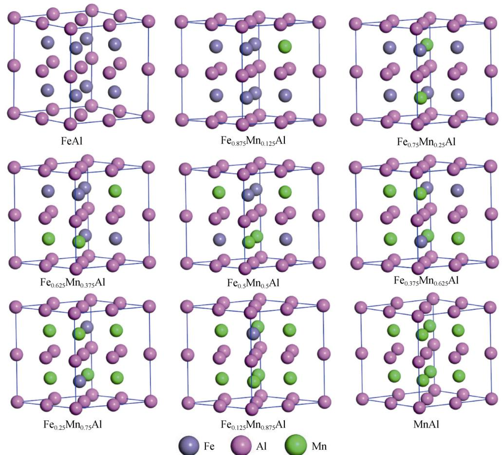  
Fig. 1 Crystal structure of $\mathrm { F e } _ { 1 - x } \mathbf { M } \mathbf { n } _ { x } \mathbf { A } 1$ (x = 0.125n, n = 0, 1, 2, 3, 4, 5, 6, 7, 8, x representing content of Mn) system

$$
\begin{array}{r l} & E _ {\mathrm{coh}} \left(\mathrm{Fe} _ {x} \mathrm{Mn} _ {y} \mathrm{Al} _ {z}\right) = \\ & \frac {E _ {\mathrm{tot}} \left(\mathrm{Fe} _ {x} \mathrm{Mn} _ {y} \mathrm{Al} _ {z}\right) - x E _ {\mathrm{iso}} (\mathrm{Fe}) - y E _ {\mathrm{iso}} (\mathrm{Mn}) - z E _ {\mathrm{iso}} (\mathrm{Al})}{x + y + z} \end{array}\tag{1}
$$

$$
\begin{array}{r l} & \Delta H _ {\mathrm{r}} \left(\mathrm{Fe} _ {x} \mathrm{Mn} _ {y} \mathrm{Al} _ {z}\right) = \\ & \frac {E _ {\mathrm{tot}} \left(\mathrm{Fe} _ {x} \mathrm{Mn} _ {y} \mathrm{Al} _ {z}\right) - x E _ {\mathrm{bin}} (\mathrm{Fe}) - y E _ {\mathrm{bin}} (\mathrm{Mn}) - z E _ {\mathrm{bin}} (\mathrm{Al})}{x + y + z} \end{array}\tag{2}
$$

where $\Delta H _ { \mathrm { r } } \ \mathrm { ( F e _ { \mathrm { { x } } } M n _ { \mathrm { { y } } } A l _ { \mathrm { { z } } } ) }$ and $E _ { \mathrm { c o h } } ~ ( \mathrm { F e } _ { x } \mathrm { M n } _ { y } \mathrm { A l } _ { z } )$ are the formation enthalpy and cohesive energy, respectively; $E _ { \mathrm { t o t } }$ $( \mathrm { F e } _ { x } \mathrm { M n } _ { y } \mathrm { A l } _ { z } )$ is the total energy; $E _ { \mathrm { i s o } } \left( X \right)$ is the total energy of a single (X) atom; $E _ { \mathrm { { b i n } } } \left( X \right)$ is the cohesive energy of the X atom in the bulk state.

## 3 Results and discussion

## 3.1 Stability

After optimizing the crystal structure, we obtain the lattice parameters. The lattice parameters, formation enthalpy and cohesive energy for Fe, Mn, Al and $\mathrm { F e } _ { 1 - x } \mathrm { M n } _ { x } \mathrm { A l }$ system are listed in Table 1. Obviously, the calculated results show good agreement with other experimental and calculated values. The slight deviation possibly results from differences in the calculation methods and experimental conditions. The stability of these $\mathrm { F e } _ { 1 - x } \mathbf { M } \mathbf { n } _ { x } \mathbf { A } \mathbf { l }$ compounds can be estimated from the formation enthalpy and cohesive energy. In general, the lower the formation enthalpy is, the better the thermodynamic stability is. As shown in Table 1, all calculated formation enthalpy and cohesive energy values are negative, indicating that these $\mathrm { F e } _ { 1 - x } \mathbf { M } \mathbf { n } _ { x } \mathbf { A } 1$ alloys are thermally stable.

Table 1 Calculated parameters (a, b, c), calculated cohesive energy $( E _ { \mathrm { c o h } } )$ and formation enthalpy (DH ) of Fe–Mn–Al alloys

<table><tr><td>Species</td><td>a = b=c/nm</td><td> $E_{\text{coh}}$ /(eV·atom-1)</td><td> $\Delta H_r$ /(eV·atom-1)</td></tr><tr><td>Fe</td><td>0.275</td><td>-8.981</td><td>0</td></tr><tr><td>FeAl</td><td>0.570</td><td>-6.947</td><td>-0.391</td></tr><tr><td> $Fe_{0.875}Mn_{0.125}Al$ </td><td>0.572</td><td>-6.920</td><td>-0.376</td></tr><tr><td> $Fe_{0.75}Mn_{0.25}Al$ </td><td>0.574</td><td>-6.889</td><td>-0.357</td></tr><tr><td> $Fe_{0.625}Mn_{0.375}Al$ </td><td>0.576</td><td>-6.868</td><td>-0.347</td></tr><tr><td> $Fe_{0.5}Mn_{0.5}Al$ </td><td>0.578</td><td>-6.843</td><td>-0.334</td></tr><tr><td> $Fe_{0.375}Mn_{0.625}Al$ </td><td>0.580</td><td>-6.824</td><td>-0.328</td></tr><tr><td> $Fe_{0.25}Mn_{0.75}Al$ </td><td>0.581</td><td>-6.794</td><td>-0.309</td></tr><tr><td> $Fe_{0.125}Mn_{0.875}Al$ </td><td>0.582</td><td>-6.744</td><td>-0.269</td></tr><tr><td>MnAl</td><td>0.584</td><td>-6.568</td><td>-0.215</td></tr><tr><td>Mn</td><td>0.354</td><td>-9.313</td><td>0</td></tr><tr><td>Al</td><td>0.405</td><td>-3.724</td><td>0</td></tr></table>

As shown in Table 1, the cohesive energy of these $\mathrm { F e } _ { 1 - x } \mathbf { M } \mathbf { n } _ { x } \mathbf { A } \mathbf { l }$ alloys varies from - 6.568 to $- \ 6 . 9 4 7 \ \mathrm { e V \cdot a t o m } ^ { - 1 }$ , and the value of the formation enthalpy of these alloys varies from - 0.215 to $- \ 0 . 3 9 1 \ \mathrm { e V \cdot a t o m } ^ { - 1 }$ . By comparing the cohesive energy values for $\mathrm { F e } _ { 1 - x } \mathbf { M } \mathbf { n } _ { x } \mathbf { A } \mathbf { l }$ system, it is found that FeAl is most stable from the viewpoint of cohesive energy. However, the thermodynamic stability is dependent on the formation enthalpy of the compound. The lower the negative formation enthalpy values are, the more stable the crystal structure will be. Figure 2 depicts the calculated cohesive energy and formation enthalpy for different Mn contents. It can be seen that both the cohesive energy and formation enthalpy increase with Mn content. Further, the formation enthalpy value for FeAl is the lowest. Therefore, in the $\mathrm { F e } _ { 1 - x } \mathrm { M n } _ { x } \mathrm { A l }$ system, FeAl is the most stable.

## 3.2 Electronic structures

In order to analyze the chemical bonding characteristics and electronic structures of $\mathrm { F e } _ { 1 - x } \mathbf { M } \mathbf { n } _ { x } \mathbf { A } 1$ system, the total density of states (TDOS), partial density of states (PDOS) and electron density distribution maps were calculated. The calculated electronic structures of these compounds are shown in Figs. 3 and 4.

The calculated PDOS and TDOS of the $\mathrm { F e } _ { 1 - x } \mathbf { M } \mathbf { n } _ { x } \mathbf { A } 1$ system are shown in Fig. 3. All these Fe–Mn–Al alloys have metallic features because they exhibit nonzero density of states (DOS) at the Fermi level. The magnetic characteristics were determined from the spin-polarized TDOS. Generally, the down and up states are almost symmetric, but a comparison of the down and up states shows that these alloys have magnetic characteristics due to the dissymmetric down and up states. Fe and Mn are transition metals, which only need to consider the role of the outermost electrons. From the DOS for Fe, it is affected by the

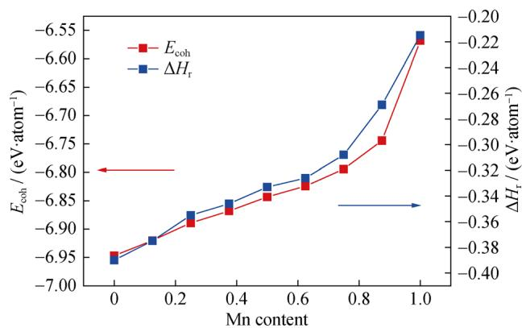  
Fig. 2 Variations of cohesive energy and formation enthalpy of $\mathrm { F e } _ { 1 - x } \mathbf { M } \mathbf { n } _ { x } \mathbf { A } 1$ system

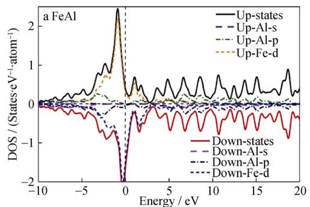

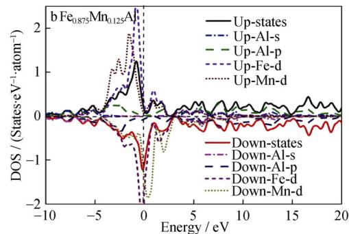

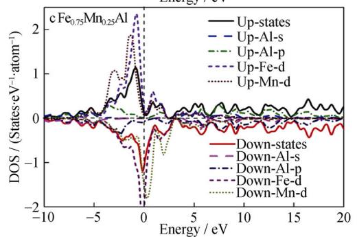

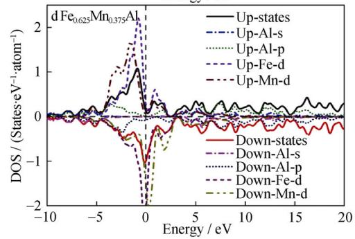

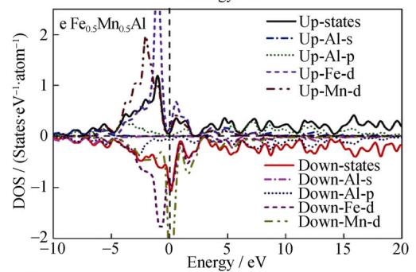

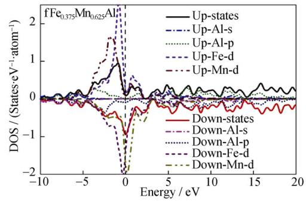

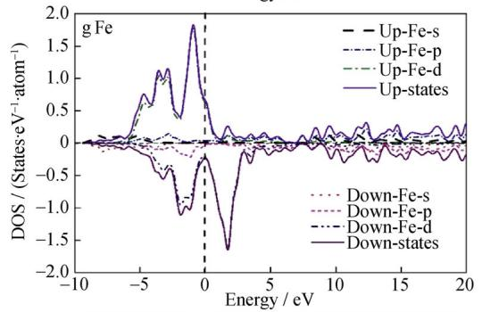

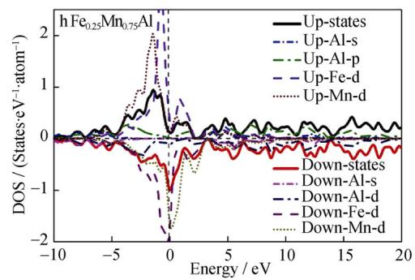

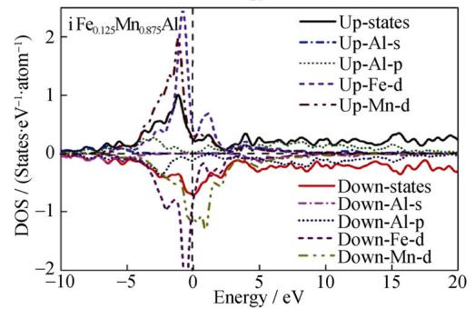

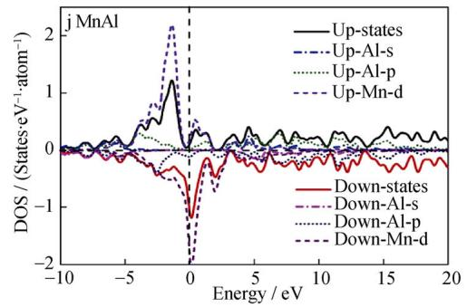  
Fig. 3 Calculated TDOS and PDOS for Fe and $\mathrm { F e } _ { 1 - x } \mathbf { M } \mathbf { n } _ { x } \mathbf { A } 1$ system (dashed lines representing Fermi level): a FeAl, b $\begin{array} { r } { \mathrm { F e } _ { 0 . 8 7 5 } \mathrm { M n } _ { 0 . 1 2 5 } \mathrm { A l } . } \end{array}$ $\mathbf { c } \ \mathrm { F e } _ { 0 . 7 5 } \mathbf { M n } _ { 0 . 2 5 } \mathbf { A l } .$ , d $\begin{array} { r } { \mathrm { F e } _ { 0 . 6 2 5 } \mathrm { M n } _ { 0 . 3 7 5 } \mathrm { A l } , } \end{array}$ e Fe Mn Al, f Fe Mn Al, g Fe, h $\mathrm { F e _ { 0 . 2 5 } \mathrm { \check { M } n _ { 0 . 7 5 } A l , \mathrm { \bf ~ \bar { i } ~ \mathrm { F e _ { 0 . 1 2 5 } M n _ { 0 . 8 7 5 } A l , \ell } } } }$ and j MnAl

Fe-d bands primarily. In Fig. 3, the up and down DOS curves of these Fe–Mn–Al alloys near the Fermi level are divided into one sharp peak mainly. It is found that the sharp peak is located on the Fermi level. There are many low peaks near the sharp peak. These peaks are attributed primarily to the Fe-d and Mn-d states. For FeAl, the band range from - 5 to 1 eV is contributed to the Al-p bands and Fe-d bands mainly. For MnAl, the band range from - 5 to 1 eV is determined by the Al-p bands and Mn-d bands mainly. For other Fe–Mn–Al alloys, the band range from - 5 to 1 eV is determined by the Al-p bands, Fe-d bands and Mn-d bands mainly. Near the Fermi level, the TDOS of FeAl and MnAl are composed mainly of the low Al-p states hybridized with the Fe-d and Mn-d states, respectively. The TDOS of the other Fe–Mn–Al alloys indicate that there is hybridization mainly between the low Al-p, Fe-d, and Mn-d states. Additionally, the FeAl and MnAl PDOS curves indicate that the Fermi surface is primarily due to the contribution of the Fe-d states and Mnd states, but also involve low Al-p states. The curves of PDOS of the other Fe–Mn–Al alloys show that the Fermi surface is due to the contribution of the Fe-d states and Mnd states, but also involve low Al-p states.

From the above discussion, it can be concluded that the $\mathrm { F e } _ { 1 - x } \mathbf { M } \mathbf { n } _ { x } \mathbf { A } 1$ system has combinations of covalent and metallic bonds, resulting in good electronic conductivity, high melting points and high hardness.

The calculated total electron density distribution maps and electron density difference distribution maps for the $\mathrm { F e } _ { 1 - x } \mathbf { M } \mathbf { n } _ { x } \mathbf { A } 1$ system are shown in Fig. 4. From Fig. 4a, c, e, g, i, Fe, Mn, and Al of core regions have smaller interstitial area and larger values. And there are covalent bonds between Fe, Mn and Al atoms. From these total electron density distribution maps, the elongated contours along the Al–Fe, Al–Mn and Fe–Mn bond axes indicate that covalent interactions exist. More details about chemical bonding characteristics can be found from the electron density difference distribution in Fig. 4b, d, f, h, j. Some electrons are delocalized and distributed throughout the circular map for the area between Al, Mn, and Fe atoms, indicating the features of covalent and metallic bonding. The electrons are actually located around Mn, Fe, and Al atoms as indicated in blue color; this shows the existence of covalent bonds between the atoms. According to above discussions, these Fe–Mn–Al alloys have magnetic characteristics, and the alloys have combinations of covalent and metallic bonds. It can be concluded that these alloys have weaker covalent bonds effect. These bonding features could lead to high melting points and high hardness.

## 3.3 Mechanical stability, elastic properties and modulus

The Fe–Mn–Al alloys are potential high-strength materials, so studying the mechanical performances is very important. The elastic constants of the $\mathrm { F e } _ { 1 - x } \mathbf { M } \mathbf { n } _ { x } \mathbf { A } \mathbf { l }$ system were calculated, as listed in Table 2. There are three independent elastic constants $( C _ { 1 1 } , C _ { 1 2 }$ and $C _ { 4 4 } )$ of $\mathrm { F e } _ { 1 - x } \mathbf { M } \mathbf { n } _ { x } \mathbf { A } \mathbf { l }$ alloys. The stability of $\mathrm { F e } _ { 1 - x } \mathbf { M } \mathbf { n } _ { x } \mathbf { A } 1$ system was further investigated by evaluating the mechanical properties, and the formulas corresponding to the mechanical stability criteria were discussed based on the elastic modulus of the crystal structure. The mechanical stability conditions can be defined as follows: Cubic system [23]:

$$
\left(C _ {1 1} - C _ {1 2}\right) > 0, \quad C _ {1 1} > 0, \quad C _ {4 4} > 0, \quad C _ {1 1} + 2 C _ {1 2} > 0\tag{3}
$$

From Table 2, it can be clearly found that these Fe–Mn– Al alloys are mechanical stable structures because they satisfy above conditions. After the elastic constants are obtained, the bulk modulus (B), Poisson’s ratio (r), Young’s modulus (E), and shear modulus (G) of polycrystalline crystal can be determined by using Voigt– Reuss–Hill (VRH) approximation, which is known to be the best method for the evaluation of the mechanical properties of polycrystalline materials (Eqs. (4)–(9)) [24].

$$
B _ {\mathrm{VRH}} = B _ {\mathrm{R}} = B _ {\mathrm{V}} = \frac {1}{3} \left(C _ {1 1} + 2 C _ {1 2}\right)\tag{4}
$$

$$
G _ {\mathrm{V}} = \frac {1}{5} (C _ {1 1} - C _ {1 2} + 3 C _ {4 4})\tag{5}
$$

$$
G _ {\mathrm{R}} = \frac {5 (C _ {1 1} - C _ {1 2}) C _ {4 4}}{4 C _ {4 4} + 3 (C _ {1 1} - C _ {1 2})}\tag{6}
$$

$$
G _ {\mathrm{VRH}} = \frac {1}{2} (G _ {\mathrm{V}} + G _ {\mathrm{R}})\tag{7}
$$

$$
E = \frac {9 B _ {\mathrm{VRH}} G _ {\mathrm{VRH}}}{(3 B _ {\mathrm{VRH}} + G _ {\mathrm{VRH}})}\tag{8}
$$

$$
\sigma = \frac {\left(3 B _ {\mathrm{VRH}} - 2 G _ {\mathrm{VRH}}\right)}{2 \left(3 B _ {\mathrm{VRH}} + G _ {\mathrm{VRH}}\right)}\tag{9}
$$

where the subscripts R and V denote the Reuss and Voigt averages; $B _ { \mathrm { V R H } } , B _ { \mathrm { V } }$ and $B _ { \mathrm { R } }$ are the bulk modulus calculated by the VRH, Voigt and Reuss approximation method, respectively; $G _ { \mathrm { V R H } } , G _ { \mathrm { V } }$ and $G _ { \mathrm { R } }$ denote the shear modulus calculated by the VRH, Voigt and Reuss approximation methods, respectively.

The results of calculations and experiments are shown in Table 2. FeAl has the highest $C _ { 1 1 }$ value of 294.0 GPa, which shows that FeAl is highly incompressible under uniaxial stress along the crystallographic x-axis $( \varepsilon _ { 1 1 } ) . \ C _ { 4 4 }$ represents the shear modulus on the (100) crystal planes.

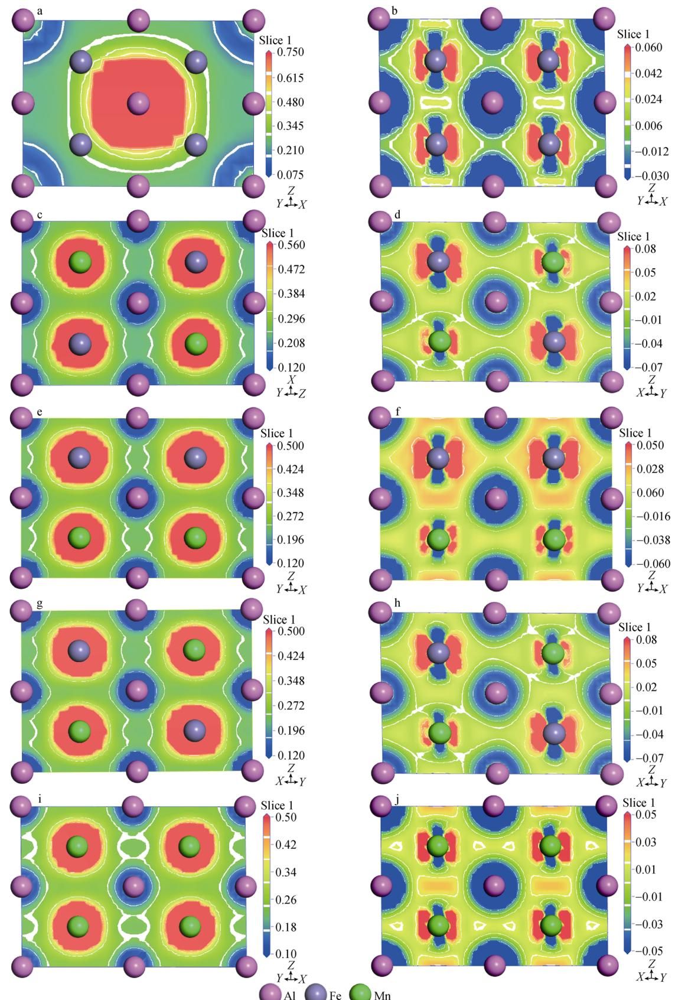  
Fig. 4 Total electron density distribution contour (left column) and electron density difference distribution contour (right column) for $\mathrm { F e } _ { 1 - x } \mathrm { M n } _ { x } \mathrm { A l }$ system: a, b FeAl-(011); c, d Fe Mn Al-(011); e, f Fe Mn Al-(110); g, h Fe Mn Al-(110); i, j Mn–Al-(110)

MnAl and FeAl have the smallest and largest $C _ { 4 4 }$ values of 126.6 and 157.0 GPa, respectively. The bulk modulus (B), shear modulus (G), Poisson’s ratio (r) and Young’s modulus (E) are calculated using Eqs. (4)–(9), as listed in Table 3. As we know, the bulk modulus reflects the compressibility of the solid under hydrostatic pressure. The values of the bulk modulus for the $\mathrm { F e } _ { 1 - x } \mathbf { M } \mathbf { n } _ { x } \mathbf { A } \mathbf { l }$ system are 187.1, 184.1, 181.9, 179.2, 176.3, 176.5, 173.3, 171.5 and 169.8 GPa for FeAl, $\mathrm { F e } _ { 0 . 8 7 5 } \mathrm { M n } _ { 0 . 1 2 5 } \mathrm { A l }$ $\mathrm { F e _ { 0 . 7 5 } M n _ { 0 . 2 5 } A l }$ $\mathrm { F e _ { 0 . 6 2 5 } M n _ { 0 . 3 7 5 } A l , \qquad F e _ { 0 . 5 } M n _ { 0 . 5 } A l } .$ $\begin{array} { r } { \mathrm { F e } _ { 0 . 3 7 5 } \mathrm { M n } _ { 0 . 6 2 5 } \mathrm { A l } . } \end{array}$ $\mathrm { F e _ { 0 . 2 5 } M n _ { 0 . 7 5 } A l , F e _ { 0 . 1 2 5 } M n _ { 0 . 8 7 5 } A l }$ and MnAl, respectively. The shear modulus indicates the resistance to deformations upon shear stress. Generally, the greater the value of the shear modulus is, the higher the hardness of the compound is. The Young’s modulus is a measure of the stiffness of the solid materials. The greater the Young’s modulus is, the larger the stiffness of materials is. As shown in Table 2, FeAl has the largest Young’s modulus and shear modulus values of 296.2 and 119.8 GPa, respectively, indicating that FeAl has the highest hardness in $\mathrm { F e } _ { 1 - x } \mathbf { M } \mathbf { n } _ { x } \mathbf { A } \mathbf { l }$ system. The Poisson’s ratio reflects the stability of the crystal structure against shear stress. The Poisson’s ratio of the $\mathrm { F e } _ { 1 - x } \mathbf { M } \mathbf { n } _ { x } \mathbf { A } 1$ system ranges from 0.236 to 0.324. Poisson’s ratios close to 0.3 indicate strong metallic bonding features.

Values significantly different from 0.3 indicate covalent bonding. The value of B/G is usually used to quantify the brittleness or ductility of a material [25]. If the B/G ratio is greater than 1.75, the material exhibits ductility; otherwise, it is brittle. It is found that FeAl and $\mathrm { F e } _ { 0 . 8 7 5 } \mathrm { M n } _ { 0 . 1 2 5 } \mathrm { A l }$ are brittle, while the other Fe–Mn–Al alloys are ductile. The Vickers hardness $( H _ { \mathrm { V } } )$ of the $\mathrm { F e } _ { 1 - x } \mathbf { M } \mathbf { n } _ { x } \mathbf { A } \mathbf { l }$ system is determined by using an empirical model which has better results for the anisotropic structures. The calculation formula is as follows [26]:

$$
H _ {\mathrm{V}} = 2 \left(k ^ {2} G\right) ^ {0. 5 8 5} - 3\tag{10}
$$

where k denotes the Pugh’s modulus ratio $\left( { k = G / B } \right)$ . The calculated results for the $\mathrm { F e } _ { 1 - x } \mathrm { M n } _ { x } \mathrm { A l }$ system are listed in Table 2. FeAl and MnAl have the highest and lowest hardness of 16.5 and 5.0 GPa, respectively. In Table 2, with the increase in Mn content, from $\mathrm { F e } _ { 0 . 8 7 5 } \mathrm { M n } _ { 0 . 1 2 5 } \mathrm { A l }$ to $\mathrm { F _ { e 0 . 1 2 5 } M n _ { 0 . 8 7 5 } A l }$ , it can be found that $\mathrm { F e } _ { 0 . 5 } \mathrm { M n } _ { 0 . 5 } \mathrm { A l }$ has the lowest $C _ { 1 1 }$ value of 225.0 GPa which shows that $\mathrm { F e } _ { 0 . 5 } \mathrm { M } -$ $\mathtt { n } _ { 0 . 5 } \mathrm { A l }$ is highly compressible under uniaxial stress along the crystallographic x-axis $\left( \varepsilon _ { 1 1 } \right)$ . It seems that $C _ { 1 2 }$ has a maximum value, $C _ { 4 4 }$ has a minimum value, E has a minimum value and Poisson ration reaches a maximum value for $\mathrm { F e _ { 0 . 5 } M n _ { 0 . 5 } A l }$ alloy, indicating that $\mathrm { F e } _ { 0 . 5 } \mathrm { M n } _ { 0 . 5 } \mathrm { A l }$ has the highest hardness and the best ductility in these compounds. The elastic constants for different Mn contents are listed in Figs. 5, 6 and 7. From Fig. 5, it can be found that the Young’s modulus and $C _ { 1 1 } - C _ { 1 2 }$ follow a similar variation trend. As shown in Fig. 6, the shear modulus and $C _ { 4 4 }$ show quite a similar variation trend, but the bulk modulus, shear modulus and $C _ { 4 4 }$ have no clear relationship. Further, from Fig. 7, the Poisson’s ratio and B/G show a similar variation trend.

Table 2 Calculated values for elastic constants $( C _ { i j } ) ,$ bulk modulus (B), shear modulus (G), Young’s modulus (E), hardness $( H _ { \mathrm { V } } )$ , B/G and Poisson’s ratio (r) of Fe–Mn–Al alloys (GPa)

<table><tr><td>Species</td><td> $C_{11}$ </td><td> $C_{12}$ </td><td> $C_{44}$ </td><td>B</td><td>G</td><td>E</td><td>σ</td><td> $H_V$ </td><td>B/G</td></tr><tr><td>FeAl</td><td>294.0</td><td>133.7</td><td>157.0</td><td>187.1</td><td>119.8</td><td>296.2</td><td>0.236</td><td>16.5</td><td>1.56</td></tr><tr><td> $Fe_{0.875}Mn_{0.125}Al$ </td><td>265.2</td><td>143.0</td><td>150.4</td><td>184.1</td><td>105.0</td><td>264.7</td><td>0.260</td><td>12.8</td><td>1.75</td></tr><tr><td> $Fe_{0.75}Mn_{0.25}Al$ </td><td>247.2</td><td>148.8</td><td>147.4</td><td>181.9</td><td>95.2</td><td>243.2</td><td>0.277</td><td>10.5</td><td>1.91</td></tr><tr><td> $Fe_{0.625}Mn_{0.375}Al$ </td><td>236.2</td><td>151.1</td><td>141.0</td><td>179.2</td><td>88.2</td><td>227.3</td><td>0.288</td><td>9.0</td><td>2.03</td></tr><tr><td> $Fe_{0.5}Mn_{0.5}Al$ </td><td>225.0</td><td>152.0</td><td>126.2</td><td>176.3</td><td>77.2</td><td>202.1</td><td>0.309</td><td>6.7</td><td>2.28</td></tr><tr><td> $Fe_{0.375}Mn_{0.625}Al$ </td><td>230.1</td><td>151.1</td><td>134.7</td><td>176.5</td><td>86.1</td><td>222.2</td><td>0.290</td><td>8.7</td><td>2.05</td></tr><tr><td> $Fe_{0.25}Mn_{0.75}Al$ </td><td>237.9</td><td>141.0</td><td>134.6</td><td>173.3</td><td>89.4</td><td>228.8</td><td>0.280</td><td>9.8</td><td>1.94</td></tr><tr><td> $Fe_{0.125}Mn_{0.875}Al$ </td><td>255.2</td><td>138.8</td><td>154.2</td><td>171.5</td><td>85.6</td><td>220.2</td><td>0.286</td><td>9.0</td><td>2.00</td></tr><tr><td>MnAl</td><td>203.8</td><td>152.9</td><td>126.6</td><td>169.8</td><td>67.5</td><td>178.8</td><td>0.324</td><td>5.0</td><td>2.52</td></tr></table>

Table 3 Calculated universal anisotropic index $( A ^ { \mathrm { U } } )$ , anisotropy $( A _ { \mathrm { B } }$ and $A _ { \mathrm { G } } )$ and shear anisotropic factors $( A _ { 1 } , A _ { 2 } , A _ { 3 } )$ of Fe–Mn–Al alloys

<table><tr><td>Species</td><td> $A^U$ </td><td> $A_B$ </td><td> $A_G$ </td><td> $A_1 = A_2 = A_3$ </td></tr><tr><td>FeAl</td><td>0.56</td><td>0</td><td>0.053</td><td>1.96</td></tr><tr><td> $Fe_{0.875}Mn_{0.125}Al$ </td><td>1.03</td><td>0</td><td>0.093</td><td>2.46</td></tr><tr><td> $Fe_{0.75}Mn_{0.25}Al$ </td><td>1.58</td><td>0</td><td>0.137</td><td>2.99</td></tr><tr><td> $Fe_{0.625}Mn_{0.375}Al$ </td><td>1.89</td><td>0</td><td>0.159</td><td>3.31</td></tr><tr><td> $Fe_{0.5}Mn_{0.5}Al$ </td><td>2.06</td><td>0</td><td>0.171</td><td>3.46</td></tr><tr><td> $Fe_{0.375}Mn_{0.625}Al$ </td><td>1.73</td><td>0</td><td>0.148</td><td>3.41</td></tr><tr><td> $Fe_{0.25}Mn_{0.75}Al$ </td><td>1.36</td><td>0</td><td>0.120</td><td>2.78</td></tr><tr><td> $Fe_{0.125}Mn_{0.875}Al$ </td><td>1.84</td><td>0</td><td>0.115</td><td>2.65</td></tr><tr><td>MnAl</td><td>3.80</td><td>0</td><td>0.276</td><td>4.97</td></tr></table>

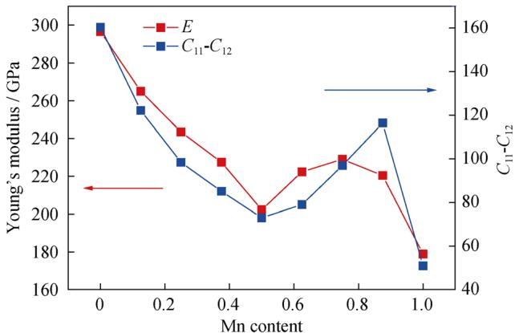  
Fig. 5 Variations in $( C _ { 1 1 } - C _ { 1 2 } )$ and Young’s modulus of $\mathrm { F e } _ { 1 - x } \mathrm { M n } _ { x } \mathrm { A l }$ system

## 3.4 Mechanical anisotropy

All the single crystals are anisotropic, therefore, suitable parameters for describing the anisotropic degree is necessary. Meanwhile, the appearance of microcracks in materials is always connected with the anisotropy. The microcracks often form in materials and harm their performance. The mechanical anisotropy in the application of materials is very important. The Fe–Mn–Al alloys act as a potential high-strength materials, so it is necessary to study the mechanical anisotropy of these alloys for industry. In this study, several anisotropic indexes were calculated, including the anisotropy index $( A _ { \mathrm { B } }$ and $A _ { \mathrm { G } } )$ , the shear anisotropic factors $( A _ { 1 } , A _ { 2 }$ and $A _ { 3 } )$ and the universal anisotropic index $( A ^ { \mathrm { U } } )$ . The equations are as follows [27]:

$$
A ^ {\mathrm{U}} = 5 \frac {G _ {\mathrm{V}}}{G _ {\mathrm{R}}} + \frac {B _ {\mathrm{V}}}{B _ {\mathrm{R}}} - 6 \geq 0\tag{11}
$$

$$
A _ {\mathrm{B}} = \frac {B _ {\mathrm{V}} - B _ {\mathrm{R}}}{B _ {\mathrm{V}} + B _ {\mathrm{R}}}\tag{12}
$$

$$
A _ {\mathrm{G}} = \frac {G _ {\mathrm{V}} - G _ {\mathrm{R}}}{G _ {\mathrm{V}} + G _ {\mathrm{R}}}\tag{13}
$$

$$
A _ {1} = A _ {2} = A _ {3} = \frac {4 C _ {4 4}}{2 C _ {1 1} - 2 C _ {1 2}}\tag{14}
$$

If all indexes are zero, then it indicates an isotropy structure while deviations from zero show anisotropy. The greater the anisotropy index $( A ^ { \mathrm { U } } )$ of compounds is, the better the mechanical anisotropic properties are. The calculated results are listed in Table 3. The calculated $A _ { \mathrm { B } }$ value for all alloys is zero due to that the bulk moduli are the same by using the Voigt or Reuss methods. $A _ { \mathrm { G } }$ has a low value for all the alloys, showing that these alloys have a weak anisotropy in shear modulus. The universal anisotropic index, ${ \overset { \cdot } { A } } ^ { \mathrm { U } } ,$ , is considered as a better indicator for the mechanical anisotropic properties of these alloys. It can be clearly found that FeAl has the smallest $A ^ { \mathrm { U } }$ value among Fe–Mn–Al alloys. The $A ^ { \mathrm { U } }$ value for MnAl is larger than those of other Fe–Mn–Al alloys, indicating that MnAl has the largest elastic anisotropy among Fe–Mn–Al alloys. In Table 3, with the increase in Mn content, from $\mathrm { F e } _ { 0 . 8 7 5 } \mathrm { M n } _ { 0 . 1 2 5 } \mathrm { A l }$ to $\mathrm { F e } _ { 0 . 1 2 5 } \mathrm { M n } _ { 0 . 8 7 5 } \mathrm { A l }$ $\mathrm { F e } _ { 0 . 5 } \mathrm { M n } _ { 0 . 5 } \mathrm { A l }$ has the largest $A ^ { \mathrm { U } }$ value, indicating that $\mathrm { F e } _ { 0 . 5 } \mathrm { M n } _ { 0 . 5 } \mathrm { A l }$ has the largest elastic anisotropy among the compounds. Generally speaking, the larger the value of $A ^ { \mathrm { U } }$ is, the stronger the anisotropy is. Hence, the descending order of anisotropy for Fe–Mn–Al alloys is MnAl $> \mathrm { F e _ { 0 . 5 } M n _ { 0 . 5 } A l } > \mathrm { F e _ { 0 . 6 2 5 } M n _ { 0 . } }$ 375 $\mathrm { A l > F e _ { 0 . 1 2 5 } M n _ { 0 . 8 7 5 } A l > F e _ { 0 . 3 7 5 } M n _ { 0 . 6 2 5 } A l > F e _ { 0 . 7 5 } M n _ { 0 . 2 5 } A l }$ $> \mathrm { F e _ { 0 . 2 5 } M n _ { 0 . 7 5 } A l } > \mathrm { F e _ { 0 . 8 7 5 } M n _ { 0 . 1 2 5 } A l } > \mathrm { F e A l }$ . Although $A _ { \mathrm { G } } ,$

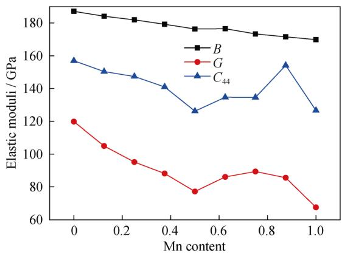  
Fig. 6 Variations in bulk modulus, shear modulus and $C _ { 4 4 }$ of $\mathrm { F e } _ { 1 - x } \mathbf { M } \mathbf { n } _ { x } \mathbf { A } 1$ system

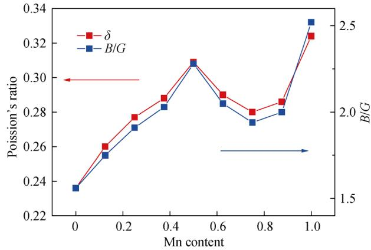  
Fig. 7 Variations in Poisson’s ratio and B/G of $\mathrm { F e } _ { 1 - x } \mathbf { M } \mathbf { n } _ { x } \mathbf { A } 1$ system

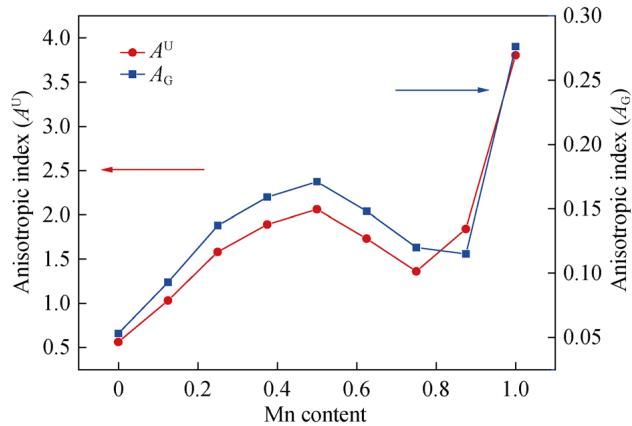  
Fig. 8 Variations in $A _ { \mathrm { G } }$ and $A ^ { \mathrm { U } }$ of $\mathrm { F e } _ { 1 - x } \mathbf { M } \mathbf { n } _ { x } \mathbf { A } 1$ system

$A _ { 1 } , A _ { 2 } ,$ and $A _ { 3 }$ decide the anisotropy of the shear modulus, they have different functions. $A _ { 1 } , A _ { 2 }$ and $A _ { 3 }$ represent the anisotropies of the shear modulus in (100), (010), and (001) planes, respectively. From Table 3, MnAl has the strongest anisotropy of shear modulus in (100), (010), and (001) planes, and the $A _ { 1 } , A _ { 2 }$ and $A _ { 3 }$ values are 4.97. In (100), (010), and (001) planes, FeAl has the weakest anisotropy of the shear modulus among these Fe–Mn–Al alloys, and $A _ { 1 } , A _ { 2 }$ and $A _ { 3 }$ values are 1.96. In addition, as shown in Fig. 8, the changes in $A _ { \mathrm { G } }$ and $A ^ { \mathrm { U } }$ follow the same trend.

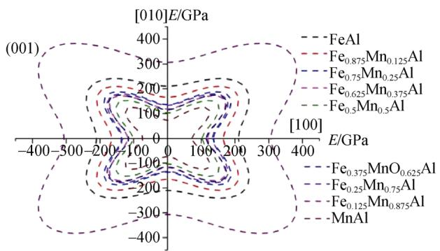

More details about the anisotropic properties of Young’s modulus on (001) and (110) planes are illustrated in Fig. 9. On these planes, the Young’s modulus has strong directional dependence. At the [100], [010], [001] and [110] directions, $\mathrm { F e } _ { 0 . 1 2 5 } \mathrm { M n } _ { 0 . 8 7 5 } \mathrm { A l }$ shows the maximum Young’s modulus, and MnAl shows the minimum Young’s modulus. For these alloys, the planar contours on the (001) and (110) planes are not similar to a spherical shape, which indicates that the Young’s modulus of these alloys on (001) and (110) planes shows strong anisotropy.

## 3.5 Debye temperature

The Debye temperature is a fundamental parameter and is related to some physical properties of the materials, such as specific heat, elastic constants and melting point [28]. It is obvious that the Debye temperature and sound velocity can be used to estimate the chemical thermal properties and chemical bond behavior of compounds. The average sound velocity $( \nu _ { \mathrm { m } } )$ and Debye temperature $( \Theta _ { \mathrm { D } } )$ can be calculated using the following equations (Eqs. (15)–(18)) [27, 29]:

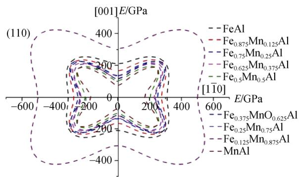  
Fig. 9 Planar projections of Young’s modulus of $\mathrm { F e } _ { 1 - x } \mathbf { M } \mathbf { n } _ { x } \mathbf { A } 1$ system on (001) and (110) crystallographic planes

Table 4 Theoretical density (q), longitudinal sound velocity $( \nu _ { 1 } , \mathrm { m } { \cdot } \mathrm { s } ^ { - 1 } )$ , transverse sound velocity $( \nu _ { \mathrm { { s } } } ) _ { : }$ , average sound velocity $( \nu _ { \mathrm { m } } , \mathrm { m } { \cdot } \mathrm { s } ^ { - 1 } )$ and Debye temperature $( \Theta _ { \mathbf { D } } )$

<table><tr><td>Species</td><td> $\rho/(kg·m^{-3})$ </td><td> $v_1/(m·s^{-1})$ </td><td> $v_s/(m·s^{-1})$ </td><td> $v_m/(m·s^{-1})$ </td><td> $\Theta_D/K$ </td></tr><tr><td>FeAl</td><td>5935.5</td><td>7644.2</td><td>4492.6</td><td>4979.7</td><td>652.5</td></tr><tr><td> $Fe_{0.875}Mn_{0.125}Al$ </td><td>5870.8</td><td>7430.0</td><td>4229.0</td><td>4700.8</td><td>614.0</td></tr><tr><td> $Fe_{0.75}Mn_{0.25}Al$ </td><td>5807.7</td><td>7292.2</td><td>4048.7</td><td>4509.5</td><td>587.0</td></tr><tr><td> $Fe_{0.625}Mn_{0.375}Al$ </td><td>5745.3</td><td>7187.5</td><td>3918.1</td><td>4370.2</td><td>567.3</td></tr><tr><td> $Fe_{0.5}Mn_{0.5}Al$ </td><td>5678.2</td><td>7012.6</td><td>3687.3</td><td>4123.3</td><td>533.3</td></tr><tr><td> $Fe_{0.375}Mn_{0.625}Al$ </td><td>5622.2</td><td>7198.1</td><td>3913.3</td><td>4365.7</td><td>563.1</td></tr><tr><td> $Fe_{0.25}Mn_{0.75}Al$ </td><td>5565.7</td><td>7249.4</td><td>4007.8</td><td>4465.4</td><td>574.2</td></tr><tr><td> $Fe_{0.125}Mn_{0.875}Al$ </td><td>5483.8</td><td>7217.1</td><td>3950.9</td><td>4405.3</td><td>564.0</td></tr><tr><td>MnAl</td><td>5448.8</td><td>6905.1</td><td>3519.6</td><td>3943.8</td><td>504.1</td></tr></table>

$$
\Theta_ {\mathrm{D}} = \frac {h}{K _ {\mathrm{B}}} \left[ \frac {3 n}{4 \pi} \left(\frac {N _ {\mathrm{A}} \rho}{M}\right) \right] ^ {1 / 3} v _ {\mathrm{m}}\tag{15}
$$

$$
v _ {\mathrm{m}} = \left[ \frac {1}{3} \left(\frac {2}{v _ {\mathrm{s}} ^ {3}} + \frac {1}{v _ {\mathrm{l}} ^ {3}}\right) \right] ^ {- (1 / 3)}\tag{16}
$$

$$
v _ {1} = \sqrt {\frac {(B + (4 / 3) G)}{\rho}}\tag{17}
$$

$$
v _ {\mathrm{s}} = \sqrt {\frac {G}{\rho}}\tag{18}
$$

where $\Theta _ { \mathrm { D } }$ is the Debye temperature; $k _ { \mathrm { B } }$ and h are the Boltzmann and Planck constants, respectively; $N _ { \mathrm { A } }$ is the Avogadro constant; n is the total number of atoms per formula; M is the molecular weight per formula; $\nu _ { \mathrm { s } }$ is the transverse sound velocity and $\nu _ { 1 }$ is the longitudinal sound velocity; G and B represent the shear modulus and bulk modulus values, respectively [30, 31].

The sound velocities and Debye temperature of $\mathrm { F e } _ { 1 - x } \mathbf { M } \mathbf { n } _ { x } \mathbf { A } \mathbf { l }$ system were calculated and the values are listed in Table 4. In general, the Debye temperature can help in understanding the thermal properties and chemical bonding features of compounds. For a crystal structure, the Debye temperature can reflect the strength of covalent bonding. From Table 4, it can be found that FeAl has the largest $\boldsymbol { \Theta } _ { \mathrm { D } }$ of 652.5 K. Hence, it can be concluded that FeAl has stronger covalent bonds than other $\mathrm { F e } _ { 1 - x } \mathbf { M } \mathbf { n } _ { x } \mathbf { A } \mathbf { l }$ alloys. MnAl has the highest B/G ratio (2.52) and the lowest $\boldsymbol { \Theta } _ { \mathrm { D } }$ (504.1 K), which shows the strongest metallic character. With the increase in Mn content, from $\mathrm { F e } _ { 0 . 8 7 5 } \mathrm { M n } _ { 0 . 1 2 5 } \mathrm { A l }$ to $\mathrm { F e _ { 0 . 1 2 5 } M n _ { 0 . 8 7 5 } A l , F e _ { 0 . 5 } M n _ { 0 . 5 } A l }$ has the highest B/G ratio (2.28) and the lowest $\boldsymbol { \Theta } _ { \mathrm { D } }$ (533.3 K), which shows the strongest metallic character and the weakest covalent bonds in these compounds. More details can be seen in Fig. 10. The Debye temperature decreases from FeAl to $\mathrm { F e } _ { 0 . 5 } \mathrm { M n } _ { 0 . 5 } \mathrm { A l }$ with Mn content increasing and increases from $\mathrm { F e } _ { 0 . 5 } \mathrm { M n } _ { 0 . 5 } \mathrm { A l }$ to $\begin{array} { r l } { \mathrm { F e } _ { 0 . 2 5 } \mathrm { M n } _ { 0 . 7 5 } \mathrm { A l } ; } \end{array}$ ; however, the Debye temperature decreases again from $\mathrm { F e } _ { 0 . 2 5 } \mathrm { M } -$ $\mathrm { n } _ { 0 . 7 5 } \mathrm { A l }$ to MnAl. The change in hardness and Debye temperature follow a similar trend. Maybe due to the bonding features, these alloys have the similar effect trend for hardness and Debye temperature. It is possible that the bonding features of these alloys result in the similar trend for hardness and Debye temperature. $\nu _ { 1 }$ and $\nu _ { \mathrm { s } }$ are influenced by density, shear modulus and bulk modulus. As a result, the calculated average sound velocities of the $\mathrm { F e } _ { 1 - x } \mathrm { M n } _ { x } \mathrm { A l }$ system are relatively high, because they have a larger elastic modulus and smaller density.

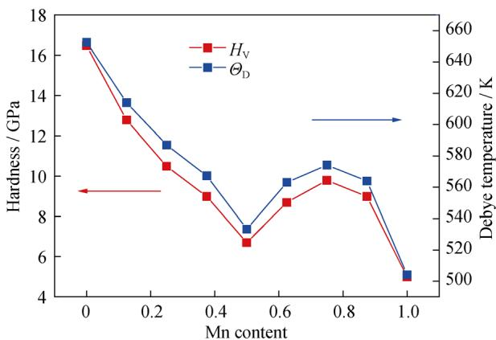  
Fig. 10 Variations in hardness and Debye temperature of $\mathrm { F e } _ { 1 - x } \mathrm { M n } -$ $_ x \mathrm { A l }$ system

## 4 Conclusion

In conclusion, the chemical stability, electronic structures, anisotropic elastic properties and Debye temperature of these Fe–Mn–Al alloys were investigated using first-principles calculations. The cohesive energy and formation enthalpy illustrate that they are thermodynamically stable. The formation enthalpy value of FeAl is the lowest. Therefore, FeAl is the most stable in the $\mathrm { F e } _ { 1 - x } \mathbf { M } \mathbf { n } _ { x } \mathbf { A } 1$ system. The bonding features of the $\mathrm { F e } _ { 1 - x } \mathbf { M } \mathbf { n } _ { x } \mathbf { A } \mathbf { l }$ system are a combination of covalent bonds and metallic bonds, which leads to good electronic conductivity, relatively high melting points and high hardness. Several anisotropy indexes were calculated to estimate the mechanical anisotropy, indicating that MnAl has the strongest anisotropy. These alloys have strong anisotropy characteristic in the Young’s modulus. The change in the hardness and Debye temperature follows a similar trend. FeAl has the highest Debye temperature of 652.5 K, showing that FeAl has stronger covalent bonds than other alloys.

Acknowledgements This work was financially supported by the National Natural Science Foundation of China (No. 51261013).

## References

[1] Frommeyer G, Drewes EJ, Engl B. Physical and mechanical properties of iron–aluminium–(Mn, Si) lightweight steels. Rev Metall. 2000;97(10):1245.

[2] Imandoust A, Zarei-Hanzaki A, Sabet M, Abedi HR. An analysis of the deformation characteristics of a dual phase twinning-induced plasticity steel in warm working temperature regime. Mater Des. 2012;40:556.

[3] Kim H, Suh DW, Kim NJ. Fe–Al–Mn–C lightweight structura alloys: a review on the microstructures and mechanical properties. Sci Technol Adv Mater. 2013;14(1):14205.

[4] Denholm WT. Esdaile JD. Siviour NG. Wilson BW. Crystallization studies in the aluminum-rich corner of the aluminum–iron–manganese system. Metall Trans. 1984;15(7): 1311.

[5] Briggs I, Russell GJ, Clegg AG. Some structural and magnetic properties of Fe–Al–C and Fe–Mn–Al–C alloys. J Mater Sci. 1985;20(2):668.

[6] Huang HH, Chuang TH. Erosion-and wear-corrosion behavior of Fe–Mn–Al alloys in NaCl solution. Mater Sci Eng, A. 2000; 292(1):90.

[7] Wang CJ, Lee JW, Twu TH. Corrosion behaviors of low carbon steel, SUS310 and Fe–Mn–Al alloy with hot-dipped aluminum coatings in NaCl-induced hot corrosion. Surf Coat Technol. 2003;163–164(02):37.

[8] Gau YJ, Wu JK. Galvanic corrosion behaviour of Fe–Mn–Al alloys in sea water. J Mater Sci Lett. 1992;11(2):119.

[9] Benz JC, Leavenworth HW. An assessment of Fe–Mn–Al alloys as substitutes for stainless Steels. JOM J Miner Met Mater Soc. 1985;37(3):36.

[10] Sato K, Takahashi K, Inoue Y, Yamazaki T, Nitoh Y. Surface layers produced by ion nitriding of austenitic Fe–Mn–Al alloys and the effects on hardness and corrosion resistance. J Mater Sci. 1988;23(12):4445.

[11] Yang FQ, Song RB, Li YP, Sun T, Wang KK. Tensile deformation of low density duplex Fe–Mn–Al–C steel. Mater Des. 2015;76:32.

[12] Medvedeva NI, Mryasov ON, Gornostyrev YN, Novikov DL, Freeman AJ. First-principles total-energy calculations for planar shear and cleavage decohesion processes in B2-ordered NiAl and FeAl. Phys Rev B Condens Matter. 1996;54(19):13506.

[13] Fu CL. Origin of ordering in B2-type transition-metal aluminides: comparative study of the defect properties of PdAl, NiAl, and FeAl. Phys Rev B. 1995;52(5):3151.

[14] Zhang HL, Lu S, Zhou M, Punkkinen MPJ, Johansson B, Vitos L. Ab initio determination of the elastic properties of ferromagnetic body-centered cubic Fe–Mn–Al alloys. J Appl Phys. 2015;118(15):103904.

[15] Umino R, Liu XJ, Sutou Y, Wang CP, Ohnuma I, Kainuma R, Ishida K. Experimental determination and thermodynamic calculation of phase equilibria in the Fe–Mn–Al system. J Phase Equilib Diffus. 2006;27(1):54.

[16] Yan SS, Liu L, Wang FR, Xiao Y, Chai SS, Li YY. Anomalous behaviour of electrical resistivity in FeMnAl alloys. Solid State Commun. 1985;54(9):831.

[17] Ren QQ, Gong HR. Ground state of stoichiometric B2 FeAl. Solid State Commun. 2013;169:57.

[18] Liu L, Wu X, Wang R. First principle study on the temperature dependent elastic constants, anisotropy, generalized stacking

fault energy and dislocation core of NiAl and FeAl. Comput Mater Sci. 2015;103:116.

[19] Kang SJ, Park S, Kin M, Han HN, Lee SK, Lee KY. Enhanced mechanical property of Fe–Al alloy due to Mn insertion: ab initio study. J Alloys Compd. 2014;583(1):295.

[20] Segall MD, Lindan PJD, Probert MJ, Pickard CJ, Hasnip PJ, Clark SJ, Payne MC. First-principles simulation: ideas, illustrations and the CASTEPcode. J Phys Condens Matter. 2002; 14(11):2717.

[21] Perdew JP, Burke K, Ernzerhof M. Generalized gradient approximation made simple. Phys Rev Lett. 1996;77(18):3865.

[22] Monkhorst HJ, Pack JD. Special points for Brillouin-zone integrations. Phys Rev B. 1976;13(12):5188.

[23] Chong XY, Jiang YH, Zhou R, Feng J. First principles study the stability, mechanical and electronic properties of manganese carbides. Comput Mater Sci. 2014;87(5):19.

[24] Yu R, Chong XY, Jiang YH, Zhou R, Yuan W, Feng J. The stability, electronic structure, elastic and metallic properties of manganese nitrides. RSC Adv. 2015;5(2):1620.

[25] Chong XY, Jiang YH, Zhou R, Feng J. Electronic structures mechanical and thermal properties of V–C binary compounds. RSC Adv. 2014;4(85):44959.

[26] Chen XQ, Niu H, Li D. Modeling hardness of polycrystalline materials and bulk metallic glasses. Intermetallics. 2011;19(9): 1275.

[27] Feng J, Xiao B, Zhou R, Pan W, Clarke DR. Anisotropic elastic and thermal properties of the double perovskite slab–rock salt layer Ln SrAl O (Ln = La, Nd, Sm, Eu, Gd or Dy) natura superlattice structure. Acta Mater. 2012;60(8):3380.

[28] Wang J, Sun J. Elastic and thermodynamic properties of IrN under pressure. Phys Status Solidi B. 2010;247(4):921.

[29] Chong XY, Jiang YH, Zhou R, Feng J. Pressure dependence of electronic structure and superconductivity of the MnX (X = N, P, As, Sb). Sci Rep. 2016;6:21821.

[30] Feng J, Xiao B, Wan CL, Qu ZX, Huang ZC, Chen JC, Zhou R, Pan W. Electronic structure, mechanical properties and thermal conductivity of Ln2Zr2O7(Ln = La, Pr, Nd, Sm, Eu and Gd) pyrochlore. Acta Mater. 2011;59(4):1742.

[31] Chong XY, Jiang YH, Zhou R, Feng J. Stability, chemical bonding behavior, elastic properties and lattice thermal conductivity of molybdenum and tungsten borides under hydrostatic pressure. Ceram Int. 2016;42(2):2117.