Full length article

# On the anisotropic deformation behavior of a low-density medium manganese steel

Shuanghong Lei a , Binhan Sun $\mathrm { a , b , } { \widetilde { \cdot } } \oplus _ { , }$ Yu Xuan c, Ran Tian a, Yan Ma d , Mohamed Naguib Elkot e, Huijie Cheng a , Ning Yao a, Tiwen Lu a, Jianping Tan a, Zhenbo Zhang c,\* , Xian-Cheng Zhang a,b,\*, Shan-Tung Tu a .a

a Key Laboratory of Pressure Systems and Safety, Ministry of Education, School of Mechanical and Power Engineering, East China University of Science and Technology, Shanghai 200237, China

b State Key Laboratory of Chemical Safety, East China University of Science and Technology, Shanghai 200237, China

c Center for Adaptive System Engineering, Shanghai Tech University, Shanghai 201210, China

d Department of Materials Science and Engineering, Delft University of Technology, Mekelweg 2, 2628 CD Delft, the Netherlands

e Max Planck Institute for Sustainable Materials, Max-Planck-Straße 1, Düsseldorf 40237, Germany

## A R T I C L E I N F O

Keywords: Medium Mn steels Lightweight steels Transformation-induced plasticity Strain partitioning Synchrotron high-energy X-ray diffraction

## A B S T R A C T

Medium manganese (Mn) lightweight steel has gained significant attention in the last decade due to its excellent mechanical properties and low mass density. This type of high-strength steel usually shows a complex micro structure composed of banded δ-ferrite and α-ferrite-austenite aggregates along the rolling direction. The me chanical response of such banded microstructure under different loading directions is crucial for understanding the forming properties of such steels. In this study, we focus on the anisotropic deformation behavior of a medium-Mn lightweight steel, employing various in-situ characterization techniques including synchrotron high energy X-ray diffraction and high-resolution microscopic digital image correlation to study the evolution of stress/strain in different phases upon loading. We observe that the sample loaded along the rolling direction (parallel to the banding direction) exhibits a notably higher strain hardening capability compared to specimens loaded along the transverse direction. Such difference is due to the different strain distribution patterns that is dependent on the intrinsic mechanical properties of individual phases as well as on the orientation of the lavered microstructure relative to the loading direction. This factor results in different kinetics of strain-induced martensitic transformation (i.e., varying transformation-induced plasticity effect) in different tensile di rections, which explains the observed different tensile responses. Our study provides important insights into the future design of similar alloys, particularly for improved forming properties.

## 1. Introduction

The automotive industry is actively searching for lightweight solu. tions to address the global energy crisis and environmental pollution concerns [1]. Studies demonstrate that reducing vehicle weight can have a substantial impact on fuel consumption and $\mathrm { C O } _ { 2 }$ emissions. In this regard, a promising material that has emerged is medium manganese (Mn) lightweight steel with Al additions (up to 12 wt.% [2,3]) that serve to reduce the density of the material (1 wt.% Al reduces \~1.2 % mass density [3,4]). Through optimized alloying and microstructure design, an excellent mechanical property (product of tensile strength and ductility up to 70 GPa% [5,6]) can be achieved in this type of materials, rendering them strong candidates for the third-generation advanced high-strength steels used in automotive lightweight body-in-white as semblies [7].

In order to fine-tune the microstructure and mechanical properties of this class of steels, intercritical annealing (IA) treatments are often employed, which generally result in the formation of austenite and α-ferrite with an ultrafine grain size (as small as 1 μm [8–10]). In addition, the addition of Al in the material also promotes the formation of δ-ferrite [11–13]. Such phase, directly transformed from the liquid phase during casting, largely does not participate in any phase trans formation processes during the subsequent thermomechanical process ing [14]. Hence, this phase is often banded along the rolling direction and its grain size is often larger (up to 15 μm) than the austenite and α-ferrite phases that are newly transformed during IA process [15]. These features thus give rise to a composite structure with a bimodal grain scale consisting of coarse δ-ferrite and fine reverted γ+α aggregate [15–17].

A variety of deformation mechanisms can be activated in medium Mn steels, which contribute to a notable strain-hardening capacity and great strength-ductility synergy. The most widely reported mechanism is the transformation-induced plasticity (TRIP) effect due to the trans formation from softer austenite to harder martensitic microstructure and the associated dislocation accommodation process upon plastic defor mation [18–20]. Depending on the stacking fault energy (SFE), the retained austenite may also be twinned upon deformation, resulting in an additional strain-hardening effect known as the twinning-induced plasticity (TWIP). This strain-hardening mechanism is due to the continuous formation of deformation twins that results in the ’dynamic Hall-Petch effect’ and a back stress hardening caused by the accumu lation of dislocations at the twin boundaries [21–23]. However, a number of studies have revealed that the TWIP effect in medium Mn steels only plays a minor role in terms of its influence on strain-hardening [6,24]. Instead, a multiphase composite effect can also significantly influence the strain-hardening behavior of such steels [25]. This effect involves the high density of geometrically necessary dislo cations (GNDs) formed due to the plastic mismatch between the different phases and the resulting forest dislocation hardening and long-range back-stress hardening [26]. The potency of such composite hardening effect is deemed to be highly influenced by the mechanical characteristics of each phase as well as their mutual interactions, which needs to be studied particularly for medium-Mn lightweight steels with a complex mixture of different phases (α, δ, and γ) crossing different grain size scales.

Extensive research has been conducted on medium lightweight Mn steels, primarily focusing on the impact of alloying elements [27,28] and heat treatment parameters [29–31] on their microstructure and me chanical properties. Much less attention has been paid to the mechanical interaction of different phases in such steels. Particularly for the steel grades with a banded microstructure containing δ-phase and γ+α ag gregates, the mechanical response of different phases to the loading direction is very likely to be different, which requires an in-depth study in order to better aid future microstructure design of these steels.

The anisotropic deformation behavior in some other multiphase steels (including duplex stainless steels and conventional low-alloy TRIP steels) has been previously studied [32–38]. It is generally observed that the yield strength along the transverse direction (TD) is higher than that along the rolling direction (RD) $[ 3 6 , 3 7 , 3 9 ]$ . This was often attributed to the crystallographic textures that were developed during the rolling processes [38,39]. For example, Hutchinson et al. [39] reported that the tensile strength along TD of a cold-rolled duplex stainless steel is 10 % higher than that along RD, which was associated to the {100} <011> texture of ferrite and the {110} <112> texture of austenite. However, the deformation anisotropy can be more complex in medium lightweight Mn steels. Such complexity arises from a) the existence of more types of phase constituents and their more complicated interactions as a response to loading, and b) the occurrence of deformation-induced martensite that can significantly influence the steels’ strain-hardening capability and strain/stress patterning developed during loading. These factors indicate that the underlying mechanisms for the defor mation anisotropy in such steels can be different from previous reports, which deserves an in-depth study.

In this work, we focus on the anisotropic deformation behavior of a medium Mn lightweight steel with a layered microstructure containing δ-phase and γ+α aggregates. A notable difference in strain-hardening capacity is observed when this steel is subjected to different loading directions. A variety of in-situ characterization techniques including synchrotron high-energy X-ray diffraction (HEXRD) and high-resolution microscopic digital image correlation (μ-DIC) are employed to disentangle the deformation behavior of individual phases. The acquired information should provide valuable insights into the deformation behavior of medium Mn steels and other steels with similar micro structures, which is useful for the future design of such steels for better mechanical and forming properties of automotive parts.

## 2. Experimental methods

## 2.1. Material and processing

A lightweight medium Mn steel with the chemical composition of Fe-7.95Mn-0.25C-4.94Al (in wt. %) was selected for the study. Its mass density was calculated to be ${ \sim } 7 . 4 0 \mathrm { g / c m ^ { 3 } }$ based on equations proposed in Ref. [40]. The addition of Al was to reduce the density of the material (by 6.2 %, calculated based on Ref. [3]). It also promotes the formation of δ-ferrite, as illustrated by the phase diagram shown in Fig. 1. The ingots were prepared in a vacuum induction furnace, and then homog enized at 1100◦C before being hot-rolled to a thickness of \~3 mm. The temperature was maintained above \~1000◦C during hot rolling. The hot-rolled sheets were then cold-rolled to a final thickness of around 1.5 mm. To produce the desired microstructure containing ultrafine γ+α aggregate and δ ferrite, the cold-rolled sheet was subjected to IA at 850◦C for 10 minutes, followed by water quenching to room temperature.

## 2.2. Microstructure characterization

The microstructure of undeformed and interrupted tensile specimens was characterized using electron backscatter diffraction (EBSD) in a Zeiss-Crossbeam 340 scanning electron microscopy (SEM). The acquired EBSD data (e.g., phase fraction and grain size) were analyzed using the TSL OIM software package and the AZtecCrystal software package. The equivalent diameter was taken as the grain size for the δ-ferrite phase. Samples for EBSD observations were finally polished with 0.02 μm silica suspension. The detailed deformation behavior of interrupted tensile specimens was examined using transmission electron microscopy (TEM, FEI Talos F200X) operated at 200 kV. Specimens for TEM investigations were prepared through mechanical grinding, followed by twin-jet pol ishing using a 10 % perchloric acid methanol solution. The hardness at different localized regions of the steel was measured by a Vickers microhardness tester (JMHVS-1000ZDP). The average value was taken from more than five different measurements within each region. Specimens used for hardness testing were prepared following the same procedures as those for EBSD analysis.

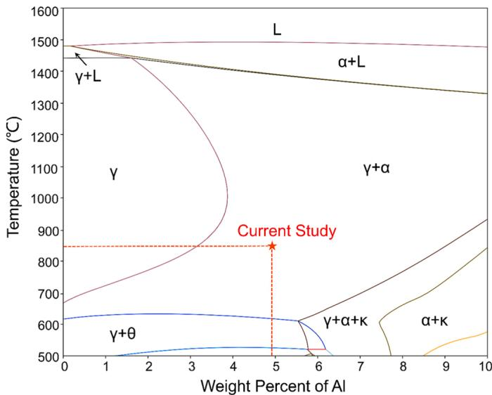  
Fig. 1. Pseudo-binary equilibrium phase diagram for the Fe-7.95Mn-0.25C-4.94Al (wt.%) steel system, calculated by the Thermo-Calc software with the TCFE9 database.

## 2.3. In-situ synchrotron high-energy X-ray diffraction

The in-situ synchrotron HEXRD experiments were conducted at the P02.1 Powder Diffraction and Total Scattering Beamline of PETRA III at Deutsches Elektronen-Synchrotron Center (DESY) in Hamburg, Ger many [41]. The experimental setup is shown in Fig. 2(a). The beamline was operated at a fixed energy of \~ 60 keV, corresponding to a mono chromatic X-ray with a wavelength of \~0.20738 Å. The beam size is 0.5 $\times \ 0 . 5 \ \mathrm { m m ^ { 2 } }$ . During HEXRD experiments, quasi-static uniaxial tensile testing was conducted simultaneously using a Kammrath & Weiss stress rig, which maintained a constant crosshead speed corresponding to an initial strain rate of ${ \sim } 1 \times { } 1 0 ^ { - 3 } s ^ { - 1 }$ . Tensile specimens with a gauge length of 12 mm, a width of 2 mm and a thickness of 1.2 mm were employed. Two types of samples taken from different orientations, denoted as RD and TD, were tested. For each orientation, the tests were repeated at least three times. It is noteworthy that the extensometer was not utilized in this study, instead, only the applied tensile load and crosshead displacement were recorded. Two-dimensional diffraction patterns were collected by a Varex XRD 4343CT fast area detector every 1 s during tensile testing. The detector distance and instrument broadening were calibrated by a standard $\mathrm { C e O _ { 2 } }$ sample.

The deformation behavior including deformation-induced phase transformation, lattice strain and dislocation density was quantitatively assessed through the analysis of Debye-Scherrer diffraction rings. The diffraction intensities over the entire azimuth range (0◦\~360◦) were integrated using the Fit2D software [42]. Fig. 2(b) presents represen tative diffraction intensity maps as a function of azimuthal angle and 2-Theta angle. The corresponding diffraction profile is shown in Fig. 2(c) and is calculated using the Rietveld refinement method. Five crystallo graphic reflections of the FCC phase ({111}, {200}, {220}, {311}, {222}) and four reflections of the BCC phase ({110}, {200}, {211}, {220}) were identified. The volume fraction of austenite was analyzed using the Rietveld refinement method with the aid of the MAUD soft ware [43]. The calculated results of the non-deformed and deformed samples at the 30 % applied strain are also shown in Fig. 2(c). It is demonstrated that the calculated diffraction profiles (solid lines) match well with the experimental diffraction data (open dots). To analyze the lattice strain of each phase and its change upon loading, the Debye-Scherrer diffraction ring was divided into 36 sectors (10◦ each) along the azimuth angle and the sector along the tensile direction (azi muth angle from -5◦ to 5◦) was selected for such analysis. Integral diffraction peaks were fitted by the single peak fitting method using the Gaussian function to ascertain the interplanar spacing (d) and the lattice parameter (a) [44]. An example of the fitting result is shown in Fig. 2(d). The lattice strain (ε ) for each diffraction plane and the weighted average lattice strain per phase (ε ) were calculated using the following equations [44,45]:

(a)  
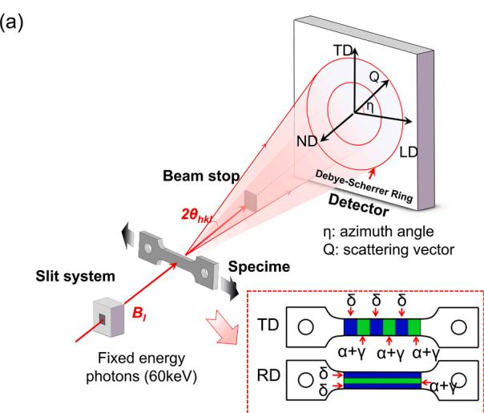  
(b)

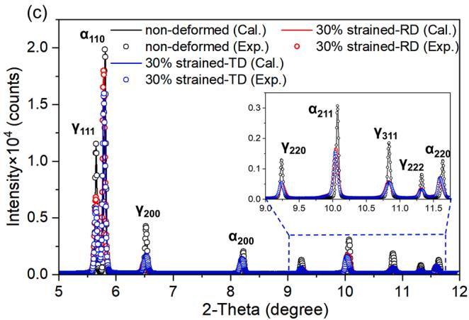

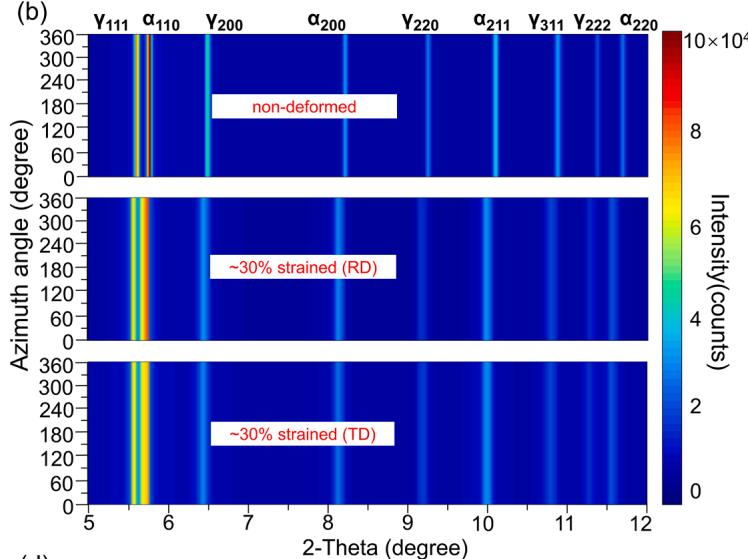

(d)  
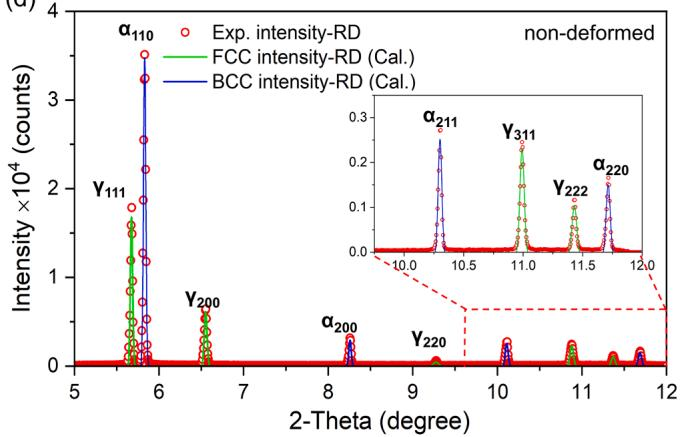  
Fig. 2. (a) The setup of the in-situ synchrotron high-energy X-ray diffraction experiment [46]; (b) Diffraction intensity plotted as a function of Azimuth angle and 2-Theta angle for samples that are non-deformed and deformed to 30% applied strain; (c) Integrated intensity as a function of 2-Theta angle for the samples in (b) (both experimental data (Exp.) and calculated results (Cal.) using the Rietveld refinement method are shown). (d) Integrated diffraction profile (red open dots) over azimuth angle from -5◦ to 5◦ and the corresponding fitted peaks of FCC and BCC (green and blue solid lines) using the single peak fitting method.

$$
\varepsilon_ {h k l} = \left(d _ {h k l} ^ {\sigma} - d _ {h k l} ^ {0}\right) / d _ {h k l} ^ {0}\tag{1}
$$

$$
\overline {{\varepsilon_ {p}}} = \left(\overline {{a _ {p} ^ {\sigma}}} - \overline {{a _ {p} ^ {0}}}\right) / \overline {{a _ {p} ^ {0}}}\tag{2}
$$

where $d _ { h k l } ^ { \sigma }$ and $d _ { h k l } ^ { 0 }$ are the interplanar spacings of the sample under tensile load and prior to deformation, respectively; $\overline { { a _ { p } ^ { \sigma } } }$ and $\overline { { a _ { p } ^ { 0 } } }$ are the weighted average lattice parameters of each phase for the loaded and unloaded samples, respectively.

## 2.4. High-resolution microscopic DIC

To investigate the strain partitioning between different phases dur ing the deformation process, high-resolution μ-DIC tests were performed on the steel samples with two different orientations (RD and TD). For such tests, a Kammrath & Weiss GmbH tensile stage was utilized for insitu testing within a Tescan Mira4 SEM. The dog-bone shape specimens with a gauge length of 20 mm were fine-polished before imaging. The microstructure before in-situ testing was first characterized by EBSD, from which different phases can be identified and subsequently can be used to correlate their respective local strain. Nano-scale gold speckles were applied to the sample through gold sputtering and gold film remodeling [47–49]. Secondary electron imaging, covering a total area of $5 0 0 \times 5 0 0 \mu \mathrm { m } ^ { 2 }$ , was performed at different interrupted strains of the specimen. These images were then processed using the La Vision DaVis software to generate strain field data.

## 3. Results

## 3.1. Microstructure and tensile properties

The EBSD results of the annealed steel are shown in Fig. 3(a-c), which consist of the microstructure taken from three normal planes. The sample exhibits a banded or layered structure, featuring ultrafine grained (UFG) γ+α phases that have reversely transformed from martensite during annealing (Fig. 3(a-c)), and a certain fraction of coarse-grained δ-ferrite (grain size above \~15 μm). The band direction is along RD. The δ-ferrite phase was retained from the hot rolling process and experienced fast recrystallization and grain growth during inter critical annealing [50–52]. The phase superimposed with image quality (IQ) map shown in Fig. 3(b) reveals a uniform contrast of the BCC phase, signifying the absence of martensite in the non-deformed microstruc ture. The distribution of grain size of different phases is displayed in Fig. 3(d) and (e). Based on such data, the average grain size can be calculated, which is \~1.8 μm, \~2 μm, and \~38 μm for austenite, α-ferrite, and δ-ferrite, respectively. The large difference in grain size between the two types of ferrite (α and δ) allows for differentiation and calculation of their respective volume fractions, which are 25 vol. % and

(a)  
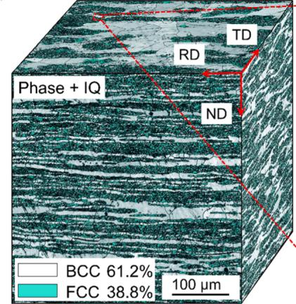

(b)  
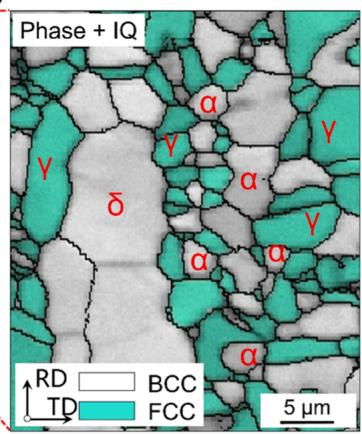  
(e)

(d)  
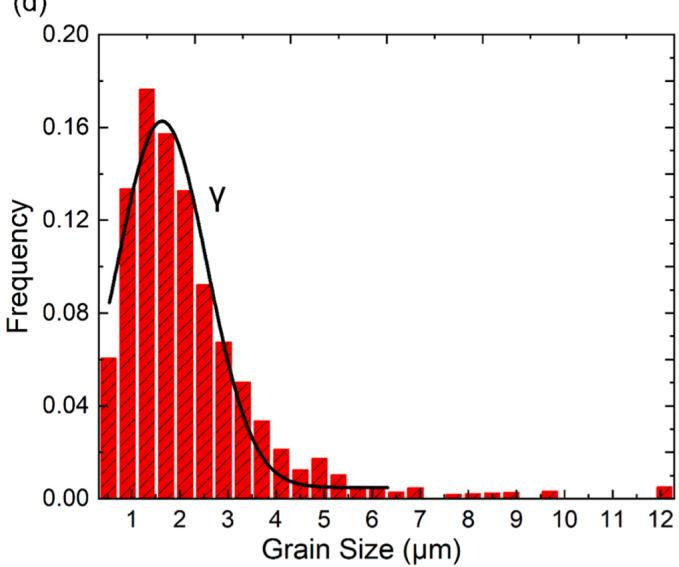

(c)  
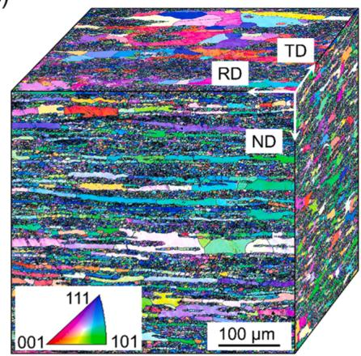

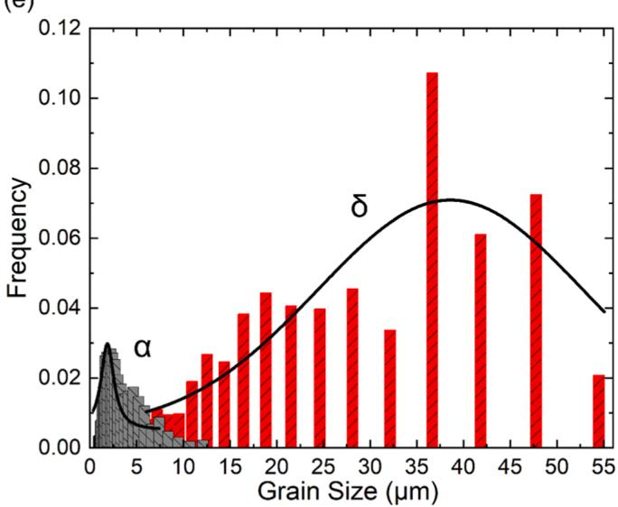  
Fig. 3. EBSD results of the microstructure for the non-deformed sample: (a) 3D reconstruction of Phase + IQ mapping (the image is arranged according to three normal planes): (b) Magnified phase + JO local plot of RD-TD plane in (a): (c) 3D reconstruction of IPEs by the same method in (a): The grain size distribution of (d) austenite and (e) δ/α ferrite (generated from EBSD results).

44 vol. %, respectively. The fraction of γ+α aggregate is thus estimated to be 56 vol. %.

Fig. 4(a) shows the engineering stress-strain curves of the RD and TD orientated samples tested at room temperature. The intercritically annealed steel demonstrates a great combination of tensile strength (\~855±35 MPa) and ductility (total elongation 65±5 %). The sample tested along RD has a higher strength (by 864 MPa) and ductility (69 %) compared to that tested along TD. The strain-hardening behavior of the two samples, shown in Fig. 4(b), can be categorized into three distinct stages. At stage $^ { \mathrm { I , } }$ the strain hardening rate drops sharply. Stage II is characterized by an increase in strain-hardening rate, starting from a true strain of \~0.2 for both samples. As the strain further increases, the strain-hardening rate begins to decrease again, i.e., Stage III, until the occurrence of necking defined by the Consid\`ere criterion. At these two strain-hardening stages, it is interesting to note that the strain-hardening rate of the RD sample (maximum 2052 MPa) is higher than that of the TD sample (maximum 1828 MPa). This difference is the reason ac counting for the different ultimate tensile strength and ductility values between the two samples.

## 3.2. Deformation substructure

To reveal the deformation mechanisms of the investigated samples, detailed EBSD characterizations were conducted on the interrupted tensile samples. Fig. 5(a) illustrates the microstructure of the TD sample strained to 15 % along the loading direction. It is shown that the BCC phase exhibits a large variation in the band slope (BS) values. The re gions with a low BS indicate the presence of deformation-induced α’-martensite, due to its much higher dislocation density and lattice distortion compared with the ferrite phase [53]. Fig. 5(b) presents a bimodal distribution of the BS value of the BCC phase obtained using the AZtecCrystal software. This information helps to differentiate ferrite and α’-martensite [54.55]. We apply a BS cut-off point at the intersection of two peaks to aid a better visualization of the two phases. Fig. 5(c) pre sents the kernel average misorientation (KAM) map corresponding to the phase + BS map in Fig. 5(a). The UFG γ+α region has a higher KAM value compared with the δ ferrite due to the strain-induced α’-martensitic transformation. A phase map after applying this threshold of a magnified region is shown in Fig. 5(d), where the nucle ation behavior of α’-martensite can be observed. It is shown that α’-martensite nucleation takes place primarily at the phase boundary between austenite and ferrite (α-ferrite or δ-ferrite), as marked by the arrows in Fig. 5(d). This preferable nucleation is due to the large stress and strain concentration developed at the heterointerfaces, which can be

(a)

revealed from the higher misorientation values (thus higher GNDs [56, 57]) at these locations (see the KAM map in Fig. 5(e)). A similar finding is also observed for the RD sample, which is not shown here for conciseness. The deformation-induced α’-martensite formation (i.e., the TRIP effect) makes a major contribution to the strain-hardening capa bility of the samples [16,58].

To further investigate the martensite nucleation behavior upon loading, TEM characterizations were performed for the same sample, as shown in Figs. 6 and 7. The results confirm that strain-induced a’- martensite is nucleated at or close to γ/α and γ/δ phase boundaries. This can be rationalized by the following two factors. First, the high strain and stress concentrations at the interface regions, resulting from the strain incapability between adjacent phases [13,18], enhance disloca tion activities and thus the interaction between different slipping sys tems close to these local regions. Second, some defects such as ledges at interfaces can serve as favorable sites for the activation of multiple slip systems [59,60]. These two factors will essentially result in more frequent intersections between different microscopic shear-bands in the form of ε-martensite, deformation twins, or stacking-fault bundles close to the interface regions, which will facilitate the nucleation of a’-martensite therein [13,16,61]. The detailed mechanisms of the α’-martensite nucleation in the investigated steel will be the subject of our future study. For some other austenite grains, α’-martensite has not yet formed (Fig. 7(a )). Dislocation planar slip and dense stacking faults (SFs, marked by the red arrows) are observed in these grains $( \mathrm { F i g . } 7 ( \mathbf { a } _ { 1 } ) ) .$ The corresponding HR-TEM image of the SFs is shown in Fig. 7(a ). The deformation behavior is different for the ferrite phase. TEM observation taken from the two-beam condition (g vector <110>) reveals the for mation of dislocation tangles (Fig. 7(b) and (c)) inside both α and δ ferrite, indicating the occurrence of dislocation cross-slip [17]. The difference in the deformation mode between austenite and ferrite lies in their different SFE. Austenite generally possesses a lower SFE than the ferrite phase [62], which favors planar dislocation slip and the occur rence of strain-induced martensite [17,63].

(b)

## 3.3. In-situ synchrotron HEXRD results

In order to reveal the underlying mechanisms for the differences in the mechanical behavior of the RD and TD steels, in-situ HEXRD was employed to investigate the microscopic deformation behavior of each phase under tensile testing. The engineering stress-strain curve acquired from the in-situ HEXRD tensile stage is shown in Fig. 4(a). The change of phase fraction and dislocation density of each phase upon deformation can be analyzed. Due to the high angular resolution of HEXRD, overlapping diffraction peaks of ferrite and strain-induced tetragonal α’-martensite can in principle be separated [44,64,65]. For the investi gated steel, the asymmetry of the BCC diffraction peaks due to such a peak overlapping effect can indeed be observed at high strain levels (e.g. above 0.3 true strain, Fig. 8(a)). However, this asymmetry is not obvious at lower plastic deformations. In this case, the peak separation for BCC diffraction peaks is prone to error. Therefore, in this study, the increase in the martensite fraction is determined to be equal to the reduction in the austenite fraction. Fig. 8(a) reveals the variation of different diffraction peaks at different true strain levels for both RD and TD samples. It is observed that the intensity of the FCC diffraction peaks decreases with the increase of plastic deformation for both samples, due to the formation of strain-induced α’-martensite. At high strain levels (e. g., above \~0.22), the BCC peaks of the RD sample appear to be clearly higher than that of the TD sample, indicating a higher amount of martensite formation. The calculated deformation-induced martensite as a function of true strain is shown in Fig. 8(b). At the elastic stage (true strain below \~0.03), the martensite fraction is negligible (less than 1 vol. %), suggesting that the martensite transformation in the studied steel occurs primarily during the plastic deformation stages $( \mathrm { i . e . , }$ strain-induced α’-martensite). Upon straining, the martensite fraction increases for both samples. A notable feature is that the RD sample shows higher martensite transformation kinetics compared with the TD sample. At higher strain levels, the difference in the martensite fraction between the two samples becomes more pronounced, which can be as high as 4 vol. % at a true strain of \~0.48 (the uniform elongation of the TD sample). The faster martensite transformation kinetics in the RD sample can explain its higher strain hardening ability, particularly at high strain levels (above \~0.2 true strain, see the inset in Fig. 8(b)).

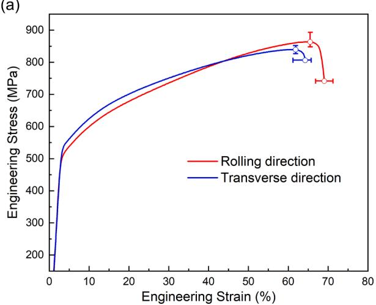

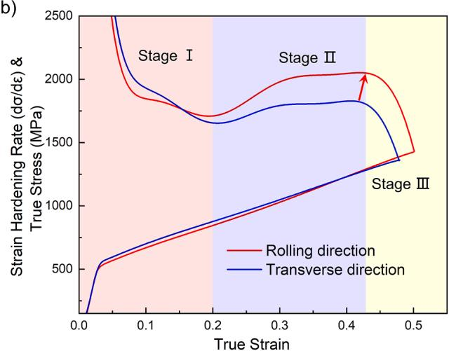  
Fig. 4. Mechanical behavior of the RD and TD samples: (a) The engineering stress-strain curves of the two samples. (b) The corresponding strain hardening curves and true stress-strain curves of the two samples.

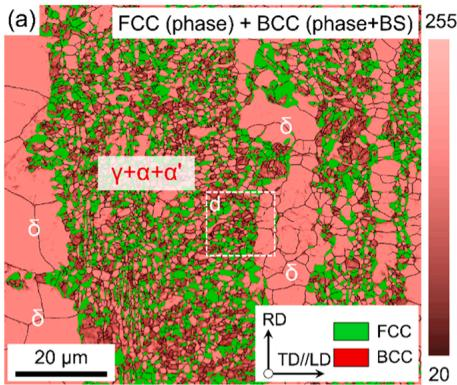

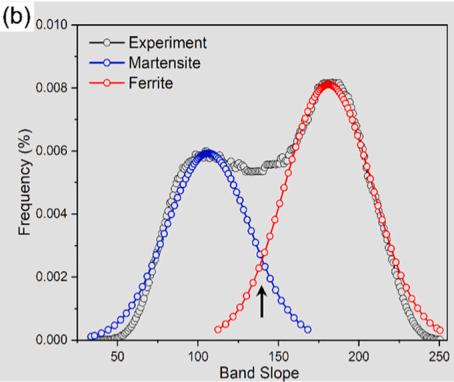

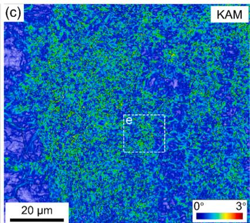

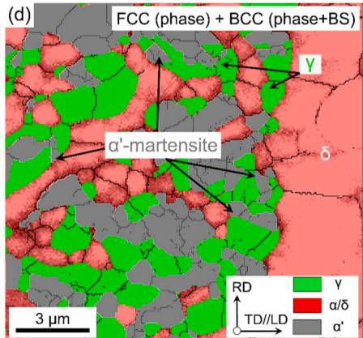

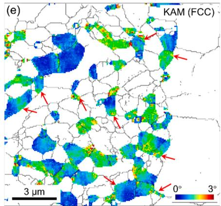  
Fig. 5. EBSD results of the microstructure at 15% engineering strain in TD sample: (a) Phase + BS map (both α’-martensite, δ/α-ferrite and austenite). (b) Distri bution of BS values for BCC. (c) The corresponding KAM map in (a). (d) Phase map of a magnified region in (a). (e) The corresponding KAM map of the FCC in (d).

The evolution of dislocation density within austenite upon straining is also investigated and the results are shown in Fig. 9. Given that the diffraction peaks of ferrite and martensite are highly overlapped and difficult to accurately separate, the dislocation density of the BCC phase is not analyzed in this work. We calculated the dislocation density based on the modified Williamson-Hall method [66], with the following equation:

$$
\Delta K - \beta W _ {h k l} = \frac {0 . 9}{L} + \left(\pi A ^ {2} b ^ {2} / 2\right) ^ {1 / 2} \rho^ {1 / 2} \left(K \overline {{{C}}} ^ {1 / 2}\right)\tag{3}
$$

where ΔK is the full width at half maximum (FWHM) of diffraction peaks. The term $\beta W _ { h k l }$ represents the stacking fault contribution to line broadening. $\beta = ( 1 . 5 \varphi _ { s } + \varphi _ { t } ) / a ,$ , where a is the lattice constant, $\varphi _ { s }$ and $\varphi _ { \mathrm { t } }$ denote the density of SF and twin boundary, respectively. $W _ { h k l }$ is a factor used to scale the faulting-induced peak broadening at different hkl re flections. The values of $W _ { h k l }$ for FCC crystals are $W _ { 1 1 1 } = 0 . 4 3 , W _ { 2 0 0 } = 1$ $W _ { 2 2 0 } = 0 . 7 1 , W _ { 2 2 2 } = 0 . 4 3$ , and $W _ { 3 l 1 } = 0 . 4 5$ [67]. L is average particle size, A is a dimensionless constant that depends on the effective outer cut-off radius of dislocations (taken as 2 [68]), b is the Burgers vector (0.258 nm for austenite [69]), ρ is the dislocation density, K is the peak position, C is the average contrast factor of dislocations on a specific crystal plane and its value is affected by the elastic constant, dislocation type, and crystal plane index of the crystal [70].

Fig. 9(a) illustrates the relationship between $\varDelta K - \beta W _ { h k l }$ and $K C ^ { 1 / 2 }$ calculated for five crystallographic reflections of FCC ({111}, {200}, {220}, {311}, {222}) in both samples at true strains of \~0.14 and 0.22. A value of β has been determined by trial-and-error by allowing that the quantities of $\varDelta K - \beta W _ { h k l }$ follow a smooth quadratic curve according to Eq. (3) [71]. For example, at a true strain of \~0.14, the values of β are 0.002 and 0.004 for the RD and TD sample, respectively. The values of β at other strains were determined using a similar approach. The dislocation density was obtained from the slope of the $( \varDelta K - \beta W _ { h k l } ) – K C ^ { 1 / 2 }$ relation as it exhibits a positive correlation with dislocation density. The RD sam ples exhibit higher slopes than the TD sample, indicating a higher dislocation density. Fig. 9(b) illustrates the dislocation density of austenite as a function of true strain. The dislocation density of austenite increases with true strain. During deformation, the dislocation density of austenite is obviously higher in the RD sample (by a maximum value of ${ \sim } 1 . 5 1 \ \times \ 1 0 ^ { 1 4 } \ \mathrm { m } ^ { - 2 } )$ . This higher dislocation may be associated with strain-induced α’-martensitic transformation. On the one hand, the volume expansion associated with the martensitic phase transformation generates localized plasticity in the matrix phase adjacent to the newly formed martensite, leading to an enhancement in dislocation activity within the matrix [72,73]. On the other hand, the mechanical contrast among ferrite, austenite and fresh martensite results in distinct stress/ strain partitioning, which consequently induces dislocation accommo dation in softer phases (here austenite) [74,75]. At the latest stages of tensile deformation (above 0.35 true strain), the difference in the austenite dislocation density between the two samples becomes smaller, which might be due to the eventual martensite transformation from the austenite with a high dislocation density. Such decay in the rate of dislocation multiplication, particularly for the RD sample, will lead to a decrease in the strain hardening rate, according to the Taylor hardening model [76]. Therefore, the difference in the dislocation multiplication between the two samples should not be the reason accounting for their different strain-hardening ability.

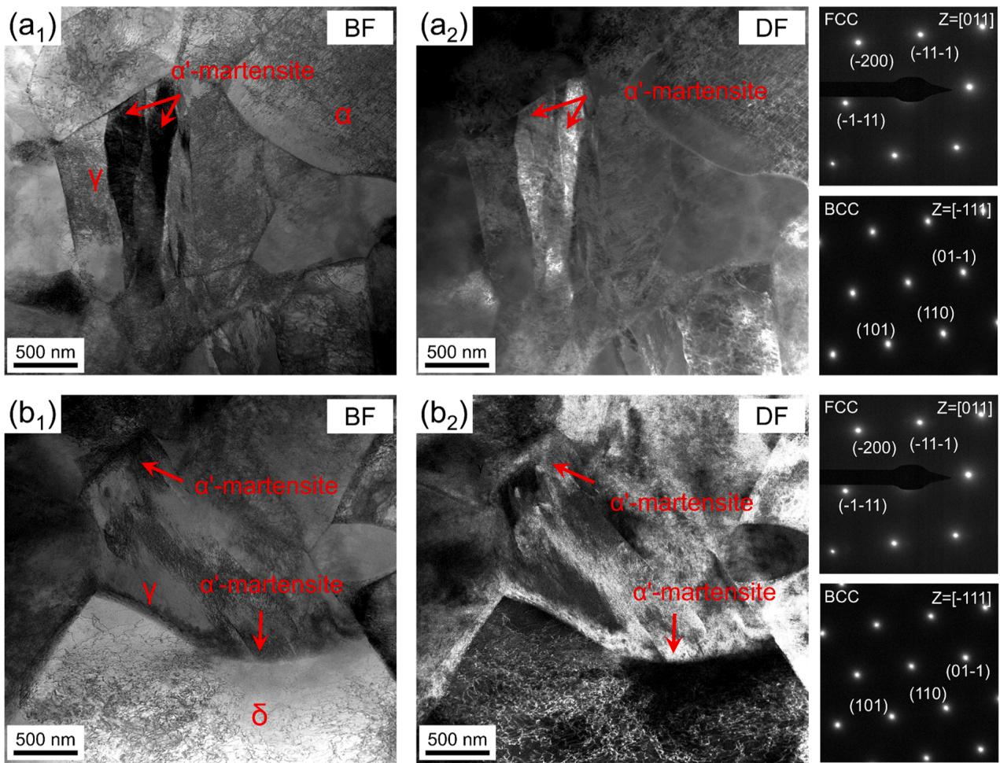  
Fig. 6. TEM observation of austenite deformation mechanisms in the TD sample (engineering strain 15%): $\mathbf { \rho } ( \mathbf { a } _ { 1 }$ and $\mathbf { b } _ { 1 } )$ Bright field (BF) image and $\left( \mathbf { a } _ { 2 } \right)$ and $\mathbf { b } _ { 2 } )$ dark field (DF) image and the corresponding diffraction patterns taken from two representative austenite grains, showing the strain-induced α’-martensite nucleation close to γ/α and $\gamma / \delta$ phase boundaries.

## 3.4. Strain partitioning behavior

Due to the multiphase feature of the investigated steel and the strength difference among different phases, the distribution of plastic strain during tensile testing should be non-uniform. This heterogeneous strain distribution was investigated by the in-situ μ-DIC technique. The advantage of this technique is the ability to visually observe the strain distribution in a selected microscopic region. Polished and gold sputtered specimens were subjected to interrupted tensile testing. SEM images at same locations of the tensile specimen were performed at every \~5 % engineering strain. It should be noted that the correlative EBSD results were acquired before gold sputtering, thus the analysis does not distinguish strain-induced $\alpha ^ { \ast }$ -martensite and austenite. Partic ular focuses are placed on the straining partitioning behavior between γ+α aggregate and δ-ferrite (Figs. 10(a) and 11(a)) and between γ and α in the ultrafine-grained region (Figs. 10(b-d) and 11(b-d)). Based on such data, the difference in the deformation behavior between RD and TD samples can be more clearly visualized.

Fig. 10 illustrates the distribution of the shear strain in the RD sample upon tensile loading. The EBSD phase plus band contrast (BC) map depicting the non-deformed microstructure of the selected region of this sample is presented in Fig. 10(a ). Fig. $1 0 ( \mathbf { a } _ { 2 ^ { - } } \mathbf { a } _ { 5 } )$ show the evolution of the shear strain field in the corresponding region at different engineer ing strain levels (from 5 % to 20 %). The strain distribution is relatively uniform throughout the entire region, indicating that the δ-ferrite and UFG $\gamma { + } \alpha$ exhibit similar deformation levels, as also illustrated by the strain profiles taken from two representative regions (Fig. 10(e)). At higher strain values, e.g., 20 %, some deformation slip bands can be observed, as marked by arrows in Fig. $\mathbf { 1 0 ( a _ { 5 } ) }$ . Fig. 10(b) provides a representative magnified view of the microstructure and the corre sponding strain distribution in the UFG region. Based on the EBSD data, the regions of $\gamma \mathbf { - } \mathbf { \alpha } \mathbf { \alpha } ^ { \prime }$ mixed phase and α-ferrite can be separated, and their strain maps are shown in Fig. 10(c) and (d), respectively. It can be observed that the UFG region shows a more heterogeneous strain dis tribution when probed at high magnifications, especially at higher strain levels (above 15 %). Such heterogeneous strain distribution is related to the different deformation behaviors of austenite and α-ferrite, attribut able to their different mechanical properties, which will be discussed in Section 4.1.

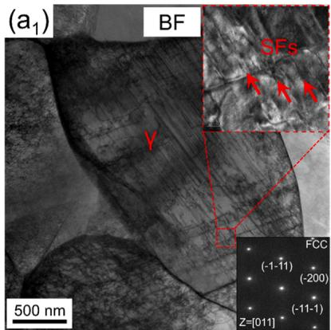

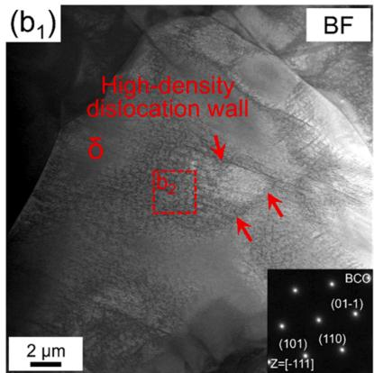

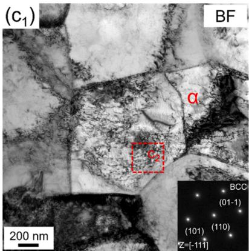

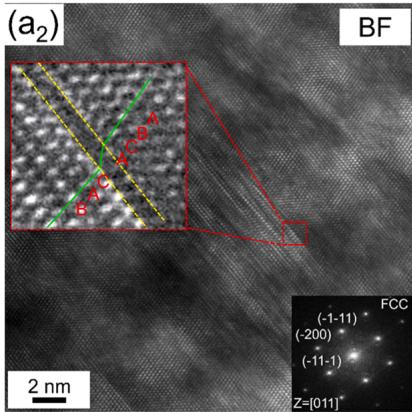

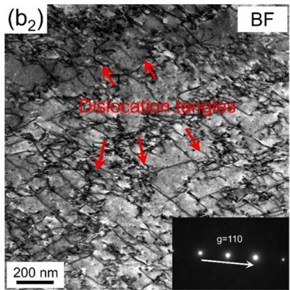

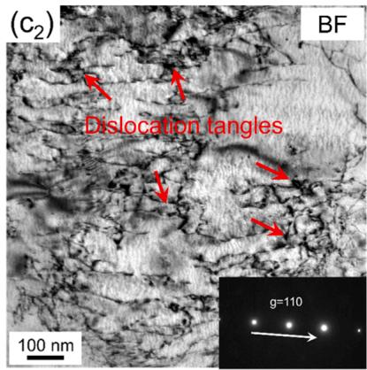  
Fig. 7. TEM observation of the deformation behavior within austenite, α-ferrite and δ-ferrite for the TD sample (engineering strain 15%): (a ) BF image and diffraction pattern for an austenite grain in the TD sample, showing the formation of stacking fault (marked by arrows); (a ) HR-TEM image taken from a local region within the austenite grain in (a ), showing details of SFs; $\left( \mathbf { b } _ { 1 } { \cdot } \mathbf { b } _ { 2 } \right)$ BF image and diffraction pattern for a δ-ferrite grain in the TD sample, showing the dislocation tangles (marked by arrow). $\left( \mathsf { c } _ { 1 } \mathsf { - c } _ { 2 } \right)$ BF image and diffraction pattern for an α-ferrite grain in the TD sample, showing the dislocation tangles (marked by arrow).

(a)  
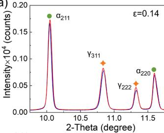

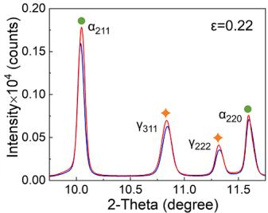

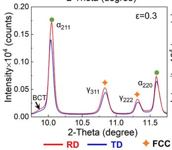

(b)  
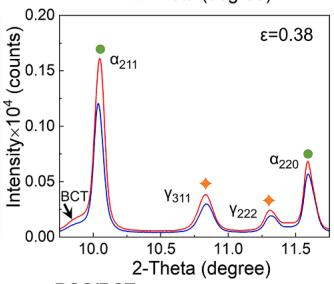

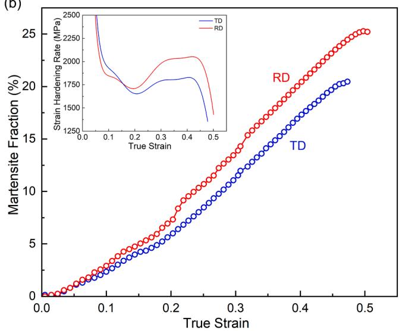  
Fig. 8. (a) The variation of different diffraction peaks with true strain of the two samples; (b) Martensite fraction calculated by the Rietveld refinement method as a function of true strain (the inset shows the corresponding strain hardening rate curves of the two samples).

In contrast to the RD sample, the TD sample demonstrates a more pronounced strain heterogeneity, which can be already observed at a lower magnification $( \mathrm { F i g . ~ 1 1 ( a ) } )$ . A detailed strain profile analysis reveals that the higher strain is concentrated in the δ-phase (as shown in Fig. 11(e)), a phenomenon that is not observed in the RD sample. The strain distribution in the UFG $\gamma { + } \alpha$ region of the TD sample closely re sembles that observed in the RD sample. Fig. 11(c) and (d) illustrate the strain distribution in the $\gamma \mathbf { - } \mathbf { \alpha } \mathbf { \alpha }$ mixed phase and α-ferrite regions, respectively, revealing a relatively higher strain inside the $\gamma \mathbf { - } \mathbf { \alpha } \mathbf { \alpha }$ mixed phase. At higher plastic deformation levels (above 15 %), strain con centration near the phase boundaries is also observed (as marked by arrows in Figs. 10(d ) and 11(d )), which matches well with the KAM data shown in Fig. 5(e). This phenomenon is due to the strain in compatibility between the two phases (austenite and ferrite) during plastic deformation, which essentially increases the number of GNDs at the phase boundaries.

(a)  
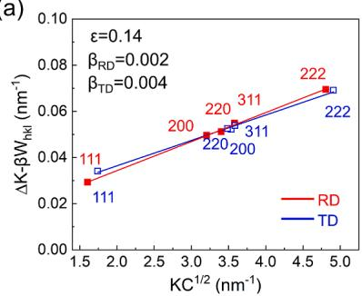  
(b)

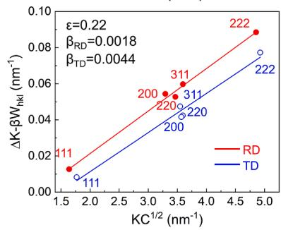

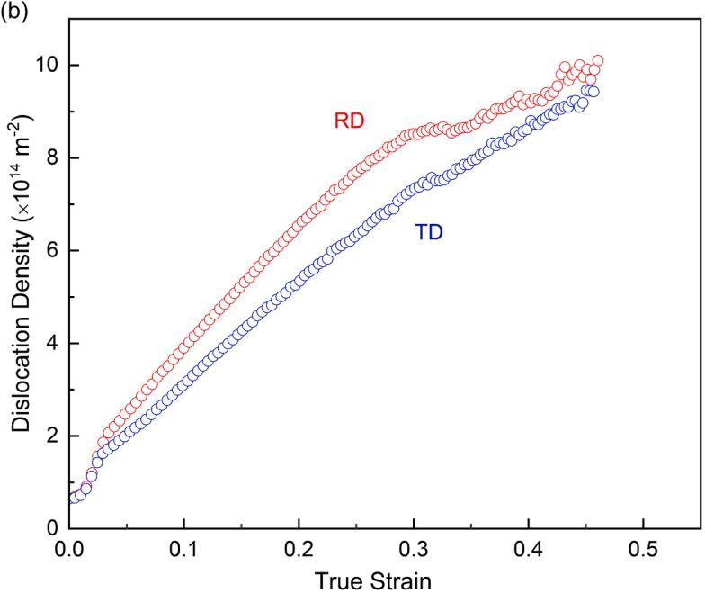  
Fig. 9. (a) The relationship between $\Delta K _ { \mathcal { \parallel } } W _ { h k l }$ and $K C ^ { 1 / 2 }$ determined using the modified Williamson-Hall method across five crystallographic reflections of FCC: {111}, {200}, {220}, {311}, and {222} for both RD and TD samples at two different strain levels. (b) Dislocation density of austenite as a function of true strain for the two samples.

(a1)  
(a2)  
(a3)  
(a4)  
(a5)  
(e1)  
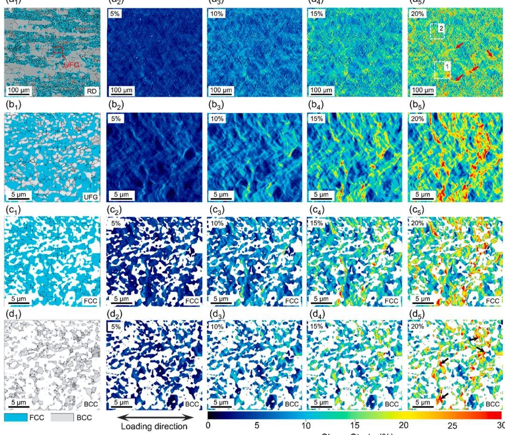

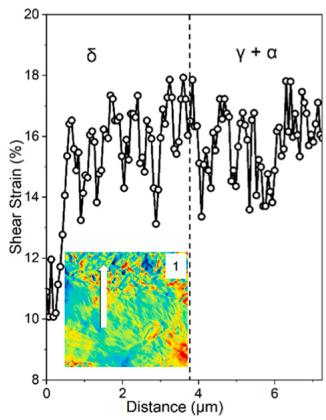

(e2)  
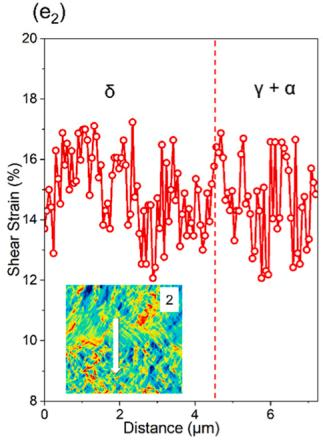  
Shear Strain (%)  
Fig. 10. Strain partitioning behavior in the RD sample: EBSD phase + BC map for $\mathbf { \left( a _ { 1 } \right) }$ the entire probed area and $\mathbf { ( b _ { 1 } ) }$ the UFG γ+α region (red rectangular frame in $\mathbf { \left( a _ { 1 } \right) } ) .$ . Single-phase maps of the area in $\mathbf { ( b _ { 1 } ) }$ are shown in (c ) for FCC phase and (d ) for BCC phase. $( { \bf a } _ { 2 } – { \bf a } _ { 5 } ) , ( { \bf b } _ { 2 } – { \bf b } _ { 5 } ) , ( { \bf c } _ { 2 } – { \bf c } _ { 5 } )$ and $( \mathsf { d } _ { 2 } \mathsf { - } \mathsf { d } _ { 5 } )$ show the shear strain distribution of the areas in $( { \bf a } _ { 1 } ) , ( { \bf b } _ { 1 } ) , ( { \bf c } _ { 1 } )$ and $( \mathrm { { d } _ { 1 } ) , }$ , respectively, at engineering strains from 5% to 20%. (e) Local strain across different representative phase regions (along the arrow marked in the inset strain maps).

(a2})  
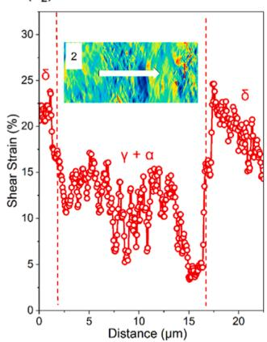

(a1)  
(a3)  
(a4)  
(a5)  
(e1)  
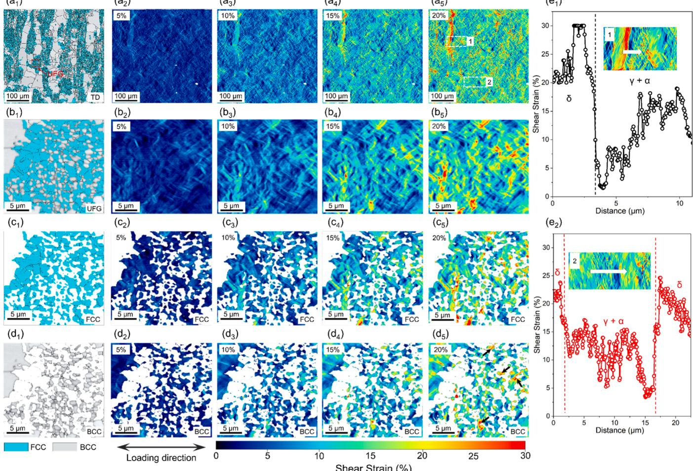  
Fig. 11. Strain partitioning behavior in the TD sample: EBSD phase + BC map for (a ) the entire probed area and (b ) the UFG γ+α region (red rectangular frame in (a )). Single-phase maps of the area in (b ) are shown in (c ) for FCC phase and (d ) for BCC phase. (a -a ), (b -b ), (c -c ) and (d -d ) show the shear strain distribution of the areas in (a ), (b ), (c ) and (d ), respectively, at engineering strains from 5% to 20%. (e) Local strain across different representative phase regions (along the arrow marked in the inset strain maps).

To better understand the strain partitioning behavior of the two samples upon tensile loading, the statistical average strain value of different phases (δ, α, and γ-α’ mixed phase) was quantified and the results are shown in Fig. 12. In the RD sample, the average strain value remain quite similar between the δ-ferrite and UFG γ+α aggregates (Fig. 12(a)). In contrast to the TD sample, the average strain value of δ-ferrite is about 1.26 times higher than that of the γ+α aggregates (Fig. 12(b)), revealing a strain concentration within the δ-ferrite. This observation is consistent with the results presented in Figs 10 and 11. Pertaining to the strain partitioning between α and γ-α’ within the UFG region, it is shown that for both samples, more strain is concentrated within the γ-α’ mixed phase, which is up to 1.3 times higher than that of the α phase (Fig. 12(c) and (d)). It should be noted that the volume expansion associated with the γ to α’-martensitic transformation (around 2\~4 % [77]) is also likely to contribute to an increase in local plastic strain in the γ-α’ mixed phase [78]. However, the strain parti tioning between α and γ-α’ is already notable at small strains (5 %) where martensite formation is relatively limited. This indicates that the observed strain concentration within the γ-α’ mixed phase is more due to the mechanical contrast between the two phases. Nevertheless, it is shown from this statistical analysis that the plastic strain concentrated in the austenite phase appears to be smaller in the TD sample in compar ison to that of the RD sample (Fig. 12(c) and (d)). This can well explain the lower kinetics of strain-induced martensite transformation of the TD sample observed in Fig. 8 and the lower strain-hardening capability. Given that the strain partitioning ratio between austenite α and γ-α’ is similar between the two samples, the lower austenite strain in the TD sample should be derived from the higher strain concentration within the δ-ferrite phase (Fig. 12(b)). The underlying reasons for the different strain partitioning behavior will be discussed in Section 4.

## 4. Discussion

Results of Section 3 demonstrate that the investigated medium Mr lightweight steel with a layered microstructure containing δ-phase and γ+α aggregates show different strain-hardening abilities when loaded under different directions (RD and TD). Such difference might be related to the texture (especially of δ-phase) developed during thermo mechanical processing and/or the different kinetics of strain-induced martensite transformation under different loading directions (as demonstrated in Fig. 8). To investigate the influence of the former fac tor, we conducted texture analysis on the δ-phase; the results are shown in Supplementary Fig. S1. A typical rolling texture with a major rotated cube texture component {100} <011>, i.e., <011>//RD and {100}// normal direction (ND), is formed after thermomechanical processing and annealing. Because the texture is not pronounced (maximum in tensity of 2.57), its effect on the anisotropic strain hardening behavior is supposed to be insignificant. In addition, Taylor factors are determined to be quite similar between samples loaded along different directions (2.83 for RD and 2.78 for TD), which further indicates a similar me chanical response of the δ-phase upon different loading directions [79]. Therefore, we mainly contemplate on the latter factor, i.e., different kinetics of strain-induced martensite transformation. This is related to the different strain partitioning behavior observed in TD and RD sample developed upon loading (Section 3.4), which requires comprehensive discussion. In this section, we first unravel the underlying reasons for the different strain partitioning behavior in the two samples. The impact of strain distribution on strain-induced martensitic transformation is then discussed.

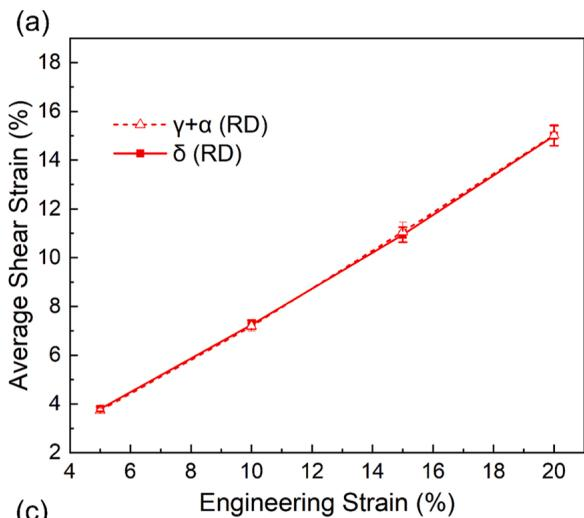

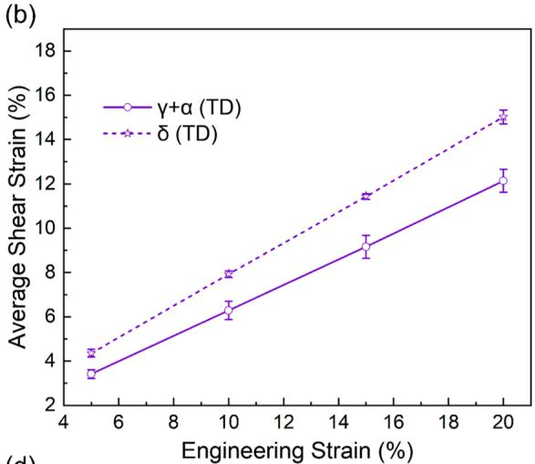

(c)  
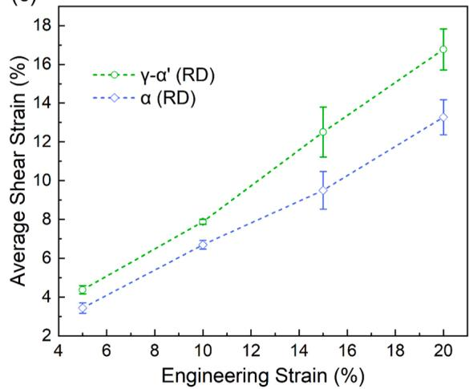

(d)  
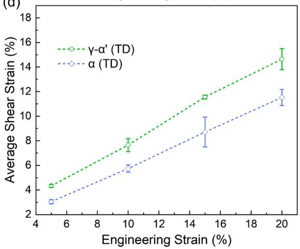  
Fig. 12. The average shear strain of δ-ferrite and UFG γ+α regions in (a) RD and (b) TD as a function of engineering strain; The average shear strain of γ-α’ mixed phase and α phase in UFG γ+α regions in (c) RD and (d) TD as a function of engineering strain.

## 4.1. Strain partitioning

The results presented in Section 3.4 reveal significant differences in strain distribution in the two samples. More specifically, a pronounced strain partitioning between δ-ferrite and γ+α aggregates is observed in the TD sample, whereas such partitioning is not found in the RD sample. For both samples, more strain is concentrated within the $\gamma \mathbf { - } \mathbf { \alpha } \mathbf { \alpha } ^ { \prime }$ mixed phase compared with the α-ferrite phase. These behaviors are likely related to a) the intrinsic mechanical properties of different phases and b) the deformation anisotropy as a response to different loading di rections. We study the former point based on the HEXRD data. Fig. 13(a) and (b) reveal the change in lattice strain along the loading direction for each crystallographic reflection of different phases in the RD and TD samples as a function of applied engineering strain. The lattice strain data plotted as a function of engineering stress are also included in Supplementary Fig. S2. The lattice strain changes of five planes for austenite (γ , γ , γ , γ , γ ) and four planes for ferrite (α , $\alpha _ { 2 0 0 } , \alpha _ { 2 1 1 } , \alpha _ { 2 2 0 } )$ are presented. The evolution of lattice strain of different crystallographic planes exhibits different behavior within the elastic regime. These differences can be attributed to the elastic anisotropy inherent in the cubic crystallographic structure [44]. However, they all show a common characteristic in both samples, namely, the lattice strain of all crystallographic planes in austenite shows an earlier change in slope in comparison to the lattice strain in ferrite (Fig. 13(a) and (b)). The earlier deviation from linearity in austenite indicates an earlier initiation of plastic deformation in this phase. The weighted average lattice strain of the two phases for the RD and TD samples is presented in Fig. 13(c) and (d), respectively. The onset of plastic deformation iden tified by the initial deviation from linearity in the curve, was determined for each phase in both samples. The weighted average lattice strain of austenite shows a change in slope at the applied strain of 1.8 % for the RD sample and 2.1 % for the TD sample. These values are smaller than those of ferrite in the respective samples (2.3 % for the RD sample and 2.9 % for the TD sample). This further demonstrates that austenite is the phase that yields first, which is consistent with observations from other medium Mn steels with similar microstructural characteristics [57,80]. It should also be noted that both austenite [81,82] and ferrite [83,84] have been found as the softer phase in medium Mn steels, depending on the specific alloy composition and processing routes. A slight reduction in the lattice strain of austenite was observed following macroscopic yielding in both samples. This result indicates a stress relaxation in the austenite, which might be due to the strain redistribution between the ferrite/martensite and austenite [85] or the formation of deformation-induced martensite [45]. Nevertheless, the softer nature of austenite, suggested from the above results, can well explain the higher strain concentration in the austenite phase within the UFG γ+α observed in both RD and TD samples upon loading (Fig. 12(c) and (d)).

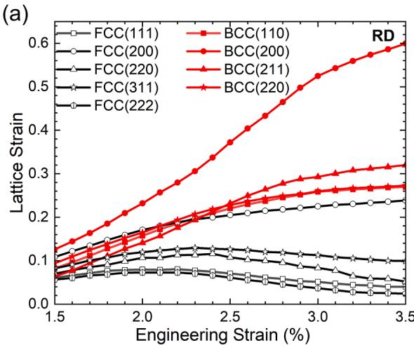

(b)  
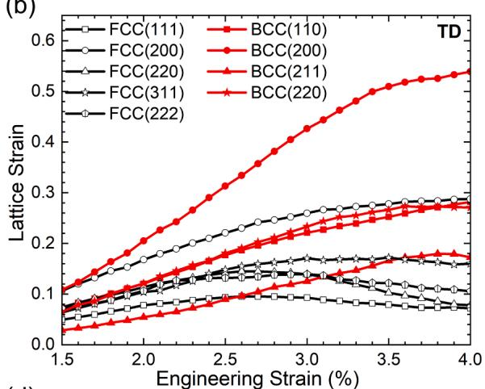

(c)  
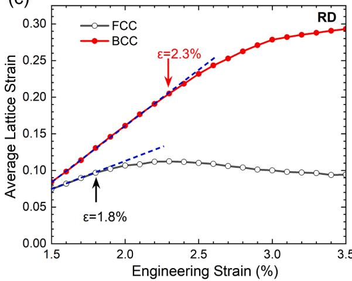

(d)  
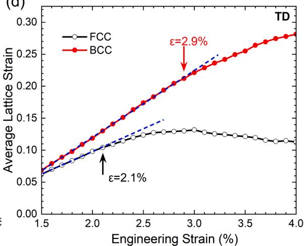  
Fig. 13. Lattice strain of individual lattice planes as a function of applied engineering strain in the (a) RD and (b) TD samples; The weighted average lattice strains for the FCC and BCC phases of (c) RD and (d) TD samples (arrows indicate the starting point at which the curve deviates from linearity).

The μ-DIC results presented in Section 3.4 suggest that δ-ferrite carries a higher plastic strain than the UFG γ+α aggregates for the TD sample, despite the fact that austenite is an intrinsically softer phase. To understand this, we measure the Vickers hardness of the two regions (γ+α aggregates and δ-ferrite). The results show that the UFG γ+α region exhibits a higher hardness (221±3.0 HV) compared with the δ-ferrite (205±1.5 HV). These results suggest that although austenite is the phase that yields first, its aggregated microstructure with α-ferrite appears to be overall stronger than δ-ferrite, which should be due to the ultrafine grain size within the γ+α regions as well as the high density of phase boundaries that serve to block dislocations. Therefore, it becomes possible that δ-ferrite is more plastically deformed when the sample is loaded under certain orientations. The remaining question is thus why the δ-ferrite phase and γ+α aggregates show different strain partitioning spectrums under different loading directions (TD and RD). We attribute this difference to the varying orientation of the layered microstructure relative to the loading direction. More specifically, when the layered structure is aligned in parallel with the loading direction (RD sample), the two microstructure constitutes (δ-ferrite and γ+α aggregates) are more likely to be deformed in an iso-strain condition, based on plastic deformation theories of composite materials [86]. In contrast, for the TD sample where the layer direction is perpendicular to the loading direc tion, an iso-stress deformation condition is more prevailed [86]. In such a scenario, strain partitioning will naturally occur between δ-ferrite and γ+α aggregates, and more strains will be concentrated into the softer region (i.e., the δ-ferrite phase).

## 4.2. Influence of heterogeneous strain distribution on martensite formation

Previous studies mainly concentrated on the influence of intrinsic characteristics of metastable austenite (e.g., composition, SFE, grain size, and morphology) on the kinetics of deformation-induced martensite transformation [27,28,87,88]. Here in this work, we demonstrate that the studied medium Mn lightweight steel with a banded microstructure exhibits significantly different kinetics of strain-induced martensite under different loading directions. More specifically, the RD sample demonstrates a higher martensite trans formation kinetics compared with the TD sample (Fig. 8(b)), which is the major reason resulting in the higher strain-hardening ability observed in this sample. Hu et al. [89] also discovered that the more pronounced TRIP effect of residual austenite can contribute a sustained work hardening rate up to high strain. Results in Section 3.4 have shown that the plastic strain concentrated in the austenite phase for the RD sample is higher than that for the TD sample by a factor of \~1.15 (Fig. 12 (c) and (d)). This difference is primarily due to the different strain partitioning behavior between the banded δ-phase and the γ+α aggre gates, which is dependent on the loading direction and the associated iso-strain or iso-stress conditions. Taking the different strain concen tration within austenite into account, the martensite transformation kinetics of the RD sample can be calculated based on the behavior of the TD sample and the Olson-Cohen (OC) model [61], which is depicted as follows:

$$
F _ {m} = F _ {\gamma_ {0}} \times \left\{1 - e x p [ - \beta [ 1 - e x p (- \alpha \varepsilon) ] ^ {n} ] \right\}\tag{4}
$$

Here, the constants $\alpha , \beta$ and n are closely related to the shear band formation rate and the SFE of austenite, and $F _ { \gamma O }$ is the initial austenite fraction (46.5 vol.%). The parameters used in the OC model equations are summarized in Table 1. It is assumed that martensite nucleation occurs randomly, with a value of n=2 [61]. We first apply the OC model to the TD sample (the plastic strain is $\varepsilon _ { T D } )$ . Subsequently, the fitting parameters obtained from the TD sample are utilized to fit the RD sample, where the plastic strain of austenite is taken as $\varepsilon _ { R D } = 1 . 1 5 \varepsilon _ { T D }$ (determined by comparing the micro-DIC data, Fig. 12(c) and (d)). Fig. 14 illustrates the accuracy of the OC model in predicting the martensite fraction, as compared with the HEXRD experimental data. This observation suggests that loading direction-dependent strain dis tribution plays a key role in the kinetics of strain-induced martensite transformation.

From the microscopic perspective, different phases and microstruc ture constituents (e.g., austenite, ferrite, and martensite) have different intrinsic properties, such as strength and strain-hardening capability. These differences lead to their different mechanical response upon me chanical loading, resulting in complex stress/strain redistribution pat terns among them. Particularly, the mechanical contrast among different phases and the resulting strain incompatibility will result in an increase of GNDs at the phase boundary regions (as observed in Fig. 5 (e)). This can be supported by the work of Hu et al. [90], who also found that a heterogeneous distribution of hardness in a stainless steel with a dual-phase heterogeneous lamellar structure can lead to a higher amount of GNDs. For the RD sample, the δ-ferrite phase and UFG α-γ aggregates are deformed to the same level to comply with the iso-strain condition. In order to maintain this condition, a high density of GNDs has to be produced to accommodate the difference in the hardness and stiffness between the two microstructure constituents. Additionally, strain concentrations are present at the phase boundary between the δ-ferrite phase and UFG α-γ aggregate region, analogous to those observed in composite materials [91,92]. This can be well supported by our μ-DIC data (as observed in Fig. 15). The higher amount of GNDs and the associated stress concentrations at the phase boundary regions provide more nucleation sites as well as increases the local driving force for martensite formation, which could be another reason accounting for the higher martensite transformation kinetics observed in the RD sample.

The above findings and discussions reveal an anisotropy behavior in terms of martensite transformation and strain hardening ability of banded medium-Mn lightweight steel, which is due to the distinctly different strain partitioning developed upon loading at different di rections. This anisotropic behavior is anticipated to influence the ma terials’ formability under multi-axial loading conditions, which will require future studies and needs to be considered for future development of this type of steels or other AHSSs with a similar microstructure.

## 5. Conclusions

In conclusion, we utilized in-situ synchrotron HEXRD and high resolution μ-DIC techniques to investigate the deformation behavior of a medium-Mn lightweight steel with a banded microstructure consisting of δ-ferrite and UFG α+γ aggregates. Particular focuses were placed on the deformation anisotropy behavior of the steel, and the following conclusions can be drawn:

Table 1  
Summary of parameters of the OC model in different tensile directions.

<table><tr><td>Sample</td><td>α</td><td>β</td><td>n</td></tr><tr><td>RD/TD</td><td>1.35</td><td>2</td><td>2</td></tr></table>

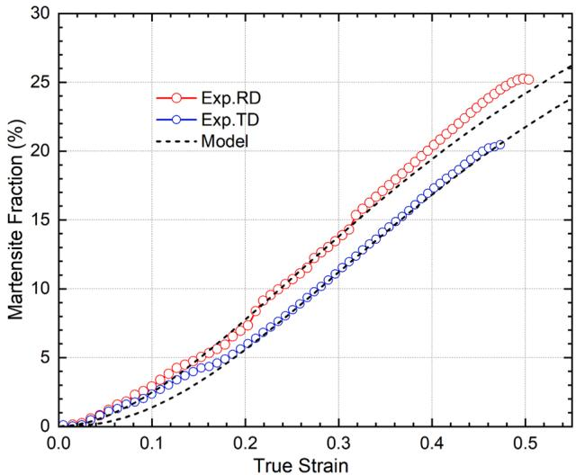  
Fig. 14. Deformation induced martensitic transformation kinetics of steel in two tensile directions (dashed lines are fitted curves based on the OC model).

1) The steel samples that were deformed along the rolling direction (parallel to the banding direction) exhibited a higher tensile strength and ductility compared with those stretched in the transverse di rection. This difference was due to the different strain-hardening capabilities between the RD and TD samples. In-situ synchrotron HEXRD experiments revealed a faster kinetics of strain-induced α’-martensite and a higher dislocation density within the austenite phase for the RD sample, which can explain its higher strainhardening rate.

2) A complex strain distribution behavior among austenite, α-ferrite and δ-ferrite was observed by μ-DIC experiments. Within the UFG α+γ region, both samples showed a heterogenous strain distribution and more strain was concentrated in the softer austenite phase compared with α-ferrite. The two samples showed markedly different strain partitioning behavior between δ-ferrite and UFG γ + α ag gregates. For the RD sample, the two regions exhibit similar defor mation levels, whereas the TD sample showed a more pronounced strain partitioning between these two banded regions with a higher strain concentrated in the δ-ferrite phase. This resulted in an overall higher local strain within the austenite phase for the RD sample, which was the main factor accounting for the higher kinetics of strain-induced α’-martensite formation and thus higher strain hard ening in this sample.

3) The difference in the strain partitioning behavior was due to the varying orientation of the layered microstructure relative to the loading direction. When the layered structure is aligned in parallel with the loading direction (RD sample), the two microstructure constituents (δ-ferrite and γ+α aggregates) are more likely to be deformed in an iso-strain condition. In contrast. in the TD sample where the layer direction is perpendicular to the loading direction, an iso-stress deformation condition is more prevalent. Such depen dence of stress/strain state on the loading direction and its associated influence on martensite transformation kinetics must be considered for the design of similar alloys, particularly for improving forming properties.

## CRediT authorship contribution statement

Shuanghong Lei: Writing – original draft, Validation, Methodology,

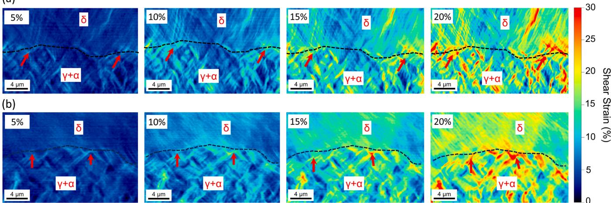  
Fig. 15. Local strain distribution close to the phase boundary of δ-ferrite and UFG γ+α aggregates of the RD sample: (a) Representative region 1 and (b) Repre sentative region 2.

Investigation, Formal analysis, Data curation. Binhan Sun: Writing – review & editing, Writing – original draft, Supervision, Resources, Project administration, Investigation, Funding acquisition, Conceptual ization. Yu Xuan: Software, Data curation. Ran Tian: Visualization, Software. Yan Ma: Writing – review & editing, Methodology, Data curation. Mohamed Naguib Elkot: Writing – review & editing, Meth odology. Huijie Cheng: Writing – review & editing, Formal analysis. Ning Yao: Writing – review & editing, Formal analysis. Tiwen Lu: Writing – review & editing. Jianping Tan: Writing – review & editing. Zhenbo Zhang: Formal analysis, Investigation, Writing – review & editing. Xian-Cheng Zhang: Investigation, Supervision, Resources. Shan-Tung Tu: Supervision, Resources, Writing – review & editing.

## Declaration of competing interest

The authors declare that they have no known competing financial interests or personal relationships that could have appeared to influence the work reported in this paper.

## Acknowledgments

This work was financially supported by the National Key Research and Development Project (No. 2023YFB3712103), National Natural Science Foundation of China (Grant No. 52275147, 52075174), Key Research and Development Program of Shandong Province (No. 2024CXPT064) and Shanghai Gaofeng Project for University Academic Program Development. We acknowledge DESY (Hamburg, Germany), a member of the Helmholtz Association HGF, for the provision of exper imental facilities. Parts of this research were carried out at the P02.1 Powder Diffraction and Total Scattering Beamline and we would like to thank Dr. Alexander Schokel ¨ for assistance in HEXR The influence of silicon additions on the deformation behavior of austenite-ferrite duplex medium manganese steelsD experiments. Beamtime was allocated for proposal I-20191072.

## Supplementary materials

Supplementary material associated with this article can be found, in the online version, at doi:10.1016/j.actamat.2025.121060.

## References

[1] Y. Ma, Medium-manganese steels processed by austenite-reverted-transformation annealing for automotive applications, Mater. Sci. Technol. 33 (15) (2017)

[2] R.L. Miller, Ultrafine-grained microstructures and mechanical properties of alloy steels, Metall, Trans, 3 (4) (1972) 905–912

[3] H. Kim, D.W. Suh, N.J. Kim, Fe-Al-Mn-C lightweight structural alloys: a review on the microstructures and mechanical properties, Sci. Technol. Ady. Mater. 14 (1) (2013) 014205

[4] G. Frommever, U. Brüx, Microstructures and Mechanical Properties of High-Strength Fe-Mn-Al-C Light-Weight TRIPLEX Steels, Steel Res. Int. 77 (9–10) (2006) 627-633.

[5] S. Lee, B.C. De Cooman, On the selection of the optimal intercritical annealing temperature for medium Mn TRIP steel, Metall. Mater. Trans. A 44 (11) (2013) 5018-5024.

[6] S. Lee, B.C. De Cooman, Annealing Temperature dependence of the tensile behavior of 10 pct Mn Multi-phase TWIP-TRIP steel, Metall. Mater. Trans. A 45 (13) (2014) 6039–6052.

[7] S. Lee, S.J. Lee, S. Santhosh Kumar, K. Lee, B.C.D. Cooman, Localized deformation in multiphase, ultra-fine-grained 6 Pct Mn transformation-induced plasticity steel, Metall. Mater. Trans. A 42 (12) (2011) 3638–3651.

[8] J. Han, A.K. da Silva, D. Ponge, D. Raabe, S.M. Lee, Y.K. Lee, S.I. Lee, B. Hwang, The effects of prior austenite grain boundaries and microstructural morphology on the impact toughness of intercritically annealed medium Mn steel, Acta Mater. 122 (2017) 199–206.

[9] A. Sarkar, S. Sanyal, T.K. Bandyopadhyay, S. Mandal, Enhanced strength-ductility relationship in a medium Mn high Al-alloyed multicomponent steel through thermomechanical processing, Mater. Sci. Eng. A 703 (2017) 205–213.

[10] B. Sun, W. Krieger, M. Rohwerder, D. Ponge, D. Raabe, Dependence of hydrogen embrittlement mechanisms on microstructure-driven hydrogen distribution in medium Mn steels. Acta Mater, 183 (2020) 313–328.

[11] Y.U. Heo, Y.Y. Song, S.J. Park, H.K.D.H. Bhadeshia, D.-W. Suh, Influence of silicon

[12] Q. Tonizzo, A.-F. Gourgues-Lorenzon, M. Mazi\`ere, A. Perlade, I. Zuazo, Microstructure, plastic flow and fracture behavior of ferrite-austenite duplex low

[13] B. Sun, D. Palanisamy, D. Ponge. B. Gault. F. Fazeli, C. Scott, S. Yue, D. Raabe. Revealing fracture mechanisms of medium manganese steels with and without delta-ferrite. Acta Mater. 164 (2019) 683–696

[14] G. Azizi, B.G. Thomas, M. Asle Zaeem, Review of peritectic solidification mechanisms and effects in steel casting, Metall. Mater. Trans. B 51 (2020) 1875-1903.

[15] D.W. Suh, J.H. Ryu, M.S. Joo, H.S. Yang, K. Lee, H.K.D.H. Bhadeshia, Mediumalloy manganese-rich transformation-induced plasticity steels, Metall. Mater

[16] B. Sun, F. Fazeli, C. Scott, N. Brodusch, R. Gauvin, S. Yue, The influence of silicon additions on the deformation behavior of austenite-ferrite duplex medium manganese steels, Acta Mater. 148 (2018) 249–262.

[17] S. Lee, S. Shin, M. Kwon, K. Lee, B.C. De Cooman, Tensile properties of medium Mn steel with a bimodal UFG α+ x and coarse δ-ferrite microstructure Metall. Mater Trans, A 48 (2017) 1678–1700

[18] J. Liu, C. Chen, Q. Feng, X. Fang, H. Wang, F. Liu, J. Lu, D. Raabe, Dislocatio activities at the martensite phase transformation interface in metastable austenitic stainless steel: An in-situ TEM study, Mater. Sci. Eng. A 703 (2017) 236–243.

[19] B. Sun, W. Lu, B. Gault, R. Ding, S.K. Makineni, D. Wan, C.H. Wu, H. Chen, D. Ponge, D. Raabe, Chemical heterogeneity enhances hydrogen resistance in high strength steels, Nat. Mater. 20 (12) (2021) 1629–1634.

[20] X. Wang, C. Liu, B. Sun, D. Ponge, C. Jiang, D. Raabe, The dual role of martensitic transformation in fatigue crack growth, Proceed. Nat. Acad. Sci. 119 (9) (2022) e2110139119.

[21] O. Bouaziz, S. Allain, C. Scott, Effect of grain and twin boundaries on the hardening mechanisms of twinning-induced plasticity steels. Scr., Mater. 58 (6) (2008 484-487

[22] I. Gutierrez-Urrutia, D. Raabe, Dislocation and twin substructure evolution during strain hardening of an Fe–22wt.% Mn–0.6wt.% C TWIP steel observed by electron channeling contrast imaging, Acta Mater. 59 (16) (2011) 6449–6462.

[23] Y. Zhang, C. He, Q. Yu, X. Li, X. Wang, Y. Zhang, J. Wang, C. Jiang, Y. Jia, X. C. Zhang, Nacre-like surface nanolaminates enhance fatigue resistance of pure titanium, Nat. Commun. 15 (1) (2024) 6917.

[24] S.K. Oh, M.E. Kilic, J.B. Seol, J.S. Hong, A. Soon, Y.K. Lee, The mechanism of dynamic strain aging for type A serrations in tensile flow curves of Fe-18Mn-0.55C (wt.%) twinning-induced plasticity steel, Acta Mater. 188 (2020) 366–375.

[25] M.F. Ashby, Work hardening of dispersion-hardened crystals, Philosophical Magazine. 14 (132) (1966) 1157–1178.

[26] T. Dieudonn´e, L. Marchetti, M. Wery, F. Miserque, M. Tabarant, J. Chˆene, C. Allely, P. Cugy, C.P. Scott, Role of copper and aluminum on the corrosion behavior of austenitic Fe–Mn–C TWIP steels in aqueous solutions and the related hydrogen absorption, Corros. Sci. 83 (2014) 234–244.

[27] D.W. Suh, S.J. Park, T.H. Lee, C.S. Oh, S.J. Kim, Influence of Al on the microstructural evolution and mechanical behavior of low-carbon, manganese transformation-induced-plasticity steel, Metall. Mater. Trans. A 41 (2) (2010) 397-408.

[28] T. Furukawa, H. Huang, O. Matsumura, Effects of carbon content on mechanical properties of 5% Mn steels exhibiting transformation induced plasticity, Mater. Sci. Technol. 10 (11) (1994) 964–970.

[29] B.C. De Cooman, S.J. Lee, S. Shin, E.J. Seo, J.G. Speer, Combined intercritical annealing and Q&P processing of medium Mn steel, Metall. Mater. Trans. A 48 (1) (2017) 39–45.

[30] H. Luo, J. Shi, C. Wang, W. Cao, X. Sun, H. Dong, Experimental and numerical analysis on formation of stable austenite during the intercritical annealing of 5Mn steel, Acta Mater. 59 (10) (2011) 4002–4014.

[31] D.P. Yang, P.J. Du, D. Wu, H.L. Yi, The microstructure evolution and tensile properties of medium-Mn steel heat-treated by a two-step annealing process, J. Mater, Sci, Technol, 75 (2021) 205–215

[32] J.J. Moverare, M. Od´en, Influence of elastic and plastic anisotropy on the flow behavior in a duplex stainless steel, Metall. Mater. Trans. A 33 (1) (2002) 57–71.

[33] J.i. Hamada, E. Ishimaru, H. Inoue, Texture and planar anisotropy in lean duplex stainless steel sheet, ISIJ International. 56 (10) (2016) 1831–1839.

[34] M. Madivala, A. Schwedt, U. Prahl, W. Bleck, Anisotropy and strain rate effects on the failure behavior of TWIP steel: a multiscale experimental study, Inter. J. Plasticity. 115 (2019) 178–199.

[35] S.C. Chen, C.Y. Huang, Y.T. Wang, C.Y. Huang, H.W. Yen, Role of the crystallographic texture in anisotropic mechanical properties of a newly-developed hot-rolled TRIP steel, Mater. Sci. Eng. A 790 (2020) 139683

[36] A. Ameri, Z. Ouadir, M. Ashraf, J. Escobedo-Diaz, Effects of load partitioning and texture on the plastic anisotropy of duplex stainless steel allovs under quasi-static loading conditions, Mater. Sci. Eng, A 752 (2019) 24–35.

[37] S. Hao. L. Chen. Y. Wang, W. Zhang, J. She. M. Jin. Influence of loading direction on tensile deformation behavior of a lean duplex stainless steel sheet: The role of martensitic transformation. Mater. Sci. Eng, A 848 (2022) 143384

[38] S. Papula, S. Anttila, J. Talonen, T. Sarikka, I. Virkkunen, H. H¨anninen, Strain hardening of cold-rolled lean-alloved metastable ferritic-austenitic stainless steels.

[39] W. Hutchinson, K. Ushioda, G. Runnsjo, ¨ Technology, anisotropy of tensile behaviour in a duplex stainless steel sheet, Mater. Sci. Technol. 1 (9) (1985) 728–736.

[40] S. Chen, R. Rana, A. Haldar, R.K. Ray, Current state of Fe-Mn-Al-C low density steels, Progress Mater. Sci. 89 (2017) 345–391.

[41] A.C. Dippel, H.-P. Liermann, J.T. Delitz, P. Walter, H. Schulte-Schrepping, O. H. Seeck, H.J. Franz, Beamline P02, 1 at PETRA III for high-resolution and highenergy powder diffraction,, J. Synchrotron Radiat. 22 (3) (2015) 675–687.

[42] A.J. Hammersley, FIT2D: a multi-purpose data reduction, analysis and visualization program. Applied Crystallography. 49 (2) (2016) 646–652.

[43] L. Lutterotti, S. Matthies, H. Wenk, MAUD: a friendly Java program for material analysis using diffraction,, CPD Newsletter. 21 (1999) 14–15.

[44] K. Yan, K.D. Liss, I.B. Timokhina, E.V. Pereloma, In situ synchrotron X-ra diffraction studies of the effect of microstructure on tensile behavior and retained austenite stability of thermo-mechanically processed transformation induced plasticity steel, Mater. Sci. Eng. A 662 (2016) 185–197.

[45] P.J. Gibbs, B. De Cooman, D.W. Brown, B. Clausen, J.G. Schroth, M.J. Merwin, D. K. Matlock. Strain partitioning in ultra-fine grained medium-manganese transformation induced plasticity steel, Mater, Sci, Eng, A 609 (2014) 323–333

[46] Y. Ma, W. Song, W. Bleck, Investigation of the microstructure evolution in a Fe-17Mn-1.5 Al-0.3 C steel via in situ synchrotron X-ray diffraction during a tensile test. Materials, 10 (10) (2017) 1129

[47] Z. Zhang, Z. Yang, S. Lu, A. Harte, R. Morana, M. Preuss, Strain localisation and failure at twin-boundary complexions in nickel-based superalloys., Nature Commun, 11 (1) (2020) 4890.

[48] X. Li, Z. Zhai, W. Lin, Y. Ou, Y. Wu, R. Yang, Z. Zhang, Precipitate mediated plasticity at twin boundary in Nickel-based superalloy, Materialia. 26 (2022) 101612.

[49] Y. Xuan, J. Chang, Y. Ou, R. Yang, Z. Zhang, Heterogeneous structure architected by additive manufacturing: facile route towards strong and ductile steel. Mater Res. Lett, 12 (3) (2024) 199–207.

[50] B. Sun, H. Avdin, F. Fazeli, S. Yue, Microstructure evolution of a medium manganese steel during thermomechanical processing, Metall. Mater. Trans. A 47 (2016).1782-1791

[51] B. Sun, F. Fazeli, C. Scott, S. Yue, Phase transformation behavior of medium manganese steels with 3 wt pct aluminum and 3 wt pct silicon during intercritical annealing, Metall. Mater. Trans. A 47 (2016) 4869–4882.

[52] B. Sun, A. Kwiatkowski da Silva, Y. Wu, Y. Ma, H. Chen, C. Scott, D. Ponge, D. Raabe, Physical metallurgy of medium-Mn advanced high-strength steels, Inter. Mater, Rev, 68 (7) (2023) 786–824

[53] C. Herrera, D. Ponge, D. Raabe, Design of a novel Mn-based 1GPa duplex stainless TRIP steel with 60% ductility by a reduction of austenite stability. Acta Mater. 59 (11) (2011) 4653–4664.

[54] J.Y. Kang, S.J. Park, M.B. Moon, Phase analysis on dual-phase steel using band slope of electron backscatter diffraction pattern, Microscopy and Microanalysis. 19 (s5) (2013) 13–16.

[55] Y. Wang, J. Hua, M. Kong, Y. Zeng, J. Liu, Z. Liu, Quantitative analysis of martensite and bainite microstructures using electron backscatter diffraction, Microscopy Research and Technique. 76 (9) (2016) 814–819.

[56] A. Kundu, D.P. Field, P.C. Chakraborti, Effect of strain and strain rate on the development of deformation heterogeneity during tensile deformation of a solution annealed 304 LN austenitic stainless steel: an EBSD study, Mater. Sci. Eng. A 773 (2020) 138854.

[57] B. Sun, Y. Ma, N. Vanderesse, R.S. Varanasi, W. Song, P. Bocher, D. Ponge, D. Raabe, Macroscopic to nanoscopic in situ investigation on yielding mechanisms in ultrafine grained medium Mn steels: role of the austenite-ferrite interface, Acta Mater. 178 (2019) 10–25.

[58] B. Sun, F. Fazeli, C. Scott, B. Guo, C. Aranas Jr, X. Chu, M. Jahazi, S. Yue, Microstructural characteristics and tensile behavior of medium manganese steel with different manganese additions, Mater. Sci. Eng. A 729 (2018) 496–507.

[59] T. Bieler, P. Eisenlohr, C. Zhang, H. Phukan, M. Crimp, Grain boundaries and interfaces in slip transfer, Current Opinion in Solid State Mater. Sci. 18 (4) (2014) 212–226.

[60] L. Capolungo, D. Spearot, M. Cherkaoui, D. McDowell, J. Qu, K. Jacob, Dislocation nucleation from bicrystal interfaces and grain boundary ledges: Relationship to nanocrystalline deformation, J. Mech, Phys, Solids. 55 (11) (2007) 2300–2327

[61] G.B. Olson, M. Cohen, Kinetics of strain-induced martensitic nucleation, Metallurgical transactions, A 6 (1975) 791–795.

[62] P. Cizek, B.P. Wynne, A mechanism of ferrite softening in a duplex stainless stee deformed in hot torsion, Mater. Sci. Eng, A 230 (1–2) (1997) 88–94.

[63] D.T. Pierce, J.A. Jim´enez, J. Bentley, D. Raabe, J.E. Wittig, The influence of stacking fault energy on the microstructural and strain-hardening evolution of Fe–Mn–Al–Si steels during tensile deformation, Acta Mater. 100 (2015) 178–190.

[64] M. Zhang, L. Li, J. Ding, Q. Wu, Y.D. Wang, J. Almer, F. Guo, Y. Ren, Temperaturedependent micromechanical behavior of medium-Mn transformation-inducedplasticity steel studied by in situ synchrotron X-ray diffraction. Acta Mater. 141 (2017) 294–303.

[65] N. Jia. Z. Cong, X. Sun, S. Cheng, Z, Nie. Y. Ren. P. Liaw. Y. Wang, An in situ highenergy X-ray diffraction study of micromechanical behavior of multiple phases in advanced high-strength steels, Acta Mater 57 (13) (2009) 3965–3977

[66] T. Ungar, ´ A. Borb´ely, The effect of dislocation contrast on x-ray line broadening: A new approach to line profile analysis, Applied Physics Letters. 69 (21) (1996) 3173–3175.

[67] T. Ungár, S. Ott. P.G. Sanders, A. Borbély, J.R. Weertman, Dislocations, grain size and planar faults in nanostructured copper determined by high resolution X-ray diffraction and a new procedure of peak profile analysis, Acta Mater. 46 (10) (1998) 3693–3699.

[68] M. Wilkens, Fundamental Aspects of Dislocation Theory, Vol, II. edited by JA Simmons, R. de Wit R. Bullough. Natl Bur. Stand. US Spec. Publ. 317 (1970) 1195- 1221.

[69] H.J. Frost, M.F. Ashby, Deformation-mechanism maps: the plasticity and creep of metals and ceramics, (No Title) (1982)

[70] T. Ung´ar, I. Dragomir, A. ´ R´ev´esz, A. Borb´ely, The contrast factors of dislocations in cubic crystals: the dislocation model of strain anisotropy in practice, Applied Crystallography. 32 (5) (1999) 992–1002.

[71] T. Ung´ar, S. Ott, P. Sanders, A. Borb´ely, J. Weertman, Dislocations, grain size and planar faults in nanostructured copper determined by high resolution X-ray diffraction and a new procedure of peak profile analysis Acta Mater. 46 (10) (1998) 3693–3699.

[72] G. Miyamoto, A. Shibata, T. Maki, T. Furuhara, Precise measurement of strain accommodation in austenite matrix surrounding martensite in ferrous alloys by electron backscatter diffraction analysis. Acta Mater. 57 (4) (2009) 1120–1131.

[73] B. Ennis, E. Jimenez-Melero, E. Atzema, M. Krugla, M. Azeem, D. Rowley, D. Daisenberger, D. Hanlon, P. Lee, Metastable austenite driven work-hardening behaviour in a TRIP-assisted dual phase steel. International Journal of Plasticity 88 (2017) 126–139

[74] M.M. Wang, C.C. Tasan, D. Ponge, A.C. Dippel, D. Raabe, Nanolaminate transformation-induced plasticity–twinning-induced plasticity steel with dynamic strain partitioning and enhanced damage resistance, Acta Mater. 85 (2015) 216–228.

[75] S. Harjo, N. Tsuchida, J. Abe, W. Gong, Martensite phase stress and the strengthening mechanism in TRIP steel by neutron diffraction, Scientific reports. 7 (1) (2017) 15149.

[76] O. Bouaziz, S. Allain, C. Scott, Effect of grain and twin boundaries on the hardening mechanisms of twinning-induced plasticity steels, Scripta Materialia. 58 (6) (2008) 484-487.

[77] J. Moyer, G. Ansell, The volume expansion accompanying the martensite transformation in iron-carbon alloys. Metall. Mater. Trans. A 6 (1975) 1785–1791

[78] P. Jacques, Q. Furn´emont, A. Mertens, F. Delannay, On the sources of work hardening in multiphase steels assisted by transformation-induced plasticity, Philosophical Magazine A 81 (7) (2001) 1789–1812.

[79] A. Ameri, Z. Quadir, M. Ashraf, C. Logos, J. Escobedo-Diaz, Effects of load partitioning and texture on the plastic anisotropy of duplex stainless steel alloys under quasi-static loading conditions, Mater. Sci. Eng. A 752 (2019) 24–35.

[80] Y. Ma, B. Sun, A. Schokel, ¨ W. Song, D. Ponge, D. Raabe, W. Bleck, Phase boundary segregation-induced strengthening and discontinuous yielding in ultrafine-grained duplex medium-Mn steels, Acta Mater. 200 (2020) 389–403.

[81] M. Koyama, T. Yamashita, S. Morooka, T. Sawaguchi, Z. Yang, T. Hojo, T. Kawasaki, S. Harjo, Microstructure and plasticity evolution during Lüders deformation in an Fe-5Mn-0.1 C medium-Mn steel, ISIJ International. 62 (10) (2022) 2036–2042.

[82] B. Sun, F. Fazeli, C. Scott, X. Yan, Z. Liu, X. Qin, S. Yue, Critical role of strain partitioning and deformation twinning on cracking phenomenon occurring during cold rolling of two duplex medium manganese steels, Scripta Materialia. 130 (2017) 49–53.

[83] B. He, Z. Liang, M. Huang, Nanoindentation investigation on the initiation of yield point phenomenon in a medium Mn steel, Scripta Materialia. 150 (2018) 134–138.

[84] X. Wang, C. Liu, B. He, C. Jiang, M. Huang, Microscopic strain partitioning in Lüders band of an ultrafine-grained medium Mn steel, Mater. Sci. Eng. A 761 (2019) 138050.

[85] R. Shi, Z. Nie, Q. Fan, G. Li, Compounds Elastic plastic deformation of TC6 titanium alloy analyzed by in-situ synchrotron based X-ray diffraction and microstructure

based finite element modeling, Journal of Alloys and Compounds 688 (2016) 787–795.

[86] S.K. Paul, Design, Real microstructure based micromechanical model to simulate microstructural level deformation behavior and failure initiation in DP 590 steel, Materials & Design, 44 (2013) 397–406

[87] A. Dutta, D. Ponge, S. Sandlobes, ¨ D. Raabe, Strain partitioning and strain localization in medium manganese steels measured by in situ microscopic digita image correlation, Materialia. 5 (2019) 100252.

[88] M. Zhang, H. Chen, Y. Wang, S. Wang, R. Li, S. Li, Y.D. Wang, , Deformation induced martensitic transformation kinetics and correlative micromechanical behavior of medium-Mn transformation-induced plasticity steel, Journal of Materials Science & Technology. 35 (8) (2019) 1779–1786.

[89] J. Hu, X. Li, Q. Meng, L. Wang, Y. Li, W. Xu, Tailoring retained austenite and mechanical property improvement in Al–Si–V containing medium Mn steel via direct intercritical rolling, Mater. Sci. Eng. A 855 (2022) 143904.

[90] J. Hu, X. Li, Z. Zhang, L. Wang, Y. Li, W. Xu, Overcoming the strength-ductility trade-off in metastable dual-phase heterogeneous structures using variable temperature rolling and annealing, Materials Research Letters. 11 (8) (2023) 648-654.

[91] M. Huang, C. Xu, G. Fan, E. Maawad, W. Gan, L. Geng, F. Lin, G. Tang, H. Wu, Y. Du. Role of lavered structure in ductility improvement of lavered Ti-Al metal composite, Acta Mater. 153 (2018) 235–249.

[92] H. Ji, C. Ren, Y. Wang, Y. Guo, X. Zhang, H. Wang, Y. Zhu, The evolution of strain pattern induced by banded structure under uniaxial tension in low-carbon microalloyed steel, Mater. Sci. Eng. A 748 (2019) 253–261.