FULL LENGTH ARTICLE

# Strong yet ductile low-density steel via multiphase heterogeneous microstructure

Jiahe YAN a,b, Zhinan YANG a,b, Jinliang DU c, Yunli FENG a,b,\*, Minghe ZHANG a,b, Xiaoyong FENG a,b, Fucheng ZHANG a,b

a Key Laboratory of Modern Metallurgical Technology of Ministry of Education, North China University of Science and Technology, Tangshan 063210, China

b College of Metallurgy and Energy, North China University of Science and Technology, Tangshan 063210, China

c Institute of Materials Research and Engineering, Agency for Science Technology and Research, Singapore 138634, Republic of Singapore

Received 22 November 2024; revised 21 January 2025; accepted 24 February 2025 Available online 4 September 2025

## KEYWORDS

Constitutive model; Low-density steel; Multiphase heterogeneous microstructure; Strength and ductility; Stress concentration relieving

Abstract Under equivalent stiffness conditions, material substitution based on a thin-walled design is crucial for the lightweight of components. Developing high-performance steels with both high-yield strength and excellent ductility has become a key focus in fields like aerospace and low altitude flight. The novel low-density steel presented here exhibits a yield strength of 1 000 MPa, which is 2–3 times higher than conventional low-alloy high-strength steels, while maintaining an elongation of about 18.7%. By combining ex-situ experimental characterization with a phase mechanical response model based on the iso-work theory and the von Mises equivalent method, the role of heterogeneous deformation-induced strengthening was revealed. The calculated values align closely with experimental results. This exceptional performance is attributed to a multiphase heterogeneous microstructure, where fresh martensite, bainite/tempered martensite, and deformation-induced martensite act as hard regions. These regions release micro-stresses through inhomogeneous cooperative deformation with soft ferrite, enabling multiple plastic deformation mechanisms and stress concentration relief. This research offers new insights into optimizing microstructures through mechanical metallurgy, which is crucial for producing high-performance, lightweight components.

© 2025 Published by Elsevier Ltd on behalf of Chinese Society of Aeronautics and Astronautics. This is an open access article under the CC BY-NC-ND license (http://creativecommons.org/licenses/by-nc-nd/4.0/).

## 1. Introduction

Energy conservation and emission reduction are essential responsibilities for modern industry and crucial pathways toward global sustainable development. Lightweight, one of the most effective strategies for achieving these goals, is partic ularly relevant in aerospace and low-altitude flight sectors, where the use of advanced high-strength steels has become a key trend. Studies show that reducing the total weight of airframes by 10% can enhance energy efficiency by 6%–8%.1,2 In this context, researchers are focused on developing thirdgeneration advanced high-strength steels, such as mediummanganese steels and Quenching & Partitioning (Q&P) steels, due to their exceptional strength-ductility balance.3,4 These materials have gained significant industrial attention for their potential to meet lightweight demands. The microstructure of Q&P steels typically consists of a martensitic matrix with a controlled amount of metastable austenite. The martensite provides high strength, while the metastable austenite enhances work-hardening capacity through the Transformation-Induced Plasticity (TRIP) effect during deformation. However, increasing the carbon content to improve strength compromises weldability, and raising the manganese content narrows the Q&P process window, making it harder to maintain product stability. These trade-offs complicate efforts to improve the comprehensive mechanical properties of Q&P steels. Medium-manganese steels (4wt%–12wt% Mn) feature a dual-phase microstructure of ferrite and metastable austenite, with a Product of Strength and Elongation (PSE) reaching up to 30–40 GPa %.5,6 However, the softer ferritic matrix leads to lower yield strength, and the high manganese content causes microsegregation in cast ingots. Additionally, martensite formation during hot rolling complicates the production of cold-rolled products, posing further challenges for industrial-scale manufacturing. A pressing challenge lies in developing a structural material substitution method that maintains strength and ductility while fulfilling the demands of lightweight applications.

Micro-defects that develop in structural materials during service can cause significant local stress concentrations, leading to catastrophic failures and substantial losses of life and property.7–10 Studies show that reducing weight by 100 kg in structures like aircraft fuselage skins, engine casings, carrier frames, and crash beams increases safety risks by 4%–6%.11 Therefore, it is imperative to develop new microstructural designs that effectively mitigate these harmful effects while meeting safety requirements and achieving lightweight construction. Under external stress, crystal defects and interfaces can form micropores, which subsequently expand and link into microcracks.12–14 The significant stress concentration at crack tips makes grain boundaries prone to tearing, gradually leading to macroscopic fractures.15,16 To address this issue, Xin et al.17 proposed introducing an appropriate number of grain boundaries to alleviate stress concentration-induced damage. While this method contributes to balancing material strength and ductility, it is not markedly effective in suppressing stress concentration and crack propagation. This indicates a need to shift from a single-plane strain fracture mode to a multipleplane stress fracture mode, where the formation of multiple microcracks can absorb substantial fracture energy. For instance, Huang et al.18 introduced high-density dislocations into martensite and combined them with weaker grain boundary interfaces to slow crack propagation, significantly enhancing the fracture toughness of the material. However, this strategy imposes excessively high demands on the dislocation storage capacity of material and is suitable primarily for situations involving sudden stress changes. Considering the load conditions, to address the issues of material substitution and lightweight in structural components during long-term service, it is especially important to start with the design of extensive dislocation interactions and accumulation.

Layered heterogeneous structures across multiple scales are widely recognized for effectively regulating dislocation behavior, which enhances plasticity and strengthens materials by impeding dislocation movement.19–23 This coupling effect is primarily due to Heterogeneous Deformation-Induced (HDI) strengthening, driven by interactions between adjacent strain fields during deformation.24 Accumulating Geometrically Necessary Dislocations (GNDs) at interfaces distributes local plastic strain more uniformly, reducing stress concentrations and improving strength and toughness.25–29 However, forming multiscale heterogeneous structures remains challenging in large-scale production. Leveraging key insights and following the principle of ‘material simplification’, we developed novel low-density steel that eliminates costly elements like Nb, Mo, and Ni, while slightly increasing Al and Mn content. By using mechanical-metallurgical methods that are easily applicable to actual production, a multi-level microstructure is introduced into this steel. The various mechanical responses promote the coupling of multiple strengthening mechanisms, forming strain gradients that effectively transmit stress and alleviate stress concentration. This material significantly outperforms conventional high-strength low-alloy steel by enhancing strength while maintaining good ductility, opening new avenues for lightweight structural design and innovative manufacturing of high-performance large components.

## 2. Experimental

## 2.1. Specimen preparation

A 39 kg low-density steel ingot, with the composition Fe-0.2 5C-3Mn-2Al-0.4Si-0.009S-0.009P, was produced via vacuum induction melting. The ingot was hot forged and cut into billets measuring 90 mm (length) 70 mm (width) 40 mm (thickness). These billets were heated to 1 200 °??C and held for 60 min. Hot rolling was carried out on a high-rigidity two-roll mill, beginning at $1 \ 1 0 0 \ { } ^ { \circ } \mathrm { C } .$ The process involved six passes with a cumulative reduction rate of 90%, yielding plates with a final thickness of 4 mm. Finish rolling was completed at 880 °??C, followed by air cooling. Cylindrical specimens (10 mm (length) 3 mm (diameter)) were extracted from the hot-rolled plates for phase transformation studies using dilatometry, with the critical temperature range illustrated in Fig. A1 in Appendix A. Cold rolling was performed on a four-roll reversible mill with a 60% reduction rate, resulting in plates with a thickness of 1.6 mm. The cold-rolled samples were annealed at 750, 800, 850 °??C for 30 min within the critical region and air-cooled to room temperature, labeled as AN750, AN800, and AN850, respectively. For further treatment, the samples underwent low bainite aging by holding at 400 °??C for 30 min, producing samples designated as AN750-T, AN800-T, and AN850-T. The full process flow is illustrated in Fig. 1(a).

## 2.2. Microstructure characterization

The phase composition and microstructure of the samples were analyzed using a field emission Scanning Electron Microscope (SEM) and Electron Backscatter Diffraction (EBSD) system (EBSD-FEI Quanta-650 FEG). A 4% nitric acid ethanol solution was used for etching, while the electrolyte for electropolishing consisted of 80% ethanol, 15% perchloric acid, and 5% glycerol. Electropolishing was conducted at 28 V and 0.1 A for 15–30 s. EBSD analysis was conducted with a 20 kV operating voltage and a scanning step size of 0.2 lm. The data was analyzed using TSL OIM 7.0, indexing both Body-Centered Cubic (BCC) and Face-Centered Cubic (FCC) phases. A minimum pixel size of 9 was applied to minimize the risk of mis-indexed pixels being mistaken for real grains.30 Dislocation and substructure evolution were examined with a Tecnai G2 F20 transmission Electron Microscope (TEM) at 200 kV. Elemental distribution within the microstructure was determined using a JEOL JXA-8230 Electron Probe Microanalyzer (EPMA) at 15 kV with a working current of $5 \times 1 0 ^ { - 8 }$ A. X-Ray Diffraction (XRD) was used to identify the phases in the microstructure. XRD phase analysis was performed on the rolling plane of the sample with an accelerating voltage of 40 kV, a tube current of 40 mA, and a scanning angle range of 30°??–110°??.

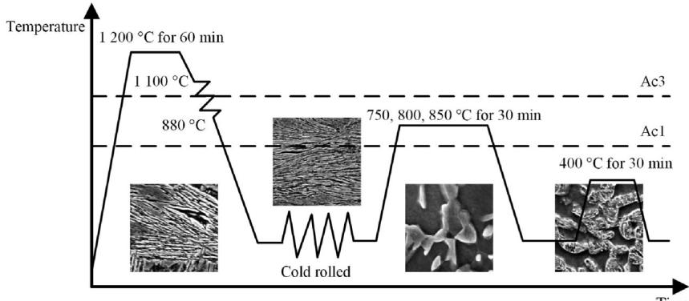  
(a) Preparation process and microstructure evolution of multiphase microstructure

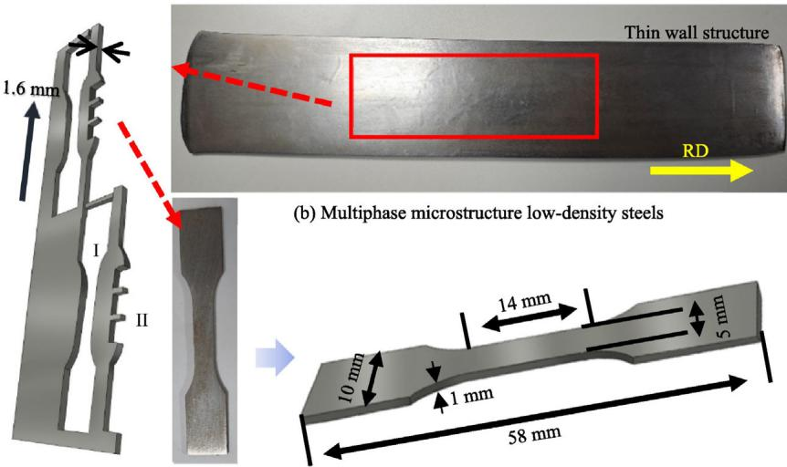  
(c) Sampling schematic of tensile ( I ) and microstructure (II ) specimens  
Fig. 1 Preparation process and sampling schematic.

## 2.3. Mechanical tests

Tensile specimens were prepared following the GB/T 228.1— 2021 standard by cutting along the rolling direction, with mgauge dimensions of 14 mm 5 mm 1 m (length width thickness), as shown in Fig. 1(b). Uniaxial tensile tests at room temperature were performed on an Instron 3382 testing machine, with the load applied parallel to the Rolling Direction (RD) at a strain rate of $5 \times 1 0 ^ { - 4 } \mathrm { ~ s ~ } ^ { - 1 }$ . Each experimental group included three specimens to ensure reproducibility. During tensile deformation, a Digital Image Correlation (DIC) system was employed to monitor the local strain distribution, capturing images every 2 s.

## 3. Results

Fig. 2 presents SEM photographs illustrating the evolution of multiphase microstructures during rolling and heat treatment. The hot-rolled microstructure primarily consists of Bainite (B) with a small amount of Fresh Martensite (FM). The phase distribution is shown in Fig. 3(a), consisting entirely of a BCC structure. After cold rolling, the bainite exhibits an elongated morphology aligned with the rolling direction and is interspersed with minor amounts of fresh martensite. During intercritical annealing, portions of the bainite and martensite reaustenitize due to the high solubility of carbon in austenite, which leads to carbon enrichment and enhanced stability within the austenite. Carbon-depleted regions form Ferrite (F), while some carbon-enriched austenite is retained during cooling, becoming Retained Austenite (RA). Unstabilized austenite undergoes a diffusionless transformation during cooling to form fresh martensite. Additionally, bainite forms during cooling in regions that are not fully austenitized. As depicted in Figs. 2(c)–(e), bainite distributes along ferrite grain boundaries, forming regions about 3 lm in size. Attached to the bainite are fresh martensite or islands comprising fresh martensite and retained austenite. Figs. 3(b)–(d) shows the phase distribution of AN750, AN800, and AN850. The inserted figures show the average grain size $( D _ { \mathrm { A V E } } )$ distribution of RA in each sample. As the annealing temperature increases, the RA content gradually decreases, with its distribution statistics presented in Fig. 3(e). XRD analysis further confirms this phenomenon (Fig. 3(f)).

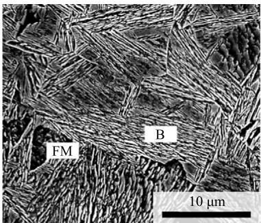  
(a) Hot Rolling (HR)

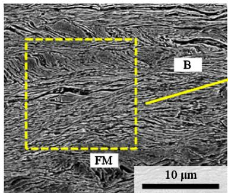

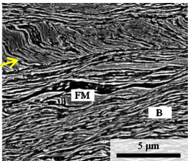  
(b) Cold rolling

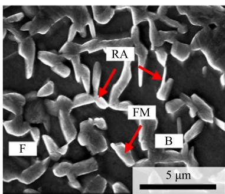  
(c) AN750

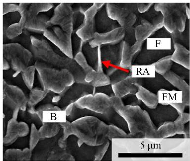  
(d) AN800

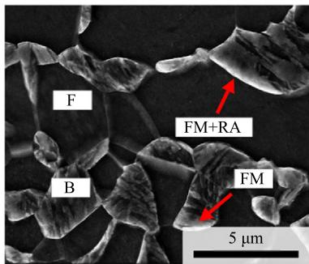  
(e) AN850

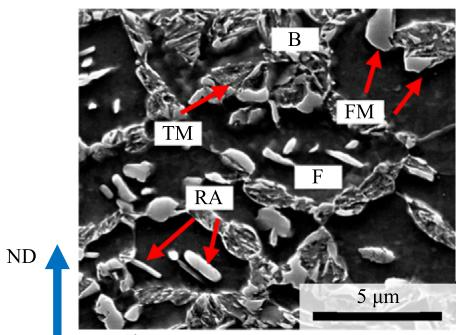  
(f) AN750-T

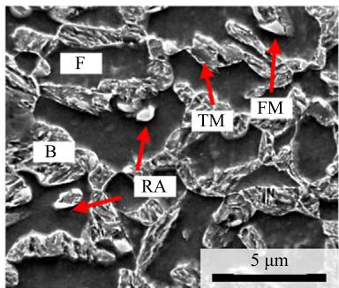  
(g) AN800-T

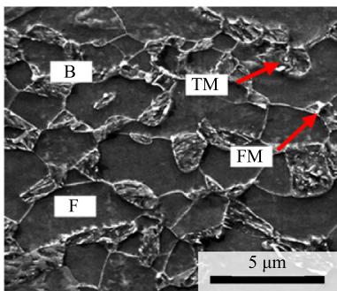  
(h) AN850-T  
RD  
Fig. 2 Multiphase microstructure evolution during rolling and heat treatment.

After aging treatment in the bainitic region, samples AN750-T, AN800-T, and AN850-T are shown in Figs. 2(f)– (h). During the tempering process, the carbon in the FM or B diffuses into austenite, which leads to an increase in the carbon content of austenite. Consequently, the martensite start transformation temperature of austenite is significantly decreased, and its thermodynamic stability is enhanced.31 With the improvement of austenite stability, it is less likely to transform into martensite during the subsequent cooling process. Secondly, some FM or B may be re-austenitized (reverse transformation austenitization) to form a new austenite phase. Therefore, more austenite is retained after tempering. In addition, the microstructure characteristics of Tempered Martensite (TM) and B are more prominent during this process, and they are further characterized by TEM.

Bainite is a microstructure composed of bainitic ferrite and carbides, with the carbides inside the bainitic ferrite distributed at a 60°?? angle to its boundaries. In tempered martensite, however, carbides are randomly distributed.32 This difference in orientation helps distinguish bainite from tempered martensite, as illustrated in Fig. 4. Despite these differences, EBSD struggles to distinguish the two structures due to their similar mechanical properties. Thus, they are grouped as B/TM.33 The content of B/TM and FM is quantified using the Image Quality (IQ) values of Kikuchi patterns from EBSD. Fig. 5(a) presents the combined Kikuchi pattern quality and phase distribution maps for AN750-T, AN800-T, and AN850-T, obtained from EBSD. Differences in carbon concentration and dislocation density cause the band contrast of martensitic phases to be lower than that of ferrite, bainite, and retained austenite.34 Several points within the white dashed boxes were sampled and averaged to determine the critical IQ values for fresh martensite, bainite/tempered martensite, and ferrite. As shown in Fig. 5(b), all three samples exhibit a distinct bimodal distribution of IQ values for the BCC structure. This pattern suggests that bainite/tempered martensite and fresh martensite, with an average size of about 1 lm, along with ferrite, averaging about 5 lm, make up a substantial portion of the volume. The decrease in retained austenite content is primarily driven by reduced austenite stability. Retained austenite contents for AN750-T, AN800-T, and AN850-T are 7.4%, 2.4%, and 0.6%, respectively.

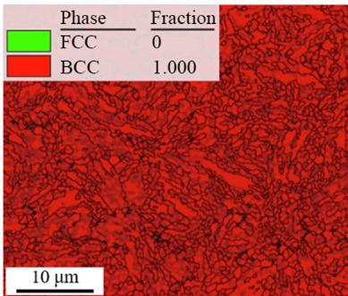  
(a) HR

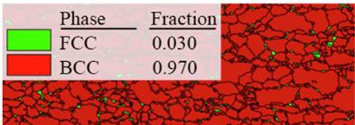

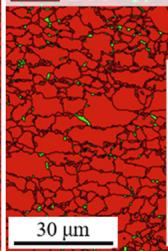

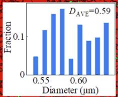  
(b) AN750

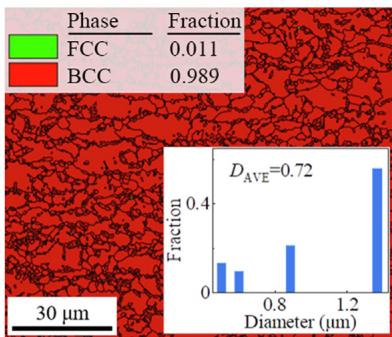

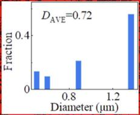  
(c) AN800

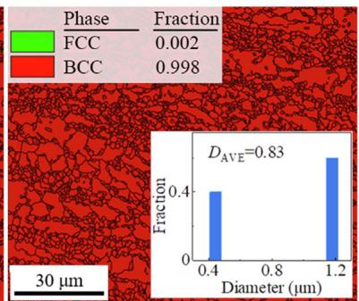

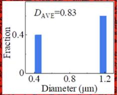  
(d) AN850

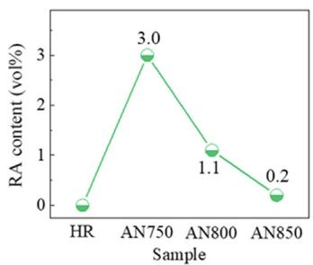  
(e) Evolution statistics of RA content

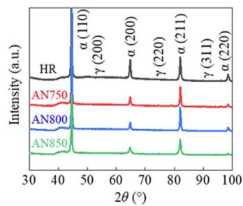  
(f) XRD analysis  
Fig. 3 Evolution of RA during thermomechanical processing.

According to the analysis of Kernel Average Misorientation (KAM) (Fig. 5(c)), it is found that there are significant strain concentrations at the boundaries between ferrite and bainite/martensite. Fig. 5(d) shows the point-to-origin analysis of the magnified areas within the black boxes in Fig. 5(c), the KAM value reaches its peak when the characteristic line crosses the boundary and then gradually decreases. This is attributed to the dislocations accumulated at grain boundaries, coordinating phases with different mechanical responses during deformation to maintain the continuity of deformation.35,36 The analysis selected multiple sets of characteristic lines for each sample and calculated their average values to reflect the objective trend. In Fig. 5(d), only 2–3 representative positions are marked. AN800-T has the highest average KAM $( \mathrm { K A M _ { A V E } } = 0 . 6 9 ^ { \circ } )$ , due to its higher content of bainite and martensite. The content and size of phases were statistically analyzed as depicted in Figs. 6(a) and (b). As the annealing temperature increases, the ferrite content rises, while the sizes of bainite and martensite decrease. RA can transform into martensite during deformation through the TRIP effect, enhancing the strength and ductility of materials. Consequently, the low-density steel develops a multiphase microstructure composed of F, B, TM, RA, and FM.

The multiphase steels demonstrate superior energy absorp tion during tensile deformation, with mechanical properties comparable to advanced high-strength steel. Their yield strength is 2–3 times higher than traditional low-alloy stee (Figs. 6(c) and $\left( \mathrm { d } \right) ^ { 3 7 - 5 0 } )$ . No dynamic propagation instabilities, such as Lu¨ ders bands or Portevin-Le Chatelier bands, were observed in any samples. The preparation process is simpler than that of Q&P steel, and the alloy cost and cold rolling process difficulty are significantly lower compared to medium manganese steel. The yield strengths of AN750-T,

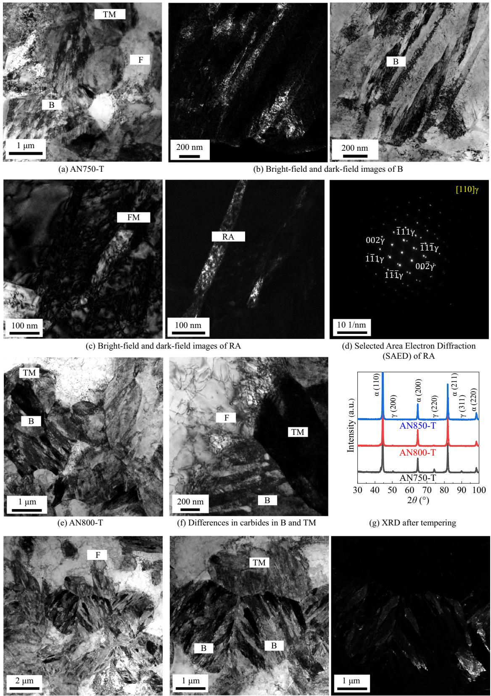  
(h) AN850-T  
(i) Bright-field and dark-field images of B and TM  
Fig. 4 Identification of B and TM based on TEM and discovery of RA.

AN800-T, and AN850-T are 697, 985, 991 MPa, respectively. Their tensile strengths are 1 068, 1 295, 1 269 MPa, with elongations of 34.0%, 18.7%, and 13.9%, respectively. This

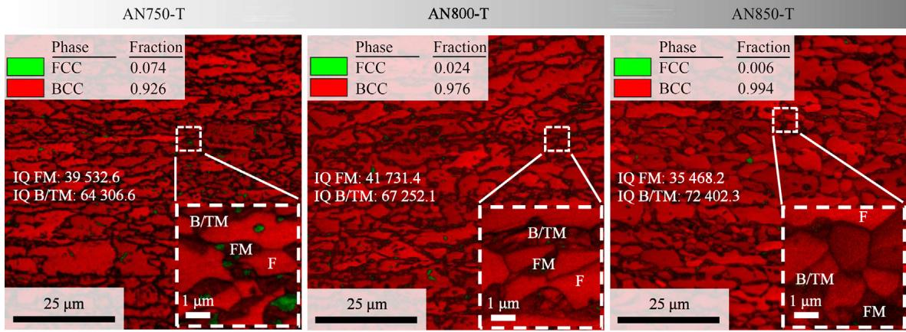  
(a) Kikuchi pattern quality and phase distribution map

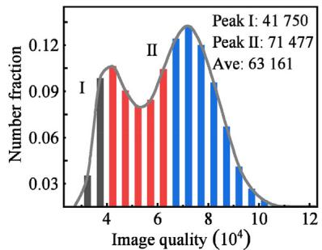

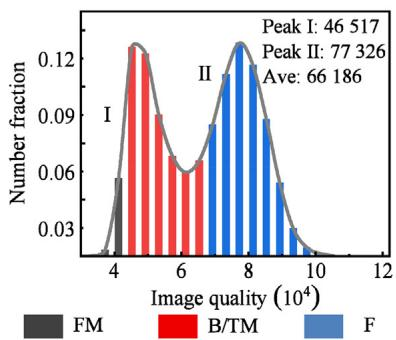

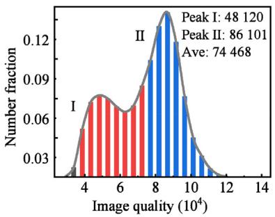

(b) Kikuchi pattern quality distribution statistics  
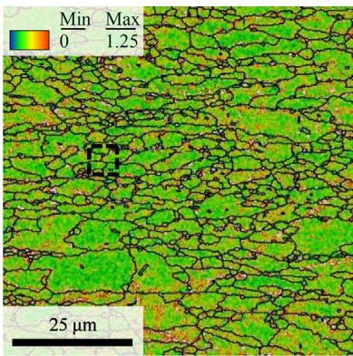

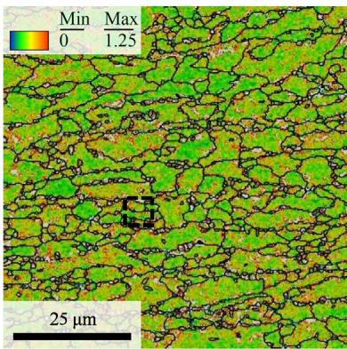

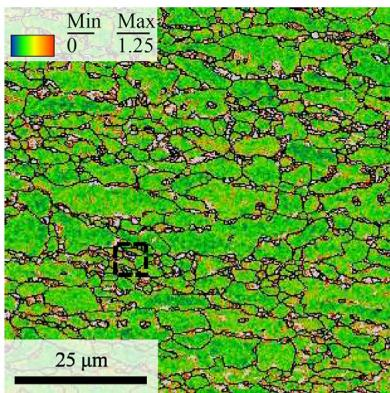

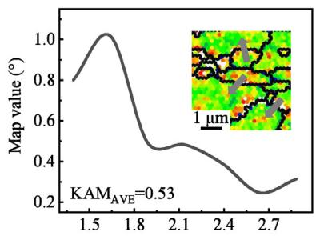  
Distance (μm)

(c) KAM  
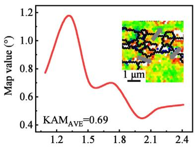  
Distance (μm)  
(d) Interphase stress quantification diagram

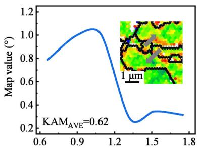  
Distance (μm)  
Fig. 5 Phases separation strategy and interphase strain analysis based on EBSD.

indicates that a reasonable proportion of multiphase microstructure and size matching is beneficial for achieving better comprehensive mechanical properties in low-density steel, especially the PSE of AN750-T reaches 36.3 GPa %. Additionally, the evolution of dislocations and substructures warrants further attention.

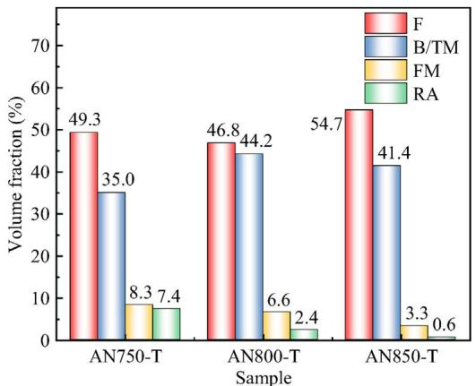  
(a) Phase volume fraction

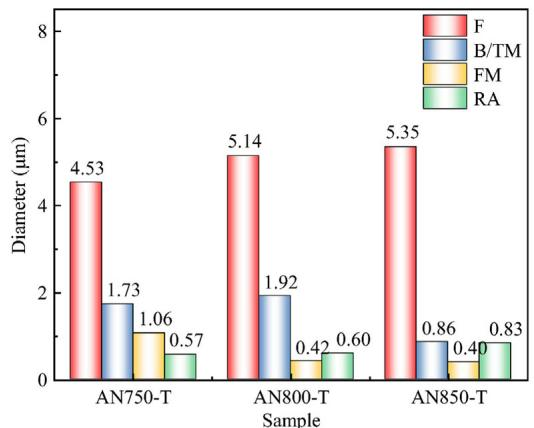  
(b) Average size of phase

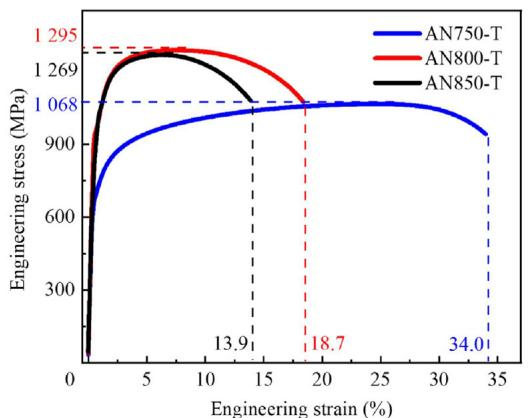  
(c) Tensile-curve data

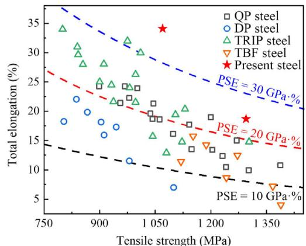  
(d) Comparison of tensile strength-total elongation37-50  
Fig. 6 Microstructure characteristics and mechanical properties of multiphase steels.

## 4. Discussion

## 4.1. Multiphase microstructure mechanical response

## 4.1.1. Model description

Modeling the mechanical behavior of low-density steel with multi-level microstructures presents challenges due to the complex interactions between dislocations and interfaces, such as blocking, bypassing, or cutting mechanisms. These interactions make it difficult to describe material strength accurately using linear superposition theory.51 The effectiveness of various strengthening mechanisms varies with the heterogeneous deformation of microstructure, requiring a quantitative analysis of phase composition and dislocation density.33,52 The isowork theory provides a realistic and direct method for analyzing the behavior of each phase during deformation.32 It assumes that tensile work is uniformly distributed across all phases,34 meaning that the product of the flow stress for each phase and the corresponding true strain increment is equal:

$$
\sigma_ {\mathrm{F}} \mathrm{d} \varepsilon_ {\mathrm{F}} = \sigma_ {\mathrm{B/TM}} \mathrm{d} \varepsilon_ {\mathrm{B/TM}} = \sigma_ {\mathrm{FM}} \mathrm{d} \varepsilon_ {\mathrm{FM}} = \sigma_ {\mathrm{RA}} \mathrm{d} \varepsilon_ {\mathrm{RA}} = \sigma_ {\mathrm{DIM}} \mathrm{d} \varepsilon_ {\mathrm{DIM}}\tag{1}
$$

where $\sigma _ { j }$ is the rheological stress of each phase; $\mathrm { d } \varepsilon _ { j }$ is the increment of true strain for each phase. The relationship between rheological stress and true strain in the constitutive model can be expressed as the sum of the product of phase content and rheological stress. Therefore, the rheological stress depends on the composition and evolution of F, B, FM, RA, and Deformation-Induced Martensite (DIM):

$$
\sigma (\varepsilon) = \sum_ {j \in \mathrm{Ph}} f _ {j} (\varepsilon_ {j}) \sigma_ {j} (\varepsilon_ {j})\tag{2}
$$

where $\sigma ( \varepsilon )$ is the function of rheological stress changing with true strain; $f _ { j } ( \varepsilon _ { j } )$ is the function of phase content changing with true strain; $\sigma _ { j } ( \varepsilon _ { j } )$ is the function of rheological stress of each phase changing with true strain; Ph is the set containing each phase, $\mathrm { P h } = \{ \mathrm { F } , \mathrm { B } / \mathrm { T M }$ , FM, RA, DIM}.

Therefore, before calculating the function of rheological stress changing with true strain, it is necessary to first determine the function of phase content changing with true strain. During the deformation process of the multiphase steel, the content of F, B/TM, and FM remains constant.

It is worth noting that there is a clear presence of deformation-induced martensitic transformation in the sample during the deformation process. The volume fractions of RA and DIM should be functions of strain. Characterization of the samples after tensile fracture was conducted using EBSD, and the content of DIM obtained from the TRIP effect can be estimated by the reduction in RA. The appearance of DIM typically occurs after material yielding and continues during subsequent deformation processes.53 This continuous transformation can be fitted using the model proposed by Olson and Cohen:54

$$
f _ {\mathrm{DIM}} = f _ {\mathrm{RA}, 0} \left\{1 - \exp \left[ - \beta (1 - \exp (- \alpha \varepsilon)) ^ {n} \right] \right\}\tag{3}
$$

where $\alpha , \beta ,$ and n are the relevant parameters for martensitic phase transformation, $^ { 5 5 } \alpha = 5 , \beta = 1 . 2 8 , n = 0 . 5 5 ; f _ { \mathrm { R A , 0 } }$ is the content of RA before deformation; e is the true strain. The fitting results are shown in Fig. 7.

The quantitative calculation of the strengthening mechanisms of each phase relies on the constitutive relationships of each phase. The flow stress of F and RA can be decomposed into the combined effects of solid solution strengthening $( \sigma _ { j } ^ { \mathrm { { s s } } } )$ grain boundary strengthening $( \sigma _ { j } ^ { \mathrm { g b } } )$ , and dislocation strengthening $( \sigma _ { j } ^ { \mathrm { { d i s } } } )$ . When establishing the constitutive relationships of F and RA, as depicted $\mathrm { i n } ^ { 5 4 }$

$$
\sigma_ {\mathrm{F}} = \sigma_ {\mathrm{F}} ^ {\mathrm{ss}} + \sigma_ {\mathrm{F}} ^ {\mathrm{gb}} + \sigma_ {\mathrm{F}} ^ {\mathrm{dis}}\tag{4}
$$

$$
\sigma_ {\mathrm{RA}} = \sigma_ {\mathrm{RA}} ^ {\mathrm{ss}} + \sigma_ {\mathrm{RA}} ^ {\mathrm{gb}} + \sigma_ {\mathrm{RA}} ^ {\mathrm{dis}}\tag{5}
$$

Different from the solid solution strengthening of RA and F, the strengthening effect of substitutional solute elements on B and martensite is extremely limited,56 considering that the concept of grain boundaries is not applicable in this case. Here, the method of Rodriguez and Gutie´ rrez was borrowed,57 the solid solution strengthening $( \Delta \sigma _ { j } ^ { \mathrm { s s } } )$ , Peierls stress $( \sigma _ { j } ^ { \mathrm { p } } )$ , and the influence of dislocation strengthening on the constitutive relationships of B/TM, FM, and DIM are mainly considered:

$$
\sigma_ {\mathrm{B/TM}} = \Delta \sigma_ {\mathrm{B/TM}} ^ {\mathrm{C}} + \sigma_ {\mathrm{B/TM}} ^ {\mathrm{p}} + \sigma_ {\mathrm{B/TM}} ^ {\mathrm{dis}}\tag{6}
$$

$$
\sigma_ {\mathrm{FM}} = \Delta \sigma_ {\mathrm{FM}} ^ {\mathrm{C}} + \sigma_ {\mathrm{FM}} ^ {\mathrm{p}} + \sigma_ {\mathrm{FM}} ^ {\mathrm{dis}}\tag{7}
$$

$$
\sigma_ {\mathrm{DIM}} = \Delta \sigma_ {\mathrm{DIM}} ^ {\mathrm{C}} + \sigma_ {\mathrm{DIM}} ^ {\mathrm{p}} + \sigma_ {\mathrm{DIM}} ^ {\mathrm{dis}}\tag{8}
$$

where $\Delta \sigma _ { j } ^ { \mathrm { C } }$ is the contribution of C atoms to the solid solution strengthening caused by bainite and martensite.

The crux of solid solution strengthening lies in the impediment it imposes on dislocations through lattice distortion induced by solute atoms. The efficacy of these strengthening correlates with both the types and mass fractions of solute atoms. Eqs. (9) and (10) are used to calculate the solid solution strengthening of RA and $\mathrm { F . } ^ { 5 8 , 5 9 }$ For B/TM, FM, and DIM, the contribution of C atoms to their strength is very significant, and the calculation is done using58

$$
\sigma_ {\mathrm{RA}} ^ {\mathrm{ss}} = 5 9 8 \omega_ {[ \mathrm{C} ]} - 1. 4 \omega_ {[ \mathrm{Mn} ]} + 2 3 \omega_ {[ \mathrm{Si} ]} + 8 7 7 \omega_ {[ \mathrm{N} ]}\tag{9}
$$

$$
\sigma_ {\mathrm{F}} ^ {\mathrm{ss}} = 5 4 + 3 2 \omega_ {[ \mathrm{Mn} ]} + 8 3 \omega_ {[ \mathrm{Si} ]} + 6 7 8 \omega_ {[ \mathrm{P} ]} + 5 5 4 4 \omega_ {[ \mathrm{S} ]}\tag{10}
$$

$$
\Delta \sigma_ {j} ^ {\mathrm{C}} = 3 0 6 5 \omega_ {[ \mathrm{C} ]} - 1 6 1\tag{11}
$$

where $\omega _ { [ i ] }$ is the mass fraction of atoms, i = {C, Mn, Si, N, P, S}.

The diffusion of elements in RA and FM during room temperature deformation can be neglected. Therefore, when exploring the strengthening mechanism related to the alloy composition of DIM, direct quantitative analysis using the alloy composition of RA is adopted. Using parameters such as the content of each phase before deformation and alloy carbon concentration to estimate the carbon concentration of FM, as shown in52

$$
\omega_ {[ \mathrm{C} ]} ^ {\mathrm{FM}} = \omega_ {[ \mathrm{C} ]} - f _ {\mathrm{RA}, 0} \omega_ {[ \mathrm{C} ]} ^ {\mathrm{RA}} - f _ {\mathrm{B/TM}} \omega_ {[ \mathrm{C} ]} ^ {\mathrm{B/TM}} - f _ {\mathrm{F}} \omega_ {[ \mathrm{C} ]} ^ {\mathrm{F}} / f _ {\mathrm{FM}}\tag{12}
$$

where $\omega _ { [ \mathrm { C } ] } ^ { j }$ is the content of C atoms in each phase, $j = \{ \mathrm { F M }$ RA, B/TM, F}.

Peierls stress is calculated by57

$$
\sigma_ {j} ^ {\mathrm{p}} = 7 7 + 7 5 0 \omega_ {[ \mathrm{p} ]} + 6 0 \omega_ {[ \mathrm{Si} ]} + 8 0 \omega_ {[ \mathrm{Mn} ]} + 5 0 \omega_ {[ \mathrm{N} ]}\tag{13}
$$

When analyzing the mass fraction of solid solution elements, observations were made using EPMA, carbon elements are mainly concentrated in B/TM, FM, and RA (Fig. 8(a)). The data selected along the red dashed lines are shown in Fig. 8(b), indicating that with increasing annealing temperature, the distribution of carbon elements becomes more uniform, while the distribution of other elements shows no significant differences. The average elemental compositions of phases AN750-T, AN800-T, and AN850-T are summarized in Table A1 in Appendix A.

When polycrystalline materials undergo deformation, the continuity restricts the deformation of adjacent grains, and the higher total grain boundary area provides greater deformation resistance, thereby enhancing the strength of materials. The average size of each phase has been counted in Fig. 6(b). The Hall-Petch formula is used to represent the effort of grain refinement to the strength of the material:60–63

$$
\sigma_ {j} ^ {\mathrm{gb}} = \sigma_ {0 j} + K _ {j} (d _ {j}) ^ {- 1 / 2}\tag{14}
$$

where $j = \{ { \bf R } { \bf A } , { \bf F } \} ; \sigma ^ { \mathrm { g b } }$ is the contribution of grain boundary strengthening; r is the friction stress, indicating the resistance of the global crystal lattice to dislocation movement, $\sigma _ { \mathrm { 0 R A } } = 1 8 0 \ \mathrm { M P a } , \sigma _ { \mathrm { 0 F } } = 1 0 0 \ \mathrm { M P a } ; ^ { 6 4 , 6 5 } \ : K _ { j }$ is the Petch parameter, used to measure the relative hardening contribution of grain boundaries or phase boundaries, $K _ { \mathrm { { R A } } } = 1 4 9 \mathrm { \ M P a } { \cdot } \mu \mathrm { { m } } ^ { 1 / 2 } ,$ $\overline { { K } } _ { \mathrm { F } } = 6 0 0 ~ \mathrm { M P a } { \cdot } \mu \mathrm { m } ^ { \bar { 1 } / 2 } ; ^ { 6 4 , 6 5 } d _ { j }$ is the average grain size.

During the deformation process, the contribution of dislocation strengthening from phases to the strength of the material should be considered separately. This contribution is analyzed using the Taylor relationship:66

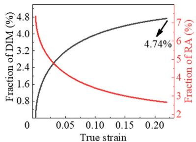  
(a) AN750-T

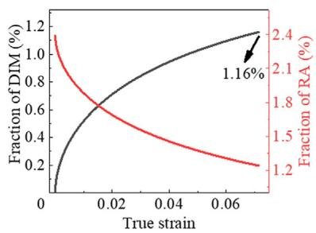  
(b) AN800-T

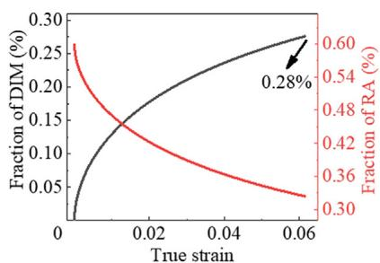  
(c) AN850-T  
Fig. 7 Deformation-induced martensite and retained austenite volume fraction changes based on O-C model.

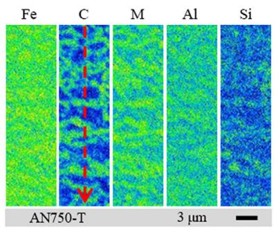

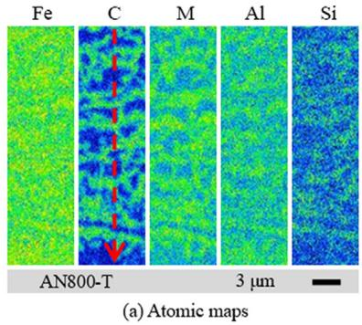

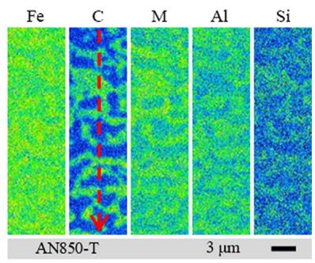

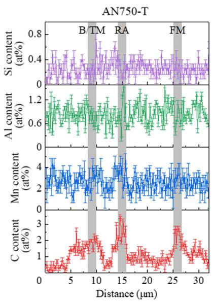

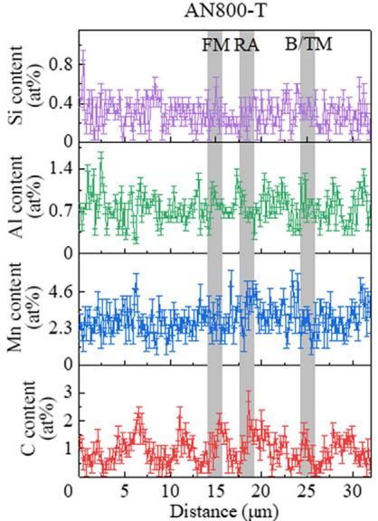

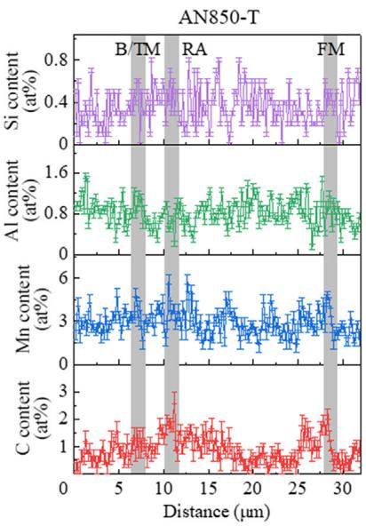  
(b) Atomic concentration statistics  
Fig. 8 Quantitative strategy of phases composition.

$$
\sigma_ {j} ^ {\text { dis }} = \alpha_ {j} M _ {j} G _ {j} b _ {j} \sqrt {\rho_ {j}}\tag{15}
$$

where $j \ = \ \{ \Gamma ,$ , B/TM, FM, RA, DIM}; $\alpha _ { j }$ is a constant, $\alpha _ { \mathrm { B C C } } ~ = ~ 0 . 3 8$ $\alpha _ { \small \mathrm { F C C } } ~ = ~ 0 . 3 5 ; ^ { 6 7 - 6 9 } ~ M _ { j }$ is the Taylor factor (obtained through EBSD analysis); $G _ { j }$ is the shear modulus, $G _ { \mathrm { F } } ~ = ~ 6 6 . 0 ~ \mathrm { G P a }$ , GB/TM, FM, DIM = 81.6 GPa, $\begin{array} { r l } { G _ { \mathbf { R A } } } & { { } = } \end{array}$ $7 2 . 0 ~ \mathrm { \ G P a ; ^ { 7 0 , 7 1 } } ~ b _ { j }$ is the modulus of Burgers vector, $b _ { \mathrm { \bf B C C } } ~ = ~ 0 . 2 4 8$ nm, $b _ { \mathrm { F C C } } ~ = ~ 0 . 2 5 0$ nm; $\rho _ { j }$ is the dislocation density. The variation of dislocation density with true strain was calculated using the Mecking-Kocks model:72,73

$$
\mathrm{d} \rho_ {j} = M _ {j} \left(\frac {1}{b _ {j} \Lambda_ {j}} + \frac {k _ {j} ^ {1}}{b _ {j}} \sqrt {\rho_ {j}} - k _ {j} ^ {2} \rho_ {j}\right) \mathrm{d} \varepsilon_ {j}\tag{16}
$$

where $A _ { j }$ is the average free path of dislocation; $k _ { j } ^ { 1 }$ and $k _ { j } ^ { 2 }$ are dislocation storage parameters and dynamic recovery parameters, respectively; $\varepsilon _ { j }$ is the true strain for each phase.

In Eq. (16), the three terms respectively represent the hindrance of defects on dislocations, the multiplication of dislocations due to dislocation entanglement, and the annihilation of dislocations caused by dynamic recovery. For F, B/TM, and FM, the mean free path is equivalent to the average size of the three. For RA, due to the existence of DIM transformation, the average dislocation mean free path of RA will change as the transformation occurs. According to the study of Lee et al.74 this change can be characterized using

$$
\frac {1}{\Lambda_ {\mathrm{RA}}} = \frac {1}{d _ {\mathrm{RA}}} + \frac {f _ {\mathrm{DIM}}}{2 c f _ {\mathrm{RA}}}\tag{17}
$$

where c is the average size of DIM.

Here, combined with the reconstruction algorithm of Huang et al.75 the calculation is performed using the Parent Grain Analysis module of AZtecCrystal software. The reconstruction was achieved in three steps, namely optimizing the orientation relationship, orientation coalescence, and regional voting between RA and DIM. The final values for c for AN750-T, AN800-T, and AN850-T were determined to be 0.12, 0.15, 0.19 lm, respectively. Detailed strategies regarding the parent grain analysis can be found in Fig. A2 in Appendix A. The model construction parameters involved based on experimental data and relevant literature are shown in Table A2 in Appendix A.

## 4.1.2. Quantitative analysis of strengthening mechanism

After the analysis of Section 4.1.1, the parameters obtained from the experiments were input into the constitutive relationship, as depicted in Fig. 9. Overall, as the true strain increases, the difference between the constitutive relationship established by the model and the mechanical performance curve obtained experimentally gradually increases. The TEM microstructure in Fig. 10 illustrates a gradient accumulation of GNDs at

Dense dislocation

the boundaries. As the degree of strain localization increases, the strain gradient also increases, resulting in back stress $\left( { \boldsymbol { \sigma } } _ { \mathbf { B } } \right)$ work hardening, as illustrated in the shaded area of Fig. 9. When AN750-T, AN800-T, and AN850-T reached the necking strain, the maximum stress caused by $\sigma _ { \mathrm { B } } = 2 1 7 , 3 0 0 , 2 7 8 \mathrm { M P a } .$ respectively. Combined with continuous DIC strain fields, strain concentration, distribution, and re-concentration were observed. The inset shows the DIC strain fields, the AN750-

True strain  
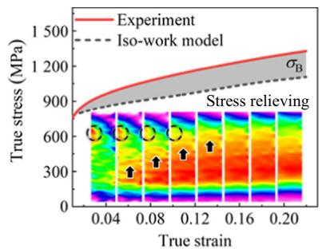  
(a) AN750-T

T sample exhibits relatively uniform strain during the yield stage, and the phenomenon of stress distribution is observed during the uniform plastic deformation stage (as indicated by the circle in Fig. 9(a)). In the AN800-T sample, two local strain concentration points are observed. As the strain progresses, these points expand at a $4 5 ^ { \circ }$ angle and connect with each other, leading to necking in the material. This phenomenon was also found in the works of Liu et al.76,77 The hard phase would bear a relatively large stress to ‘accelerate’ the increase of its strain, while the soft domain would bear a relatively smaller load to ‘slow down’ the increase of its strain, thereby ensuring the continuity of strain between the hard and soft domain in the microstructure and achieving the purpose of plasticity enhancement. The strain distribution phenomenon is more pronounced in AN750-T, which is closely related to the strain-hardening behavior induced by TRIP during the deformation process. However, this phenomenon was also observed in AN800-T and AN850-T with lower RA content, further confirming that the coordinated strain between the soft domain and hard domain effectively prevents premature failure.

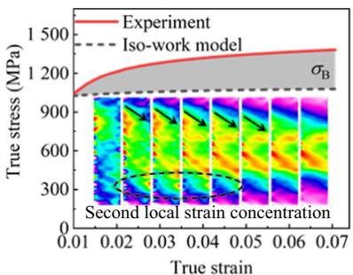  
(b) AN800-T

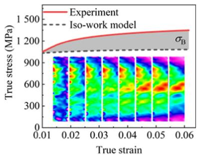  
(c) AN850-T  
Fig. 9 Constitutive relationship fitting curve and experimental data comparison of AN750-T, AN800-T and AN850-T.

AN750-T  
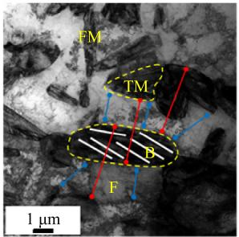

AN800-T  
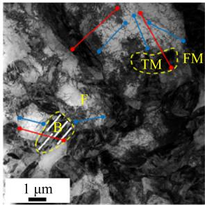

(a) Internal characteristics and dislocation distribution  
  
(c) Release of GNDs in soft domain

(b) Dark-field image of AN850-T  
  
(d) Bright-field image of AN850-T

  
(e) Constitutive relation fitting of phases and its contribution to strength

  
Fig. 10 TEM analysis of microstructure of soft domain and hard domain.

Based on experimental observations, back stress plays a hardening role in structures with strain gradients. Therefore, the stress induced by single-edge GNDs can be expressed $\mathrm { a s } ^ { 7 8 }$

$$
\left\{ \begin{array}{l} \sigma_ {x} = \frac {3 \mu b R ^ {2}}{8 (1 - v)} \cdot \frac {\partial \rho_ {\mathrm{GND}}}{\partial y} \\ \sigma_ {x y} = - \frac {\mu b R ^ {2}}{8 (1 - v)} \cdot \frac {\partial \rho_ {\mathrm{GND}}}{\partial x} \\ \sigma_ {y} = \frac {\mu b R ^ {2}}{8 (1 - v)} \cdot \frac {\partial \rho_ {\mathrm{GND}}}{\partial y} \\ \sigma_ {x z} = 0 \\ \sigma_ {z} = \frac {\mu b v R ^ {2}}{2 (1 - v)} \cdot \frac {\partial \rho_ {\mathrm{GND}}}{\partial y} \\ \sigma_ {y z} = 0 \end{array} \right.\tag{18}
$$

Assuming that GNDs are uniformly distributed along the x direction, then $\hat { \boldsymbol { 0 } } \rho _ { \mathrm { G N D } } / \hat { \boldsymbol { 0 } } x ~ = ~ 0 .$ , and ${ \hat { \mathrm { 0 } } } \rho _ { \mathrm { G N D } } / { \hat { \mathrm { 0 } } } y$ can be approximated as $\Delta \rho _ { \mathrm { G N D } } / \Delta h$ . Consequently, the non-zero stress components are $\sigma _ { x } , ~ \sigma _ { y } ,$ and $\sigma _ { z } .$ . Therefore, the back stress induced by GNDs can be calculated using the von Mises equivalent method:34

$$
\sigma_ {\mathrm{b}} \left(\varepsilon_ {\mathrm{b}}\right) = \sqrt {1 6 v ^ {2} - 1 6 v + 7} \frac {G b R ^ {2}}{8 (1 - v)} \cdot \frac {\Delta \rho_ {\mathrm{GND}}}{\Delta h}\tag{19}
$$

where m is the Poisson’s coefficient, $\nu = 0 . 2 8 ; \Delta \rho _ { \mathrm { G N D } }$ is the difference in GND density between adjacent regions34; R is the average characteristic size of the back stress influence zone; Dh is the average thickness of the unit heterogeneous layer, obtained by averaging several TEM structures using the method shown in Fig. 10(a). By combining Eq. (16) for calculation, the evolution of additional strain hardening of GNDs with strain can be obtained.

The flow stress (r) depends on the evolution of F, B/TM, FM, RA, and DIM, as well as the contribution of back stress:

$$
\sigma (\varepsilon) = \sum_ {j \in \mathrm{Ph}} f _ {j} \left(\varepsilon_ {j}\right) \sigma_ {j} \left(\varepsilon_ {j}\right) + \sigma_ {\mathrm{b}} \left(\varepsilon_ {\mathrm{b}}\right)\tag{20}
$$

where $f _ { j } ( \varepsilon _ { j } )$ is the function of phase content changing with true strain; $\sigma _ { j } ( \varepsilon _ { j } )$ is the function of rheological stress of each phase changing with true strain; Ph is the set containing each phase, Ph = {F, B/TM, FM, RA, DIM}.

Fig. 10(a) shows the TEM microstructure of AN750-T, AN800-T, and AN850-T before deformation, with F surrounded by hard domains. The mechanical incompatibility generated by phases during deformation, a strain gradient forms at the interface between the soft domain and hard domain, leading to the release of mass GNDs at the phase boundaries. Accompanying these GNDs is the back stress generated by them in the direction opposite to the applied stress, as depicted in Fig. 10(c). The internal stress generated in the F is compressive stress, thereby weakening the promoting effect of external tensile loads on dislocation motion within ferrite grains, making dislocation slip relatively difficult compared to the original situation, and slowing down the rate of increase in grain plastic strain. At the same time, the internal stresses generated in the adjacent B/TM and FM to the F are in the same direction as the tensile direction. In other words, the coordinated deformation behavior leads to the soft domain hardening and the hard domain softening, thus maintaining the continuity of deformation between phases as much as possible, and avoiding premature initiation of micro-porosity due to deformation incompatibility.27

  
Fig. 11 Crack path and dimple statistics of multiphase steels were characterized by SEM.

The model calculation results are shown in Fig. 10(e). The model fits well with the experimental data, but at the initial stage of strain, the calculated values of the model are higher. This is partly because some non-strain functions, such as solid solution strengthening, boundary strengthening, and Peierls stress, were considered in the model. Additionally, Pierce et al. explained, suggesting that the nonuniform distribution of carbon in FM would lead to a mixed microstructure with different hardness regions.79 These regions would yield successively under applied stress, resulting in a continuous stress– strain curve at low-stress levels. Compared to AN800-T and AN850-T, the relatively lower concentration of carbon elements in FM in AN750-T leads to a smaller discrepancy between model calculations and experimental values at the ini tial stages of strain. The strength contribution of B/TM is higher than other phases, and with increasing annealing tem perature, reaching 23%, 41%, and 54% of the flow stress at necking strain. The relationship is not solely tied to the B/ TM content but is significantly influenced by carbon concentration. The content of RA decreases with increasing strain, yet the stress carried by the remaining RA shows no significan decrease. During the strain process, the RA transforms into DIM, which has a smaller average free path for dislocations, leading to a significantly increased rate of dislocation accumu lation.80 Therefore, the stress–strain curves of DIM exhibit higher strain hardening values than B/TM. For AN850-T, the lower content of RA results in no significant strainhardening phenomenon induced by DIM. Furthermore, under necking strain, the back stress strengthening contributions caused by GND in AN750-T, AN800-T, and AN850-T are 236, 291, 254 MPa, respectively, which are closely related to the synergistic deformation mechanism of the multiphase heterogeneous structure.

  
(c) Point-to-point orientation difference and Kikuchi pattern quality distribution statistics  
Fig. 12 EBSD analysis of necking position after tensile fracture.

## 4.2. Mitigating stress concentration mechanism

Microscale strain localization can lead to the initiation of microcracks, while the plastic anisotropy of different microstructures can significantly alter the propagation path of cracks.81,82 The necking region after tensile fracture (indicated by the red dot in Fig. 11) was selected for SEM analysis to gather key insights into the fracture behavior. Microscale voids (yellow dashed boxes) are mainly distributed at the interface of the soft domain and hard domain. If the deformation is severe enough, these voids will coalesce, leading to microvoid coalescence fracture, as depicted in Fig. 11(a). In AN750-T and AN800-T, the crack tip blunts at the hard domain interface, generating secondary cracks (yellow arrows). The driving force for crack propagation is lower than the resistance provided by the hard domains, allowing cracks to extend into other easily nucleated areas. In AN850-T, the hard domains were observed to be severed (red arrows). At 850 °??C, significant migration of carbon and manganese into the B/TM and FM regions results in local oversaturation of alloying elements, increasing the strength but also the brittleness of the hard domains. The fracture morphology shows large dimples surrounded by smaller ones (Fig. 11(b)). AN750-T displays relatively deep dimples, whereas AN800-T and AN850-T exhibit some quasi-cleavage fractures, mostly originating from fresh martensite. Dimple size distribution was analyzed using Nano Measure software (Fig. 11(c)), revealing a bimodal distribution, with AN750-T having larger average dimple sizes. This suggests that the coarse ferrite and fine hard phases effectively alleviate stress concentration during deformation.

EBSD characterization was conducted on the necking region, compared to the state before tensile deformation, the RA content in AN750-T, AN800-T, and AN850-T decreased (Fig. 5(a)). The yellow dashed box areas in Fig. 12(a) were selected for magnified characterization. Stress concentration mainly occurs in the hard regions represented by B/TM and FM (highlighted in red). The white pixel areas are regions prone to micropore nucleation and expansion during deformation (Fig. 12(b)). In Fig. 12(a), characteristic lines (yellow arrows) were selected for Point-to-Point (P-T-P) orientation difference and Kikuchi pattern quality statistics (Fig. 12(c)), where $\mathrm { P - T - P _ { A v e } }$ is the average of P-T-P orientation. When the characteristic line crosses the phase boundary, the orientation difference increases sharply, and the Kikuchi pattern quality drops to a minimum, indicating significant strain and intense dislocation accumulation at the phase interface. The stress distribution behavior between the soft domain and hard domain changes significantly to accommodate the discontinuity of strain.83,84

Overall, during the deformation process, the strength difference between the soft domain and hard domain leads to stress concentration within the ferrite, especially near the phase boundaries, thereby initiating crack nucleation. The continuity of the phases (continuous B/TM microstructure) can enhance the overall strength of the steels but also create pathways for crack propagation at the boundaries between the soft domain and hard domain. The crack tip, hindered by the hard domains, may induce the formation of secondary cracks, thereby mitigating stress concentration. High hardness phases (such as FM) tend to fracture through cleavage, while the soft domain may absorb energy through the dimple fracture mechanism, thus delaying the overall fracture process. Additionally, the TRIP effect significantly enhances the strain-hardening capability of the steels by absorbing energy and increasing the strength of local regions.

## 5. Conclusions

We developed a low-density steel component with a multi-level microstructure using practical mechanical-metallurgical techniques. The research systematically analyzed the evolution of composition and dislocations within the microstructure. A constitutive model of the mechanical behavior of the multiphase structure was established, revealing the synergistic effects of various strengthening mechanisms and the multilevel toughening processes.

(1) Annealing at $7 5 0 ^ { \circ } \mathrm { C }$ enabled the low-density steel with a multi-level microstructure to achieve a strength-ductility product of 36.3 GPa %, with a tensile strength of 1 068 MPa and a fracture elongation of 34.0%. At 800 ${ } ^ { \circ } \mathbf { C } .$ , the tensile strength increased to 1 295 MPa, with a fracture elongation of 18.7%. These properties match those of advanced high-strength steels.

(2) The constitutive model, combining the iso-work theory with the von Mises equivalent method, showed strong alignment with experimental data. It highlighted the role of back stress strengthening, consistent with changes in the bainite and tempered martensite content. Fresh martensite, with high dislocation density and carbon content, significantly enhanced strength. Deformationinduced martensite from the TRIP effect was crucial in boosting strain-hardening capacity.

(3) The stress-buffering mechanism of multiphase microstructure design mainly relies on the reasonable stress/strain distribution and the soft-hard domain topology for stress transfer between phases. This effectively prevents the generation of microcracks, mitigating localized stress concentrations during deformation. The hard domains, primarily composed of bainite/tempered martensite, serve as rigid nodes for stress transfer and significantly resist crack propagation, thereby mitigating macroscopic stress concentrations.

## CRediT authorship contribution statement

Jiahe YAN: Investigation, Data curation, Writing – original draft, Writing – review & editing. Zhinan YANG: Project administration, Supervision, Conceptualization. Jinliang DU: Data curation, Investigation, Writing – review & editing. Yunli FENG: Writing – review & editing, Methodology, Funding acquisition, Validation. Minghe ZHANG: Methodology, Formal analysis. Xiaoyong FENG: Methodology, Formal analysis. Fucheng ZHANG: Formal analysis, Methodology.

## Declaration of competing interest

The authors declare that they have no known competing financial interests or personal relationships that could have appeared to influence the work reported in this paper.

## Acknowledgements

This work was funded by the National Natural Science Foundation of China (No. 51974134) and the Innovation Ability Promotion Plan Project of Hebei Province, China (No. 24461002D).

## Appendix A.

A1. Selection of experimental materials and heat treatment temperature

Weight reduction, a key strategy for energy conservation and emissions reduction, has promoted the widespread use of advanced high-strength steels in critical aerospace and low altitude flight components. Third-generation steels, such as medium-manganese and Q&P steels, typically require complex processes like quenching, tempering, or microalloying, which, despite their effectiveness, raise production costs.

This study introduces a novel low-density steel that eliminates costly elements like Nb, Mo, and Ni, with a slight increase in Mn and Al content. Higher Mn content lowers the critical austenite temperatures (Ac1 and Ac3), stabilizing austenite at lower temperatures during cooling and enabling retained austenite at room temperature. It also slows the transformation to pearlite, allowing bainite or martensite to form even at slower cooling rates. Increasing the Al content can stabilize ferrite, enhance its fraction during the cooling process, and reduce the occurrence of incomplete bainite transformation, significantly accelerating the kinetics of bainite formation. Moreover, the addition of Al effectively lowers the density of the steel.

The specific measurement steps for the quenching phase transformation experiment are shown in Fig. A1(a), and Fig. A1(b) illustrates the trend of sample expansion with temperature variation, where DL is the length variation of the measured sample relative to its initial reference length during heat treat ment (heating or cooling). Using the tangent method, the Ac1, Ac3, Bf, and Ms temperatures of the experimental steel were determined to be 705, 950, 380, 346 °??C, respectively, where Bf represents the bainite transformation finish temperature and Ms denotes the martensite transformation start temperature. A critical zone annealing process was applied to adjust the pro portion of ferrite and austenite, promoting the formation of a multiphase structure during cooling to achieve a multi-level microstructural strengthening effect. Aging in the lower bainite region $( 4 0 0 ~ ^ { \circ } \mathrm { C } )$ facilitates the refinement of bainitic structures, controls the kinetics of bainite transformation, prevents pearlite formation, and ensures excellent mechanical properties.

  
(a) Phase transition temperature measurement process

  
(b) Variation of length with heat treatment process  
Fig. A1 Experimental determination of phase transition temperature.

## A2. Acquisition of relevant parameters in constitutive model

Table A1 Composition information of phases.

<table><tr><td rowspan="2">Sample</td><td rowspan="2">Element</td><td colspan="5">Content (wt%)</td></tr><tr><td>F</td><td>B/TM</td><td>FM</td><td>RA</td><td>DIM</td></tr><tr><td rowspan="4">AN750-T</td><td>C</td><td>0.02</td><td>0.30</td><td>0.53</td><td>1.40</td><td>1.40</td></tr><tr><td>Mn</td><td>2.43</td><td>3.50</td><td>3.50</td><td>4.10</td><td>4.1</td></tr><tr><td>Al</td><td>2.10</td><td>2.10</td><td>2.10</td><td>1.40</td><td>1.40</td></tr><tr><td>Si</td><td>0.40</td><td>0.40</td><td>0.40</td><td>0.40</td><td>0.40</td></tr><tr><td rowspan="4">AN800-T</td><td>C</td><td>0.02</td><td>0.35</td><td>0.57</td><td>1.20</td><td>1.20</td></tr><tr><td>Mn</td><td>2.70</td><td>2.80</td><td>3.00</td><td>3.80</td><td>3.80</td></tr><tr><td>Al</td><td>2</td><td>2</td><td>2</td><td>1.70</td><td>1.70</td></tr><tr><td>Si</td><td>0.40</td><td>0.40</td><td>0.40</td><td>0.40</td><td>0.40</td></tr><tr><td rowspan="4">AN850-T</td><td>C</td><td>0.02</td><td>0.50</td><td>0.59</td><td>1.03</td><td>1.03</td></tr><tr><td>Mn</td><td>2.84</td><td>2.92</td><td>2.92</td><td>3.60</td><td>3.60</td></tr><tr><td>Al</td><td>2.10</td><td>2.10</td><td>2.10</td><td>1.30</td><td>1.30</td></tr><tr><td>Si</td><td>0.40</td><td>0.40</td><td>0.40</td><td>0.40</td><td>0.40</td></tr></table>

  
Fig. A2 Detailed strategy for calculating c using parent grain analysis $( A = c )$

Table A2 Constitutive relationship parameters of steels.

<table><tr><td>Sample</td><td> $j$ </td><td> $K_{j} (MPa·μm^{1/2})$ </td><td> $α_{j}$ </td><td> $M_{j}$ </td><td> $G_{j} (GPa)$ </td><td> $b_{j} (nm)$ </td><td> $k_{j}^{1}$ </td><td> $k_{j}^{2}$ </td><td> $ρ_{0} (10^{14} m^{-2})$ </td><td> $R (μm)$ </td><td> $Δh (μm)$ </td></tr><tr><td rowspan="5">AN750-T</td><td>F</td><td>600</td><td>0.38</td><td>2.86</td><td>66.0</td><td>0.248</td><td>0.015</td><td>20</td><td>0.33</td><td>1.58</td><td>3.40</td></tr><tr><td>B/TM</td><td></td><td>0.38</td><td>3.20</td><td>81.6</td><td>0.248</td><td>0.015</td><td>20</td><td>0.44</td><td></td><td></td></tr><tr><td>FM</td><td></td><td>0.38</td><td>3.28</td><td>81.6</td><td>0.248</td><td>0.015</td><td>20</td><td>0.86</td><td></td><td></td></tr><tr><td>RA</td><td>149</td><td>0.35</td><td>3.14</td><td>72.0</td><td>0.250</td><td>0.015</td><td>10</td><td>0.81</td><td></td><td></td></tr><tr><td>DIM</td><td></td><td>0.38</td><td>3.14</td><td>81.6</td><td>0.248</td><td>0.015</td><td>20</td><td></td><td></td><td></td></tr><tr><td rowspan="5">AN800-T</td><td>F</td><td>600</td><td>0.38</td><td>2.89</td><td>66.0</td><td>0.248</td><td>0.015</td><td>20</td><td>0.46</td><td>2.13</td><td>3.48</td></tr><tr><td>B/TM</td><td></td><td>0.38</td><td>3.24</td><td>81.6</td><td>0.248</td><td>0.015</td><td>20</td><td>0.99</td><td></td><td></td></tr><tr><td>FM</td><td></td><td>0.38</td><td>3.33</td><td>81.6</td><td>0.248</td><td>0.015</td><td>20</td><td>1.04</td><td></td><td></td></tr><tr><td>RA</td><td>149</td><td>0.35</td><td>3.10</td><td>72.0</td><td>0.250</td><td>0.015</td><td>10</td><td>1.01</td><td></td><td></td></tr><tr><td>DIM</td><td></td><td>0.38</td><td>3.10</td><td>81.6</td><td>0.248</td><td>0.015</td><td>20</td><td></td><td></td><td></td></tr><tr><td rowspan="5">AN850-T</td><td>F</td><td>600</td><td>0.38</td><td>2.91</td><td>66.0</td><td>0.248</td><td>0.015</td><td>20</td><td>0.37</td><td>1.44</td><td>4.33</td></tr><tr><td>B/TM</td><td></td><td>0.38</td><td>3.28</td><td>81.6</td><td>0.248</td><td>0.015</td><td>20</td><td>1.04</td><td></td><td></td></tr><tr><td>FM</td><td></td><td>0.38</td><td>3.37</td><td>81.6</td><td>0.248</td><td>0.015</td><td>20</td><td>1.16</td><td></td><td></td></tr><tr><td>RA</td><td>149</td><td>0.35</td><td>3.06</td><td>72.0</td><td>0.250</td><td>0.015</td><td>10</td><td>0.68</td><td></td><td></td></tr><tr><td>DIM</td><td></td><td>0.38</td><td>3.06</td><td>81.6</td><td>0.248</td><td>0.015</td><td>20</td><td></td><td></td><td></td></tr></table>

## References

1. Zhao JW, Jiang ZY. Thermomechanical processing of advanced high strength steels. Prog Mater Sci 2018;94:174–242.

2. Jiang HW, Song YR, Wu YC, et al. Microstructure evolution and mechanical anisotropy of M50 steel ball bearing rings during multi-stage hot forging. Chin J Aeronaut 2021;34(11):254–66.

3. Dai ZB, Ding R, Yang ZG, et al. Elucidating the effect of Mn partitioning on interface migration and carbon partitioning during quenching and partitioning of the Fe-C-Mn-Si steels: Modeling and experiments. Acta Mater 2018;144:666–78.

4. Speer J, Matlock DK, De Cooman BC, et al. Carbon partitioning into austenite after martensite transformation. Acta Mater 2003:51(9):2611–22.

5. Luo HW, Shi J, Wang C, et al. Experimental and numerical analysis on formation of stable austenite during the intercritical annealing of 5Mn steel. Acta Mater 2011;59(10):4002–14.

6. Shi J, Sun XJ, Wang MQ, et al. Enhanced work-hardening behavior and mechanical properties in ultrafine-grained steels with large-fractioned metastable austenite. Scr Mater 2010;63 (8):815–8

7. Ding QQ, Fu XQ, Chen DK, et al. Real-time nanoscale observation of deformation mechanisms in CrCoNi-based

medium- to high-entropy alloys at cryogenic temperatures. Mater Today 2019;25:21–7.

8. Oliaei M, Jamaati R. Improvement of the strength-ductilitytoughness balance in interstitial-free steel by gradient microstructure. Mater Sci Eng A 2022;845:143237.

9. Han QN, Lei XS, Su Y, et al. In-situ observation and finite element analysis of fretting fatigue crack propagation behavior in 1045 steel. Chin J Aeronaut 2021;34(11):131–9.

10. Bien´ AN, Szkodo M, Doberski J, et al. Effect of selective laser treatment on initiation of fatigue crack in the main part of an undercarriage drag strut. Chin J Aeronaut 2019;32(3):701–14.

11. Bian XL, S¸opu D, Wang G, et al. Signature of local stress states in the deformation behavior of metallic glasses. NPG Asia Mater 2020;12:59.

12. Ren D, Wang CC, Wei XL, et al. Building a quantitative composition-microstructure-property relationship of dual-phase steels via multimodal data mining. Acta Mater 2023;252:118954.

13. Yang HY, Yan YF, Liu TS, et al. Unprecedented enhancement in strength-plasticity synergy of (TiC+Al6MoTi+Mo)/Al cermet by multiple length-scale microstructure stimulated synergistic deformation. Compos Part B Eng 2021;225:109265.

14. Yang CY, Luan YK, Li DZ, et al. Effects of rare earth elements on inclusions and impact toughness of high-carbon chromium bearing steel. J Mater Sci Technol 2019;35(7):1298–308.

15. Wang XY, Li SP, Han YF, et al. Visual assessment of special rod-like a-Ti precipitates within the in situ TiC crystals and the mechanical responses of titanium matrix composites. Compos Part B Eng 2022;230:109511.

16. Zhang CT, Chen Y, Dou M. Axial compression behaviour and modelling of pultruded basalt-fibre-reinforced polymer (BFRP) tubes. Buildings 2023;13(6):1397.

17. Yan CJ, Xin YC, Chen XB, et al. Evading strength-corrosion tradeoff in Mg alloys via dense ultrafine twins. Nat Commun 2021;12(1):4616.

18. Liu L, Yu Q, Wang Z, et al. Making ultrastrong steel tough by grain-boundary delamination. Science 2020;368(6497):1347–52.

19. Du JL, Li J, Feng YL, et al. Exploring nonlinear strengthening in polycrystalline metallic materials by machine learning methods and heterostructure design. Int J Plast 2023;164:103587.

20. Du JL, Liu GL, Feng YL, et al. Strength and ductility enhancement of plain carbon steel by heterostructure design. Mater Sci Eng A 2023;868:144770.

21. Du JL, Li J, Feng YL, et al. Effect of layered heterogeneous microstructure design on the mechanical behavior of medium carbon steel. Mater Des 2022;221:110953.

22. ZhaoYL LYR, Yeli GM, et al. Anomalous precipitate-size dependent ductility in multicomponent high-entropy alloys with dense nanoscale precipitates. Acta Mater 2022;223:117480.

23. Ravi AM, Kumar A, Herbig M, et al. Impact of austenite grain boundaries and ferrite nucleation on bainite formation in steels. Acta Mater 2020;188:424–34.

24. Kim HJ, Jin SC, Jung JG, et al. Influence of undissolved secondphase particles on dynamic recrystallization behavior of Mg– 7Sn–1Al–1Zn alloy during low- and high-temperature extrusions. J Mater Sci Technol 2021;71:87–97.

25. Li XY, Lu L, Li JG, et al. Mechanical properties and deformation mechanisms of gradient nanostructured metals and alloys. Nat Rev Mater 2020;5(9):706–23.

26. Zhu YT. Introduction to heterostructured materials: A fast emerging field. Metall Mater Trans A 2021;52(11):4715–26.

27. Zhu YT, Ameyama K, Anderson PM, et al. Heterostructured materials: Superior properties from hetero-zone interaction. Mater Res Lett 2021;9(1):1–31.

28. Wei K, Li JS, Cheng W, et al. Remarkable cryogenic tensile property of the 304L stainless steel with a lamellar bimodal heterostructure. J Mater Sci 2024;59(30):14065–77.

29. Liu T, Li JS, Cheng W, et al. Formation mechanisms of heterostructures in 304L stainless steel processed by cold rolling and annealing. Vacuum 2024;223:113104.

30. Prakash P, Midawi A, Muhammad W, et al. Role of heat treatment conditions in the high-temperature deformation behavior of laser-powder bed fused Fe–Cr–Ni–Al maraging stainless steel. Mater Sci Eng A 2024;909:146837.

31. Kang JY, Pottore NS, Zhu H, et al. An in situ investigation of neighborhood effects in a ferrite-containing quenching and partitioning steel: Mechanical stability, strain partitioning, and damage. Acta Mater 2023;254:118985.

32. Bouaziz O, Buessler P. Mechanical behaviour of multiphase materials: An intermediate mixture law without fitting parameter. Rev Met Paris 2002;99(1):71–7.

33. Tan XD, Ponge D, Lu WJ, et al. Carbon and strain partitioning in a quenched and partitioned steel containing ferrite. Acta Mater 2019;165:561–76.

34. Li JJ, Weng GJ, Chen SH, et al. On strain hardening mechanism in gradient nanostructures. Int J Plast 2017;88:89–107.

35. Tu XY, Shi XB, Shan YY, et al. Tensile deformation damage behavior of a high deformability pipeline steel with a ferrite and bainite microstructure. Mater Sci Eng A 2020;793:139889.

36. Jafari M, Bang CW, Han JC, et al. Evolution of microstructure and tensile properties of cold-drawn hyper-eutectoid steel wires during post-deformation annealing. J Mater Sci Technol 2020;41:1–11.

37. Liu S, Xiong Z, Guo H, et al. The significance of multi-step partitioning: processing-structure-property relationship in governing high strength-high ductility combination in mediummanganese steels. Acta Mater 2017;124:159–72.

38. Yu WL, Qian LH, Wei CZ, et al. Enhancing the ductility and yield strength of 2.7Mn steel via two-step partitioning heat treatment. Int J Plast 2024; :104148.

39. Xie ZJ, Langelier B, Tsai YT, et al. Characterization of nanosized precipitation and dislocations and the correlation with mechanical properties of a low alloy TRIP-aided steel. Mater Sc Eng A 2019;763:138149.

40. Song H, Yoo J, Kim SH, et al. Novel ultra-high-strength Cu containing medium-Mn duplex lightweight steels. Acta Mater 2017;135:215–25.

41. Wang X, Xu YB, Gao YJ, et al. Enhancing strength-ductility combination in a novel Cu–Ni bearing Q&P steel by tailoring the characteristics of fresh martensite. J Mater Res Techno 2023;24:9015–29.

42. Wang Q, Kong DY, Zhou SH, et al. Micro-structure evolution, precipitation behavior and strengthening mechanism of Ni-Cr-Mo system steel fabricated via laser powder bed fusion and subsequent quenching control. Chin J Aeronaut 2025;38 (3):103221.

43. Wang Y, Pan XY, Wang XB, et al. Influence of laser shock peening on surface integrity and tensile property of high strength low alloy steel. Chin J Aeronaut 2021;34(6):199–208.

44. Gu XL, Xu YB, Wang X, et al. Austenite formation and mechanical behavior of a novel TRIP- assisted steel with ferrite/martensite initial structure. Mater Sci Eng A 2021;803:140468.

45. Wang Y, Xu YB, Zhang TY, et al. Effects of quenching temperature on bainite transformation, retained austenite and mechanical properties of hot-galvanized Q&P steel. Mater Sci Eng A 2021;822:141643.

46. Wang Y, Xu YB, Wang X, et al. Improving the stretch flangeability of ultra-high strength TRIP-assisted steels by introducing banded structure. Mater Sci Eng A 2022;852:143722.

47. Wallner M, Steineder K, Schneider R, et al. Effect of galvannealing on the microstructural and mechanical properties of a Si and Al alloyed medium-Mn quenching and partitioning steels. Mater Sci Eng A 2022;841:143067.

Gao XY, Wang HY, Xing L, et al. The synergistic effects of48. ultrafine grains and nano-size Cu-rich precipitates on the mechanical properties of DP steels. Mater Sci Eng A 2021;805:140547.

49. Li CH, Chen CY, Tsai SP, et al. Microstructure characterization and strengthening behavior of dual precipitation particles in CuTi microalloyed dual-phase steels. Mater Des 2019;166:107613.

50. Ebner S, Suppan C, Schnitzer R, et al. Microstructure and mechanical properties of a low C steel subjected to bainitic or quenching and partitioning heat treatments. Mater Sci Eng A 2018;735:1–9.

51. Vinogradov A, Estrin Y. Analytical and numerical approaches to modelling severe plastic deformation. Prog Mater Sci 2018;95:172–242.

52. Li YJ, Liu D, Chen D, et al. Response of retained austenite to quenching temperature in a novel low density Fe-Mn-Al-C steel processed by hot rolling-air cooling followed by non-isothermal partitioning. Mater Sci Eng A 2019;753:197–207.

53. Zhou YT, Hojo T, Koyama M, et al. Effect of austempering treatment on the microstructure and mechanical properties of 0.4C–1.5Si-1.5Mn TRIP-aided bainitic ferrite steel. Mater Sci Eng A 2021;819:141479.

54. Olson GB, Cohen M. Kinetics of strain-induced martensitic nucleation. Metall Trans A 1975;6(4):791–5.

55. Gao PF, Liang JH, Chen WJ, et al. Prediction and evaluation of optimum quenching temperature and microstructure in a 1300 MPa ultra-high-strength Q&P steel. J Iron Steel Res Int 2022;29 (2):307–15.

56. Flower HM, Lindley TC. Electron backscattering diffraction study of acicular ferrite, bainite, and martensite steel microstructures. Mater Sci Technol 2000;16(1):26–40.

57. Rodriguez RM, Gutie´ rrez I. Unified formulation to predict the tensile curves of steels with different microstructures. Mater Sci Forum 2003;426–432:4525–30.

58. Eliasson J, Sandstro¨ m R. Proof strength values for austenitic stainless steels at elevated temperatures. Steel Res 2000;71(6– 7):249–54.

59. Song SH, Yuan ZX, Shen DD, et al. Grain boundary segregation of phosphorus and molybdenum in a Cr–Mo low alloy steel. Mater Sci Technol 2004;20(1):117–20.

60. Hall EO. Variation of hardness of metals with grain size. Nature 1954;173(4411):948–9.

61. Hall EO. The deformation and ageing of mild steel: III discussion of results. Proc Phys Soc Sect B 1951;64(9):747.

62. Petch NJ. The cleavage strength of polycrystals. Iron Steel Inst 1953;174:25–8.

63. Pavlina EJ, Van Tyne CJ. Correlation of yield strength and tensile strength with hardness for steels. J Mater Eng Perform 2008;17(6):888–93.

64. Wang YH, Kang JM, Peng Y, et al. Hall-Petch strengthening in Fe-34.5Mn-0.04C steel cold-rolled, partially recrystallized and fully recrystallized. Scr Mater 2018;155:41–5.

65. Tejedor R, Edalati K, Benito JA, et al. High-pressure torsion of iron with various purity levels and validation of Hall-Petch strengthening mechanism. Mater Sci Eng A 2019;743: 597–605.

66. Taylor GI. The mechanism of plastic deformation of crystals. Part I. Theoretical. Proc R Soc Lond Ser A Contain Pap Math Phys Character 1934;145(855):362–87.

67. Keh AS. Work hardening and deformation sub-structure in iron single crystals deformed in tension at 298 K. Philos Mag 1965;12 (115):9–30.

68. Madec R, Devincre B, Kubin LP. From dislocation junctions to forest hardening. Phys Rev Lett 2002;89(25):255508.

69. Mun˜ oz JA, Higuera OF, Benito JA, et al. Analysis of the micro and substructural evolution during severe plastic deformation of ARMCO iron and consequences in mechanical properties. Mater Sci Eng A 2019;740–741:108–20.

70. Kamikawa N, Sato K, Miyamoto G, et al. Stress–strain behavior of ferrite and bainite with nano-precipitation in low carbon steels. Acta Mater 2015;83:383–96.

71. Choi WS, De Cooman BC, Sandlo¨ bes S, et al. Size and orientation effects in partial dislocation-mediated deformation of twinning-induced plasticity steel micro-pillars. Acta Mater 2015;98:391–404.

72. Estrin Y, Mecking H. A unified phenomenological description of work hardening and creep based on one-parameter models. Acta Metall 1984;32(1):57–70.

73. Mecking H, Kocks UF. Kinetics of flow and strain-hardening. Acta Metall 1981;29(11):1865–75.

74. Lee SJ, Lee S, De Cooman BC. Martensite transformation of sub-micron retained austenite in ultra-fine grained manganese transformation-induced plasticity steel. Int J Mater Res 2013;104 (5):423–9.

75. Huang CY, Ni HC, Yen HW. New protocol for orientation reconstruction from martensite to austenite in steels. Materialia 2020:9:100554

76. Liu GL, Liu K, Zhang MH, et al. Effect of cold rolling reduction ratio on microstructure and mechanical properties of Fe–10Mn– 4Al-0.4C steel containing d ferrite. Mater Sci Eng A 2023;867:144715.

77. Du JL, Feng YL, Liu GL, et al. Strong yet ductile bionic steel by mitigating local stress concentration function. J Mater Sci Technol 2024;192:190–200.

78. Bayley CJ, Brekelmans WAM, Geers MGD. A comparison of dislocation induced back stress formulations in strain gradient crystal plasticity. Int J Solids Struct 2006;43(24):7268–86.

79. Jiang L, Fu HD, Zhang HT, et al. Physical mechanism interpretation of polycrystalline metals’ yield strength via a data-driven method: A novel Hall–Petch relationship. Acta Mater 2022;231:117868.

80. Gao B, Lai QQ, Cao Y, et al. Ultrastrong low-carbon nanosteel produced by heterostructure and interstitial mediated warm rolling. Sci Adv 2020;6(39):eaba8169.

81. Hu YN, Wu SC, Guo Y, et al. Inhibiting weld cracking in highstrength aluminium alloys. Nat Commun 2022;13(1):5816.

82. Shi YD, Wang YY, Shang W, et al. Influence of grain size distribution on mechanical properties and HDI strengthening and work-hardening of gradient-structured materials. Mater Sci Eng A 2021;811:141053.

83. Du JL, Li WJ, Huang ZX, et al. Coupling effects of multiple strengthening mechanisms in spheroidal microstructure eutectic high-entropy alloys. J Mater Res Technol 2024;30:3268–84.

84. Pelligra C, Samei J, Shalchi Amirkhiz B, et al. Microstrain partitioning, Transformation induced plasticity, and the evolution of damage during deformation of an austeniticmartensitic 1.5 GPa quench and partition steel. Mater Sci Eng A.2024:895:146181.