Original Article

# - Decomposition in Fe–Mn–Al–C lightweight steels

C. Mapellia, S. Barellaa,∗, A. Gruttadauriaa, D. Mombellia, M. Bizzozeroa, X. Veysb

a Politecnico Di Milano, Dipartimento di Meccanica, via La Masa 1, 20156 Milano, Italy

b ArcelorMittal Global R&D, OCAS NV, Technologiepark 48, BE-9052 Zwijnaarde, Gent, Belgium

## a r t i c l e i n f o

Article history: Received 11 December 2019 Accepted 24 February 2020 Available online 3 March 2020

Keywords: Low-density steels --Carbides Discontinuous precipitation Precipitation transformation Cellular transformation Spinodal decomposition

## a b s t r a c t

In the last few decades the steelmaking industry has been focusing on lightweight steel development and the Fe–Mn–Al–C system has been put under the spotlight. In fact, this quaternary alloy has been shown to be able to lower common steel density by more than 20 wt.%. In addition, these steels may also be suitable for cryogenic applications, corrosion and high-temperature oxidation resistance and wear resistance. Austenite plays an important role in Fe–Mn–Al–C steels because of its possible evolutions. Each configuration derived from  reaction has its own specific properties and/or drawbacks, which need to be mastered in order to develop valuable products. The aim of this paper is to study the different austenite decomposition reactions at different temperatures for different chemical compositions: the microstructures obtained have been characterized by means of optical and SEM microscopy with the support of Vickers macro-hardness tests, SEM-EDS and phase volume fraction diagrams. Results have made it possible to characterize four different  transformations. Limiting conditions for triggering each reaction have been established, in terms of the chemical composition driving force, thermal energy input and thermodynamic stability of austenite. Discontinuous precipitation occurred at 600 ◦C and in a medium Mn, high Al and high C combination. Cellular transformation developed at 800 ◦C annealing between 9–12% Al. For 1% C spinodal decomposition was triggered at the expense of cellular transformation, as far as austenite stability is influenced by the --carbide driving force as well.

© 2020 The Authors. Published by Elsevier B.V. This is an open access article under the CC BY-NC-ND license (http://creativecommons.org/licenses/by-nc-nd/4.0/).

## 1. Introduction

The steelmaking industry is making large efforts to develop lightweight steels, since they have been identified as one of the best compromises between costs, weight saving and structural properties in order to compete with expensive aluminium and Ti/Ni/Cr-alloys [1–4]. High Strength Steels have already been industrialised with success and research has been improving their properties [5–9] constantly. A lot of steel grades have been developed and over the years and, nowadays, advanced high strength steels, such as Dual Phase, TRIP, TWIP, Q&P, are widely used in the steel industry thanks to their improved strength-ductility combinations. These properties are obtained by special alloying and thermo-mechanical processing [10,11]. On the other hand, Fe–Mn–Al–C steels are very promising since they make it possible to achieve more than 20% density reduction by alloying at least 16 wt.% of aluminium. In the beginning, the Fe–Al system was targeted as the best candidate, but it showed some important issues. Aluminium is an -phase former, its solubility in - phase is low and fully ferritic steels often show low ductility. Aluminium plays the most important role in density reduction [1,9,12]. Moreover, aluminium enhances microstructure ordering, which often leads to embrittlement problems. The breakthrough idea has been to add austenite stabilizers, like Mn and C. in order to improve microstructures and mechanica properties [13]. Different microstructural configurations are obtainable by varying composition and process parameters. A wide range of constituents and mechanisms can be involved during processing of this quaternary system [1,12,14–21]. Fe–Mn–Al–C lightweight alloys at T are characterized by the presence of 5 main phases: /-ferrite, -austenite, -- carbide, $\mathtt { M _ { X } C _ { y } }$ carbides, and -Manganese. Other phases can form such as ’/-martensite, B-bainite and SROs K-state [1.19.22]. For this reason low-density Fe-Mn-Al–C allovs have been considered as the most appealing for the future, not only due to their light weight, but also for the achievable properties and the possibility of controlling them. These lightweight steels feature an extended variety of microstructures, that is why Fe–Mn–Al–C lightweight steels are being developed for various applications. As first, they were mainly aimed at the automotive/military/transportation industry [14,16,20,23,24]. They also show good properties for high temperature oxidiz ing environments [21,22,24] and cryogenic applications [12,25]. Corrosion resistance in aqueous environments is comparable to HSS [1,12] and can be improved with alloying elements such as Cr and Ni, and in some cases, they reach an oxidation rate comparable to stainless steels [23]. On the other hand, this variety comes with very complex metallurgy. Many different transformations at different levels are involved: austenite transformations, ferrite ordering reactions, --carbide and - Mn formation. Moreover, the microstructural evolution is so sensitive to process parameters and chemical composition that a significant part of the breakthroughs already gained still need to be certified by further investigations.

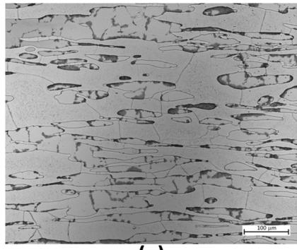  
(a)

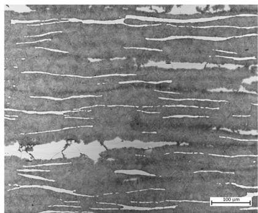  
(b)  
Fig. 1 – Discontinuous precipitation in 600 ◦C tempered alloys 9Al-10Mn-0.4C (a) and in 9Al-10Mn- 1C (b).

Austenite plays an important role in Fe–Mn–Al–C lowdensity steels, not only because of its excellent mechanical properties, but also because of its possible various evolutions. Understanding of the behaviour of austenite within these lightweight steels is fundamental. --Carbides are always involved in these transformations, increasing the complexity and variety of microstructures. Each configuration derived from the  reaction has its own specific properties and/or drawbacks, which need to be mastered in order to develop valuable products. In this study, various microstructure morphologies have been characterized as a function of different austenite transformations: discontinuous precipitation $( \gamma $  + -), precipitation transformation $( \gamma \to \gamma _ { 0 } + \kappa )$ , cellular transformation $( \gamma \to \alpha + \kappa \mathrm { o r } \gamma \to \alpha + \kappa + \gamma _ { 0 } )$ and spinodal decomposition $( \gamma \to \gamma _ { 0 } + \gamma ^ { \prime } \to \gamma _ { 0 } + \mathtt { L } 1 _ { 2 } \to \gamma _ { 0 } + \mathtt { L } 1 _ { 2 } / \mathtt { E } 2 _ { 1 } )$ Discontinuous precipitation is a reaction involving the grain boundary migration and does not affect the non-transformed parent phase composition [26]. Cellular transformation, on the other hand, could be explained as an eutectoid reaction featuring grain boundary migration [27]. The product phases of both discontinuous precipitation and cellular transformation mechanisms are lamellar structures, which usually start to develop from the grain boundaries. In Fe–Mn–Al–C alloys such transformations produce intergranular --carbides that can form as discrete or continuous/fine or coarse particles [12,27–29]. If the aging time is extended, such --carbides form first on $\gamma / \gamma$ grain boundaries and then they grow towards the adjacent -grains [29,30]. Due to their morphology and distribution along boundaries/phase interfaces these intergranular --carbides induce serious brittleness. They affect material structural stability, strength and ductility both during hotworking, cold-working and under nominal loading conditions at room temperature [14,31–36].

<table><tr><td colspan="2">Table 1 – Chemical composition ranges of the tested Fe–Mn–Al–C grades.</td></tr><tr><td>Alloying element</td><td>Composition (wt%)</td></tr><tr><td>Al</td><td>9–12</td></tr><tr><td>Mn</td><td>10–20–30</td></tr><tr><td>C</td><td>0.4–1</td></tr><tr><td>Fe</td><td>Bal.</td></tr></table>

Table 2 – Example of hardening effects of discontinuous precipitation.

<table><tr><td rowspan="2">Composition (wt%)</td><td colspan="2">Hardness [HV]</td></tr><tr><td>Hot-rolled</td><td>600 °C — Tempered</td></tr><tr><td>9Al-10Mn-1C</td><td>273</td><td>439</td></tr></table>

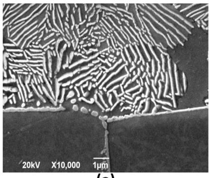  
(a)

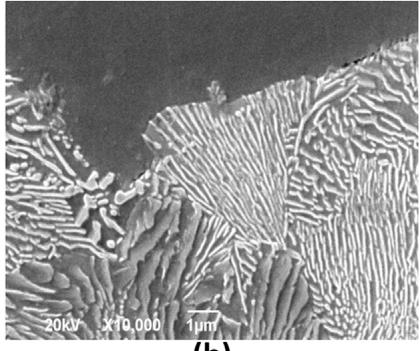  
(b)

Fig. 2 – Discontinuous precipitation in - + -carbides lamellae at 600 ◦C in: (a) 9Al-10Mn-0.4C; (b) 9Al-10Mn-1C.  
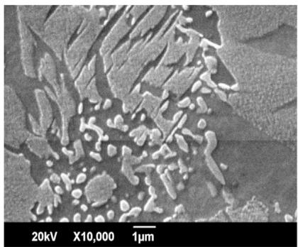

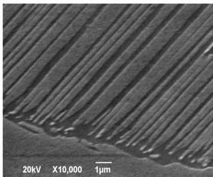  
(b)  
Fig. 3 – Heat treatment at 600 ◦C: (a) 2Al-10Mn-0.4C and (b) 12Al-10Mn-1C.

Spinodal decomposition, however, generates intragranular nano-sized cube-shaped --carbides within the -phase [1,37–40], and they are usually associated with strengthening effects [1,37]. This transformation has been found to start from when Al and C additions are made, forming carbon-rich -phase and carbon-lean -phase. Then, the carbon-enriched region evolves into a short-range ordered SRO- $\cdot \mathbf { L } \mathbf { 1 } _ { 2 }$ structure. $\mathbf { L } \mathbf { 1 } _ { 2 }$ is an ordered -phase with aluminium atoms at the corners of the cube and iron/manganese at the faces. After that, L1 undergoes further ordering of C atoms, which settle at the octahedral site of the cube lattice, resulting in the formation of $\mathtt { E 2 } _ { 1 }$ and $\mathrm { L } { \bf \vec { 1 } } _ { 2 }$ structures [1,30,39,41]. Aging is the most common process that triggers spinodal decomposition of austenite [28,30,37,42–46]. Various studies have given different results showing that alloys featuring different compositions and aging parameters do not behave in the same way. Carbon and aluminium concentrations mainly affect --carbide formation [1,38–41]. Al and C amounts influence the chemical driving force and the coherency strain energy between --carbides and , which are essential for  decomposition [37,43]. As a matter of fact, some works have also reported spinodal decomposition occurring during quenching [40,41,43,46]. The degree of carbon supersaturation in austenite has been suspected of playing a crucial role in triggering the formation of intragranular --carbides during fast cooling [43]. Other experiments have revealed fine---carbides homogeneously dispersed in austenite grains. These are thought to have formed during quenching, implying a further precipitation on $\gamma / \gamma$ boundaries during subsequent aging treatment [30,39,40,44].

## 2. Experimental procedure

The different alloyed steels were produced by casting using a 100 kW vacuum induction furnace, resulting in 0,5 kg ingots (Table 1). The ingots were hot-rolled at $1 1 5 0 ^ { \circ } \mathrm { C } ,$ obtaining 5 mm flat-products, followed by water quenching. Samples were heat treated at 600 ◦C and 800 ◦C for 30 min, followed by water quenching.

Through-thickness embedding, grinding and polishing were performed separately for hot-rolled and heat-treated samples. All the alloys, at the different processing conditions (hot-rolling and tempering), were analysed using optical microscopy. An SEM analysis was been performed only on the selected microstructures. Secondary Electron Images (SEI) and Energy Dispersive X-rays (EDX) were acquired in order to analyse the phase morphologies and chemical compositions. EDX-spectroscopy (EDS) was done to provide qualitative information on the local phase composition.

Macro-hardness tests were performed using the Vickers method. A 5 kg load was applied for all the indentations. 5 indentations per sample were made to perform a powerful statistical analysis.

Minitab18® software was used to verify the consistency of the data acquired. Outliers were excluded from the investigation. Data was plotted in order to highlight chemical composition and process effects, by associating them to the micrographs.

<table><tr><td colspan="9">Table 3 – EDS for Al and Mn in 9Al-10Mn-1C tempered at 600 °C.</td></tr><tr><td rowspan="2">wt%</td><td colspan="4">Al</td><td colspan="4">Mn</td></tr><tr><td>δ</td><td>γ</td><td>K</td><td>γ nano-k</td><td>δ</td><td>γ</td><td>k</td><td>γ nano-k</td></tr><tr><td>Min</td><td>7.8</td><td>7.6</td><td>8.0</td><td>7.8</td><td>9.7</td><td>9.9</td><td>10.2</td><td>13.2</td></tr><tr><td>Mean</td><td>8.2</td><td>7.8</td><td>8.2</td><td>8.0</td><td>9.9</td><td>10.3</td><td>10.4</td><td>13.4</td></tr><tr><td>Max</td><td>8.7</td><td>8.0</td><td>8.3</td><td>8.1</td><td>10.0</td><td>10.7</td><td>10.5</td><td>13.6</td></tr></table>

## 3. Results

## 3.1. Discontinuous precipitation

Discontinuous precipitation occurred in alloys treated at 600 ◦C for lower Mn contents enhancing the hardness of the grades (Table 2, Fig. 1). Austenite evolved through discontinuous precipitation into $\gamma + \kappa$ lamellar structures. At 9Al-10Mn-0.4C,  grains underwent only partial discontinuous precipitation (Fig. 1(a)), whereas at 9Al-10Mn-1C almost all the austenite volume was transformed into the above-mentioned lamellar structure, where it might be possible that some -phase is also present. Only a few -band-shaped regions survived the transformation in the last-mentioned microstructure (Fig. 1(b)).

Higher magnifications show that at 9Al-10Mn-0.4C discontinuous precipitation starts from the grain boundaries (Fig. 2(a)). Whereas, at 9Al-10Mn-1C most of the austenite is transformed through the discontinuous precipitation reaction (Fig. 2(b)). In both cases  + --carbide fine lamellae were produced. Moreover, in the $9 \mathsf { A l - } 1 0 \mathrm { M n } \mathsf { - } 1 \mathsf { C }$ , the non-discontinuous precipitated austenite seems to have featured nano-sized -- carbide precipitation, as suggested by EDS (Table 3). This EDS analysis did not give clear and defined results, but a reasonable interpretation was given in accordance with the related microscopy observations.

At 12% Al the reactions involved the whole  volume (Fig. 3(a)). For example, at 12Al-10Mn-0.4C  precipitation produced a multifaceted microstructure. A similar austenite transformation was also triggered at $1 2 \mathsf { A l } \mathsf { - } 1 0 \mathsf { M n } \mathsf { - } 1 \mathsf { C }$ during tempering at $6 0 0 ~ ^ { \circ } \mathbf { C } ~ \left( \mathrm { F i g } . ~ 3 ( \mathsf { b } ) \right)$ . Moreover, it did not develop  + --carbide lamellar structures, but an austenite matrix only featured by carbon-depleted  regions with globular --carbides. This austenite transformation was also accompanied by strong --carbide precipitation along $\delta / \gamma$ boundaries and poor precipitation of --carbides within ferrite.

## 3.2. Precipitation transformation

In medium Mn with a high Al content of 12% (Fig. 4) tempered at $\cdot 6 0 0 ^ { \circ } \mathrm { C } , \gamma$ passed through a more complex random-like transformation, not as ordered and defined as discontinuous precipitation, and in this case it was been linked to slight hardening effects (Table 4). As a matter of fact, this transformation was labelled generic precipitation transformation. Not only  + - lamellae, but also alternated bands of what seem to be two different austenite grades are observable. Probably, carbon-

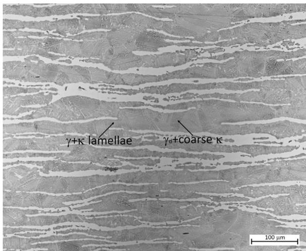  
Fig. 4 – Precipitation transformation in $6 0 0 ^ { \circ } \mathbf { C }$ tempered alloys 12Al-10Mn-1C.

Table 4 – Example of hardening effects of precipitation transformation on 12Al-10Mn-1C.

<table><tr><td colspan="2">Hardness [HV]</td></tr><tr><td>Hot-Rolled</td><td>600 °C — Tempered</td></tr><tr><td>401</td><td>420</td></tr></table>

depleted austenite is one of those two variants of the -phase, since also globular --carbides precipitated in it and not in the other -grade.

## 3.3. Cellular transformation and spinodal decomposition

Only the alloys tempered at $8 0 0 ~ ^ { \circ } \mathrm { C }$ underwent cellular transformation and/or spinodal decomposition. For high Al and C with medium Mn, austenite underwent both spinodal decomposition and cellular transformation. This microstructure is therefore characterised by wide-spread $\kappa ~ + ~ \alpha ~ + ~ \gamma$ lamellar structures, derived from  cellular transformation, thin band-shaped -ferrite grains and scattered regions of spinodal decomposed $\gamma \left( \mathrm { F i g . } 5 ( \mathsf { a } ) \right)$ , followed by a significant increase in hardness (Table 5). Then, for higher Al the microstructure features scattered thin-band-shaped -ferrite grains within a matrix of  + --carbide lamellae, derived from complete austenite cellular transformation (Fig. 5(b)). In this case hardness enhancement seems to depend on lamellae dimension and spacing (Table 5). Increased manganese concentration to medium-high levels leads to similar phases, but they show less developed transformation if compared to the previous

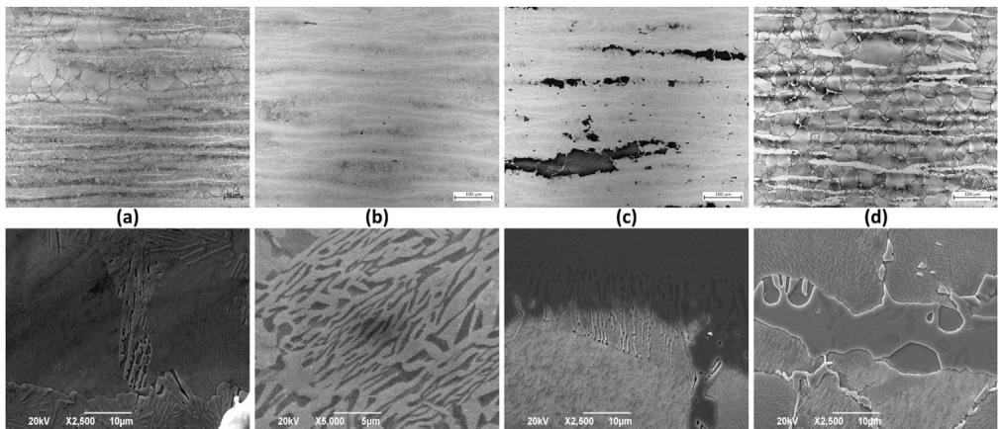  
Fig. 5 – Cellular transformation in (a) 9Al-10Mn-1C; (b) 12Al-10Mn-1C; (c) 12Al-20Mn-1C; and spinodal decomposition in (d) 12Al-30Mn-1C (800 ◦C tempered alloys). Up: optical microscope micrographies; down: secondary electron images micrographies.

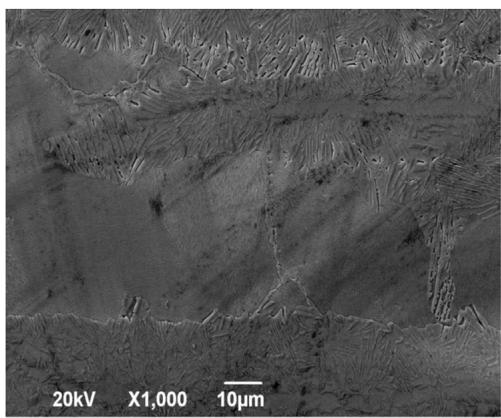

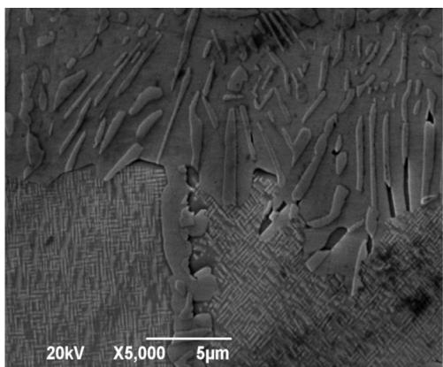  
(b)

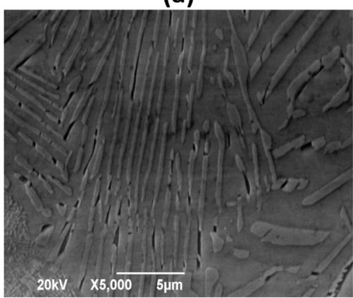  
(c)

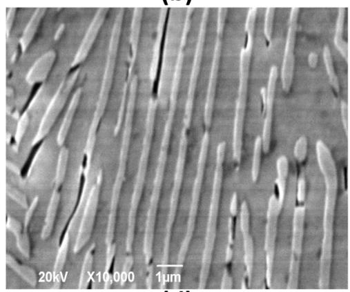  
(d)  
Fig. 6 – 9Al-10Mn-1C at 800 ◦C. - Transformations: spinodal decomposition in - + nano-sized -carbides (a, b) and cellular transformation in -carbides +  + residual - lamellar structure (c, d).

one. As a matter of fact,  grains present only early cellular transformed  + --carbide lamellae at their boundaries (Fig. 5(b)). At higher C, for high Al and medium-high Mn grades, their microstructures feature the same phases and morphologies as the previous alloy, except for the fact that some austenite grains have developed spinodal decomposition, instead of cellular transformation (Fig. 5(c)). Then, increasing manganese to high content the austenite grains were fully spinodal decomposed (Fig. 5(d)). In these cases, spinodal decomposition contributes to increasing the hardness level of the alloy (Table 5).

Along with the microstructure developed in 9Al-10Mn-1C at $6 0 0 ^ { \circ } \mathrm { C } ,$ , the microstructure obtained at 800 ◦C for the same alloy gained outstanding hardness values among the alloys featuring 9% aluminium. For this reason, a detailed SEM analysis is shown in Fig. 6 and Table 6.

Table 5 – Example of hardening effects of cellular transformation and spinodal decomposition.

<table><tr><td rowspan="2">Composition (wt%)</td><td colspan="2">Hardness [HV]</td></tr><tr><td>Hot-rolled</td><td>800 °C — Tempere</td></tr><tr><td>9Al-10Mn-1C</td><td>273</td><td>356</td></tr><tr><td>12Al-10Mn-1C</td><td>401</td><td>399</td></tr><tr><td>12Al-20Mn-1C</td><td>357</td><td>404</td></tr><tr><td>12Al-30Mn1C</td><td>324</td><td>352</td></tr></table>

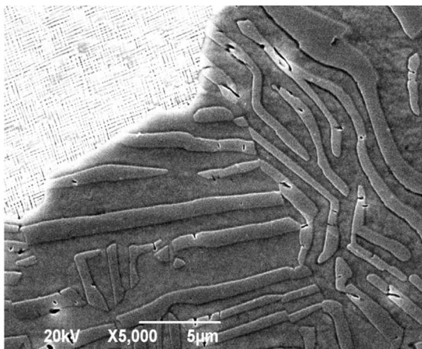  
Fig. 7 –  +  Lamellae in 12Al-20Mn-1C at 800 ◦C.

A different microstructure characterised the 800 ◦C tempered 12Al-20Mn-1C alloy (Fig. 5(c)), with similar features to 9Al-10Mn-1C (Figs. 5(a) and 6). These conditions gave rise to full austenitic decomposition.  Grains followed cellular transformation in --carbide +  + residual- lamellar structures, along with spinodal decomposition. Anyway, these --carbides were different, since they consisted of wide, thick lath-like lamellae (Fig. 7). Due to that, EDS analysis was also more accurate (Table 7). At 12% aluminium the --carbide lath-like strips look wider and thicker than at 9% Al. In these cases, even though the inter-lamellar spacing is high the hardening effects were consistent as shown in Table 5.

Higher magnification, of the detected spinodal decompositions, makes it possible to analyse the nano-sized --carbides. Actually, they assumed slightly different morphologies in the three different cases:

In 9Al-10Mn-1C, --carbides agglomerated into thin acicular morphologies in a relatively medium-dense grid (Fig. 8(a), (b)).

<table><tr><td colspan="7">Table 7 – EDS for Al and Mn in 12Al-20Mn-1C tempered at 800 °C.</td></tr><tr><td rowspan="2">wt%</td><td colspan="3">Al</td><td colspan="3">Mn</td></tr><tr><td>δ</td><td>γ</td><td>k</td><td>δ</td><td>γ</td><td>k</td></tr><tr><td>Min</td><td>11.0</td><td>5.7</td><td>10.3</td><td>15.2</td><td>20.3</td><td>21.9</td></tr><tr><td>Mean</td><td>11.9</td><td>7.8</td><td>10.8</td><td>17.9</td><td>23.6</td><td>23.9</td></tr><tr><td>max</td><td>13.6</td><td>9.9</td><td>11.9</td><td>20.8</td><td>27.6</td><td>25.5</td></tr></table>

In 12Al-20Mn-1C, --carbides presented the densest and thickest configuration with proper cuboidal morphology (Fig. 8(c), (d)).

In 12Al-30Mn-1C, --carbides agglomerated again into acicular-like precipitates, but with the finest and less dense configuration (Fig. 8(e), (f)).

## 4. Discussion

In order to trigger austenite decomposition a sufficient driving force and reaction velocity are needed, and this can be ensured by a specific combination of chemical composition, thermal energy input and thermodynamic stability of the concerned phase. As a matter of fact,  reactions occurred for faster reaction kinetics, thanks to the higher energy supply provided by the 600 ◦C and 800 ◦C heat treatments.

The energy introduced during tempering accelerated the reaction kinetics.

The tempering established thermodynamic changes for  stability with respect to the hot-rolled conditions.

Qualitative inferences of the entity of these thermodynamic gradients can be made by looking at the  phase volume fractions at different temperatures. For example, the 9Al-10Mn-0.4C alloy underwent austenite decomposition during tempering at 600 ◦C (Fig. 1(a)), but not at 800 ◦C even though kinetics should have been faster. However, this is not incoherent. In fact, the non-transforming behaviour of austenite reflects the respective phase volume fraction diagram (Fig. 9(a)). The austenite fraction along the red line does not decrease at 800 ◦C compared to 1150 ◦C.

This could be considered to be a qualitative indication of a possible  transformation. Indicative and qualitative, since alloy hot-rolled conditions at T (before thermal treatments) are not the same during hot rolling at 1150 ◦C. Discontinuous precipitation took place in 9Al-10Mn-0.4C at 600 ◦C (Fig. 1(a)). Actually, in its phase diagram the drop of  volume fraction from 1150 ◦C to 600 ◦C (Fig. 9(a)) was pointed out. Moreover, the  fraction gradient was also detected in 9Al-10Mn-1C at $6 0 0 ~ ^ { \circ } \mathrm { C }$ and $8 0 0 ~ ^ { \circ } \mathrm { C }$ (Fig. 9(b)). In these cases, the austenite decompositions were triggered. These conditions mean that not only tempering plays an important role in austenite decompositions. As a matter of fact, the chemical composition is also fundamental, since it provides not only the Al–C driving force for k-carbide precipitation, but it also imposes the phase equilibria among which tempering can operate.

<table><tr><td colspan="7">Table 6 – EDS for Al and Mn in 9Al-10Mn-1C tempered at 800 °C.</td></tr><tr><td rowspan="2">wt%</td><td colspan="3">Al</td><td colspan="3">Mn</td></tr><tr><td>δ</td><td>γ</td><td>k</td><td>δ</td><td>γ</td><td>k</td></tr><tr><td>Min</td><td>8.1</td><td>6.8</td><td>8.6</td><td>7.4</td><td>11.1</td><td>10.1</td></tr><tr><td>Mean</td><td>8.4</td><td>7.4</td><td>9.4</td><td>8.3</td><td>11.4</td><td>12.3</td></tr><tr><td>Max</td><td>8.7</td><td>8.7</td><td>10.0</td><td>9.1</td><td>12.3</td><td>13.8</td></tr></table>

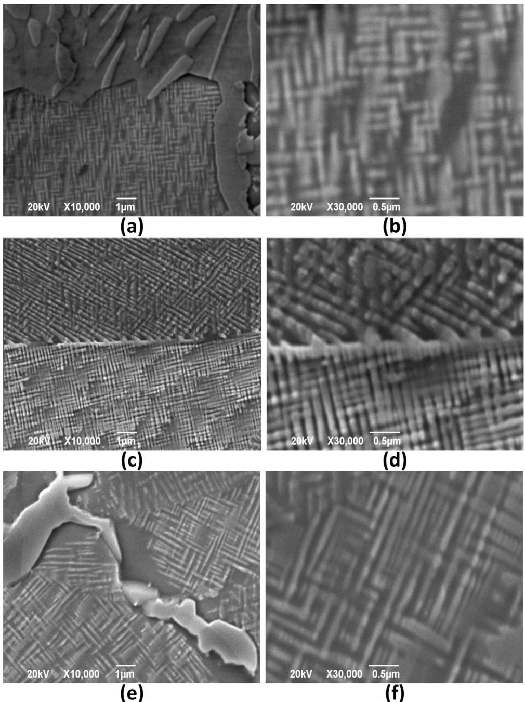  
Fig. 8 – Different nano-sized-carbides: (a, b) agglomerated nano-sized -carbides from spinodal decomposition 9Al-10Mn-1C at ${ \bf 8 0 0 } ^ { \circ } { \bf C } ;$ (c, d) cuboidal nano-sized -carbides from spinodal decomposition in 12Al-20Mn-1C at 800 ◦C; (e, f) agglomerated -carbides from spinodal decomposition in 12Al-30Mn-1C at ${ \bf 8 0 0 ^ { \circ } C } .$

During the discontinuous precipitation, a lower driving force, caused by a lower annealing temperature at

600 ◦C allowed grain boundary migration of the forming lamellar phase rather than completing lamellae separation.

The manganese and carbon concentrations were not high enough to stabilize the  phase against its own transformation. This austenite evolution was granted by the following boundary conditions:

10% of manganese.

Thermal energy introduced at $6 0 0 ^ { \circ } \mathrm { C } .$

(a)  
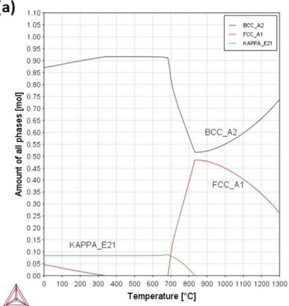

(b)  
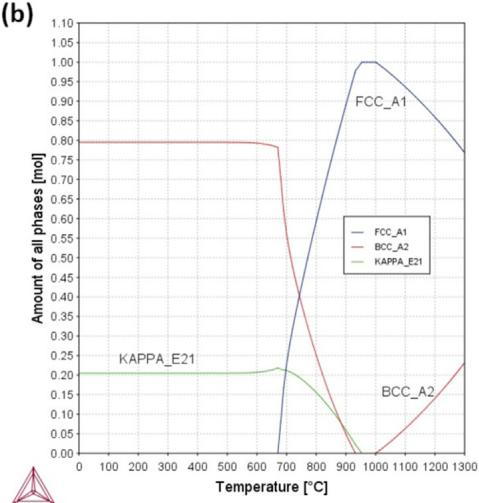

Fig. 9 – Example of the presence of thermodynamic gradients for austenite stability from phase volume fraction diagrams. (a) 9Al-10Mn-0.4; (b) 9Al-10Mn-1C.  
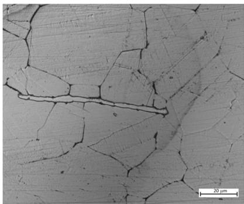  
(a)

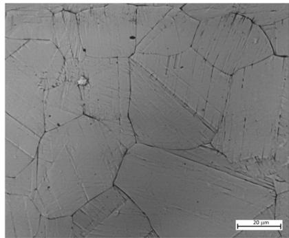  
(b)  
Fig. 10 – - Grain striations and -/- precipitates: (a) 9Al-20Mn-1C; (b) 9Al-30Mn-1C at $6 0 0 ^ { \circ } \mathbf { C } .$

In these cases, the carbon concentration seems to have played a threshold role.

At an $8 0 0 ~ ^ { \circ } \mathrm { C }$ annealing temperature, different equilibrium states are identified. Such boundary conditions developed at $9 \mathsf { A l - } 1 0 \mathsf { M n - } 1 \mathsf { C }$ cellular transformation for most of the austenite fraction and spinodal decomposition for the remainder. Cellular transformation generated - +  + residual- lamellar phases (Fig. 6, Table 6). The residual austenite was detected as the portions of --carbide lamellae, suggesting a non-complete reaction.

Therefore, the following situations were been ensured:

Fast reaction kinetics due to $8 0 0 ~ ^ { \circ } \mathrm { C }$ tempering.

Medium-high Al–C driving force.

Medium-low austenite stability.

This microstructure, along with the one developed in 9Al-10Mn-1C at $6 0 0 ~ ^ { \circ } \mathrm { C } ,$ gained outstanding hardness values among the alloys featuring 9% aluminium. Similar hardening, even if lower, was revealed for 9Al-20Mn-1C and 9Al-30Mn-1C at $6 0 0 ~ ^ { \circ } \mathrm { C }$ (Table 8). Anyway, such cases need to be investigated further since no austenite transformation was detected. A hypothesis could be the solid solution strengthening effect of carbon and/or very fine nano --carbides. Only the secondary phases along grain boundaries were detected.

<table><tr><td colspan="4">Table 8 – A comparison among the hardening effects in 9Al-xMn-1C at 600 °C and 800 °C tempering.</td></tr><tr><td>Composition (wt%)</td><td colspan="3">Hardness [HV]</td></tr><tr><td></td><td colspan="3">Hot-rolled600 °C — Tempered800 °C — Tempered</td></tr><tr><td>9Al-10Mn-1C</td><td>273</td><td>439</td><td>356</td></tr><tr><td>9Al-20Mn-1C</td><td>233</td><td>359</td><td>249</td></tr><tr><td>9Al-30Mn-1C</td><td>216</td><td>330</td><td>238</td></tr></table>

They are probably $\kappa + \alpha$ in $9 \mathsf { A l - } 2 0 \mathrm { M n - } 1 \mathsf { C }$ (since there seems to be a continuity with  grains) (Fig. 10(a) and 11 ) and only --carbides in 9Al-30Mn-1C (Fig. 10(b)). It is interesting that in both cases the austenite featured parallel striations with different directions in each grain (Fig. 10). A deeper investigation is also needed to understand the nature of this morphology.

In the 12% aluminium alloys, the thermodynamic gradients between the hot-rolling and the tempering equilibria seem to have been further increased by the higher amount of aluminium. As a matter of fact, the phase volume fraction diagrams show that the f.c.c. field lines moved to the right (towards higher temperatures) and away from the tempering temperatures. Even at $: 8 0 0 ^ { \circ } \mathrm { C } ,$ austenite stability seems to have been significantly affected. For example, for the 9Al-20/30Mn-1C composition, the austenite fraction is higher

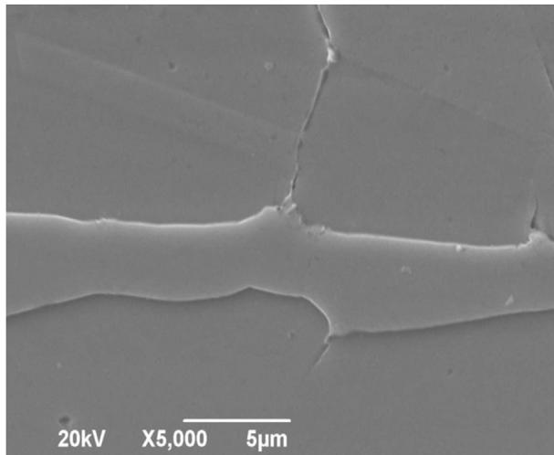  
Fig. 11 –  and/or -Carbides along - grain boundaries in 9Al-20Mn-1C at $6 0 0 ^ { \circ } \mathbf { C } .$ . Evidence of the continuity with  grain.

(which may indicate more stability) at $8 0 0 ~ ^ { \circ } \mathrm { C }$ than $1 1 5 0 ~ ^ { \circ } \mathrm { C }$ (Fig. 12(a), (b)). On the contrary, for 12Al-20/30Mn-01C the situation was reversed (Fig. 12(c), (d)). This behaviour would justify the  phase propensity to transform during tempering in 12Al alloys. Reactions which involved the austenite volume were detected for 12Al-10Mn-1C during $6 0 0 ~ ^ { \circ } \mathrm { C }$ heat treatment (Fig. 4) and during tempering at 800 ◦C for 12Al-10Mn-1C (Fig. 5(b)), 12Al-20Mn-1C (Fig. 5(c)) and 12Al-30Mn-1C $( \mathrm { F i g . } 5 ( \mathrm { d } ) )$

(a)  
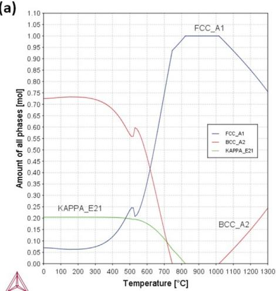

(c)  
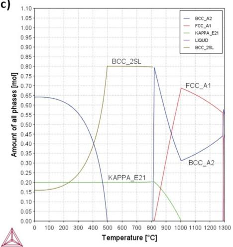  
(d)

Reaction kinetic acceleration caused by tempering played an important role:

Tempering at $8 0 0 ^ { \circ } \mathrm { C }$ provided the maximum acceleration of the reaction kinetics, allowing strong transformations even for short 30 min tempering.

Tempering at $6 0 0 ^ { \circ } \mathrm { C }$ allowed slighter or non-fully-developed reactions.

This situation may have led austenite to uncontrolled reactions. Making a comparison, in the corresponding heattreated alloy with 9% aluminium (Fig. 1(a)) austenite grains partially transformed, while at 12% Al the reactions involved the whole  volume. That is coherent with the enhanced driving force ensured by the higher aluminium content. The nature of these transformations is also different as shown in Fig. 3.  + --carbide lamellar structures were not detected and only globular --carbides are embedded in the matrix. The absence of “random” lamellar phases ensured a more solid microstructure configuration. These complex

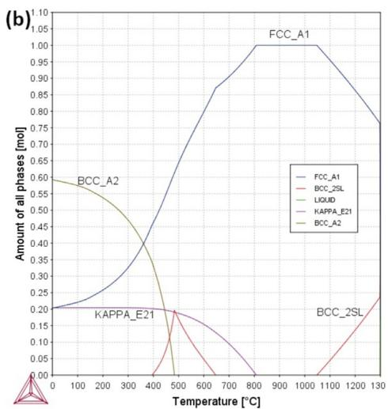

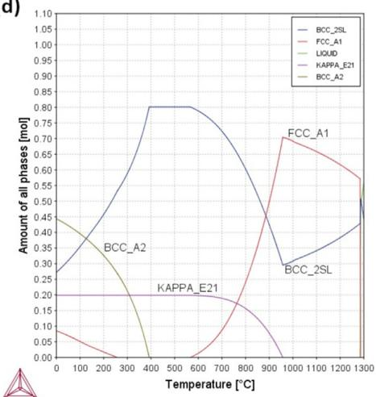  
Fig. 12 – Phase volume fraction diagrams: (a) 9Al-20Mn-1C; (b) 9Al-30Mn-1C; (c) 12Al-20Mn-1C; (d) 12Al-30Mn-1C.

Table 9 – Hardening effect and inter-lamellar spacing.

<table><tr><td rowspan="2">Composition (wt%)</td><td colspan="4">Hardness</td></tr><tr><td>Hot-rolled [HV]</td><td>Temperature [°C]</td><td>Tempered [HV]</td><td>Inter-lamellar spacing</td></tr><tr><td>12Al-10Mn-1C</td><td>401</td><td>800</td><td>399</td><td>Wide</td></tr><tr><td>9Al-10Mn-1C</td><td>273</td><td>600</td><td>439</td><td>Narrow</td></tr></table>

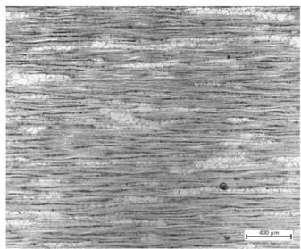  
(a)

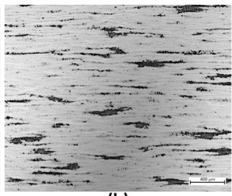  
(b)

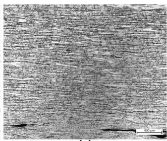  
(c)

Fig. 13 – Spinodal decomposition and cellular transformation share in: (a) 9Al-10Mn-1C; (b) 12Al-20Mn-1C; (c) 12Al-30Mn-1C after tempering at 800 ◦C.  
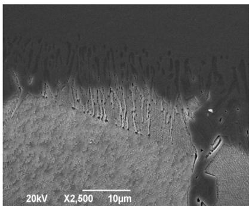  
(a)

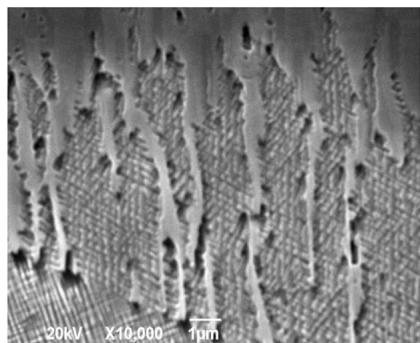  
(b)  
Fig. 14 – -Ferrite branches within spinodal decomposed - grains in 12Al-20Mn-1C at 800 ◦C.

evolutions derived from the interaction between carbon and manganese.

The combination of the thermal energy of the heat treatment and the composition created the following effects:

Accelerated but not fast reaction kinetics.

Not outstanding austenite stability.

Increased Al–C driving force for --carbide formation.

Within the 12Al group, tempering at 800 ◦C also caused outstanding austenite reactions. At 12Al-10Mn-1C austenite underwent full cellular transformation into  + -- carbide coarse lamellae, featuring high inter-lamellar spacing (Fig. 5(b))

For common pearlite this characteristic is known to be detrimental since it causes strength and ductility losses. The same behaviour might be hypothesized for Fe–Mn–Al–C steels, since the two last-mentioned microstructures kept the same hardness of their respective hot-rolled variants, instead of being strengthened by the high amount of --carbides (Fig. 10). As a matter of fact, on the contrary, 9Al-10Mn-1C alloys treated at 600 ◦C, with fine lamellae featuring short inter-lamellar spacing (Fig. 2(b)) showed significant hardening effects (Table 9).

The 12Al-20Mn-1C alloy tempered at 800 ◦C (Fig. 7) shows similar features to 9Al-10Mn-1C (Figs. 5(a) and 6). In these cases the Mn--stabilization was balanced by the Al–C driving force for --carbide formation. Fully austenitic decomposition occurs through cellular transformation along with spinodal decomposition. The resulting --carbides have wide and thick lath-like lamellae.

It is worth noting that at 800 ◦C the evolution of phase transformations seems to be relatively clear. As the austenite stability increased as the manganese concentration increases, the spinodal decomposition is more significant and occurred at the expense of cellular transformation. So, it is possible to hypothesize that spinodal decomposition requires:

Fast reaction kinetics.

A fair balance between austenite stability and Al–C chemical driving force.

That would be consistent with the phenomenon implying that cellular transformed fractions were predominant over the spinodal decomposed ones, due to lower Mn%- stability, at 9Al-10Mn-1C (Fig. 13(a)) and 12Al-20Mn-1C (Fig. 13(b)) grades; instead, at 12Al-30Mn-1C only spinodal decomposition has involved the entire austenitic volume (Fig. 13(c)). In 12Al-20Mn-1C tempered at 800 ◦C (Fig. 5(e)) it is interesting to note that some grains feature a mixed structure:  ferrite branches (linked to  + --carbide lamellar grains) are extended inside spinodal decomposed  grains (Fig. 14). This phenomenon requires further studies in order to be properly understood.

This microstructure coupled with the --carbide morphology should be the reason for the high hardness of this chemical composition. Higher hardness is related to higher tensile properties, on the other hand, these thick precipitates formed from spinodal decomposition, are associated to brittleness [33]. At any rate, the best microstructure seems to be the one obtained for the 9Al-10Mn-1C at 600 ◦C, in this condition the carbides have been obtained by discontinuous precipitation and they have narrow inter-lamellar spacing. This leads the highest value of hardness (Table 2) and the literature also suggest the better tensile ductility.

## 5. Conclusions

Different austenite transformations have been detected and characterised. Special attention was focused on pointing out both general and specific boundary conditions for each type of reaction.

Tempering at 600 ◦C triggered slight/incipient transformations: discontinuous precipitation and precipitation transformation. Differently, tempering at 800 ◦C triggered complete and widespread transformations like cellular transformation coupled with spinodal decomposition.

On one hand discontinuous precipitation developed  + --carbide fine lamellae, on the other hand precipitation transformation produced microstructures featuring fine/coarse  + --carbide lamellae and carbon-depleted -bands + --carbidenodules.

Cellular transformation developed  + - lamellar structures and two different morphologies were detected: wide-interspaced thick lath-like --carbide strips within a ferrite matrix and  + - wide lamellae with high inter-lamellar spacing that does not affect the improvement of hardness.

Spinodal decomposition produced different nano--- carbides within . Moreover, a more precise distinction can be performed for spinodal decomposition as a function of the carbides formed:

Spinodal decomposition + cellular transformation and medium dense and thin needle-like --carbides for the chemical composition featuring 12% Al + 20% Mn.

Spinodal decomposition + cellular transformation featuring the most dense and thickest nano-sized cuboidal --carbides and continuity between cellular transformed- lamellae and spinodal decomposed- + - grains for the chemical composition featuring 12% Al + 30% Mn.

## Conflicts of interest

The author declares no conflicts of interest.

## Funding

This research did not receive any specific grant from funding agencies in the public, commercial, or not-for-profit sectors.

## Data availability

The raw/processed data required to reproduce these findings cannot be shared at this time as the data are confidential and also forms part of an ongoing study.

## CRediT authorship contribution statement

C. Mapelli: Conceptualization. S. Barella: Conceptualization, Writing - original draft. A. Gruttadauria: Resources. D. Mombelli: Writing - review & editing. M. Bizzozero: Investigation, Formal analysis. X. Veys: Methodology, Supervision.

## Acknowledgements

Special thanks to ArcelorMittal Global R&D — OCAS (Belgium) for giving the opportunity to exploit its resources and for its fruitful collaboration with Politecnico di Milano.

## Appendix A. Supplementary data

Supplementary material related to this article can be found, in the online version, at doi:https://doi.org/10.1016/j. jmrt.2020.02.088.

## r e f e r e n c e s

[1] Chen S, Rana R, Haldar A, Ray RK. Current state of Fe-Mn-Al-C low density steels. Prog Mater Sci 2017;89:345–91, http://dx.doi.org/10.1016/j.pmatsci.2017.05.002.

[2] Kim H, Suh D-W, Kim NJ. Fe-Al-Mn-C lightweight structural alloys: a review on the microstructures and mechanical properties. Sci Technol Adv Mater 2013;14, http://dx.doi.org/10.1088/1468-6996/14/1/014205.

[3] Suh J, Jeon D, Yoon S, Eun J, Park H. Development of strong lightweight cementitious matrix for lightweight concrete simply by increasing a water-to-binder ratio in Ca(OH) -Na CO -activated fly ash system. Constr Build Mater 2017;152:444–55, http://dx.doi.org/10.1016/j.conbuildmat.2017.07.011.

[4] Kaspar J, Vielhaber M. Sustainable lightweight design — relevance and impact on the product development & lifecycle process. Procedia Manuf 2017;8:409–16, http://dx.doi.org/10.1016/j.promfg.2017.02.052.

[5] Sutou Y, Kamiya N, Umino R, Ohnuma L, Ishida K. High-strength Fe-20Mn-Al-C-based alloys with low density. ISII Int 2010:50:893–9. http://dx.doi.org/10.2355/isijinternational.50.893.

[6] Javidan F, Heidarpour A, Zhao X, Fallahi H. Fundamental behaviour of high strength and ultra-high strength steel subjected to low cycle structural damage. Eng Struct 2017;143:427–40, http://dx.doi.org/10.1016/j.engstruct.2017.04.041.

[7] Javidan F, Heidarpour A, Zhao X, Minkkinen J. Thin-walled structures application of high strength and ultra-high strength steel tubes in long hybrid compressive members: experimental and numerical investigation. Thin Walled Struct 2016;102:273–85, http://dx.doi.org/10.1016/j.tws.2016.02.002.

[8] Wang Q, Liu X. Non-saturated cyclic softening and uniaxial ratcheting of a high-strength steel: experiments and viscoplastic constitutive modeling. Mech Mater 2017;113:112–25, http://dx.doi.org/10.1016/j.mechmat.2017.07.021.

[9] Kim S-H, Kim H, Kim NJ. Brittle intermetallic compound makes ultrastrong low-density steel with large ductility. Nature 2015;518:77–9, http://dx.doi.org/10.1038/nature14144.

[10] Zamani M, Mirzadeh H, Maleki M. Enhancement of mechanical properties of low carbon dual phase steel via natural aging. Mater Sci Eng A 2018;734:178–83.

[11] Dieck S, Ecke M, Rosemann P, Fritsch S, Wagner MF-X, Halle T. Strength differential effect in martensitic stainless steel under quenching and partitioning heat treatment condition. In: Plasticity, damage and fracture in advanced materials. Springer; 2020. p. 35–42.

[12] Bausch M, Frommeyer G, Hofmann H, Balichev E, Soler M, Didier M, et al, RFSR-CT-2006-00027 Ultra high-strength and ductile FeMnAlC light-weight steels; 2013, http://dx.doi.org/10.2777/33040.

[13] Frommeyer G, Brüx U. Microstructures and mechanical properties of high-strength Fe-Mn-Al-C light-weight TRIPLEX steels. Steel Res Int 2006;77:627, http://dx.doi.org/10.1016/S1006-706X(08)60113-2.

[14] Howell RA. Microstructural influence on dynamic properties of age hardenable femnal alloys. Doctoral disertation. Missouri University of Science and Technology; 2009.

[15] Choi K, Seo CH, Lee H, Kim SK, Kwak JH, Chin KG, et al. Effect of aging on the microstructure and deformation behavior of austenite base lightweight Fe-28Mn-9Al-0.8C steel. Scr Mater 2010;63:1028–31, http://dx doi org/10.1016/i scriptamat 2010.07 036

[16] Bartlett L, Van Aken D. High manganese and aluminum steels for the military and transportation industry. JOM 2014;66, http://dx.doi.org/10.1007/s11837-014-1068-y.

[17] Scott C, Guelton N, Allain S, Faral M, AIST. The development of a new Fe-Mn-C austenitic steel for automotives applications. Proceeding AISTech 2007, Indianapolis 2007, http://dx.doi.org/10.13140/RG.2.1.1691.3449.

[18] Raabe D, Tasan CC, Springer H, Bausch M. From high-entropy alloys to high-entropy steels. Steel Res Int 2015;86:1127–38, http://dx.doi.org/10.1002/srin.201500133.

[19] Tjong SC. Electron microscope observations of phase decompositions in an austenitic Fe-8.7Al-29.7Mn-1.04C alloy. Mater Charact 1990;24:275–92, http://dx.doi.org/10.1016/1044-5803(90)90055-0.

[20] Yoo JD, Park KT. Microband-induced plasticity in a high Mn-Al-C light steel. Mater Sci Eng A 2008;496:417–24, http://dx.doi.org/10.1016/j.msea.2008.05.042.

[21] Peng W, Wang J, Zhang H, Hong X, Wu Z, Xu Y, et al. Insights into the role of grain refinement on high-temperature initial oxidation phase transformation and oxides evolution in high aluminium Fe-Mn-Al-C duplex lightweight steel. Corros Sci 2017;126:197–207,

[22] Wang CJ, Chang YC. TEM study of the internal oxidation of an Fe-Mn-Al-C alloy after hot corrosion. Oxid Met 2002;57:363–78, http://dx.doi.org/10.1023/A:1014834620707.

[23] Bonini F. Sviluppo di una nuova classe di acciai non inossidabili a bassa densità: studio di una lega Fe-Al-Mn-Ni-Cr-C. Master Thesis. Politecnico di Milano; 2017.

[24] Peng W, Wu Z, Xu Y, Ran Q, Xu W, Li J, et al. Internal oxidation behaviour of Fe-Mn-Al-C duplex light-weight steels with good combination of strength and ductility. Corros Sci 2017;120:148–57, http://dx.doi.org/10.1016/j.corsci.2017.03.005.

[25] Kaputkina LM, Svyazhin AG, Smarygina IV, Kindop VE. Strength of “light” ferritic and austenitic steels based on the Fe-Mn-Al-C system. Met Sci Heat Treat 2017;58:515–9, http://dx.doi.org/10.1007/s11041-017-0046-8.

[26] Aaronson HI, Pande CS. A synthesis of mechanisms for initiation of the cellular (or discontinuous precipitation) reaction. Acta Mater 1998;47:175–81, http://dx.doi.org/10.1016/S1359-6454(98)00335-8.

[27] Cheng WC. Phase transformations of an Fe-0.85 C-17.9 Mn-7.1 Al austenitic steel after quenching and annealing. JOM 2014;66:1809–20, http://dx.doi.org/10.1007/s11837-014-1088-7.

[28] Chao CY, Liu TF. Grain boundary precipitation in an Fe28.6Mn9.8Al0.8Si1.0C alloy. Scr Metall Mater 1991;25:1623–8, http://dx.doi.org/10.1016/0956-716X(91)90464-C.

[29] Chao CY, Hwang CN, Liu TF. Grain boundary precipitation in an Fe-7.8Al-31.7Mn-0.54C alloy. Scr Metall Mater 1993;28:109–14, http://dx.doi.org/10.1016/0956-716X(93)90546-5.

[30] Cheng WC, Cheng CY, Hsu CW, Laughlin DE. Phase transformation of the L12 phase to kappa-carbide after spinodal decomposition and ordering in an Fe-C-Mn-Al austenitic steel. Mater Sci Eng A 2015;642:128–35, http://dx.doi.org/10.1016/j.msea.2015.06.096.

[31] Shin SY, Lee H, Han SY, Seo CH, Choi K, Lee S, et al. Correlation of microstructure and cracking phenomenon occurring during hot rolling of lightweight steel plates. Metall Mater Trans A 2010;41:138–48, http://dx.doi.org/10.1007/s11661-009-0081-1.

[32] Han SY, Shin SY, Lee S, Kim NJ, Kwak JH, Chin KG. Effect of carbon content on cracking phenomenon occurring during cold rolling of three light-weight steel plates. Metall Mater Trans A 2011;42:138–46, http://dx doiorg/10.1007/s11661-010-0456-3

[33] Kimura Y, Handa K, Hayashi K, Mishima Y. Microstructure control and ductility improvement of the two-phase -Fe/--(Fe, Mn)3AlC alloys in the Fe-Mn-Al-C quaternary system. Intermetallics 2004;12:607–17, http://dx.doi.org/10.1016/j.intermet.2004.03.010.

[34] Lu WJ, Zhang XF, Qin RS. k-carbide hardening in a low-density high-Al high-Mn multiphase steel. Mater Lett 2015;138:96–9, http://dx.doi.org/10.1016/j.matlet.2014.09.104.

[35] Sohn SS, Lee B, Lee S, Kwak J. Effects of aluminum content on cracking phenomenon occurring during cold rolling of three ferrite-based lightweight steel. Acta Mater 2013;61:5626–35, http://dx.doi.org/10.1016/j.actamat.2013.06.004.

[36] Cheng WC, Song YS, Lin YS, Chen KF, Pistorius PC. On the eutectoid reaction in a quaternary Fe-C-Mn-Al alloy: austenite ferrite + kappa-carbide + M23C6 carbide. Metall Mater Trans A 2014;45:1199–216, http://dx.doi.org/10.1007/s11661-013-2083-2.

[37] Huang H, Gan D, Kao PW. Effect of alloying additions on the - phase precipitation in austenitic Fe-Mn-Al-C alloys. Scr Metall Mater 1994;30:499–504, http://dx.doi.org/10.1016/0956-716X(94)90610-6.

[38] Bentley AP. Ordering in Fe-Mn-Al-C austenite. J Mater Sci Lett 1986;5:907–8, http://dx.doi.org/10.1007/BF01729270.

[39] Wang CS, Hwang CN, Chao CG, Liu TF. Phase transitions in an Fe-9Al-30Mn-2.0C alloy. Scr Mater 2007;57:809–912, http://dx.doi.org/10.1016/j.scriptamat.2007.07.007.

[40] Lin CL, Chao CG, Bor HY, Liu TF. Relationship between microstructures and tensile properties of an

Fe-30Mn-8.5Al-2.0C alloy. Mater Trans 2010;51:1084–8, http://dx.doi.org/10.2320/matertrans.M2010013.

[41] Kalashnikov I, Acselrad O, Shalkevich A, Pereira LC. Chemical composition optimization for austenitic steels of the Fe-Mn-Al-C system. J Mater Eng Perform 2000;9:597–602, http://dx.doi.org/10.1361/105994900770345430.

[42] Kalashnikov IS, Acselrad O, Shalkevich A, Chumakova LD, Pereira LC. Heat treatment and thermal stability of FeMnAlC alloys. J Mater Process Technol 2003;136:72–9, http://dx.doi.org/10.1016/S0924-0136(02)00937-8.

[43] Tsay G, Tuan Y, Lin C, Chao C, Liu T. Effect of carbon on spinodal decomposition in Fe-26Mn-20Al-C alloys. Mater

Trans 2011;52:521–5, http://dx.doi.org/10.2320/matertrans.M2010255.

[44] Chang S, Wang S, Tsao L. Morphology and kinetics of discontinuous precipitation and dissolution in an Fe-8.5Al-27Mn-0.92C-1.0Si alloy. Metall Mater Trans A 2003;34:25–31.

[45] Han KH, Choo WK. Phase decomposition of rapidly solidified Fe-Mn-Al-C austenitic alloys. Metall Trans A 1989;20:205–14, http://dx.doi.org/10.1007/BF02670246.

[46] Ishida K, Ohtani H, Satoh N, Kainuma R, Nishizawa T. Phase equilibria in Fe-Mn-Al-C alloys. ISIJ Int 1990;30:680–6, http://dx.doi.org/10.2355/isijinternational.30.680.