Review Article

# Research status and development prospect of FeeMneCeAl system low-density steels

Shao-bin Bai a,b, Yong-an Chen c, Xin Liu c, Hui-hu Lu d, Pei-kang Bai b, Da-zhao Li c,\*, Zhi-quan Huang b, b,\*\*, Jing-yang Li a

a School of Aerospace Engineering, North University of China, Taiyuan, 030024, China

b Schoool of Mechanical Engineering, Taiyuan University of Science and Technology, Taiyuan, 030051, China

c School of Materials Science and Engineering, North University of China, Taiyuan, 030024, China

d Schoool of Mechanical Engineering, North University of China, Taiyuan, 030024, China

## a r t i c l e i n f o

Article history: Received 6 April 2023 Accepted 4 June 2023 Available online 9 June 2023

Keywords: FeeMneCeAl low-density steel Microstructure Production process Strengthening and toughening mechanisms Service performance

## a b s t r a c t

The rapid development of automotive industry results in a series of increasingly serious problems such as energy consumption and environmental pollution, so that developing the automotive steels with high-strength and low-density is of great significance for energy conservation and emission reduction. Recently, FeeMneCeAl system steel is favored by numerous researchers because of its low density and excellent combination of strength and ductility. However, too much Al addition inevitably triggers various changes of microstructure, deformation mechanism, and mechanical properties. In this paper, the composition design, production process, strengthening and strain hardening mechanism, and microstructure evolution are systematically expounded. The discussion mainly focuses on various strengthening (solid solution strengthening, grain refinement strengthening and precipitation strengthening) and strain hardening mechanisms (phase transformation-induced-plasticity (TRIP), twinning-induced-plasticity (TWIP), microbandinduced-plasticity (MBIP), shear-band-induced-plasticity (SIP) and dynamic slip band refinement (DSBR), etc.). Also, the existing problems and future challenges in FeeMneAleC low-density steels are pointed out via analyzing the service performance (cryogenic performance, impact toughness, fatigue performance, hydrogen embrittlement, wear performance, and tensile properties). Finally, we look forward to the future development direction of FeeMneAleC low-density steels and provide the valuable ideas.

© 2023 The Author(s). Published by Elsevier B.V. This is an open access article under the CC BY-NC-ND license (http://creativecommons.org/licenses/by-nc-nd/4.0/).

With the rapid development of automobile industry, fuel efficiency and greenhouse gas emissions become increasingly serious. More and more advanced high-strength steel or lightweight materials (such as magnesium alloy, aluminum alloy, and carbon fiber materials) are employed in automobile production towards the above issues via achieving lightweighting. However, their expensive material cost and poor service properties (formability, wear, and hydrogen embrittlement et al.) result in a limited application in automotive materials.

Low-density steels, which are considered as the new generation automobile materials, have been developed to overcome the aforementioned shortages. As early as the 1930 s, Korter and Ton [1] first put forward the concept of FeeMneCeAl system steels with Ni and Cr additions in consideration of the development prospect of high-strength steels. To lower the cost and density together, Ham and Carin [2] adopted the cheap Al and Mn elements instead of expensive Ni and Cr elements to optimize the chemical composition of stainless steels in the 1958 s. In the 1980 s and 1990 s [3e5], the replacement of Ni and Cr in stainless steel was widely studied, whereas few scientific studies on lowdensity steels were reported. Until the 2000 s, Frommeyer et al. [6] systematically investigated the microstructure and mechanical properties of FeeMneAleC low-density steels and considered that this steel can be employed to equip automobile steels. Since then, FeeMneAleC low-density steels started to attract much attention.

With the in-depth research of FeeMneCeAl steels in recent years, it was found that Si addition presents a competitive advantage, which could restrain the carbide precipitation and enhance the mechanical properties [7e12]. However, some other scholars insisted that the Si addition played a negative role in improving the mechanical properties of this steel [13,14]. It can be seen that the role of Si element in FeeMneAleC steels is still controversial. In addition, Si element is not the main chemical component in FeeMneAleC low-density steels. Therefore, Si element will not be discussed in the following sections.

In recent years, the research on low-density high-strength steels mainly focuses on the composition design, role of alloying elements, and microstructure characteristics. The relationship between precipitates and matrix phases is also widely studied by numerous researchers. In FeeMneAleC steels, the variation of alloying element content results in the changes of both microstructures and strain hardening mechanisms, leading to the distant differences in application performance [13e18]. Therefore, the present work will give a brief introduction to alloying design and producing process. Furthermore, this work summarizes various strengthening and toughening mechanisms of single ferrite and austenite, austenite base duplex phase (A-BDP), and ferrite base duplex phase (F-BDP) steels with FeeMneAleC composition. Finally, the existing problems and future challenges under different service environments are investigated.

## 1. Composition design and microstructure characteristics of FeeMneAleC low-density steels

The composition design plays an important role in density and microstructure characteristics, such as lattice constant, phase composition and precipitate type. Thus, it is necessary to summarize the composition design and role of alloying elements, as well as the resulting influence on microstructure characteristics of FeeMneCeAl low-density steels.

## 1.1. Composition design and role of alloying element

## 1.1.1. Density

In general, the density of FeeMneAleC steel is determined by alloying composition, as shown in Eq. (1) [19]:

$$
\rho = 8. 1 5 - 0. 1 0 1 \omega (\mathrm{Al}) - 0. 4 1 \omega (\mathrm{C}) - 0. 0 0 8 5 \omega (\mathrm{Mn})\tag{1}
$$

where $\omega ( \mathbb { A } ] ) , \omega ( \mathbb { C } )$ and u(Mn) represent the mass fractions of Al, C and Mn elements, respectively. Obviously, C content plays the most significant role in reducing density. However, the C solid solution is generally below 1.2 wt% in austenite of FeeMneCeAl steel to restrain the carbide precipitation and crack generation during the plastic processing [20e22]. Therefore, the density of FeeMneCeAl steel is mainly related to Al and Mn contents. Compared with the density of Mn (7.2 g/cm3), that of Al (2.7 g/cm3) has an obvious advantage in density reduction, implying that its low density shall be mainly controlled by Al content.

## 1.1.2. Lattice constant

During the thermal-mechanical processing, a large number of C, Mn and Al atoms are partitioned into austenite, resulting in the variation of austenite lattice constant. This complex relationship can be explained using Eq. (2) [23,24]:

$$
\begin{array}{l} \alpha = 0. 3 5 7 2 1 + 0. 0 0 0 2 7 7 1 \omega (\mathrm{Al}) + 0. 0 0 4 4 0 8 9 \omega (\mathrm{C}) \\ \quad + 0. 0 0 0 1 1 6 6 \omega (\mathrm{Mn}) \end{array}\tag{2}
$$

where $\omega ( \mathbb { A } ] ) , \omega ( \mathbb { C } )$ and u(Mn) represent the mass fractions of Al, C and Mn elements, respectively. Meanwhile, C atom is much more important for expanding austenite lattice constant than those of Mn and Al atoms. Because C atom exists in the form of interstitial solid solutions, while Al and Mn atoms exist in the form of substitutional solid solutions.

It is reported that the larger mass fractions of C, Mn and Al elements within austenite of FeeMneCeAl steel, the higher the yield strength, which can be explained via Eqs. (3)e(5) [25e28]:

$$
\sigma_ {\text { yield }} = 1 0. 5 \omega (\mathrm{Al}) + 3 5 1. 5\tag{3}
$$

$$
\sigma_ {\text { yield }} = 0. 5 8 \omega (\mathrm{Mn}) + 3 2 8. 0\tag{4}
$$

$$
\sigma_ {\text { yield }} = 1 8 0. 7 \omega (\mathrm{C}) + 2 5 0. 7\tag{5}
$$

where $\sigma _ { \mathrm { y i e l d } }$ is the yield strength increment. It is obvious that C and Al play a more positive role in yield strength increment than that of Mn. The yield strength increment is positively related to the lattice constant variation which inevitably leads to the various solution strengthening effects.

## 1.1.3. Phase diagram

$\mathsf { C } ,$ Mn and Al are the main elements for FeeMneCeAl steels. Other micro-alloying elements (such as Si, Ni, Cr, V and Mo) also can be added to meet various service requirements. As the austenite stabler, C addition can improve the austenite stability and expand the austenite phase region [29]. Mn is considered another austenite stabler. When Mn content ranges from 5 to 12 wt%, austenite will first transform into ε-martensite and then á-martensite. When Mn content is located between 15 and 30 wt%, austenite will directly transform into martensite [19]. Al is the ferrite stabler. A high Al content can promote the ordered transformation of ferrite to (Fe, Mn)Al or (Fe, Mn) Al phases [30]. As the increasing Al content, the (Fe, Mn) C-type carbide in austenite will be replaced by (Fe, Mn) AlC-type carbide (k-carbide).

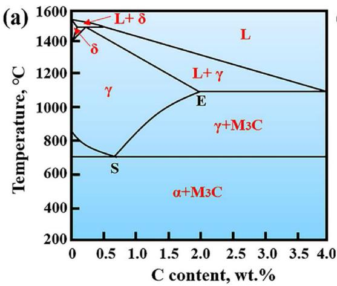

(b)  
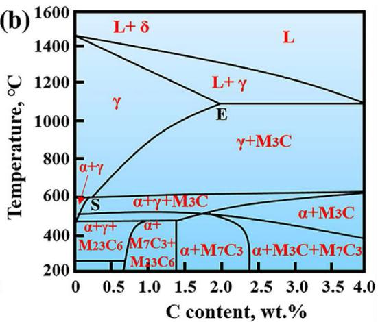

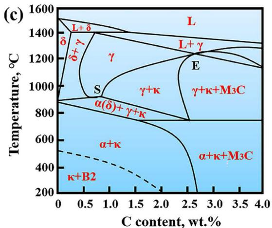  
Fig. 1 e The effects of Mn and Al addition on phase constituent and fields of the FeeC system [31e35]: (a) FeeC, (b) Fee15MneC, (c) Fee7AleC. The diashed line in (c) indicates the A2 to B2 transition temperature caused by Al addition

Fig. 1 shows the influence of Mn and Al additions on phase constituents [31e35]. Fig. 1a shows the FeeC phase diagram, the primary phases comprise of ferrite (a and d), austenite (g) and cementite $( \mathrm { M } _ { 3 } \mathrm { C } ,$ , M refers to Fe or Mn). Mn addition pro motes the austenite phase region to expand to a lower temperature. The S-point temperature represents the lowest temperature at which austenite exists as a single phase, as shown in Fig. 1b. When the temperature is lower than S-point temperature, g-austenite decomposes into a-ferrite and carbide, even forming ${ \bf M } _ { 7 } { \bf C } _ { 3 }$ and ${ \bf M } _ { 2 3 } { \bf C } _ { 6 }$ (Fig. 1b). In addition, increasing Mn content will result in the decreased C content and S-point temperature. A higher Mn content (>20 wt%) may accelerate the generation of b-Mn brittle phase (Fig. 1b). However, Al addition will make the $\left( \gamma + \mathsf { M } _ { 3 } \mathsf { C } \right)$ region replaced by (g k) and $\left( \gamma + \kappa + \mathsf { M } _ { 3 } \mathsf { C } \right)$ regions, as shown in Fig. 1c. As the Spoint temperature and C content increase, the (d g) region expands and the $\boldsymbol { \Upsilon }$ single-phase region migrates to the right (Fig. 1c).

## 1.2. Microstructure characteristics

According to the alloy composition and main constituent phases, the $\mathrm { F e { \mathrm { - } } M n { \mathrm { - } } A l { \mathrm { - } } C }$ system low-density steels after hot rolling and rapidly cooling to room temperature can be divided into single ferrite and austenite steels, A-BDP and F-BDP steels, as shown in Table 1.

<table><tr><td colspan="5">Table 1 – Microstructural and compositional characteristics of low-density Fe–Mn–Al–C steels [36].</td></tr><tr><td>Fe–Mn–Al–C steels</td><td>single ferrite steel</td><td>single austenite steel</td><td>A-BDP steel</td><td>F-BDP steel</td></tr><tr><td rowspan="3">Alloy composition (wt.%)</td><td> $X_{Mn} < 5.0$ </td><td> $15.0 < X_{Mn} < 30.0$ </td><td> $10.0 < X_{Mn} < 25.0$ </td><td> $3.0 < X_{Mn} < 10.0$ </td></tr><tr><td> $5.0 < X_{Al} < 12.0$ </td><td> $2.0 < X_{Al} < 12.0$ </td><td> $5.0 < X_{Al} < 12.0$ </td><td> $3.0 < X_{Al} < 9.0$ </td></tr><tr><td> $X_{C} < 0.1$ </td><td> $0.5 < X_{C} < 2.0$ </td><td> $0.6 < X_{C} < 1.0$ </td><td> $X_{C} < 0.4$ </td></tr><tr><td>Constituent phases</td><td> $\delta, B2, DO3,$  $\kappa$ </td><td> $\gamma, \alpha, \delta,$  $\kappa, \beta-Mn$ </td><td> $\alpha, B2, DO3,$  $\gamma, \kappa, \beta-Mn$ </td><td> $\alpha, \delta, B2, DO3,$  $\gamma, \kappa, \alpha'$ </td></tr></table>

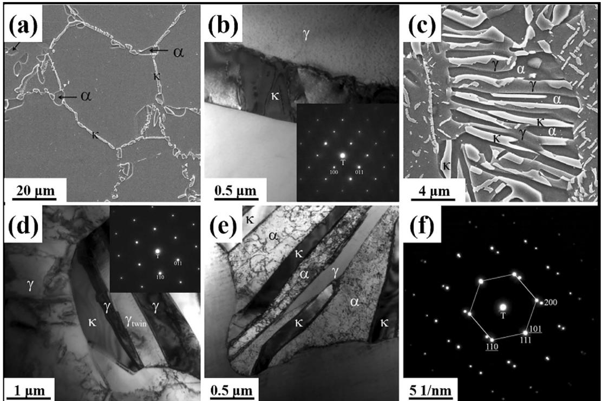  
Fig. 2 e The distribution of k-carbide at various locations [40]. (a, b) k\*-carbide precipitated along grain boundary; (c, d)′ k -carbide precipitated within grain; (e, f) k-carbide precipitated simultaneously along grain boundary and within grain

The room temperature microstructure of single ferrite FeeMneAleC steels is d-ferrite. A high Al content results in an increase of ferrite recrystallization temperature. So the dferrite grain is hard to be refined due to the limited dynamic or static recrystallizations [37]. Therefore, d-ferrite prolongs along the rolling direction and presents the banded morphology under hot rolling conditions. During the subsequent cooling process, k-carbide will precipitate along the dferrite grain boundary if the cooling rate is slow. Moreover, Al content can significantly influence the crystal structures of matrix phases. Due to the difference in Al content, the disordered FeAl phase with A2, ordered FeAl phase with B2, or ordered Fe Al phase with DO3 structures can act as the matrix phases [38].

The room temperature microstructure of single austenite FeeMneAleC steels is composed of equiaxed austenite together with annealing twins [39], because the temperature of thermal-mechanical processing is generally located within the single austenite phase region. After cold rolling, the severe plastic deformation makes numerous grains elongated into lath-like morphology along the rolling direction. Due to the differences in element contents and cooling rates, the carbide types formed in austenite are k-carbide and B2/DO3. Generally, k-carbide can be divided into intragranular k0-carbides and intergranular k\*-carbides, as shown in Fig. 2 [40].

The microstructure of FeeMneAleC duplex phase lowdensity steels is relatively complex, including austenite, ferrite (a and d), B2, DO3, k-carbide, b-Mn, and other precipitates (Table 1). The substructure, size, volume fraction and distributed location of these phases are different due to the influence of ferrite and austenite recrystallization [37,41] and element partitioning [18] under various heat-treatment processes. The quenched microstructure of A-BDP steels is full austenite. After aging at 500e800 C, the lath-like ferrite will form along the austenite grain boundary, and the B2 phase is found within the lath-like ferrite. While the microstructures of hot-rolled and cold-rolled F-BDP steels are the typical bimodal banded structure of d-ferrite and austenite. Meanwhile, k-carbide is generated along the interface between austenite and d-ferrite [42]. It can be seen that the evolution law of matrix phases caused by chemical composition has been relatively clear. However, a small difference in element content will lead to complex transformations of precipitate types, especially in A- and F-BDP steels. Thus, the depth-type purification during the smelting process is the primary technical problem to be solved.

## 2. Production process

Due to the different element contents in various FeeMneAleC low-density steels, the thermal-mechanical processing technologies, including plastic deformation and heat treatment, are also different. Generally, the forging ingot is homogenized at 1100e1250 C for 1e3 h, then hot-rolled to 2e5 mm thickness between 1100 and 850 C (Fig. 3). In some cases, it needs to reheat among different rolling-passes to avoid crack generation during hot rolling. A large rolling reduction can provide enough recrystallization driving force, thus inhibiting the segregation of Fe Al or FeAl. For austenite-base FeeMneCeAl steels [19,43], the hot-rolled steels can be rapidly cooled to room temperature and then subjected to isothermal annealing and aging treatments (Route 1 in Fig. 3). However, the d-ferrite in hot-rolled steels presents coarse and lath-like morphologies. Thus, cold rolling and recrystallization annealing are employed to tailor the d-ferrite size, texture and k-carbide (Route 2 in Fig. 3). Moreover, the cooling rate after hot rolling strongly influences intergranular k-carbide formation [44]. Note that aging at 500e700 C for 0.5e2 h (Routes 3 and 4 in Fig. 3) is beneficial to the nucleation of nano precipitates.

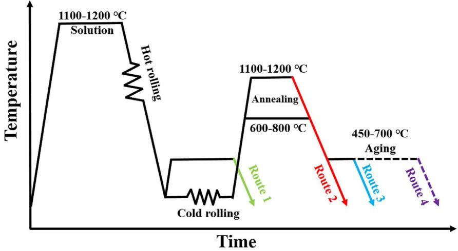  
Fig. 3 e Abstract images of hot and cold rolling, annealing and aging processes of FeeMneAleC steel.

## 2.1. Cold rolling and recrystallization annealing

For FeeMneCeAl low-density steels, the generation of deformation twins during cold rolling can effectively refine grains through the dynamic Hall-Petch effect to enhance strength [45]. However, the large cold rolling deformation also results in high residual stress, which harms the formability of steels [46]. The annealing process can eliminate work hardening and improve the toughness. Therefore, the combination of cold rolling and subsequent annealing process should be a reliable method to obtain high strength and good formability. Haase et al. [47] studied the influence of cold-rolling reduction (30%, 40% and 50%) and annealing time on the hardness of a $\mathrm { F e } { - } 2 2 . 5 \mathrm { M n } { - } 1 . 2 \mathrm { A l } { - } 0 . 3 \mathrm { C }$ steel. The hardness was improved with the increase of cold rolling reduction due to the high work hardening but was decreased with the increase of annealing time due to recrystallization (Fig. 4). Zhang et al. [48] designed the A-BDP steel with ultrafine grains by adopting austenite recrystallization and ferrite transformation via annealing in a cold rolled Fee25.7Mne10.6Ale1.2C steel. The final microstructure consisted of recrystallized austenite, recovered austenite, ultrafine ferrite and nano k-carbide, and the average grain size reached $1 . 1 2 \pm 0 . 5 7 ~ \mu \mathrm { m }$ . An et al. [49] adopted a simple thermomechanical method of cold rolling and subsequent annealing to tailor the grain size and B2 particles in a Fee28Mne11Ale1Ce5Ni steel. Nano B2 particles precipitated along the recrystallized austenite grain boundaries, while the ultrafine B2 particles were generated in coarse non-recrystallized austenite. Such a complex microstructure can significantly overcome the strength-ductility trade-off, but a few nano precipitates limit the enhancement of yield strength.

## 2.2. Aging hardening

Age hardening is a valid method to tailor the uniform distribution of carbide precipitates in austenite. Generally, the fine and dispersed carbides generate in a single austenite-base $\mathrm { F e { \mathrm { - } } M n { \mathrm { - } } A l { \mathrm { - } } C }$ steel (Al>7 wt% and $\mathrm { ~ C ~ } { > } ~ 0 . 7$ wt%) after aging treatment, thus enhancing the precipitation strengthening. Chen et al. [50] studied the influence of aging temperature (500, 600 and $7 0 0 ^ { \circ } \mathrm { C } )$ on precipitate nucleation of the $1 0 0 0 ^ { \circ } \mathrm { C } \cdot$ annealed-water quenched Fee30Mne10Ale2C steel. After aging at $5 0 0 ^ { \circ } \mathrm { C } ,$ a large number of k-carbide precipitated along the austenite grain boundary. When aging was conducted at $6 0 0 ^ { \circ } \mathrm { C } ,$ , b-Mn was generated and showed dramatic secondary hardening. Further aging at $7 0 0 ^ { \circ } \mathrm { C } ,$ , the b-Mn was also observed along the austenite grain boundary, however, it played an inactive role in ductility. Liu et al. [51] investigated the influence of aging time (3, 10, 30 and 720 min) on carbide nucleation in the 1000 C-annealed Fee11Mne10Ale1.2C steel. With aging at 500 C for 3 min, prior k-carbide quickly grew up and coarsened along the austenite grain boundary. After aging for 10 min, coarse k-carbide nucleated along the initial austenite grain boundary, which decreased the C content of local region and further formed the C-depleted area, finally transforming into thin grain boundary ferrite. After aging for 30 min, austenite within the C-depleted area decomposed into ferrite and k-carbide via eutectoid reaction. When the aging time reached 720 min, the continuous eutectoid reaction increased the fraction of nano k-carbide precipitates, finally contributing to a high yield strength. Bidyapati et al. [52] pointed out that the proper aging time could accelerate the intragranular B2 phase and k-carbide precipitation at once. However, a long aging time resulted in the decreased fractions of B2 phase and k-carbide. In addition, aging process also can be carried out after cold rolling to enhance mechanical properties. Hwang et al. [53] studied the influence of aging treatment on a Fee21Mne10Ale1Ce5Ni steel under partial and complete recrystallization annealing conditions. The result showed that the hardness of B2 phase and yield strength were significantly improved after the annealing-aging process. So, the combination among cold rolling, recrystallization annealing, and aging processes can not only ensure a high yield strength but also overcome the strength-ductility trade-off in FeeMneAleC steels.

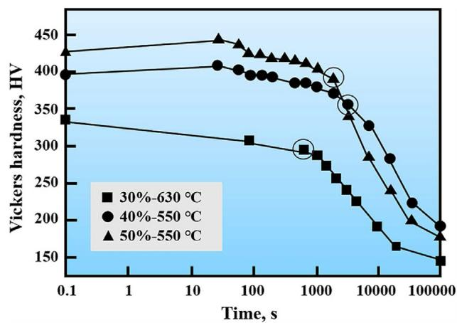  
Fig. 4 e Vickers hardness evolution of $30 \% ,$ 40% and 50% cold-rolled steels for different annealing times of Fe-22.5Mn-1.2Al-0.3C steel [47].

## 2.3. Other processes

To pursuit more outstanding combination between strength and ductility, the scholars adopted some other thermal mechanical processing technologies. Ren et al. [54] adopted the rapidly water-quenched to manufacture the short-range ordering phase and k-carbide in a Fe-30.4Mne8Al-1.2C steel. As the cooling rate increased, the transformation from shortrange ordering to k-carbide was restrained, which increased the work hardening without deteriorating yield strength. Kwang and Hyo et al. [55] developed a low-temperature tempering-induced partitioning process to overcome the strength-ductility trade-off in a Fe-2.8Mn-5.7Al-0.3C steel. The austenite grains with heterogeneous size-distribution were embedded in ferrite, which provided a suitable condition for C partitioning. Interestingly, more C preferentially partitioned into smaller austenite grains than larger ones. This sizedependent partitioning led to the slip spacing variation and lattice strain under dislocation motion.

In the above, many factors influence the microstructures and mechanical properties of FeeMneAleC low-density steels. Table 2 summarizes the mechanical properties of various forged plates obtained under different thermalmechanical processes. It can be seen that the tensile strength and total elongation of low-density steels strongly depend on cold rolling-annealing and aging hardening. Because the type, distribution and size of precipitates are susceptible to annealing/aging temperatures and times. Thus, it is necessary to precisely control the type, size and distribution of precipitates, which requires relevant scholars to optimize the existing process and to further narrow the temperature and time intervals on the basis of clarifying precipitation rules.

## 3. Strengthening and strain hardening mechanisms

The strengthening and toughening mechanisms determine the mechanical properties of steels. For single ferrite and austenite FeeMneAleC low-density steels, solution strengthening, fine grain strengthening, dislocation strengthening and strain hardening are the main strengthening and toughening mechanisms [19]. While that of dualphase FeeMneAleC low-density steels mainly includes TRIP and TWIP effects in addition to the above mechanisms, resulting in the multi-stage strain hardening characteristics due to the synergetic effect of various deformation mechanisms [20].

## 3.1. Strengthening mechanisms

## 3.1.1. Solution strengthening

Austenite-base FeeMneAleC steels contain a large fraction of Al, Mn and C elements. Interstitial C and N atoms enter into FCC g-Fe, the lattice distortion is caused and the stress field is formed simultaneously, which then interacts with dislocations in the matrix to generate a strong hardening effect. In contrast, the lattice distortion caused by the replacement atoms (such as Mn, Ni or Si) is spherical symmetry, so its strengthening effect is weaker than that of interstitial solid solution atoms [26,56]. The influence of alloy elements on yield strength of austenite steels is shown in Fig. 5 (a). The 1 wt % C contributes to a yield strength increment of 187e300 MPa for austenite, while the contributed yield strength of 1 wt% Al is slightly below 10 MPa. Mn addition can not only improve the austenite fraction but increase the solubility of Al and C in austenite, both of which indirectly affect the mechanical properties.

Table 2 e Comparison of mechanical properties of low-density steels under different thermal-mechanical processes. TE and UTS represent total elongation and ultimate tensile strength, respectively.

<table><tr><td>Composition (wt.%)</td><td>Density (g·cm-3)</td><td>TE (%)</td><td>UTS (MPa)</td><td>Thermal-mechanical processes</td></tr><tr><td>Fe-15Mn-10Al-0.86C-5Ni [19]</td><td>6.71</td><td>18.0</td><td>1548</td><td>Cold rolling-annealing</td></tr><tr><td>Fe-23Mn-1.5Al-0.3C [48]</td><td>6.98</td><td>98.9</td><td>840</td><td>Hot rolling-solution</td></tr><tr><td>Fe-27Mn-12Al-0.9C [24]</td><td>6.46</td><td>40</td><td>800</td><td>Cold rolling-water quenching</td></tr><tr><td>Fe-11Mn-10Al-1.2C [51]</td><td>6.5</td><td>22.2</td><td>1314</td><td>Cold rolling-annealing-aging</td></tr><tr><td>Fe-30Mn-11Al-1.2C [34]</td><td>6.29</td><td>17.8</td><td>1218</td><td>Solution-aging</td></tr><tr><td>Fe-21Mn-10Al-1C-5Ni [54]</td><td>7.0</td><td>80</td><td>775</td><td>Solution-water quenching</td></tr><tr><td>Fe-29Mn-9.4Al-0.3C [47]</td><td>7.4</td><td>30</td><td>757</td><td>Cold rolling-annealing</td></tr><tr><td>Fe-28Mn-9Al-0.9C-5Ni [53]</td><td>6.79</td><td>20.3</td><td>1620</td><td>Cold rolling-annealing-aging</td></tr></table>

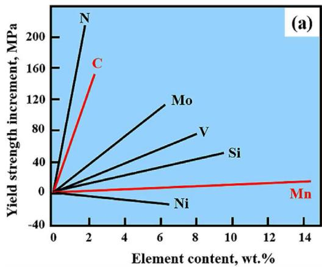

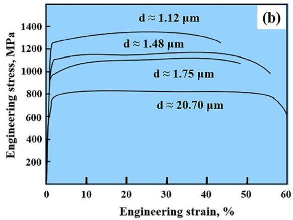  
Fig. 5 e (a) Contributed yield strength increment of alloying elements in austenite steel [6]; (b) Engineering stress-strain curves of samples with various austenite grain sizes [48].

## 3.1.2. Grain refinement strengthening

According to the Hall-Petch effect, grain refinement strengthening is another strengthening mechanism. Generally, cold rolling, recrystallization annealing, and adding micro-alloying elements (Nb, V, Ti, and Mo et al.) are also used to refine grains $[ 5 5 , 5 7 - 5 9 ]$ . Zhang et al. [48] prepared a coldrolled $\mathrm { F e { \mathrm { - } } M n { \mathrm { - } } A l { \mathrm { - } } C }$ dual-phase steel with ultrafine grains in consideration of austenite recrystallization and ferrite transformation. The result implied that the austenite grain refinement increased the yield strength and ultimate tensile strength above 400 MPa (Fig. 5b). However, too small grains will weaken this strengthening effect.

## 3.1.3. Precipitation strengthening

FeeMneAleC low-density steels included numerous precipitates, such as k-carbide, B2, DO3 and b-Mn. Due to the different precipitate modes, the corresponding precipitation strengthening can be divided into two types. The first one is related to the uniformly distributed nano k-carbide, which affects the movement and arrangement of dislocations during plastic deformation [60]. While the other one is related to elongated a-ferrite, which can continuously and orderly transform into B2 or DO3 intermetallic compounds during the aging process [61]. However, b-Mn can significantly deteriorate the ductility of FeeMneAleC low-density steels and reduce impact energy, it will not be described in detail [20,62].

## (1) k-Carbide strengthening

The k-carbide has L012 ordered crystal structure similar to that of perovskite oxide, as shown in Fig. 6 [63]. The chemical formula of k-carbide is usually (Fe, Mn) AlC . Still, the exact chemical composition is unknown because the C content in ultrafine precipitates is challenging to measure. In 1995, Palm [64] reported that the chemical formula of k-carbide should be $( \mathrm { F e , \ M n ) _ { y } A l _ { 1 - y } C _ { x } \ ( - 0 . 2 \ < \ y < + 0 . 2 , \ 0 . 4 2 \ < \ x \ < \ 0 . 7 1 ) }$ through experiment and accurate calculation. Although the commonly used Fe AlC formula does not take into account the Fe/Al ratio deviation, it is still widely used. Seol et al. [42] proposed that the formation of k-carbide was determined by a eutectoid reaction related to nucleation and growth, which further revealed that the composition of k-carbide varied with the aging conditions and alloy composition.

High C (>0.7 wt%) and Al (>7.0 wt) contents are the primary conditions for k-carbide formation in single austenite-base $\mathrm { F e { \mathrm { - } } M n { \mathrm { - } } A l { \mathrm { - } } C }$ steels. However, k-carbide can be divided into k0-carbide and k\*-carbide according to the aging temperature. When the aging temperature ranges from 500 to $7 0 0 ^ { \circ } \mathrm { C } ,$ the spinodal decomposition will occur in austenite, which is described as follows: $\gamma \to \gamma ^ { \prime } + \gamma " \to \gamma " + \mathrm { L } 1 _ { 2 }$ (short-range ordering phase) $ \gamma ^ { \prime } + \kappa ^ { \prime }$ [65]. Meanwhile, the $\kappa ^ { \prime } \cdot$ -carbide refers to the ultrafine precipitate nucleated within the austenite matrix $( \mathrm { F i g . } \ 6 ) ,$ , showing a coherent relationship between them [29,42,61]. Finally, the ultrafine layer $\kappa ^ { \prime } \cdot$ carbide in austenite and nano dispersed k0-carbide in ferrite can significantly enhance yield stress and cause aging hardening [66,67]. As the aging temperature increases to $7 0 0 { - } 9 0 0 \ ^ { \circ } \mathrm { C } ,$ the coarse $\kappa ^ { \prime } -$ carbide will generate in austenite matrix or along the prior austenite grain boundary. This k0-carbide is called intercrystalline k\*-carbide. Therefore, the high aging temperature can accelerate the precipitation of coarse k\*-carbide along the grain boundary. Moreover, the long aging time will lead to the formation of brittle b-Mn phase. However, k\*-carbide and $\beta -$ Mn are unfavorable to the ductility and toughness of $\mathrm { F e { \mathrm { - } } M n { \mathrm { - } } A l { \mathrm { - } } C }$ low-density steels [68]. Therefore, the aging temperature and time should be precisely regulated to avoid the formations of intergranular k\*-carbide and b-Mn in single austenite-base FeeMneAleC steel. Under a plastic deformation, the interaction between k-carbides and dislocations does not change the plane slip mode, but the additional dislocation sources are activated and acted upon by cross slip [38]. Moreover, these nano k-carbides uniformly distribute in austenite and then promote the plane slip. As the strain increases, the plane dislocation structure is further refined, contributing to continuous strain hardening. This is the main contribution of k-carbide strengthening in single austenite base FeeMneAleC steels.

## (2) B2 phase strengthening

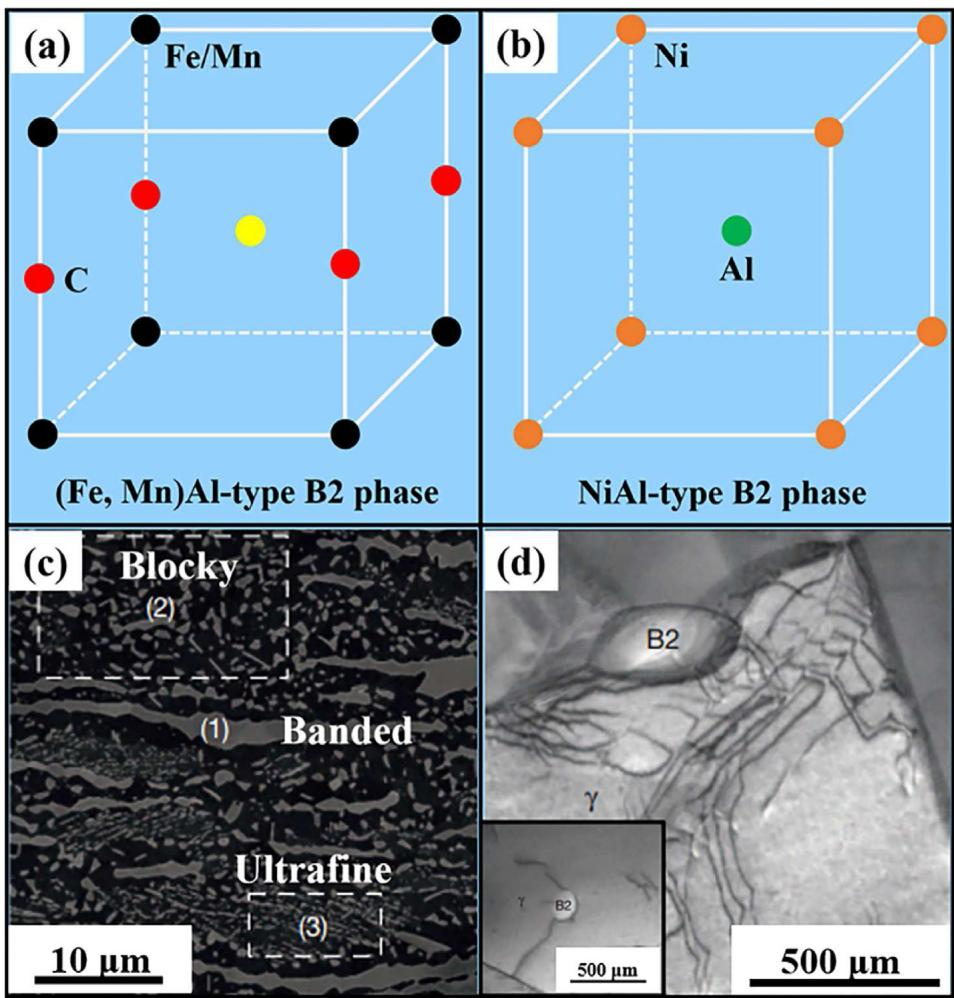  
Fig. 6 e (a, b) Lattice of B2 phase and NiAl ordered phases in FeeMneAleC low density steel [69]; (c, d) B2 phase precipitates in aged FeeMneAleC steel [71].

When the FeeMneAleC low-density steels undergo quenching-aging/cold rolling-annealing, the (Fe, Mn)Al or NiAl type ordered intermetallic compounds are formed. B2 phase is an ordered body-centered cubic structure of CsCl type, as shown in Fig. 6a and b [69]. The previous reports imply that B2 at room temperature is unfavorable to plasticity, but it is favorable to corrosion resistance, oxidation resistance and wear resistance [70].

In addition to k-carbide, a small amount of ultrafine aferrite precipitate along the austenite grain boundary in A-BDP FeeMneAleC steels under different annealing temperatures. High Al content can induce the a-ferrite transformation into B2 and DO3. Kim et al. [71] reported that the Ni addition in FeeMneAleC steels effectively combined with Al to form the NiAl-type B2 phase. Numerous studies implied that cold rolling and annealing processes could provide a suitable condition for B2 nucleation [42,43,53]. After cold rolling and annealing, it was found that there are three different morphologies (banded, blocky and ultrafine) of B2 phases (Fig. 6c) in the Fee16Mn-9.6Al-0.86C-4.9Ni steel [71]. The banded B2 phase was transformed from d-ferrite (white rectangle area). The blocky B2 phase, which precipitated along the recrystallized austenite grain boundaries, was transformed from aferrite (yellow rectangle area). However, the ultrafine B2 particles nucleated on shear bands of recrystallized austenite grains (red rectangle area). The widely distributed B2 phase contributed to the enhancements of yield strength, tensile strength, and ferrite hardness.

Compared with k-carbide, B2 phase is not sheared by slip dislocations. This phenomenon leads to the dislocation pileup at phase boundary, finally enhancing the work hardening of FeeMneAleC steels containing B2 phase during plastic deformation (Fig. 6d) [71]. In this regard, relevant scholars have given different opinions. Yang et al. [72] believed the enhancement of work hardening was attributed to high back stress due to the presence of B2 phase. During plastic deformation, the strain incompatibility between the austenite matrix and B2 phase accelerated the dislocation multiplication at phase interfaces and formed high internal stress, resulting in the retardation of dislocation slip in austenite. At a much larger plastic deformation, B2 phase began to yield and the long-term back stress was formed. However, Kim et al. [73] insisted that the short-range ordering phases were the internal factor responsible for work hardening, rather than the difference in stress/strain distribution in FeeMneAleC steels. Sohn et al. [74] pointed out that the NiAl-type B2 phase precipitated in Ni-containing steels had a stronger chemical bond than FeAl-type B2 precipitates in Ni-free steels, which was conducive to improving strength. However, a large number of hard and brittle B2 phases distributed along the grain boundary would deteriorate the plasticity and toughness.

In addition, Cu is added into single austenite-base FeeMneAleC steels to induce the B2 phase formation [75]. Cu, as an austenite stabler, can increase the volume fraction of austenite and delay the recrystallization, due to the drag effect [76,77]. Song et al. [78] added 0.3 wt% Cu into a Fee12Mne7Al-0.5C dual-phase steel to form a large number of nano Cu-rich B2 particles. The plane slip and ultrafine dislocation substructure (Taylor lattice) were observed during subsequent plastic deformation. The synergistic effect among solution hardening, delayed recrystallization, and Cu-rich B2 particles significantly enhanced the yield strength and strain hardening.

## (3) MC carbide strengthening

In recent years, the addition of micro-alloying element (Nb, V and Ti et al.) has been widely employed to improve the mechanical properties of FeeMneAleC low-density steels. Due to a high affinity between micro-alloying (Nb, V and Ti et al.) and C atoms, numerous stable MC carbides are formed, effectively reducing the nucleation driving force of other carbides, thus inhibiting the precipitation and growth of other carbides [57,58]. Song et al. [60] considered that the yield strength increment from MC carbides was similar to that from k-carbide in FeeMneAleC steels under suitable microstructure controlling. Zargaran et al. [59] confirmed that the 0.2 wt% Nb addition into a Fee8Ale5Mn-0.1C steel could result in 0.2% volume fraction of NbC precipitates, much lower than 2.3% volume fraction of k-carbide. Although NbC precipitates have poorer inhibition on k-carbide precipitation, the austenite grain size is obviously refined. Compared with Nb-free steels under the same conditions, the yield strength of Nbcontaining steel increases by about 100 MPa without deteriorating ductility. However, a few scholars hold different opinions on the above conclusion. Li et al. [79] studied the effect of Ti, Mo and Nb composite additions on microstructure and tensile behavior of a Fe-26Mn-8Al–1.5C steel. It was found that the additions of Ti, Mo and Nb could refine the grains, increase the size and volume fraction of κ-carbide, and form intercrystalline and intragranular (Ti, Mo, Nb)C particles. The coarse k-carbide and nano (Ti, Mo, Nb)C particles on grain boundary resulted in the poor ductility. It can be seen that there is no agreed theory about the effect of MC carbide on κ- carbide precipitation and growth, and further research is needed.

Hereby, the Mn and C contents can affect the solution strengthening, precipitation strengthening and austenite characteristics. The rolling deformation and heat-treatment technologies also influence the nucleation of various precipitates (k-carbide, B2, and MC), grain size and austenite characteristics. However, the existing researches only focus on a certain scientific problem, such as the role of recrystallization annealing on MC precipitation behavior. The research and development of FeeMneAleC low-density steel is still under the gestation stage, and more systematic and in-depth researches are needed in future.

## 3.2. Strain hardening mechanism

TRIP and TWIP effects are the main deformation mechanisms for FeeMneAleC duplex phase low-density steels. When the fractions of d-ferrite and austenite are high, the deformation mechanisms show multi-stage strain hardening characteristics. In addition, due to the absence of austenite in single ferrite FeeMneAleC steels, martensite transformation is absent. For single austenite-base FeeMneAleC steels, the deformation mechanism is closely related to stacking fault energy (SFE).

## 3.2.1. Single ferrite steel

Al content strongly influences the tensile properties of single ferrite-base FeeMneAleC steels by influencing crystal structures (Fig. 7) [80]. When the Al content reaches 6 wt%, the k phase with a short-range ordering crystal structure is gradually formed, resulting in a sharp decrease of ductility [81]. With the increase of Al content over 7 wt%, the short-range ordering reaction continuously occurs, and the shear action of dislocations on ordered phases induces high work hardening during plastic deformation [82]. Further increasing Al content to a peak of 16 wt%, a terrific amount of B2 and DO3 phases with super crystal structures are formed, resulting in a rapid decrease of work hardening [20]. Herrmann et al. [83] observed dislocation slip bands in Fe-xAl steels, and they believed that the generation and slip of dislocations in a Fee6Al steel determined the deformation mechanism during plastic deformation. As the Al content increased to 11e19 wt %, the number of active mobile dislocations decreased under a low deformation temperature, due to a limited number of dislocation slip systems. At this time, the number of mobile dislocations sensitively depended on crystal orientation. After fracture, the dense dislocation bundles and undeformed B2 phase were also observed in ferrite, indicating that uneven plastic deformation occurred in ferrite. The above discussion implies that the shear of mobile dislocations on ordered phases and dislocation slips mainly control the strain hardening of single ferrite steels.

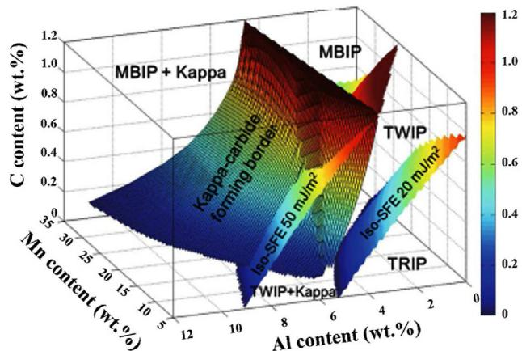  
Fig. 7 e Relationship between composition, deformation mechanism and SFE in FeeMneAleC steel under room temperature [80].

## 3.2.2. Single austenite steel

SFE can significantly affect dislocation mobility during plastic deformation, thus changing the deformation mechanism. Table 3 summarizes the deformation mechanism and mechanical properties of different austenite base FeeMneAleC steels with various SFEs. Generally, it is believed that the primary deformation mechanism of austenite gradually changes from TRIP to TWIP effect and dislocation slip-induced plasticity with the increase of SFE [84]. Still, TRIP and TWIP effects are also related to dislocation slips. So, the high strain hardening ability is attributed to the volcanic dislocation slip during strain relaxation. Dislocation slip is the most basic plastic deformation mode at room temperature, which is closely related to the deformation mechanisms of TRIP, TWIP, SIP, DSBR and MBIP.

Fig. 7 shows the relationship between SFE and deformation mechanism [80]. It can be employed to predict the deformation mechanism of single austenite-base FeeMneAleC steels. The SFE values of these steels increase with the increased Al content. Thus, the deformation mechanism changes from TRIP to TWIP and then to MBIP and SIP, accompanied by kcarbide precipitation. However, the strain hardening behavior of single austenite-base FeeMneAleC steels can not be perfectly explained only by SFE. Many scholars insisted that the influence of short-range ordered phase clusters formed via spinodal decomposition on dislocation substructure evolution was the main factor [43].

Frommeyer et al. [85] studied the tensile behavior of a Fee28Mne10Al-1.2C steel with the SFE of 110 mJ/m2, and found that austenite, ferrite, and k-carbides were coexisted in this studied steel. During the tensile deformation, deformation twins were almost restrained, and the shear band was formed accompanied by dislocation slips. At the same time, nano k-carbides were uniformly arranged on the austenitic matrix with a certain spacing. In addition, the uniform shear deformation (namely, the SIP effect) in austenite is very beneficial to total elongation. The synergistic effect among these deformation mechanisms results in the excellent mechanical properties.

Low-density TWIP steels have a high Mn content of 20e30 wt%. After rolling, annealing and quenching treatments, the microstructure consists of complete austenite together with a large number of annealing twins. Hong et al. [86] studied the formation mechanism of deformation twins in a Fee17.5Mne1.5Al-0.85C TWIP steel (Fig. 8). They deemed that the prior austenite grain boundary provided the nucleated locations for deformation twins. When the tensile strain rate reached 0.02, various slip systems were activated near the austenite grain boundary. The interaction among mobile dislocations on different slip planes led to the formation of Shockley and Frank partial dislocations at positions slightly away from the prior austenite grain boundary, finally forming the stacking faults. Further straining to 0.05, deformation twins formed near the austenite grain boundary and gradually grew into the grains. Therefore, the strong dislocation movement and deformation twins systematically contributed to the high strain hardening of TWIP steels.

Park et al. [87] studied the microstructure evolution of a quenched Fee28MnexAle(0.8e1.0)C steel during tensile deformation at room temperature and proposed the MBIP mechanism. Unlike TRIP steel, the matrix microstructure of these steels was only austenite after quenching. Meanwhile, the nano short-range ordering phases were precipitated in partial areas. Under a low strain, dislocations aggregated on a single slip plane and formed Taylor crystal lattices. Upon a high strain, the microbands gradually formed due to the interaction between mobile dislocations and Taylor crystal lattices. The total dislocation density continuously increased with the increasing strain, leading to the high work hardening. At this time, the interaction among various microbands could also refine grains and enhance the strength and toughness (873 MPa tensile strength and 100% total elongation) through the dynamic Hall-Petch effect. Welsch et al. [88] studied the strain hardening mechanism of a Fee30.4Mne8Ale1.2C lowdensity steel with the SFE of 85 mJ/m2. They acknowledged that DSBR was the main strain hardening mechanism, contributing to the excellent mechanical properties (900 MPa tensile strength and 68% total elongation). The fundamental feature of this mechanism is that the sliding band substructure is gradually refined under plastic deformation, which restrains the strain localization phenomenon in other sliding planes. However, the current research on microbands only stays in the abstract conceptual stage and does not give quantitative results.

## 3.2.3. A-BDP steel

When the C and Mn contents in the austenite steels are lower, the austenite stability decreases and d-ferrite forms, forming the A-BDP steels. Its deformation mechanism is strongly affected by the d-ferrite fraction, hardness difference between austenite and ferrite, and the ordered phases in ferrite.

Generally, austenite determines the deformation mechanism when the d-ferrite fraction is less than 10%. Frommeyer et al. [85] studied the influence of solution and water-quenching

Table 3 e Comparison of the deformation mechanisms and room temperature mechanical properties of FeeMneAleC steels. TL represents Taylor lattice.

<table><tr><td>Composition (wt.%)</td><td>SFE (mJ·m-2)</td><td>Deformation mechanism</td><td>YS/UTS</td><td>Refs.</td></tr><tr><td>Fe-21Mn-1.6Al-0.11C-2.5Si</td><td>21</td><td>TWIP + TRIP</td><td>0.42</td><td>[30]</td></tr><tr><td>Fe-26Mn-8Al-1.5C</td><td>43</td><td>SIP + TWIP + MBIP</td><td>0.51</td><td>[80]</td></tr><tr><td>Fe-3.9Mn-5.8Al-0.35C</td><td>60</td><td>TWIP + SIP + TL</td><td>0.62</td><td>[16]</td></tr><tr><td>Fe-30.5Mn-2.1Al-1.2C</td><td>63</td><td>TWIP + SIP + DSBR</td><td>0.26</td><td>[17]</td></tr><tr><td>Fe-27Mn-11.5Al-0.95C</td><td>80</td><td>DSBR + MBIP</td><td>0.85</td><td>[67]</td></tr><tr><td>Fe-16Mn-2Al-0.45C</td><td>92</td><td>TWIP + DSBR</td><td>0.85</td><td>[58]</td></tr><tr><td>Fe-27Mn-12Al-0.9C</td><td>110</td><td>DSBR + MBIP</td><td>0.87</td><td>[24]</td></tr><tr><td>Fe-18Mn-7Al-0.85C</td><td>120</td><td>DSBR + SIP + MBIP</td><td>0.66</td><td>[19]</td></tr></table>

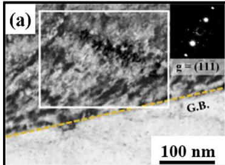

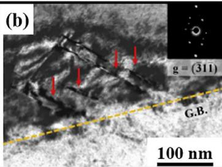

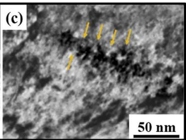

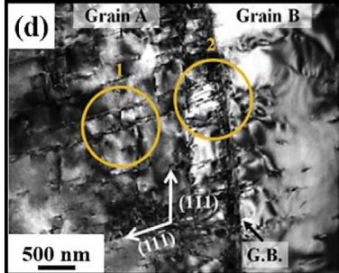

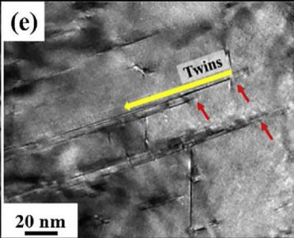

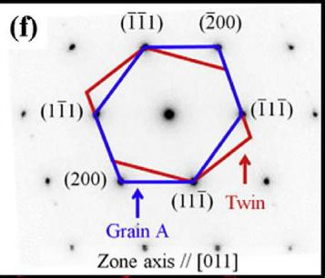  
Fig. 8 e The mechanism of deformation twins near grain boundaries in Fe-17.5Mn-1.5Al-0.58C steel under various strain [86]. (aec) After straining at 0.02, stacking faults and Frank partial dislocations on the (111) plane are indicated by red and orange arrows, respectively; (def) After straining at 0.05, deformation twins formed near the austenite grain boundary and gradually grew into the grains. Red arrows indicate the starting point of twins and a yellow arrow indicates the growth direction of twins in (e).

treatments on a Fee26Mne10AleC steel with 883 MPa tensile strength and 65% total elongation. The uniform shear deformation of austenite determined such an outstanding combination of strength and ductility. Moreover, with the increase of dferrite fraction, both ferrite and austenite provided strong strain hardening effect. Hwang et al. [89] studied the evolution of dislocation substructures in austenite and ferrite of a Fee20Mne9Al-0.6C duplex phase steel under different tensile strains. For austenite, the unidirectional slips were observed on the (111) plane under 5% tensile strain (Fig. 9a), and multidirectional slips occurred with the increase of strain, as shown in Fig. 9b and (c). After straining at 40%, unidirectional slips determined the deformation mechanism, while the space of slip line was much smaller than that under low strain (Fig. 9d). For ferrite, dislocations dominated the deformation mechanism at 5% low strain, and explosive dislocation multiplication developed into dislocation cells at 40% high strain (Fig. 9e and f). It can be seen that austenite shows an obvious plane slip mechanism due to the high SFE, while ferrite shows wave slips and forms the dislocation cells.

The hardness difference between ferrite and austenite in A-BDP steels results in the multi-stage strain hardening behavior during the tensile deformation [90,91]. With the increase of plastic deformation, austenite showed higher strain hardening than ferrite, so the Fee12Mne8Ale0.8C A-BDP steel showed three stages of strain hardening curve (Fig. 10) [90]. In the first stage, the single ferrite deformation led to a sharp decrease in strain hardening rate. In the second stage, austenite started to deform and the strain hardening curve presented approximately a line. In the third stage, the severe strain localization resulted in a quick drop in strain hardening rate, due to the obvious hardness difference between ferrite and austenite.

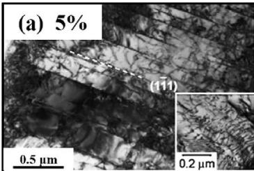

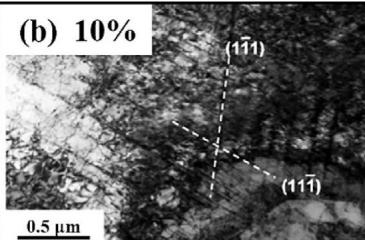

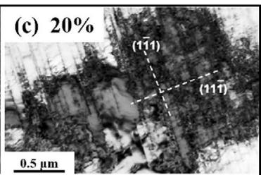

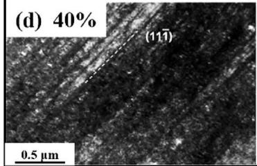

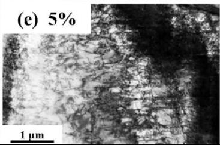

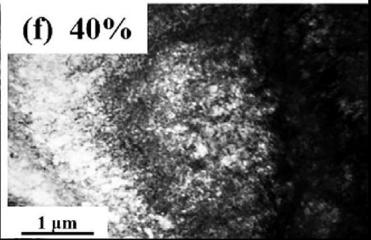  
Fig. 9 e The evolution of dislocation substructures in austenite (aed) and ferrite (e, f) of Fee20Mne9Al-0.6C duplex phase steel under different tensile strains [89].

The ordered B2 and DO3 phases are formed on the disordered ferrite matrix of A-BDP steels, which will affect the deformation behavior [91,92]. Park et al. [91] investigated the influences of quenching and ordering annealing on microstructure and deformation mechanism of a Fee27Mne12Ale0.8C A-BDP steel with 27% d-ferrite fraction (Fig. 11). The nano k-carbide also precipitated in austenite under quenching or quenching-ordering annealing conditions, and its size gradually became larger with increasing ordering annealing temperature. Interestingly, the coarse B2 and ultrafine DO3 particles precipitated in ferrite. During tensile deformation, the k-carbide in austenite was sheared by plane slip dislocations; however, the strong interaction among super-dislocations with narrow mechanical reverse domain boundaries occurred in ferrite. Therefore, the strain hardening of A-BDP steels is mainly controlled by the shearing effect of ordered phases by super-dislocations in ferrite and plane slip dislocations in austenite.

## 3.2.4. F-BDP steel

In F-BDP steels, the uniformly distributed ultrafine austenite on the ferrite matrix enables martensite transformation during plastic deformation [93]. However, the volume expansion caused by martensite transformation will drive the ferrite to undergo plastic deformation, resulting in the stress relaxation and transfer. The non-uniformity of plastic deformation will be significantly improved during further deformation. Therefore, the synergistic effect between ferrite plastic deformation and TRIP effect dominates the strain hardening of F-BDP steels.

Similar to A-BDP steels, the strain hardening rate curve of F-BDP steels presents various stages. Liu et al. [15] studied the strain hardening mechanism of a Fee3.9Mne5.8Ale0.35C

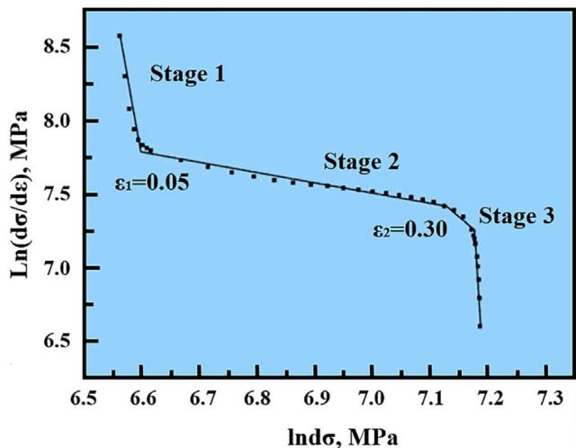  
Fig. 10 e The ln(ds/dε) vs. lns curves of Fee12Mne8Ale0.8C steel shows three stages with different slopes at the critical strains $( \mathbf { { \varepsilon _ { 1 } } }$ and $\mathbf { \epsilon } _ { \mathbf { \mathcal { E } } _ { 2 } } )$ [90].

F-BDP steel under different tensile strains, as shown in Fig. 12. In the first stage, the dislocation motion in ferrite led to a sharp decrease in strain hardening rate. In the second stage, due to the low stability and fraction of austenite, the limited TRIP and TWIP effects at a low strain could not contribute much to strain hardening (Fig. 12bed). The increase of strain hardening rate was mainly attributed to the dislocation slip in ferrite and austenite. Meanwhile, the strain hardening curve reached a peak value and entered a long-term continuous hardening stage. In the third stage, the dislocation overcame obstacles caused by the increased strain in previous stages and the dislocation motion resistance decreased, thus reducing the hardening rate (Fig. 12e and f). In the fourth stage, the martensite transformation rate was rapidly increased, and TWIP effect was also activated with the increase of strain. Therefore, the strain hardening mechanism in this stage included TRIP, TWIP effect and dislocation strengthening. In the fifth stage, the martensite transformation rate significantly decreased with the loss of austenite. Meanwhile, the volume expansion caused by martensite transformation intensified the local non-uniform deformation, resulting in a slow decrease in strain hardening rate.

The strain hardening mechanism of F-BDP steels mainly involves the TRIP and TWIP effects. Among them, TRIP effect is more crucial and closely related to the grain orientation and mechanical stability of austenite. Seo et al. [94] studied the deformation behavior of a $\mathrm { F e } { - 3 . 5 \mathrm { M n } { - 5 . 9 \mathrm { A l } { - 0 . 4 \mathrm { C } } } }$ steel and found that the grain orientation had an important influence on austenite stability. Austenite grains with the higher schmid factor were more likely to undergo martensite transformation. In addition, the previous investigations showed that the austenite stability was mainly affected by: (1) grain size, namely, the coarser the austenite grains, the poorer the austenite stability [95]; (2) C content in austenite, namely, the larger C content in austenite, the higher the austenite stability [96]; (3) constraining effect from the adjacent phases surrounding austenite [97]; and (4) austenite volume fraction [98]. However, there are still disputes about these factors. For example, the coarse austenite grains near martensite were more stable than ultrafine austenite with lath-like or film morphologies [99]. These factors are interrelated and jointly determine the austenitic stability. The evaluation criteria of these influencing factors should be further clarified in future. For example, C content in austenite is the influential factor determining its stability, which has been reported in medium Mn steels [100].

From the previous investigations, it can be found that the strengthening mechanisms of solution strengthening, grain refinement strengthening, precipitation strengthening, dislocation slips, and strain hardening are displayed in the abovementioned four kinds of FeeMneAleC low-density steels. Therein, the strain hardening mechanisms of both plane slip dislocations and shear effect of mobile dislocations on the ordering phases are presented in all the above steels. Still, the main strain hardening mechanism among them is slightly different. In the single austenite steels, MBIP, DSBR, SIP, and TL play a great role, while that in A- and F-BDP steels is mainly determined by TRIP and TWIP effects. Moreover, the deformation mechanisms in A- and F-BDP steels also exhibit multistage strain hardening behavior when the fractions of d-ferrite and austenite are high. The coupling and competition of various strain hardening mechanisms make the deformation extremely complicated, especially in the dual-phase $\mathrm { F e { \mathrm { - } } M n { \mathrm { - } } A l { \mathrm { - } } C }$ steels. Therefore, it is necessary to further elucidate the coupling and competition mechanisms via more advanced characterization equipment in future.

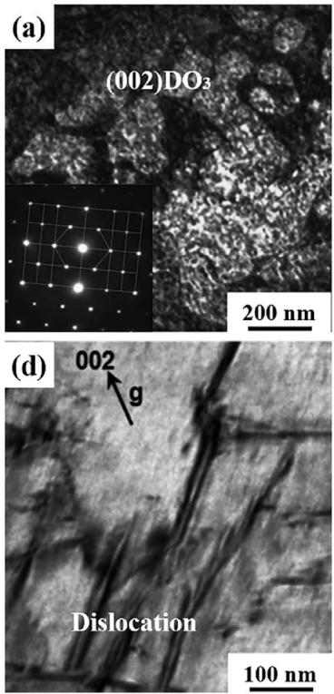

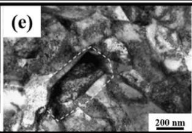

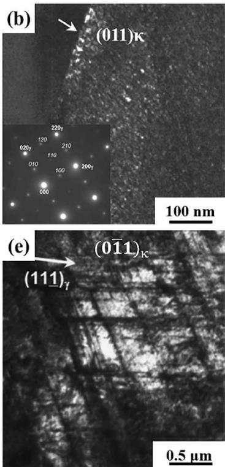

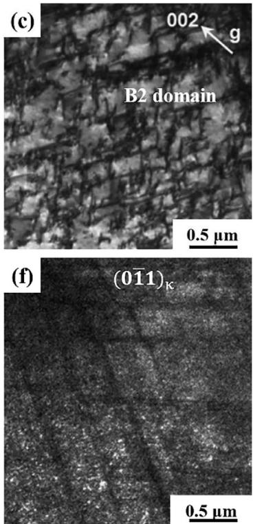  
Fig. 11 e Microstructure of ferrite and austenite of the as quenched-annealed Fee27Mne12Ale0.8C duplex steel before and after tensile deformation [91]. (a) Fine DO3 particles in ferrite: (b) Nano κ-carbide in austenite: (c, d) Deformed microstructure of ferrite 5% strain, dislocations inside the B2 domain; (e, f) Deformed microstructure of austenite 5% strain.

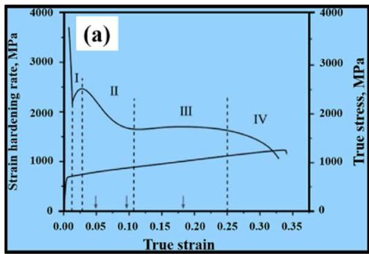

## 4. Application performance of FeeMneAleC low-density steels

## 4.1. Cryogenic performance

For FeeMneAleC low-density steels, the austenite matrix can provide high work hardening to resist the damage under extreme conditions. With the rapid development of natural gas and hydrogen energies, the cryogenic performance of metal materials needs to be improved so as to satisfy the storage and transportation of above gases. Note that the FeeMneAleC low-density steels are considered one of the most promising structural material, its cryogenic performance is necessary to investigate.

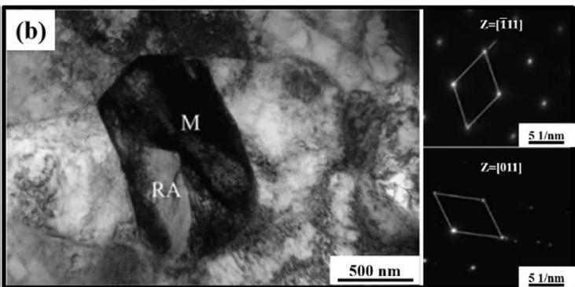

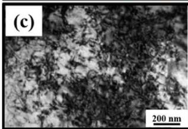

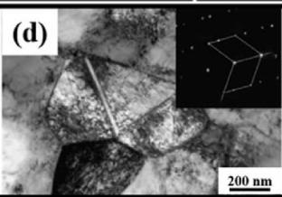

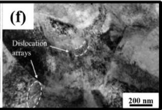  
Fig. 12 – Strain hardening rate curve (a) and the corresponding strengthening mechanism (b–f) of Fe-3.9Mn–5.8Al–0.35C F. BDP steel under different tensile strains [15]. (bed) Straining at 10%; (e, f) Straining at 20%.

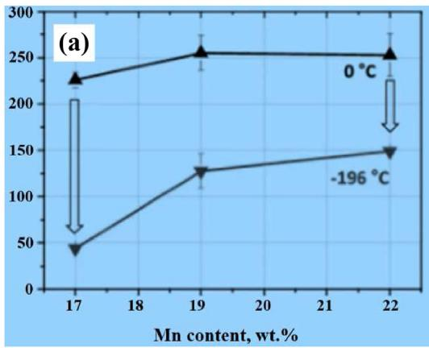

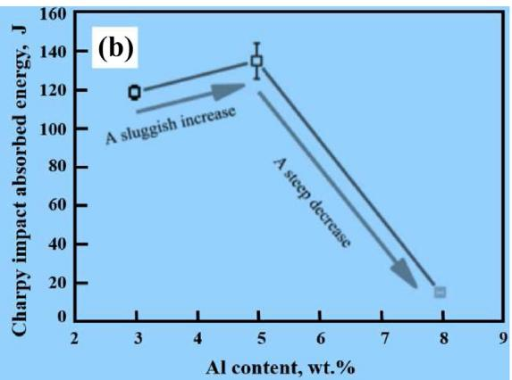  
Fig. 13 e (a) Charpy impact absorbed energy of Fe-xMn-2Al-0.45C-0.05Si steel as a function of Mn content [101]; (b) Charpy impact absorbed energy of Fee18MnexAl-0.6C steel as a function of Al content [102].

The element content strongly influences cryogenic toughness. Lee et al. [101] pointed out that the (17, 19 and 22 wt%) Mn addition into Fe-xMn-2Al-0.45C low-density steels significantly affected the tensile and Charpy impact properties under cryogenic conditions (Fig. 13a). However, the influences of Mn content on the tensile and Charpy impact properties at room temperature were minimal. Under cryogenic conditions, the ductility and impact energy gradually decreased with the increase of Mn content. The corresponding cryogenic ductility for 17, 19 and 22 wt% Mn steels were 75.7%, 53.4% and 9.7%, respectively. Whereas the corresponding impact energies were 80.5, 49.8 and 41.1 J, respectively. Moreover, Chen et al. [102] investigated the effect of (3, 5 and 8 wt%) Al addition into Fee18MnexAl-0.6C low-density steels on impact energy at cryogenic temperature (Fig. 13b). With the Al content increasing from 3 to 5 wt%, the impact energy at cryogenic temperature increased from 122 to 138 J. However, 8 wt% Al content resulted in a decrease of impact energy at cryogenic temperature.

The secondary phase transformation is significant for the deterioration of the impact energy at cryogenic temperature. For example, the strain-induced martensite transformation during plastic deformation could relieve the local stress and enhance the impact energy of a $\mathrm { F e } { - } 1 8 \mathrm { M n } { - } 8 \mathrm { A l } { - } 0 . 6 \mathrm { C }$ lowdensity steel [102]. The coarse banded d-ferrite phase boundaries acted as the center of microcrack nucleation and propagation during tensile or impact deformations, finally resulting in the unacceptable degradation of mechanical properties at cryogenic temperature. In addition, the microband structure can also enhance the mechanical properties of FeeMneAleC low-density steels at cryogenic temperature. Gutierrez-Urrutia et al. [103] systemically investigated the microband evolution in a Fee30Mne6.5Ale0.3C (wt.%) lowdensity steel during tensile deformation at $- 1 9 6 ~ ^ { \circ } \mathrm { C }$ (Fig. 14). Under a low strain, the intense movement of closely spaced slip bands activated the planar slip localization, finally forming the microbands (Fig. 14a and b). At a high strain, the new microbands formed together with the generation of deformation twins (Fig. 14a and b). However, the microbands located within austenite grains were not conducive to the formation of deformation twins (Fig. 14c and d). This complex deformation structure led to the highly uneven deformation behavior, which significantly enhanced the work hardening and mechanical properties of studied steels under cryogenic conditions.

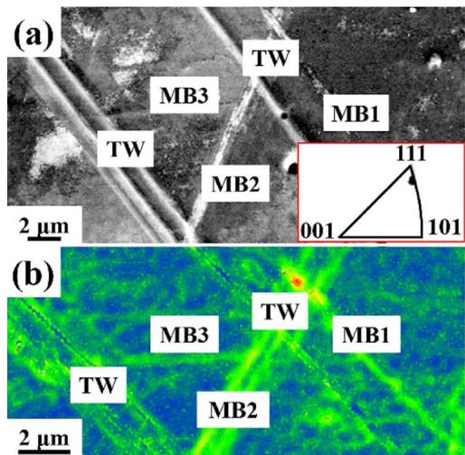

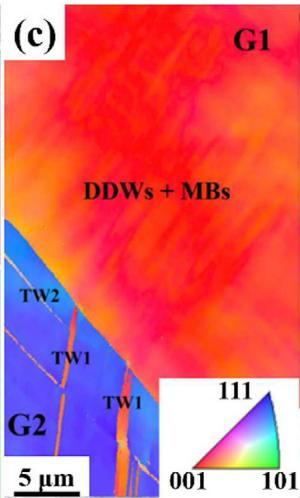

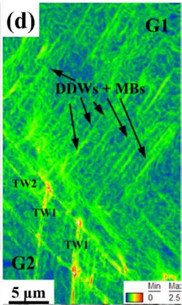  
Fig. 14 e The microstructure evolution in Fee30Mne6.5Ale0.3C (wt.%) low-density steel during tensile deformation at 196 C [103].

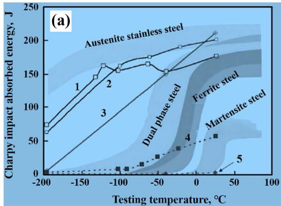

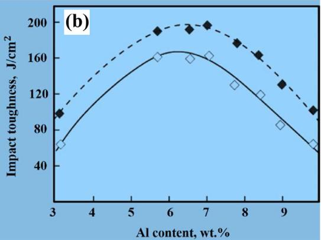  
Fig. 15 e (a) Relationship between Charpy impact absorbed energy and testing temperature for FeeMneAleC austenite steel [104,105]. (b) Relationship between impact toughness and Al content for FeeMneAleC steel [106].

## 4.2. Impact toughness

Impact toughness is one of the essential properties for eval uating automotive steels, representing the ability to absorb plastic deformation and fracture energies under impact loading. The impact toughness of FeeMneAleC steels depends on the phase composition and its distribution, especially the k-carbide precipitation and d-ferrite formation [104].

Fig. 15a shows the relationship between the Charpy impact absorbed energy of FeeMneAleC A-BDP steels and testing temperature [104,105]. It can be seen that the impact energy of A-BDP steels after solution treatment was much higher at room temperature, even exceeding the typical austenite stainless steel at room temperature (as shown in curves 1, 2 and 3 in Fig. 15a). When the testing temperature was below ${ \bf \cdot } 1 0 0 ^ { \circ } { \bf C } ,$ there was an obvious ductile-brittle transition stage. After aging at $5 5 0 ~ ^ { \circ } \mathrm { C }$ for 16 h, the impact energy of FeeMneAleC A-BDP steels at room temperature decreased significantly (as shown in curves 4 and 5 in Fig. 15a), especially the value of a Fee30Mne10Ale1C steel is close to 0 J. This was mainly related to the precipitation of k-carbide.

Al content also affects the impact toughness of aged FeeMneAleC steels (Fig. 15b) [106]. This phenomenon is closely related to k-carbide precipitation and d-ferrite formation. When Al content was lower than 7%, k-carbide could not precipitate, but $\mathrm { F e } _ { 3 } \mathrm { C } _ { 7 }$ and ${ \bf M } _ { 7 } { \bf C } _ { 3 }$ might precipitate along grain boundaries during aging, reducing the impact toughness. After increasing Al content to 7%e10%, the formations of $\mathrm { F e } _ { 3 } \mathrm { C } _ { 7 }$ and ${ \bf M } _ { 7 } { \bf C } _ { 3 }$ were inhibited, but the brittle k-carbide gradually precipitated along the grain boundary, also leading to a decreased impact toughness. When Al content exceeded 10%, d-ferrite gradually formed and further reduced the impact toughness. Due to the deformation incompatibility between austenite and ferrite phases, microcracks were mainly generated at the phase interface.

In short, the Al element affects the precipitation position and particle size of k-carbide, thereby affecting the impact toughness of FeeMneAleC steels. In contrast, the impact toughness of FeeMneAleC austenite steels is higher under the conditions of solution treatment and water quenching than that under aging treatment. In addition, due to the formations of short-range ordering phase and k-carbide, the impact toughness is significantly affected by the cooling rate after solution treatment.

## 4.3. Fatigue performance

Fatigue fracture is one of the main failure modes in metallic components under variable loading, thus numerous studies about fatigue behavior of FeeMneAleC steels have been carried out. Kalashnikov et al. [107] reported that the fatigue life of a Fee28Mne9Al-0.86C austenite low-density steel was about twice that of a Fee12Cre1.5Nie0.2Ve1.8We0.5Moe0.15C martensite stainless steel. Hamada et al. [108] studied the fatigue crack growth behavior of FeeMneAleC austenitic low-density steels. They found that this steel had a stronger ability to prevent fatigue crack growth than that of 304 L austenite stainless steels. However, due to the limitations of objective factors and test data, the fatigue behavior of FeeMneAleC austenite lowdensity steels is still unclear.

Hamada et al. [109] systematically investigated the fatigue behavior of high-Mn steels with various grain sizes. They insisted that the decreased grain size enhanced the fatigue resistance, and the cracks preferentially generated at sites of intersections of slip bands, grain boundaries, and annealing twin boundaries. However, the continuous slip bands were generated and deformation twins were absent during highcycle straining [109]. Subsequently, they analyzed the cyclic behaviors of a Fee16Mne1.5Ale0.3C steel with fine- and coarse-grained structures [110]. In the coarse-grained steel, deformation twins, stacking faults, planar dislocation arrays, and dislocation tangles were observed under cyclic loading. Still, the deformation twins were only displayed in the finegrained steel (Fig. 16a and b). It can be seen that the fatigue behavior of FeeMneAleC steels are closely related to chemical compositions and microstructures. Zhao et al. [111] pointed out that the microalloyed element additions in FeeMneAleC steels exhibited a higher fatigue life than that of non-microalloyed one. Numerous parallel deformation bands together with planar dislocations and nano-size precipitates showed a positive influence on enhancing the fatigue life (Fig. 16cee). The previous reports mainly focus on the effect of various deformation mechanisms on fatigue behavior of FeeMneAleC steels. However, the influence of micro-alloyed carbides on the cyclic behavior of FeeMneAleC steels is reported minimally.

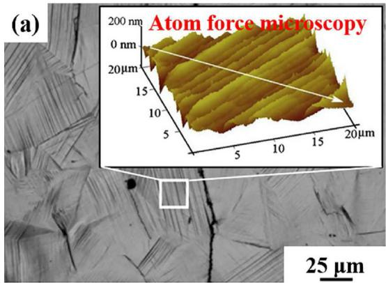

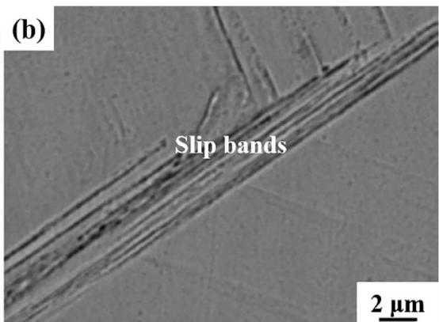

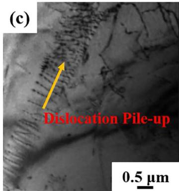

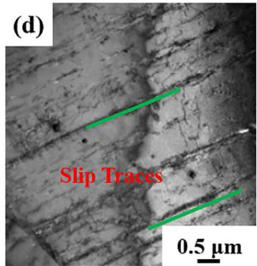

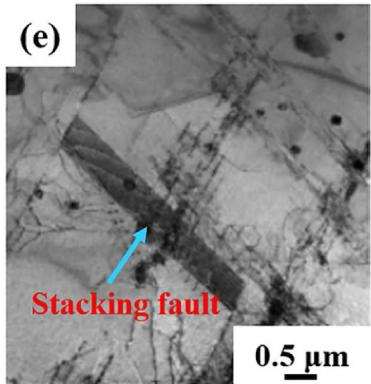  
Fig. 16 e The fatigued surface and atom force microscopy images (a) and slip band structure (b) in Fee16Mne2Ale0.3C steel [109]. The deformed microstructures of micro-alloyed Fee28Mne7Ale1C steel after fatigue failure at 0.4% (c, d) and 0.8% (e) strains [111].

## 4.4. Hydrogen embrittlement

Hydrogen embrittlement is the hydrogen dissolved in steels, which causes stress concentration and then forms microcracks, resulting in catastrophic fracture of the structural material and component [112e115]. Once hydrogen embrittlement is generated, it can not be eliminated. FeeMneAleC low-density steels are considered as high-strength steels for industrial applications. It is necessary to study the hydrogen embrittlement sensitivity and its influence on mechanical properties. Koyama et al. [112] insisted that the fracture modes induced by hydrogen embrittlement were mainly composed of intergranular and transgranular fractures in a Fee18Mne1.2C steel. Meanwhile, the transgranular fracture was initiated parallel to the primary and secondary deformation twin boundaries, resulting in the generation of cracks at grain boundaries and twin boundaries. Afterwards, they examined the hydrogen-assisted cracking mechanisms of a Fee26Mne11Ale1.2C steel [113]. They proposed that the grain boundary triple junction cracking and slip-localizationinduced intergranular cracking along micro-voids determined the embrittlement ability. Meanwhile, grain boundary triple junction cracking was preferentially generated on grain boundaries, while the microscopically ductile sliplocalization-induced intergranular cracking assisted crack growth during plastic deformation, resulting in the macroscopic brittle fracture appearance (Fig. 17).

In addition, the precipitates (k-carbide, B2, DO3, and b-Mn et al.) also closely act with hydrogen and affect the hydrogen embrittlement of FeeMneAleC steels [114]. Due to the high SFEs, numerous k-carbides are often precipitated. Thus, the hydrogen embrittlement is closely related to k-carbide particles [115]. It is reported that C content in FeeMneAleC steels determined the hydrogen embrittlement [114]. For high C (u > 1 wt%) steels, hydrogen embrittlement occurred in the interdendritic area due to the presence of k-carbide, while the k-carbide could limit crack propagation. For low C (u < 0.05 wt %) steels, the hydrogen embrittlement occurred in DO3 phase. Given the chemical formula composition and crystal structure characteristics of k-carbide, hydrogen is easy to combine with it to form a relatively stable hydride (Fe AlH). Based on the density-functional theory, Timmerscheidt et al. [115] calculated the interaction between k-carbide and hydrogen dissolving. The interaction of HeH showed a strong repulsive force in a short distance, while CeH showed a strong repulsive force in a long distance. In addition, the efficiency of k-carbide capturing and diffusing hydrogen depended on C and Mn contents. C content determined the number of k-carbide and thus the capacity of capturing hydrogen. However, Mn content determined the overall efficiency of capturing hydrogen. Therefore, to control hydrogen diffusion in k-carbide, the C content in k-carbide should be increased while the Mn content should be reduced. Moreover, the presence of vacancies at the k-carbide/austenite interface could improve hydrogen solubility. So, the k-carbide/austenite interface would consider as an effective hydrogen capture center.

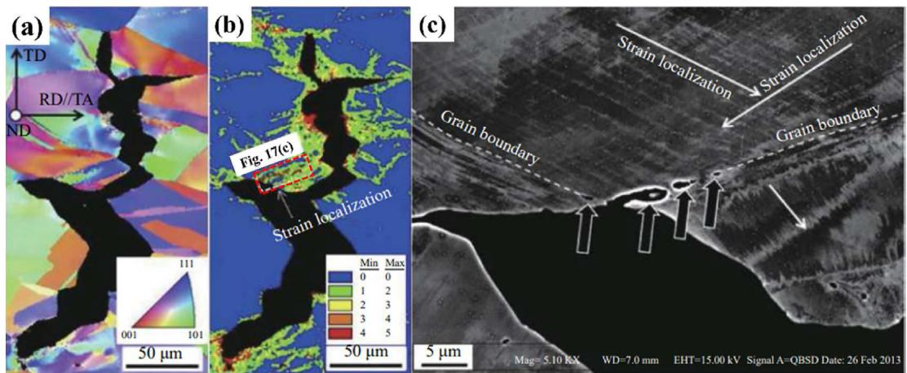  
Fig. 17 e Hydrogen-induced intergranular crack in Fee26Mne11Ale1.2C austenitic steel containing k-carbides [113]. (a) Inverse pole figure. (b) KAM figure. (c) Orientation-optimized ECC image corresponding to the part surrounded by the red broken lines in (b).

## 4.5. Wear performance

Due to the interaction among various strengthening mechanisms, FeeMneCeAl low-density steels show good wear performance. Sohrabizadeh et al. [116] evaluated a relationship between aging time and wear rate in a Fe-22.33Mn-1.35C-9.87Al steel. After aging at high temperature or for long duration, the k-carbide within austenite matrix could inhibit crack nucleation during the wear test. Peng et al. [117] selected

In recent years, the metal injection molding process has been proposed further to optimize the wear-resistant a quenched Fee25Mne1.3Ce6.6Al steel upon aging at 550 C for different time (from 1 to 4 h) to conduct impact abrasive wear tests (Fig. 18). The fine nano-size k-carbide precipitated coherently within the austenite matrix under the aging treatment for 2 h (Fig. 18a), which resulted in the best wear resistance and hardness (Fig. 18e). However, a longer aging time resulted in the decomposing of austenite into k-carbide toward the whole austenite grains and grain boundaries (Fig. 18b). These over-coarsened k-carbide along grain boundaries made the material extremely brittle, decreasing the wear resistance (Fig. 18e). The surface hardening showed LomereCottrell locks, high-density dislocation tangles, and dislocation walls; neither martensite nor deformation twins were observed under the low impact energy condition (Fig. 18c and d). It can be seen that the aging time play an essential role in the wear resistance of FeeMneCeAl low-density steels. The suitable aging time and temperature should be further studied.

(a)  
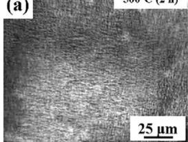

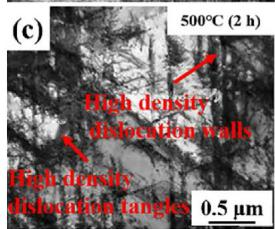

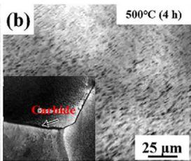

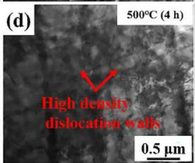

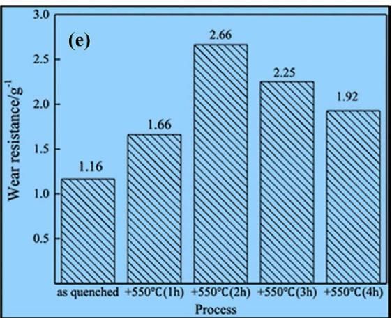  
Fig. 18 e Microstructure (aed) and wear resistance (e) of Fee25.1Mne6.6Ale1.3C steel under quehching at 1050 C and aging at 550 C for 2 and 4 h [117].

  
Fig. 19 e The measured room-temperature tensile properties of FeeMneAleC low-density steels with various Mn contents [15,23,34,51,52,79,80], [91e93], [120e150].

properties of FeeMneCeAl low-density steels. Garcia-Aguirre et al. [118] mixed a Fee22Mne0.4Ce1.5Ale1.5Si steel powder with high-density polyethylene and paraffin wax and immersed them in the solvent. It was then annealed between 1200 and 1360 C to obtain full austenite with uniformly distributed $\mathsf { M n O } _ { 2 }$ particles. According to this manufacturing method, superhard SiC, $\mathrm { N i _ { x } A l _ { y } }$ (NiAl, Ni Al and $\mathrm { N i } _ { 2 } \mathrm { A l } _ { 3 } )$ and (Fe, Mn, Cr) C particles can be mixed with steel powders to prepare composite materials, further improving the wearresistant properties of FeeMneCeAl steels. For example, El-Bagoury et al. [119] studied the influence of alloying elements and solution treatment conditions on the microstructure and its turn-on wear resistance of FeeMneAleCeCr steels. After solution at 1050 C for 2 h, the blocky or lath-like (Fe, Mn, Cr) C precipitates were observed besides austenite, ferrite, and martensite. With the increase of solution time to 4 h, the partial (Fe, Mn, Cr) C precipitates were dissolved, and the matrix microstructure became full austenite. Therefore, the low volume fraction of (Fe, Mn, Cr) C precipitates and high volume fraction of austenite lowered the wear resistance of the studied steel. In addition, as the C, Mn and Cr contents increased, the volume fraction of (Fe, Mn, Cr) C precipitates increased, which could enhance the wear resistance, Note that the metal injection molding process is a promising method to enhance the wear resistance of FeeMneAleC lowdensity steels. However, the addition of micro-alloying elements with excessively high mass fraction conflicts with the development of low-cost high strength steels. Therefore, it is necessary to develop the injection molding process of FeeMneAleC low-density steel without micro-alloying elements in future.

## 4.6. Tensile properties

Fig. 19 shows room-temperature the tensile properties of FeeMneAleC low-density steels with various Mn contents. [91e93], [120e150]. It is clearly indicated that the relationship between strength and ductility of FeeMneAleC steels follows“ ” the typical banana curve, the mechanical properties of single austenite and A-BDP steels seems to be superior than those of other ones. For example, the Fee30Mne11Ale1.2C steels with single austenite phase shows 1058 MPa yield strength, 1310 MPa tensile strength, and 38% total elongation [137]. Both the fine intragranular k-carbide and intergranular one can significantly enhance the yield strength without significantly deteriorating the ductility but result in the increased yield ratio (>0.8) of FeeMneAleC low-density steels. Moreover, a high Mn content seems to expand more space for enhancing the strength and ductility of FeeMneAleC steels, but it also can bring the increased material cost and processing difficulty. Achieving good performance and ensuring good economy are the long-term targets during its sustainable development of FeeMneAleC low-density steels.

## 5. Conclusion and prospect

Under the target demand of "C neutrality" and "C neutralization", the FeeMneAleC low-density steel will play an essential role in fuel savings. Due to its outstanding mechanical properties, impact resistance and hydrogen embrittlement resistance, and wear performance, it is widely used in automobile, military and construction fields. However, there are still numerous scientific problems to be further studied. In addition, basic research on the service properties of FeeMneAleC low-density steels is insufficient. The investigation of FeeMneAleC low-density steels can be started from the following aspects.

(1) Alloy design. The variations of Mn, Al, and C contents lead to the difference of phase constituents in FeeMneAleC low-density steels and a wide range of tensile properties can be acquired. Still, Al addition can achieve the weight saving and microstructure regulation, the limitation of Al addition should be further adequately clarified to exploit its lightweight role. The Mn, Al and C additions should be also tailored properly to exert their advantage role in enhancing the performance. In addition, the additions of microalloying elements (Nb, V, Ti, Cr, and Ni et al.) need to be explored so as to optimize the performance and thereby broaden the service fields of FeeMneAleC lowdensity steels.

(2) Smelting process. High Mn and Al contents result in the poor heat dissipation rate of steel ingot and Al-oxide pollution during the casting process, respectively. A small difference in element content can lead to significant variations of precipitate types, especially in A- and F-BDP steels. The depth-type purification of metallurgical is the primary challenge to solving the Mn-and Alenriched problems.

(3) Thermal mechanical processing. Adopting the combination between traditional hot/cold rolling and heattreatment to achieve comprehensive properties of FeeMneAleC steels is feasible. However, the sensitivity of properties to temperature and time easily results in a series of problems in the industrial production lines. It is necessary to explore and develop new processing technologies. For instance, powder metallurgy could be a promising method for manufacturing the FeeMneAleC low-density steels.

(4) Strain hardening mechanism. The competition and coupling among various strain hardening mechanisms increase the difficulty for analyzing the deformation behavior of FeeMneAleC steels. Moreover, the stress/ strain partitioning among various interfaces also strongly affect microstructure evolution and deformation behavior. Simulation methods should be helpful for analyzing the above-mentioned laws and problems.

(5) Service properties. Research work on the influence of precipitation behavior on service properties of FeeMneAleC low-density steels is still limited. Especially, the influence of short-range order and k-carbide on service properties is still a debatable point. Systematic research on the service properties of FeeMneAleC lightweight steels is also needed.

In conclusion, the comprehensive properties of FeeMneAleC low-density steels can be optimized by tailoring the composition design, controlling the type, size and distribution of various precipitates in the matrix, and optimizing the technology parameters of thermal-mechanical processing to meet the "strength, toughness, and lightweight" index and further expand its application areas.

## Credit author statement

Shao-bin Bai was responsible for writing and editing the manuscript. Yong-an Cheng, Xin-Liu, and Hui-hu Lu searched the literatures. Pei-kang Bai, Da-zhao Li, Zhi-quan Huang, and Jing-yang Li were responsible for modifying this manuscript.

## Declaration of competing interest

We declare that we have no conflicts of interest.

## Acknowledgments

This work was funded by the National Natural Science Foundation of China (Nos. 52071300, 52205402, 52105408), Fundamental Research Program of Shanxi Province (CN) (Nos. 202303021212318, 20210302124205).

## r e f e r e n c e s

[1] Korter W, Ton WA. Eisenhuettenw 1933;7:365.

[2] Ham JL, Carin RE. Prod Eng 1958;52e59.

[3] Lai HJ, Wan CM. The study of work hardening in Fe-Mn-Al-C alloys. J Mater Sci 1989;24:2449e53.

[4] Chen FC, Li P, Chu SL, Chou CP. Evidence of strain-induced martensitic transformation in Fe-Mn-Al austenitic alloy steels at room temperature. Scripta Metall Mater 1991;25:585e90.

[5] Kim YG, Han JM, Lee JS. Composition and temperature dependence of tensile properties of austenitic Fe-Mn-Al-C alloys. Mater Sci Eng A 1989;114:51e9.

[6] Frommeyer G, Drewes EJ. Physical and mechanical properties of irpn-aluminium-(Mn, Si) lightweight steels. Revue De Metallurgie-International Journal of Metallurgy 2022;97(10):1245.

[7] Raabe D, Springer H, Urrutia IG, Rousch F, Bausch M, Seol JB, Koyama M, Choi PP, Tsuzaki K. Alloy design, combinatorial synthesis, and microstructureeproperty relations for lowdensity Fe-Mn-Al-C austenitic steels. JOM 2014;66:1845e56.

[8] Park SJ, Hwang B, Lee KH, Lee TH, Suh DW, Han HN. Microstructure and tensile behavior of duplex low-density steel containing 5 mass% aluminum. Scripta Mater 2013:68:365.

[9] Springer H, Raabe D. Rapid alloy prototyping: compositional and thermo-mechanical high throughput bulk combinatorial design of structural materials based on the example of 30Mn-1.2C-xAl triplex steel. Acta Mater 2012;60:4950.

[10] Yang HK, Zhang ZJ, Dong FY, Duan QQ, Zhang ZF. Strain rate effects on tensile deformation behaviors for Fe-22Mn-0.6C-(1.5Al) twinning-induced plasticity steel. Mater Sci Eng A 2018;731:61.

[11] Yin FX, Xia H, Feng JH, Cai MH, Sawaguch T. Mechanical properties of an Fe-30Mn-4Si-2Al alloy after rolling at different temperatures ranging from 298e1073 K. Mater Sci Eng A 2018;715:25.

[12] Sohrabizadeh MA, Mazaheri Y, Sheikhi M. The effects of age hardening on tribological behavior of lightweight Fe-Mn-Al-C steel. J Mater Eng Perform 2021;30:4629.

[13] Bartlett LN, Van ADC, Medvedeva J, Isheim D, Medvedeva NI, Song K. An atom probe study of kappa carbide precipitation and the effect of silicon addition Metall Mater Trans A 2014;45(5):2421e35.

[14] Heo YU, Song YY, Park SJ. Influence of silicon in low density Fe-Mn-Al-C steel. Metall Mater Trans A 2012;43(6):1731.

[15] Liu M, Song C, Cui Z. Crystallographic texture evolution and martensite transformation in the strain hardening process of a ferrite-based low density steel. J Mater Sci Technol 2021:78:247-59.

[16] Gutierrez-Urrutia I, Raabe D. Multistage strain hardening through dislocation substructure and twinning in a high strength and ductile weight-reduced Fe-Mn-Al-C steel. Acta Mater 2012;60:5791e802.

[17] Wei LL, Gao GH, Kim J, Misra RDK, Yang CG, Jin XJ. Ultrahigh strength-high ductility 1 GPa low density austenitic steel with ordered precipitation strengthening phase and dynamic slip band refinement. Mater Sci Eng A 2022;838:142829.

[18] Chen SP, Rana R, Haldar A, Ray RK. Current state of Fe-Mn-Al-C low density steels. Prog Mater Sci 2017;89:345e91.

[19] Kim H, Suh DW, Kim NJ. Fe-Al-Mn-C lightweight structural alloys: a review on the microstructures and mechanical properties. Sci Technol Adv Mater 2013;14:014205.

[20] Howell RA, Van AkFen DC. A literature review of age hardening Fe-Mn-Al-C alloys. Iron Steel Technol 2009;6:193e212.

[21] Khaple S, Prakash U, Golla BR, Prasad VVS. Effect of niobium addition on microstructure and mechanical properties of Fe-7Al-0.35C low-density steel. Metallogr Microstruct Anal 2020:9:127-39.

[22] Yao MJ, Welsch E, Ponge D, Haghighat SMH, Sandlobes S, Choi P, Herbig M, Bleskov I, Hickel T, Lipinska-Chwalek M, Shanthraj P, Scheu C, Zaefferer S, Gault B, Raabe D. Strengthening and strain hardening mechanisms in a precipitation-hardened high-Mn lightweight steel. Acta Mater 2017;140:258e73.

[23] Chu CM, Huang H, Kao PW, Gan D. Effect of alloying chemistry on the lattice constant of austenitic Fe-Mn-Al-C alloys. Scripta Metall Mater 1994;15:505e8.

[24] Hu SF, Zheng ZB, Yang WP, Yang HK. Fe-Mn-C-Al lowdensity steel for structural materials: a review of alloying, heat treatment, microstructure, and mechanical properties. Steel Res Int 2022;93:2200191.

[25] Jin JE, Lee YK. Effects of Al on microstructure and tensile properties of C-bearing high Mn TWIP steel. Acta Mater 2012;60:1680e8.

[26] Ding H, Liu DG, Cai MH, Zhang Y. Austenite-Based Fe-Mn-Al-C ligntweight steels: research and prospective. Metals 2022:12:1572.

[27] Herrmann J, Inden G, Sauthoff G. Deformation behavior of iron-rich iron-aluminum alloy at low temperatures. Acta Mater 2003:51:2847.

[28] Shao CW, Zhang P, Liu R, Zhang ZJ, Pang JC, Duan QQ, Zhang ZF. A remarkable improvement of low-cycle fatigue resistance of high-Mn austenitic TWIP alloys with similar tensile properties: importance of slip mode. Acta Mater 2016:118:196-212.

[29] Zambrano OA. A general perspective of Fe-Mn-Al-C steels. J Mater Sci 2018:53:14003—62.

[30] Eskandari M, Zarei-Hanzaki A, Kamali A, Mohtadi-Bonab M, Szpunar J. Strain hardening during hot compression through planar dislocation and twin-like structure in a lowdensity high-Mn steel. J Mater Eng Perform 2014;23: 3567-76.

[31] Schneider A, Falat L, Sauthoff G, Frommeyer G. Microstructures and mechanical properties of Fe3Al-based Fe-Al-C allovs, Intermetallics 2005:13:1322-31

[32] Yao MJ, Dey P, Seol JB. Combined atom probe tomography and density functional theory investigation of the Al offstoichiometry of k-carbide in an austenitic Fe-Mn-Al-C low density steel. Acta Mater 2016;106:229.

[33] Ren P, Chen XP, Cao ZX. Synergistic strengthening effect induced ultrahigh yield strength in lightweight Fe-30Mn-11Al-1.2C steel, Mater Sci Eng A 2019:752:160.

[34] Moon J, Parkk SJ, Jang JH. Investigations of the microstructure evolution and tensile deformation behavior

of austenite Fe-Mn-Al-C lightweight steels and the effect of Mo addition. Acta Mater 2018;147:226.

[35] Gutierrez-Urrutia I, Raabe D. High strength and ductile low density austenitic Fe-Mn-Al-C steels: simplex and alloys strengthened by nanoscale ordered carbides. Mater Sci Technol 2014;30:1099.

[36] Gutierrez-Urrutia I. Low density steels encyclopedia of materials. Metals and Alloys 2022;2:106e14.

[37] Castan C, Montheillet F, Perlade A. Dynamic recrystallization mechanisms of an Fe-8% Al low density steel under hot rolling conditions. Scripta Mater 2013;68:360e4.

[38] Gutierrez-Urrutia I. Low density Fe-Mn-Al-C steels: phase structures, mechanisms and properties. ISIJ Int 2021;61:16e25.

[39] Bartlett L, Aken DV. The effect of silicon content on the dynamic fracture toughness of high manganese and aluminum steels. JOM 2014:66:1770—84.

[40] Cheng WC. Phase transformations of a Fe-0.85C-17.9Mn-7.1Al austenitic steel after quenching and annealing. JOM 2014:66:1809-20.

[41] Rana R, Liu C, Ray RK. Low-density low-carbon Fe-Al ferritic steels. Scripta Mater 2013;68:354e9.

[42] Seol JB, Raabe D, Choi P. Direct evidence for the formation of ordered carbides in a ferrite-based low-density Fe-Mn-Al-C alloy studied by transmission electron microscopy and atom probe tomography. Scripta Mater 2013;68:348e53.

[43] Kang JH, Ingendahl T, Appen JV. Impact of short-range ordering on yield strength of high manganese austenitic steels. Mater Sci Eng A 2014;614:122e8.

[44] Howell RA, Aken DV. A literature review of age hardening Fe-Mn-Al-C alloys. Iron Steel Technol 2009;6:193e9.

[45] Etienne A, Veronique MJ, Cazottes S. Ferrite effects in Fe-Mn-Al-C triplex steels. Metall Mater Trans A 2014;45:324e9.

[46] Alireza R, Hiren K, Samuel C, Vit J, Seetharaman S. Nanomechanical properties of Fe-Mn-Al-C lightweight steels. Sci Rep 2018;8:9065.

[47] Haase C, Barrales-Mora LA, Molodov DA. Application of texture analysis for optimizing thermo-mechanical treatment of a high Mn TWIP steel. Adv Mater Res 2014;922:213e8.

[48] Zhang JL, Raabe D. Designing duplex, ultrafine-grained Fe-Mn-Al-C steels by tuning phase transformation and recrystallization kinetics. Acta Mater 2017;141:374e87.

[49] An YF, Chen XP, Ren P, Cao WQ. Ultrastrong and ductile austenitic lightweight steel via ultra-fine grains and heterogeneous B2 precipitates. Mater Sci Eng A 2022:860:144330

[50] Chen XP, Xu YP, Ren P, Li WJ, Cao WQ, Liu Q. Aging hardening response and β-Mn transformation behavior of high carbon high manganese austenitic low-density Fe-30Mn-10Al-2C steel. Mater Sci Eng A 2017;17:30949.

[51] Liu DG, Ding H, Han D, Cai MH, Lee YK. Microstructural evolution and tensile properties of Fe-11Mn-10Al-1.2C medium-Mn lightweight steel. Mater Sci Eng A 2020;797:140256.

[52] Bidyapati M, Rajdeep S, Vajinder S, Deepak K, Mukhopadhyay A, Madhu V, Prasad MJNV. Effect of cold rolling and subsequent heat treatment on microstructural evolution and mechanical properties of Fe-Mn-Al-C-(Ni) based austenitic low-density steels. Mater Sci Eng A 2022;861:144324.

[53] Hwang J, Trang T, Lee O. Improvement of strength-ductility balance of B2-strengthened lightweight steel. Acta Mater 2020;191(11):1e12.

[54] Ren P, Chen XP, Yang MJ, Liu SM, Cao WQ. Effect of early stage of k-carbides precipitation on tensile properties and

deformation mechanism in high Mn-Al-C austenitic lowdensity steel. Mater Sci Eng A 2022;857:144132.

[55] Kwang KK, Hyo JB, Eun HP, Hyeon J, Hyong SP, Jae SJ, Jung GK, Hyokyung S, Nokeun P, Jae BS. A feasible route to produce 1.1 GPa ferritic-based low-Mn lightweight steels with ductility of 47%. J Mater Sci Techno 2022;117:225e37.

[56] Garcia JC, Rosas N, Rioja RJ. Development of oxidation resistant Fe-Mn-Al-C alloys. Metal Prog 1982;122:47.

[57] Huang H, Yang G, Zhao G. Effect of Nb on the microstructure and properties of Ti-Mo microalloyed highstrength ferritic steel. Mater Sci Eng A 2018;736:148e55.

[58] Gwon H, Kim JK, Shin S. The effect of vanadium microalloying on the microstructure and the tensile behavior of TWIP steel. Mater Sci Eng A 2017:696:416–21.

[59] Zargaran A, Kim HS, Kwak JH. Effects of Nb and C additions on the microstructure and tensile properties of lightweight ferritic Fe-8Al-5Mn alloy. Scripta Mater 2014;89:37e40.

[60] Song WW, Dronskowski R, Bleck W. k-phase formation in Fe-Mn-Al-C austenitic steels. Steel Res Int 2015:86:1161-9

[61] Cheng WC, Cheng CY, Hsu CW. Phase transformation of the L1 to kappa-carbide after spinodal decomposition and ordering in an Fe-C-Mn-Al austenitic steel. Mater Sci Eng A 2015:642:128-35.

[62] Keunho L, Seong P, Joonoh M. b-Mn formation and aging effect on the fracture behavior high-Mn low-density steels. Scripta Mater 2016;124:193e7.

[63] Sato K, Tagawa K, Inoue Y. Modulated structure and magnetic properties of age-hardenable Fe-Mn-Al-C alloys. Metall Trans A 1990;21:5e11.

[64] Palm M, Gerhard I. Experimental determination of phase equilibria in the Fe-Al-C system. Intermetallics 1995;3:443e54.

[65] Bartlett L, Van Aken D. High manganese and aluminum steels for the military and transportation industry. JOM 2014;66:1770e84.

[66] Yang FQ, Song RB, Li YP, Sun T, Wang KK. Tensile deformation of low density duplex Fe-Mn-Al-C steel. Mater Des 2015;76:32e9.

[67] Cheng WC, Cheng CY, Hsu CW. Phase transformation of an Fe-0.85C-17.9Mn-7.1Al austenitic steel after quenching and annealing. JOM 2014;66:1809e20.

[68] Chen Z, Liu MX, Zhang JK, Yang L, Zhang YH, Song CJ. Effect of annealing treatment on microstructures and properties of austenite-based Fe-28Mn-9Al-0.8C lightweight steel with addition of Cu. China Foundry 2021;18:207e16.

[69] Sundman B, Ohnuma I, Dupin N. An assessment of the entire Al-Fe system including DO3 ordering. Acta Mater 2009:57:2896–908.

[70] Chao CY, Hwang CN, Liu TF. Grain boundary precipitation behaviors in an Fe-9.8Al-28.6Mn-0.8Si-1.0C alloy. Scripta Mater 1996;34:75e81.

[71] Kim SH, Kim H. Brittle intermetallic compound makes ultrastrong low-density steel with large ductility. Nat 2015;518:784e90.

[72] Yang MX, Yuan FP, Xie QG. Strain hardening in Fe-16Mn-10Al-0.86C-5Ni high specific strength steel. Acta Mater 2016;109:213e22.

[73] Kim H. Strain hardening of novel high Al low-density steel consisting of austenite matrix and B2-ordered intermetallic second phase in the perspective of non-cell forming facecen-tered-cubic alloy with high stacking fault energy. Scripta Mater 2019;160:29e32.

[74] Sohn SS, Lee BJ, Lee S. Effect of annealing temperature on microstructural modification and tensile properties in 0.35C-3.5Mn-5.8Al lightweight steel. Acta Mater 2013:61:5050-66

[75] Song H, Yoo J, Kim SH, Sohn SS, Koo M, Kim NJ. Novel ultrahigh-strength Cu-containing medium-Mn duplex steels. Acta Mater 2017;135:215e25.

[76] Xiao B, Xu L, Cayron C, Xue J, Sha G, Loge R. Solutiondislocation interactions and creep-enhanced Cu precipitation in a novel ferrite-martensitic steel. Acta Mater 2020;195:199e208.

[77] Zhang C, Enomoto M. Study of the influence of alloying elements on Cu precipitation in steel by non-classical nucleation theory. Acta Mater 2006;54:4183e91.

[78] Song H, Yoo J, Kim SH. Novel ultra-high-strength Cucontaining medium-Mn duplex lightweight steels. Acta Mater 2017;135:215e25.

[79] Li Z, Wang YC, Cheng XW. The effect of Ti-Mo-Nb on the microstructure and tensile properties of a Fe-Mn-Al-C austenitic steel. Mater Sci Eng A 2020;780:139220.

[80] Song WW, Tobias I, Wolfgang B. Control of strain hardening behavior in High-Mn-austenitic steels. Acta Metall Sin 2014:546e56.

[81] Baligidad RG, Radhakrishna A. Effect of hot rolling and heat treatment on structure and properties of high carbon Fe-Al alloys. Mater Sci Eng A 2001;308:136e42.

[82] Raabe D, Springer H, Gutierrez-Urrutia I. Alloy design, combinatorial synthesis and microstructure-property relations for loe-density Fe-Mn-Al-C austenitic steels. JOM 2014;66:1845e56.

[83] Herrmann Inden G, Sauthoff G. Deformation behaviour of iron-rich iron-aluminium alloys at low temperatures. Acta Mater 2003;51:2847e57.

[84] Park KT, Jin KG, Han SH. Stacking fault energy and plastic deformation of fully austenitic high manganese steels: effect of Al addition. Mater Sci Eng A 2010;527:3651e61.

[85] Frommeyer G, Bruex U. Microstructures and mechanical properties of high-strength Fe-Mn-Al-C light-weight TRIP-LEX steels. Steel Res 2006;77:627e33.

[86] Hong JS, Kang S, Jung JG. The mechanism of mechanical twinning near grain boundaries in twinning-induced plasticity steel. Scripta Mater 2020;174:62e7.

[87] Park KT. Tensile deformation of low-density Fe-Mn-AL-C austenitic steels at ambient temperature. Scripta Mater 2013;68:375e9.

[88] Welsch E, Ponge D, Haghighat SM, Sandloebes S, Choi P, Herbig M. Strain hardening by dynamic slip band refinement in a high-Mn lightweight steel. Acta Mater 2016:188-99.

[89] Hwang SW, Ji JH, Lee EG, Park KT. Tensile deformation of a duplex Fe-20Mn-9Al-0.6C steel having the reduced specific weight. Mater Sci Eng A 2011;15:5196e203.

[90] Wu ZQ, Ding H, Li HY, Huang ML, Cao FR. Microstructure evolution and strain hardening behavior during plastic deformation of Fe-12Mn-Al-0.8C steel. Mater Sci Eng A 2013;584:150e5.

[91] Park KT, Hwang SW, Son CY, Lee JK. Effects of heat treatment on microstructure and tensile properties of a Fe-27Mn-12Al-0.8C low-density steel. JOM 2014;66:1828e36.

[92] Hwang SW, Ji JH, Lee EG. Tensile deformation of a duplex Fe-20Mn-9Al-0.6C steel having the reduced specific weight. Mater Sci Eng A 2011;528:5196e203.

[93] Zhang LF, Song RB, Zhao C. Research progress of new automotive steel-low-density high strength-toughness steel. Mater Sci Eng A 2015;643:183e93.

[94] Seo CH, Kwon KH, Choi K. Deformation behavior of ferriteeaustenite duplex lightweight Fe-Mn-Al-C steel. Scripta Mater 2012;66:519e22.

[95] Zhao Y, Songa BY, Pei JY, Jiaa CB, Li B, Guo LL. Effect of deformation speed on the microstructure and mechanical properties of AA6063 during continuous extrusion process. J Mater Process Technol 2013:213:1855-63

[96] Dijk NH, Butt AM, Zhao L, Sietsma J, Offerman SE, Wright JP. Thermal stability of retained austenite in TRIP steels studied by synchrotron X-ray diffraction during cooling. Acta Mater 2005;53:5439e47.

[97] Tirumalasetty GK, Huis MA, Kwakernaak C, Sietsma J, Sloof WG, Zandbergen HW. Deformation-induced austenite grain rotation and transformation in TRIP-assisted steel. Acta Mater 2012;60:1311e21.

[98] Sohn SS, Lee BJ, Kwak JH, Lee S. Effects of annealing treatment prior to cold rolling on the edge cracking phenomenon of ferritic lightweight steel. Metall Mater Trans A 2014;45:3844e56.

[99] Tao R, Zeng Q, Chai XS, Yuan LJ, Wen PC, Li D. The relationship between austenite morphology and continuous TRIP effects in forged 4Mn steel. Mater Char 2022;191:112172.

[100] Sun SH, Cai MH, Ding H, Huang HS, Pan HJ. Deformation mechanisms of a novel Mn-based 1 GPa TRIP/TWIP assisted lightweight steel with 63% ductility. Mater Sci Eng A 2021;802:140658.

[101] Lee J, Sohn SS, Hong S, Suh BC, Kim SK, Lee BJ, Kim NJ, Lee S. Effects of Mn addition on tensile and Charpy impact properties in austenitic Fe-Mn-C-Al-based steels for cryogenic applications. Metall Mater Trans A 2014;45:5419e30.

[102] Chen J, Ren JK, Liu ZY. Deformation microstructures as well as strengthening and toughening mechanisms of lowdensity high Mn steels for cryogenic applications. J Mater Res Technol 2021;13:947e61.

[103] Gutierrez-Urrutia I, Shibata A, Tsuzaki K. Microstructural study of microbands in a Fe-30Mn-6.5Al-0.3C low-density steel deformed at cryogenic temperature by combined electron channeling contrast imaging and electron backscatter diffraction. Acta Mater 2022;233:117980.

[104] Luo KT, Kao PW, Gan D. Low temperature mechanical properties of Fe-28Mn-5Al-1C alloy. Mater Sci Eng A 1992;151:L15e8.

[105] Acselrad O, Pereira LC, Dille J. Room-temperature cleavage fracture of FeMnAlC steels. Metall Mater Trans A 2004;35:3863.

[106] Kalashnikov I, Acselrad O, Shalkevich A. Chemical composition optimization for austenitic steels of the Fe-Mn-Al-C system. J Mater Eng Perform 2000;9:597e602.

[107] Kalashnikov I, Acselrad O, Pereira LC, Kalichak T. Behavior of Fe-Mn-Al-C steels during cyclic tests. J Mater Eng Perform 2000:9:334-7.

[108] Hamada AS, Karjalainen LP, Puustinen J. Fatigue behavior of high-Mn TWIP steels. Mater Sci Eng A 2009;517:68e77.

[109] Hamada AS, Porter D, Puustinen J, Karjalainen LP. Study on cyclic strain localization and fatigue fracture mechanism in high manganese twinning-induced plasticity steels. Mater Sci Forum 2013;762:411e7.

[110] Karjalainen LP, Hamada AS, Misra K, Porter A. Some aspects of the cyclic behavior of twinning-induced plasticity steels. Scripta Mater 2012;66:1034e9.

[111] Zhao T, Chen C, Wang YF, Wang TS, Sheng GL, He YM. Effect of Nb-V micro-alloying on low-cycle fatigue property of Fe-Mn-Al-C austenitic steel. J Mater Res Technol 2023;23:3711e25.

[112] Koyama M, Akiyama E, Sawaguchi T, Raabec D, Tsuzaki K. Hydrogen-induced cracking at grain and twin boundaries in an Fe-Mn-C austenitic steel. Scripta Mater 2012;66:459e62.

[113] Koyama M, Springer H, Merzlikin S V, Akiyama E, Raabe D. Hydrogen embrittlement associated with strain localization in a precipitation-hardened Fe-Mn-Al-C light weight austenitic steel. Int J Hydrogen Energy 2014;39:4634e46.

[114] Rao VS. Some observations on the hydrogen embrittlement of Fe3Al-Fe3AlC intermetallic compounds. Mater Res Bull 2004:39:169-74

[115] Timmerscheidt TA, Dey P, Bogdanovski D, Appen JV, Hickle T. The role of k-carbides as hydrogen traps in high Mn steels. Metals 2017;7:264.

[116] Sohrabizadeh MA, Mazaheri Y, Sheikhi M. The effects of age hardening on tribological behavior of lightweight Fe-Mn-Al-C steel. J Mater Eng Perform 2021;30:4629e40.

[117] Peng SG, Song RB, Sun T, Pei ZZ, Cai CH, Feng YF, Tan ZD. Wear behavior and hardening mechanism of novel lightweight Fe-25.1Mn-6.6Al-1.3C steel under impact abrasion conditions. Tribol Lett 2016;64:13.

[118] Garcı´a-Aguirre KA, Felguera-Jimenez JL, Herranz G, CalvoMunoz J, Benito-Paramo JA, Cabrera-Marrero JM. Metal injection moulding (MIM) as an alternative fabrication process for the production of TWIP steel. Powder Metall 2019;62:205e11.

[119] El-Bagoury N, Moussa ME, Ibrahim K, Ghayad I, Halfa H. Influence of Cr and solution treatment on structure and properties of new class lightweight Fe-Mn-Al-C stainless steels. Metallogr Microstruct Anal 2022;11:38e58.

[120] Zhou NP, Song RB, Li X, Li JJ. Dependence of austenite stability and deformation behavior on tempering time in an ultrahigh strength medium Mn TRIP steel. Mater Sci Eng A 2018;738:153e62.

[121] Zhao C, Song RB, Zhang LF, Yang FQ, Kang T. Effect of annealing temperature on the microstructure and tensile properties of Fe-10Mn-10Al-0.7C low-density steel. Mater Des 2016;91:348e60.

[122] Liu DG, Cai MH, Ding H, Han D. Control of inter/intragranular k-carbides and its influence on overall mechanical properties of a Fe-11Mn-10Al-1.25C low density steel. Mater Sci Eng A 2018;715:25e32.

[123] Liu DG, Ding H, Cai MH, Han D. Mechanical behaviors of a lower-Mn-added Fe-11Mn-10Al-1.25C lightweight steel with distinguished microstructural features. Mater Lett 2019;242:131e4.

[124] Liu DG, Ding H, Han D, Cai MH. Improvement of the yield strength of Fe-11Mn-xAl-yC medium-Mn lightweight steels by tuning partial recrystallization and intra-granular kcarbide strengthening. Mater Sci Eng A 2022;833:142553.

[125] Sohn SS, Song H, Jo MC, Song T, Kim HS, Lee S. Novel 1.5 GPa-strength with 50%-ductility by transformation-induced plasticity of non-recrystallized austenite in duplex steels. Sci Rep 2017;7:1255.

[126] He W, Wang BL, Yang Y, Zhang YH, Duan L, Luo ZP, Song CJ, Zhai QJ. Microstructure and mechanical behavior of a lowdensity Fe-12Mn-9Al-1.2C steel prepared using centrifugal casting under near-rapid solidification. J Iron Steel Res Int 2018:25:830-8.

[127] Liu S, Ge YL, Liu HY, Liu JY, Feng YL, Chen C, Zhang FC. Tensile properties and microstructure evolutions of lowdensity duplex Fe-12Mn-7Al-0.2C-0.6Si steel. Materials 2022:15:2498.

[128] Han D, Ding H, Liu DG. The microstructure and tensile properties of aged Fe-xMn-8Al-0.8C low-density steels. Mater Sci Eng A 2020;785:139286.

[129] Xie ZQ, Hui WJ, Zhang YJ, Zhao XL. Effect of Cu and solid solution temperature on microstructure and mechanical properties of Fe-Mn-Al-C low-density steels. J Mater Res Technol 2022;18:1307e21.

[130] Feng YF, Song RB, Wang YJ, Liu M, Li H, Liu XG. Aging hardening and precipitation behavior of Fe-31.6Mn-8.8Al-1.38C austenitic cast steel. Vacuum 2020;181:109662.

[131] Wang H, Gao ZY, Shi ZY, Xu HF, Zhang L, Wu GL, Wang C, Wang CY, Weng YQ, Cao WQ. High temperature deformation behavior and microstructure evolution of lowdensity steel Fe30Mn11Al1C micro-alloyed with Nb and V. Materials 2021:14:6555

[132] Liu JX, Wu HB, He JS, Yang SW, Ding C. Effect of k-carbides on the mechanical properties and superparamagnetism of Fe-28Mn-11Al-1.5/1.7C-5Cr lightweight steels. Mater Sci Eng A 2022;849:143462.

[133] Ma L, Tang ZY, You ZY, Guan GF, Ding H, Misra D. Microstructure, mechanical properties and deformation behavior of Fe-28.7Mn-10.2Al-1.06C high specific strength steel. Metals 2022;12:602.

[134] Ba QN, Song RB, Zhou NP, Pei ZZ, Feng YF, Song RF. Revealing working hardening behavior and substructure evolutions of ultrahigh strength and enhanced wear resistance Fe-25Mn-7Al-1C steel treated by explosion processing. J Mater Sci 2020;55:1256e68.

[135] Feng YF, Song RB, Liu S, Tan ZD, Peng SG, Dou GY. Compression deformation behavior of a Fe-26Mn-7Al-1.3C austenitic steel after precipitation-hardened treatment. Steel Res Int 2019;90:1800571.

[136] Ren P, Chen XP, Cao ZX, Mei L, Li WJ, Cao WQ, Liu Q. Synergistic strengthening effect induced ultrahigh yield strength in lightweight Fe-30Mn-11Al-1.2C steel. Mater Sci Eng A 2019;752:160e6.

[137] Wang WJ, Man TH, Zhang M, Wang Y, Dong H. d-ferrite dynamic recrystallization behavior during thermal deformation in Fe-32Mn-11Al-0.9C low density steel. J Mater Res Technol 2022;18:1345e57.

[138] Park BH, Kim CW, Lee KW, Park JU, Park SJ, Hong HU. Role of Nb addition on microstructural stability and deformation behaviors of FeMnAlC lightweight steels at 400 degrees C. Metall Mater Trans 2021;52:4191e205.

[139] Han KH. The microstructures and mechanical properties of an austenitic Nb-bearing Fe-Mn-Al-C alloy processed by controlled rolling. Mater Sci Eng 2000;279:1e9.

[140] Ma T, Gao JX, Li HR, Li CQ, Zhang HC, Li YG. Microbandinduced plasticity in a Nb content Fe-28Mn-10Al-C low density steel. Metals 2021;11:345.

[141] Gao S, Yoshimura T, Mao WQ, Bai Y, Gong W, Park MH, Shibata A, Adachi H, Sato M, Tsuji N. Tensile deformation of ultrafine-grained Fe-Mn-Al-Ni-C alloy studied by in situ synchrotron radiation X-ray diffraction. Crystals 2020;10:1115.

[142] Kim C, Hong HU, Jang JH, Lee BH, Park SJ, Moon J, Lee CH. Reverse partitioning of Al from k-carbide to the g-matrix upon Ni addition and its strengthening effect in Fe-Mn-Al-C lightweight steel. Mater Sci Eng A 2021;820:141563.

[143] Zargaran A, Trang TTT, Park G, Kim NJ. k-Carbide assisted nucleation of B2: a novel pathway to develop high specific strength steels. Acta Mater 2021;220:117349.

[144] Kwok TWJ, Rahman KM, Vorontsov VA, Dye D. Strengthening k-carbide steels using residual dislocation content. Scripta Mater 2022;213:114626.

[145] Liu MX, Li X, Zhang YH, Song CJ, Zhai QJ. Precipitation of kcarbide in a V-containing austenite-based lightweight steel. Metall Mater Trans 2022;53:1231e43.

[146] Zhang JL, Liu YX, Hu CH, Jiang YS, Addad A, Ji G, Song CJ, Zhai QJ. The effect of Cr content on intragranular k-carbide precipitation in Fe-Mn-Al-(Cr)-C low-density steels: a multiscale investigation. Mater Char 2022;186:111801.

[147] Yang L, Li ZM, Li X, Zhang YH, Han K, Song CJ, Zhai QJ. An enhanced Fe-28Mn-9Al-0.8C lightweight steel by coprecipitation of nanoscale Cu-rich and k-carbide particles. Steel Res Int 2020;91:1900665.

[148] Liu MX, Zhou JY, Zhang JK, Song CJ, Zhai QJ. Ultra-high strength medium-Mn lightweight steel by dislocation slip band refinement and suppressed intergranular k-carbide with Cr addition. Mater Char 2022:190:112042.

[149] Kumar N, Singh K, Singh A. Microstructural evolution after heat treatment of high specific strength steel: Fe-13Al-16Mn-5Ni-0.8C and correlation with tensile properties. Materialia 2022;22:101412.

[150] Lee SI, Lee SW, Kim SG, Hwang B. Correlation of delta-ferrite with tensile and Charpy impact properties of austenitic Fe-23Mn-Al-C steels. Metall Mater Trans 2021:52:4170–80.

Da-zhao Li (corresponding author) received the B.S. degree from the School of Materials Science and Engineering, North University of China in 1996e2000 and the M.S. degree from the School of Information and Communication Engineering, North University of China in 2003e2006. The Ph.D. degree was achieved in the School of Materials Science and Engineering, Taiyuan University of Technology in 2007e2011.

Shao-bin Bai (first author) received the B.S. degree from the School of Materials Science and Engineering, North University of China in 2009–2013 and the M.S. degree from the School of Materials Science and Engineering, North University of China in 2013e2016. The Ph.D. degree was achieved in the School of Materials Science and Engineering, Taiyuan University of Technology in 2018e2021.