# Low-density nano-bainitic Al–C steels

Serkan Turan \* , Johannes Buhl, Heinz Palkowski

Institute of Metallurgy, Clausthal University of Technology, 38678, Clausthal-Zellerfeld, Germany

A R T I C L E I N F O

Handling editor: SN Monteiro

Keywords: Low-density nano-bainitic steels High C–Al steels Ti-microalloying Bainitic transformation

## A B S T R A C T

This study investigates the bainitic transformation and mechanical performance of five medium-to high-Al steels with varving C contents. alloving elements (Ti. Ni). and austenitizing/austempering parameters. In steels with ≥6 % wt.% Al, the fastest transformation was determined for S1 at $3 5 0 ^ { \circ } \mathrm { C } ,$ with a transformation time 1600 s. In contrast, for the S3 steel with 8.08 wt.% Al, the transformation time increased dramatically, ranging from 14,000 to 43,000 s depending on the austempering temperature. This significant delay is attributed to the presence of excessively stabilized retained austenite, resulting from C-enrichment around polygonal ferrite. For S5, a lower C (0.60 wt.%) and moderate Al (3.92 wt.%) steel, the transformation kinetics were the fastest (700-1000 s), and reduced impingement was observed in the microstructure. Additionally, lenticular martensite near the Ms temperature further accelerated the transformation at lower austempering temperature. Regarding mechanical properties, the ultimate tensile strength (UTS) ranged from 1315 MPa to 1600 MPa. Ti-micro-alloyed S4 achieved the highest average total elongation (10 %) under optimal heat treatment. Yield strength $\mathrm { ( R _ { p 0 . 2 } ) }$ trends generally matched the UTS, except for S3 at low austempering temperature. Microstructural precipitate analysis confirmed the primary formation of $( \mathrm { F e M ) _ { x } C _ { y } }$ and TiMoC. MatCalc simulations supported these findings, indicating primary precipitation above austempering temperatures at the austenitizing and cooling stages. Overall, the findings highlight the pivotal role of alloy composition and microstructural features in governing bainitic transformation and the resulting strength–ductility response.

## 1. Introduction

The development of advanced steels with high strength, ductility, and toughness remains a key objective in materials engineering, particularly for demanding applications such as the automotive in dustry. Bainitic steels are especially attractive due to their promising mechanical properties [1–4]. On the other hand, vehicle weight reduc tion is a critical factor in improving fuel efficiency and reducing emis sions. In this regard, the low-density steel (LDS) concept, typically Fe–Mn–C-based alloys alloyed with lightweight elements such as Al and/or Si, has gained increasing attention as they offer reduced density without compromising strength [5–11]. Using Al has been reported to reduce the density of steel by approximately 1.3 % per 1 wt.% addition [5,7,10]. Adding more than 9 wt.% Al can lead to embrittlement due to ordering and environmental effects [8]. Moreover, Al is known for suppressing carbide precipitation, stabilizing ferrite, and accelerating bainitic transformation [1,2,6,9,12,13]. Furthermore, Al plays a signif icant role in refining bainitic lamellae during low-temperature aus tempering, aiding in the design of nano-bainitic (nB) steels: According to the study of Hu on the nano-bainitic (nB) steels, the addition of only 3.4 wt.% Al resulted in an ultimate tensile strength (UTS) of around 2 GPa and 15 % total elongation (El) while also reducing the density down to 5 % [12]. García-Mateos et al. demonstrated that in high-carbon steels (0.80 wt.%) alloyed with approximately 1.6 wt.% Si and 1.0 wt.% Al, a UTS (2 GPa), and an El of 10 % were achieved. This was attributed to an increased amount and enhanced stability of retained austenite (γr), promoted by the improved strain-hardening effect [14]. In the study of [15], approximately 2 GPa of UTS and 9 % El were achieved in nB steel containing around 3 wt.% Al. The role of Al in solid solution strength ening within iron matrices has been a subject of debate. Some studies classify Al as a potent solid solution strengthener [10,16], while others report minimal strengthening effects $[ 1 7 , 1 8 ]$ . These contradictions suggest that the synergistic interactions between Al and other alloying elements, such as C and Mn, play a crucial role in determining the me chanical properties of these steels. In the conventional steels, the addi tion of Al suppresses cementite precipitation by decreasing both the activity and diffusivity of C in austenite, while promoting the formation of short-range order through the ordering of Al and C in the solid solution. Short-range order generates the strain energy necessary for spinodal decomposition, ultimately leading to the formation of pre cipitates [5]. As a known ferrite stabilizer, Al has been shown in several studies to accelerate the bainitic transformation $[ 2 , 6 , 9 , 1 5 , 1 9 ]$ . The po tential synergistic effects of C–Al and further microalloying elements in bainitic steels remain an open topic for further investigation.

This study investigates the transformation kinetics and mechanical properties of high C and Al-containing nB-steels, with a focus on clari fying the microscopic mechanisms that underlie these properties. Pre cipitation kinetics simulations are used as a complementary tool in this investigation. The novelty of this work lies in the systematic investiga tion of transformation behavior and mechanical performance in nano bainitic steels with relatively high C–Al contents, a compositional range that remains insufficiently studied in the literature, given its relevance for low-density, high-strength applications.

## 2. Materials and methods

## 2.1. Alloy design

In this study, the investigated steels were specifically designed to minimize the density and bainitic transformation time (Bt) via Al, which was a primary objective in the development of nB steels. For steels S1, S2, S3, and S4, incorporating Al at levels of 5.8–8 wt.% and limiting Mn content to 1 wt.% helps stabilize the ferrite phase, thereby accelerating the transformation process. However, this approach also has the draw back of raising the martensite start (Ms) temperature, reducing the size of the austenite single-phase region, and shifting it to higher tempera tures and C contents. To address this, a high C content of 0.9–1.0 wt.% is required to achieve full austenitization without polygonal ferrite $( \alpha _ { \mathsf { p } } )$ phases and to maintain a Ms temperature around $3 0 0 ^ { \circ } \mathrm { C } .$ Si is added to suppress the carbide precipitation. but its content is kept low at 0.3 wt.% since Al also performs this role. Additionally, Mo is included to enhance hardenability, while micro-alloying with B is utilized to further improve hardenability only for S1, S2, S3, and S4 without negatively impacting the bainitic transformation. In Steel S4, a slightly lower Al content was utilized to suppress ${ \mathfrak { X } } _ { \mathrm { p } }$ formation, while a reduced C content was employed to accelerate the bainitic transformation and mitigate brit tleness. Additionally, Ti microalloying was applied to enhance bainitic transformation and improve mechanical properties. To prevent the po tential formation of ${ \mathfrak { d } } _ { \mathfrak { p } }$ due to the decrease in C content, 0.78 % Ni was added to the composition. Alloy S5 is designed with a lower alloying concept. This alloy contains 0.6 % C and 3.92 % Al. The addition of Ni promotes an $\alpha _ { \mathrm { p } } .$ free microstructure without compromising the bainitic transformation kinetics or reducing the resulting strength [20,21], in contrast to the commonly used Mn. Ni content was minimized to 0.78 % due to its high cost and austenite stabilization effect in the steel S4 and S5. Chemical compositions of the steel grades are given in Table 1.

## 2.2. Sample preparation and heat treatment

Steel blocks were cast via vacuum arc furnace. Following casting, the steel undergoes homogenization at $1 1 0 0 ~ ^ { \circ } \mathrm { C }$ for 24 h with inert argon protection, promoting uniform composition and microstructure throughout the steel blocks. Subsequently, the homogenized steel is subjected to step-by-step hot rolling, reducing its thickness to \~11 mm, followed by slow cooling in the oven. Finally, samples are precisely fabricated using a water jet cutting machine (OMAX 2626, Kent, Washington, USA), allowing for accurate geometries and minimizing thermal distortion. Cylindrical specimens $( \cos 5 \mathrm { x } 1 0 \mathrm { m m } ^ { 3 } )$ were subjected to the heat treatments by DIL 805A dilatometer (TA Instruments, New Castle, DE, USA). Tensile tests were carried out using a Zwick/Roell universal testing machine (250 kN load cell, Zwick Roell Group, Ulm, Germany) on ASTM E8 sub-size round specimens (12.5 mm gauge length, 2.5 mm diameter, 7 mm shoulder length). All tensile specimens were heat-treated using the DIL 805A dilatometer, applying the thermal cycle shown in Fig. 1 (a), which includes the transformation finish time (Bt) determined from dilatometric analysis.

Table 1  
Chemical composition (wt.%) of the steel grades.

<table><tr><td>Steel</td><td>C</td><td>Al</td><td>Mn</td><td>Si</td><td>Mo</td><td>B</td><td>Ni</td><td>Ti</td></tr><tr><td>S1</td><td>0.98</td><td>6.00</td><td>0.99</td><td>0.33</td><td>0.49</td><td>0.0036</td><td>-</td><td>-</td></tr><tr><td>S2</td><td>1.10</td><td>6.05</td><td>1.03</td><td>0.34</td><td>0.51</td><td>0.0039</td><td>-</td><td>-</td></tr><tr><td>S3</td><td>1.05</td><td>8.08</td><td>1.00</td><td>0.30</td><td>0.50</td><td>0.0039</td><td>-</td><td>-</td></tr><tr><td>S4</td><td>0.87</td><td>5.76</td><td>0.97</td><td>0.30</td><td>0.48</td><td>0.0026</td><td>0.78</td><td>0.10</td></tr><tr><td>S5</td><td>0.60</td><td>3.92</td><td>1.01</td><td>0.31</td><td>0.50</td><td>-</td><td>0.78</td><td>-</td></tr></table>

The austenitizing temperatures $( \mathrm { T _ { A } } )$ were detected using dilatometry with 1 $\mathrm { K } s ^ { - 1 }$ + heating rate above $1 1 0 0 ~ ^ { \circ } \mathrm { C }$ and MatCalc software (Version: 6.01 (rel 1.003), Institute of Materials Science and Technol ogy, TU Wien, Wien, Austria), based on equilibrium phase calculations with step value calculations. The applied austenitizing temperatures were selected above the calculated and measured values, to ensure a microstructure as free as possible from $\mathfrak { C } _ { \mathfrak { p } ^ { - } }$ and to dissolve all possible carbides. The martensite start temperature (Ms) was determined using dilatometric analysis by rapid cooling at a rate of $1 0 0 ~ \mathrm { K } s ^ { - 1 }$ from the corresponding applied $\mathrm { T _ { A } }$ . Ms on cooling was obtained by a tangentintersection analysis of the dilatometric RLC curves. The results for $\mathrm { T _ { A } }$ and Ms were discussed in the section of 3.1. They were then subjected to heat treatment at austempering temperature $\left( \mathrm { T _ { B } } \right)$ durations determined to be just above the pre-measured Ms temperature (see Table 2) to obtain nB microstructure. Additionally, to facilitate the maximum dissolution of $\textstyle \mathbf { M } _ { \mathbf { X } } \mathbf { C } .$ -type precipitates and release the impingement effect, additional heat treatments at $1 2 5 0 ~ ^ { \circ } \mathrm { C }$ were conducted on S4 steel. The cooling rate from austenitization to the austempering temperature was $1 0 0 ~ \mathrm { K } s ^ { - 1 }$ , which is sufficiently fast to suppress intermediate phase transformations and ensure fine bainitic transformation (for heat treat ments see Fig. 1 (a)).

The transformation finish time (Bt) was defined as the point where the transformation rate decreased to a negligible level, corresponding to the onset of the plateau in the RLC curve. While not mathematically zero, the rate of change beyond this point becomes minimal and consistent with criteria used in prior works $[ 1 5 , 2 2 , 2 3 ]$ . This correspond to the beginning of the plateau region in the relative length change (RLC (%)) curve shown in Fig. 1 (b)). Although this method involves some subjective interpretation, any resulting variation is expected to have a negligible effect on the final properties [23].

## 2.3. Microscopic methods

A comprehensive set of characterization techniques was employed to evaluate the microstructure, phase composition, and precipitation behavior of the investigated steels. These included light optical micro scopy (LOM), scanning electron microscopy (SEM), energy-dispersive Xray spectroscopy (EDX), electron backscatter diffraction (EBSD), X-ray diffraction (XRD) and precipitation modeling using MatCalc. The spe cific sample preparation procedures and analysis methodologies for each technique are detailed below.

For LOM (Carl Zeiss AG, Jena, Germany), samples were etched with 6 % Nital solution to reveal microstructural features, particularly due to the high Al content. First, $1 0 5 0 ~ ^ { \circ } \mathrm { C }$ was established as the benchmark temperature $\left( \mathrm { T _ { A } } \right)$ for all steels, and at this condition the overall ferrite distribution was inspected after applying black-and-white contrast in ImageJ. Quantitative image analysis of the primary $\alpha _ { \sf p }$ volume fraction and spatial distribution was performed only for steel $^ { \mathbf { \boldsymbol { S 3 } } } \mathrm { , }$ , selected due to its higher polygonal ferrite content, using ImageJ (v1.53, NIH, Bethesda, MD, USA) on light-optical micrographs $( 2 0 0 ~ \times ~ )$ acquired from five distinct regions. Subsequently, gold sputter coating was applied to etched samples to enable SEM analysis (Carl Zeiss $\mathbf { A G } ,$ Jena, Germany) and EDX (Oxford Instruments, Abingdon, UK). SEM micrographs were utilized to determine bainite thickness with the aid of ImageJ image analysis software. For each condition, 100 measurements were con ducted from 10 SEM images per specimen, with 10 measurements taken per image. The true lamellar thickness, Lt(t), was calculated by first measuring the mean linear intercept, Lt, perpendicular to the length of the bainitic lamellae. As Lt cannot directly represent the actual thickness of the lamellae, a stereological correction was applied using the rela tionship $L t ( t ) = 2 \mathrm { L t } / \pi .$ This method is specified in the study of [24], and also used in these studies [15,25].

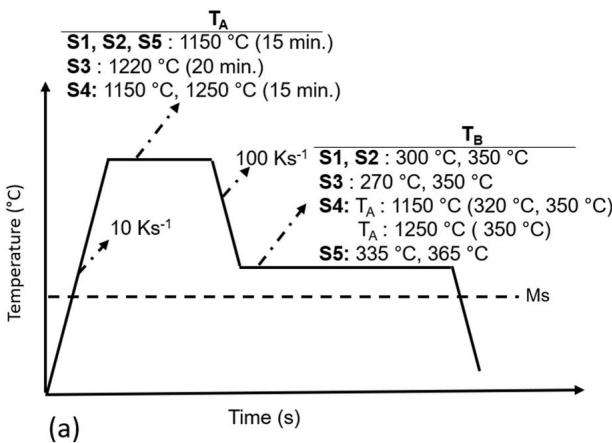

(b)  
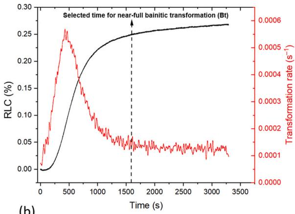  
Fig. 1. (a) Schematic representation of the heat treatment cycles applied to the studied steels, (b) representative methodology for determining the bainitic trans formation finish time (Bt) based on dilatometric analysis.

EBSD was performed in a Carl Zeiss SEM (Carl Zeiss AG, Jena, Ger many) equipped with an Oxford Instruments EBSD system and software. Specimens were prepared by standard procedures: after grinding, sur faces were finished by electropolishing and vibratory polishing to obtain a deformation-free surface. Patterns were acquired at an accelerating voltage of 20 kV with a step size of 0.2 μm, selected according to the microstructural feature size.

MatCalc was used to calculate the phase transformations and pre cipitation kinetics (Time-Temperature Precipitation (TTP) diagrams). The equilibrium calculations were performed using the standard step calculation method. The synergy of existing phases fcc, bcc, liquid, κ-carbide, hcp carbide, AlN, TiCN–TiMoC system was considered for both equilibrium and kinetic calculations. $\mathrm { T i - M o - C , ( F e , M ) _ { x } C _ { y } }$ carbide systems were kinetically simulated by a precipitation kinetics model according to the heat treatment defined for bainitic transformation. The modeling was based on a heterogeneous nucleation theory, considering only dislocation and grain boundary sites and ortho-equilibrium trans formation. Volumetric misfit was also considered in the simulations due to possible lattice parameter mismatches between the investigated car bides and the ferritic/austenitic matrix, which can notably influence nucleation energy and growth kinetics. κ-carbides were considered as fixed phase fractions due to the consideration of that κ-carbides form with the spinodal decomposition [26–28], hence inappropriate for classical nucleation theory.

XRD measurements were performed on a Malvern Panalytical Empyrean diffractometer, equipped with a Cu X-ray tube, operated at 40 kV/40 mA with a PIXcel 1D detector at the TU Clausthal Institute of Non-Metallic Materials on mechanically grinded and polished samples. The diffractometer was operated at a voltage of 40 kV with Cu Kα ra diation. The volume fraction of retained austenite $( V _ { \gamma } )$ and micro-strains (for austenite: $\varepsilon \gamma ,$ for bainitic ferrite: εα) were determined using the Rietveld refinement method, which relies on the integrated intensity of XRD peaks, following the guidelines of ASTM E975-13 [29]. Due to the high alloying concept, the presence of precipitates and intermetallic phases was expected to enhance peak intensity because they can be embedded, particularly within the fcc crystals. More accurate integrated intensity measurements were obtained by accounting for the presence of relevant phases at the $( 1 1 1 ) _ { \vee } , ( 2 0 0 ) _ { \vee } , ( 2 2 0 ) _ { \vee } ,$ and (311)y peaks. MatCalc equilibrium phase diagrams were employed to assess the phase fraction of these particles by considering $( 1 - V _ { c } )$ as the total (bainitic ferrite + γr) fraction, excluding the fraction of particle phases such as κ-carbide, TiMoC, $( \mathrm { F e , M ) _ { x } C _ { y } }$ , etc. This relation is given with equation (1) (Eq. (1)):

$$
V _ {\gamma} = \left(1 - V _ {c}\right) \left(I _ {\gamma} / R _ {\gamma}\right) / \left[ \left(I _ {\alpha} / R _ {\alpha}\right) + \left(I _ {\gamma} / R _ {\gamma}\right) \right]\tag{Eq. 1}
$$

where $V _ { \gamma }$ volume fraction of retained austenite, $V _ { c }$ volume fraction of carbides, $\mathrm { I } _ { \alpha }$ and $\mathrm { I } _ { \gamma }$ are the integrated intensities of α and $\gamma ,$ and $\mathrm { R } _ { \alpha }$ and $\mathrm { R } _ { \checkmark }$ are the theoretical relative intensities. The applied method for $V _ { \gamma }$ determination is summarized in Fig. 2.

## 3. Results and discussion

## 3.1. Determination of $T _ { A }$ and Ms temperatures

This section quantifies austenitization and extracts useable $\mathrm { T _ { A } }$ values by integrating dilatometry, LOM, and MatCalc equilibrium phase dia gram, explicitly addressing the broadened dissolution signals in high-C–Al steels that obscure a unique $\mathrm { T _ { A } , }$ and Ms values and guiding the chosen optimized heat-treatment conditions.

In this high C–Al alloy set, overlapping carbide-dissolution sequences tend to broaden the RLC–Temperature (T) signal and prevented a single sharp break from marking the austenitizing temperature $\mathrm { T } _ { \mathrm { A } } .$ An opera tional $\mathrm { T _ { A } }$ was therefore taken from the differentiated curves as the temperature at which the first-derivative peak decaved and linearity of the base curve was first restored. Using this criterion, approximate $\mathrm { T _ { A } }$ values were obtained as $1 0 6 2 ^ { \circ } \mathrm { C } \left( { \mathrm { S } } 1 \right) , 1 0 3 1 ^ { \circ } \mathrm { C } \left( { \mathrm { S } } 2 \right)$ , a broadened tran sition without a unique $\mathrm { T _ { A } }$ for $S 3 , 1 0 6 7 ^ { \circ } \mathrm { C } \left( S 4 \right)$ , and ${ \sim } 9 0 0 \ { } ^ { \circ } \mathrm { C }$ (S5) as shown in Fig. 3. To disentangle concurrent effects and to estimate the carbide-dissolution temperature (Tcd) and the ferrite-free $\mathrm { T _ { A } , }$ MatCalc was employed as an assisting tool (see Fig. 4). The simulations indicated ferrite-free $\mathrm { T _ { A } }$ values of 991 ◦C (S1), 929 ◦C (S2), 1177 ◦C (S3), 1016 ◦C (S4), and $9 8 6 ^ { \circ } \mathrm { C } \left( { \bf S } { \bf 5 } \right)$ and predicted complete dissolution of MC-type (Fe, $\mathrm { M ) _ { x } C _ { y } }$ carbides around $1 1 0 3 - 1 1 0 7 ^ { \circ } \mathrm { C }$ for S1–S2 and near $1 1 3 4 ^ { \circ } \mathrm { C }$ for S4. Guided by these considerations, $1 0 5 0 ~ ^ { \circ } \mathrm { C }$ was first assessed as a bench mark temperature for all steels to reach the $\alpha _ { \mathrm { p } } .$ -free microstructure (for LOM images see Fig. 3). At 1050 ◦C, S1 displayed a dual-phase structure with ${ \mathfrak { d } } _ { { \mathfrak { p } } } ,$ whereas S2 appeared $\mathfrak { a } _ { \mathfrak { p } ^ { - } } \mathrm { f r e e } _ { \mathrm { i } }$ , consistent with its lower derivative-based $\mathrm { T } _ { \mathrm { A } } .$ S3 exhibited extensive ${ \mathfrak { d } } _ { \mathfrak { p } }$ at $1 0 5 0 ^ { \circ } ($ (area fraction $\sim 1 4 . 6 \% )$ , and ${ \mathfrak { d } } _ { \mathfrak { p } }$ persisted even at $1 2 2 0 ^ { \circ } \mathrm { C }$ (area fraction: \~8.2 %), in line with the simulated requirement ${ \bf o f } \sim 1 1 7 7 ^ { \circ } { \bf C }$ for approaching a ferrite-free state and with the known ferrite-stabilizing effect of very high Al; a single experimental $\mathrm { T _ { A } }$ could therefore not be assigned to S3. S4 contained a visibly higher amount of ${ \mathfrak { d } } _ { \mathfrak { p } }$ at $1 0 5 0 ^ { \circ } \mathrm { C } ,$ , but only a trace level (< 1. %) at $1 1 5 0 ~ ^ { \circ } \mathrm { C } ,$ consistent with the derivative-based $\mathrm { T } _ { \mathrm { A } } .$ Similarly, S5 showed more prominent ${ \mathfrak { d } } _ { \mathfrak { p } }$ at $1 0 5 0 ~ ^ { \circ } \mathrm { C }$ and only a very small residual fraction $( \lesssim 1 \ { \% } ) \ { \mathrm { a t } } \ 1 1 5 0 \ { \mathrm { ^ { \circ } C } } ,$ while the simulations placed Tcd near ${ \sim } 7 7 5 ^ { \circ } \mathrm { C }$ and a ferrite-free $\mathrm { T _ { A } }$ around $9 8 6 ^ { \circ } \mathrm { C } .$ . Taken together, the three data streams (dilatometry, simulation, and LOM) point to $1 1 5 0 ~ ^ { \circ } \mathrm { C }$ as an optimized austenitizing temperature for S1, S2, S4, and ${ \mathsf { S } } 5 ,$ where carbide dissolution is advanced, chemical homogenization is improved, and ${ \mathfrak { d } } _ { \mathfrak { p } }$ is suppressed to negligible or non-existing levels. For $^ { S 3 , }$ a higher schedule of $1 2 2 0 ~ ^ { \circ } \mathrm { C }$ was required to minimize ${ \mathfrak { X } } _ { \mathrm { p } }$ and to approach the simulated ferrite-free field, although a fully $\alpha _ { \mathrm { p } } .$ -free con dition could not be realized within the practical window. Additionally, the rationale for these applied temperatures follows directly from the above synthesis. At substantially lower $\mathrm { T _ { A } , }$ incomplete dissolution and carbon heterogeneity would be retained, which are known to increase scatter in mechanical response and to disturb bainitic transformation through particle-assisted impingement.

Consequently, to enable consistent comparison among steels with varying $\mathrm { T _ { A } , }$ a fixed austenitization temperature of $1 1 5 0 ^ { \circ } \mathrm { C }$ was applied for alloys S1, S2, S4, and S5 in this study. This approach ensures that observed differences in bainitic transformation behavior are primarily attributable to alloy composition and $\mathrm { T } _ { \mathrm { B } } ,$ rather than variations in prior austenite conditions, Only for the alloy with the highest Al content (8 wt. %) (S3), 1220 ◦C represents the most effective compromise available for the minimum $\alpha _ { \sf p }$ level and maximum austenitizing. Where relevant (e.g., S4), an additional high-temperature schedule (e.g., 1250 ◦C) can further dissolve nanoscale MC/TiC precipitate and enhance austenite homogenization.

The measured values were $2 7 7 ^ { \circ } \mathrm { C } ( \mathrm { S } 1 ) , 2 7 4 ^ { \circ } \mathrm { C } ( \mathrm { S } 2 ) , 2 5 8 ^ { \circ } \mathrm { C } ( \mathrm { S } 3 ) ,$ , 310 ◦C (S4) after austenitizing at $1 1 5 0 ~ ^ { \circ } \mathrm { C }$ and $3 0 5 ~ ^ { \circ } \mathrm { C }$ after austenitizing at $1 2 5 0 ^ { \circ } \mathrm { C } ,$ , and 331 ◦C (S5) (see $\mathrm { F i g } . 5 ) .$ The order of magnitudes conforms to the established inverse dependence of Ms on the carbon content of austenite, with secondary influences from substitutional solutes (Al tending to raise $\mathbf { M } s ; \mathbf { M } \mathbf { n } , \mathbf { N } \mathbf { i }$ , and Mo tending to suppress it)[30–34].

In S1–S3, the relatively low Ms values indicate austenite that is effectively carbon-enriched after austenitization; the lowest Ms in S3 is consistent with extended κ-carbide (see Fig. 4 (c)) dissolution together with ferrite retention that facilitates local carbon partitioning into austenite despite the Ms-raising tendency of its very high Al content. In S4, Ms decreased only marginally from $3 1 0 ^ { \circ } \mathbf { C } \left( 1 2 5 0 ^ { \circ } \mathbf { C } \right.$ austenitization) to $3 0 5 ^ { \circ } \mathbf { C } \left( 1 1 5 0 ^ { \circ } \mathbf { C } \right.$ austenitization). In S4, Ms changes only marginally with austenitizing temperature $( 3 0 5 ^ { \circ } \mathbf { C } \mathrm { ~ a t ~ } 1 1 5 0 ^ { \circ } \mathbf { C }$ versus $3 1 0 ~ ^ { \circ } \mathrm { C }$ at $1 2 5 0 ^ { \circ } \mathrm { C } ; \Delta \colon 5 ^ { \circ } \mathrm { C } ) ,$ , which is within experimental scatter. No clear effect of the Ti microalloying addition on Ms was evident (Fig. 5 (d)). In S5, the relatively high Ms (331 ◦C) reflects the lower effective carbon in austenite under the chosen condition, in agreement with the continueddissolution signature observed in the heating curve and with its lower overall alloying. Overall, the Ms trends are internally consistent with the alloy chemistries and the austenitization analysis, and they support the heat-treatment strategy: austempering temperatures were chosen slightly above the measured Ms values to promote bainitic trans formation while suppressing martensite.

Summary of $\mathrm { T _ { A } }$ and Ms values.

<table><tr><td>Steel</td><td> $T_A$  (MatCalc)</td><td> $T_A$  (measured)</td><td> $T_A$  (applied)</td><td>Ms ( $^\circ C$ )</td></tr><tr><td>S1</td><td>991</td><td>1062</td><td>1150</td><td>277</td></tr><tr><td>S2</td><td>929</td><td>1031</td><td>1150</td><td>274</td></tr><tr><td>S3</td><td>1177</td><td>broadened transition</td><td>1220</td><td>258</td></tr><tr><td>S4</td><td>1016</td><td>1067</td><td>1150</td><td>305</td></tr><tr><td></td><td></td><td></td><td>1250</td><td>310</td></tr><tr><td>S5</td><td>986</td><td>900</td><td>1150</td><td>331</td></tr></table>

Table 2 compiles the MatCalc-predicted, the measured, the applied $\mathrm { T _ { A } , }$ and the measured Ms, forming the basis for the subsequent heattreatment conditions.

## 3.2. Transformation kinetics

Bainitic transformation behavior for the steels with varying C–Al levels was evaluated from the dilatometric RLC (%)–time (s) curves summarized in Fig. 6 (a) and (b). ) plot time on a logarithmic axis, while subfigures (c–e) replot the same data on a linear time axis to make the transformation times easier to read. For the steels S1, S2 and S3 (Al ≥ 6 wt.%), the kinetics are shown in Fig. 6 (a), with the corresponding linear-time views in Fig. 6 (c) and, for the slowest case (S3), an extendedtime view in Fig. 6 (d). For the steels S4 and S5 $( \mathrm { A l } < 6 ~ \mathrm { w t . \% } )$ , the kinetics are shown in Fig. 6 (b) and the linear-time view in Fig. 6 (e). Vertical dashed lines denote the approximate bainite finish time for each condition.

The steels S1 and S2 exhibit a minor difference of approximately 0.1 % in C-content, resulting in a slight variation in Ms temperatures, with S1 at $2 7 7 ^ { \circ } \mathrm { C }$ and S2 at $2 7 4 ^ { \circ } \mathrm { C } .$ . During austempering at $3 5 0 ^ { \circ } \mathrm { C } ,$ bainitic transformation was completed in approximately 1600 s for S1 and 2300 s for S2. The corresponding incubation times were 100 s for S1 and 210 s for S2. At a lower austempering temperature of ${ } ^ { 3 0 0 ~ ^ { \circ } \mathbf { C } , }$ , the trans formation durations were measured as 4000 s for S1 and 3600 s for S2. An increase in C content in S2 tends to shift the onset of bainitic trans formation toward lower temperatures. As a result. while S1 exhibited faster transformation at $3 5 0 ^ { \circ } \mathrm { C } ,$ S2 showed relatively faster kinetics at $3 0 0 ^ { \circ } \mathrm { C } .$ Under this condition, the incubation times were determined as 80 s for S1 and 130 s for S2. These results indicate that S1 consistently exhibited shorter incubation periods than S2 under both austempering conditions.

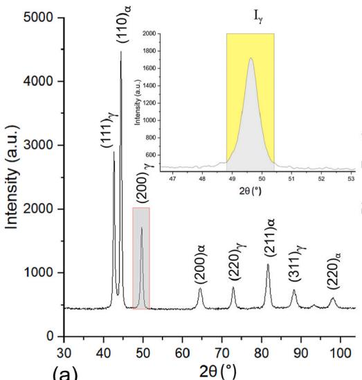  
(a)

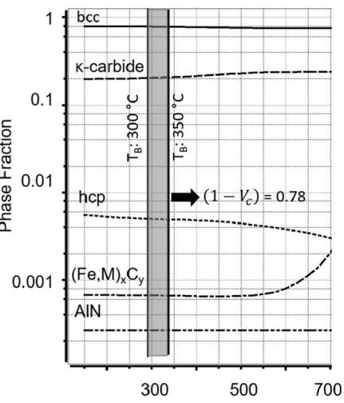  
(b)  
Fig. 2. The method used to determine $V _ { \gamma }$ as an example from S1, $3 5 0 \ { ^ \circ } \mathbf { C } \ \mathrm { T } _ { \mathrm { B } } { \mathrm { : } }$ (a) integration of peak intensities of S1, $\mathrm { T _ { B } } { : 3 5 0 \ ^ { \circ } C , ( b ) }$ MatCalc-simulated equilibrium phase fractions of S1 steel as a function of temperature.

LOM image for αp at selected $\mathbf { T _ { A } }$  
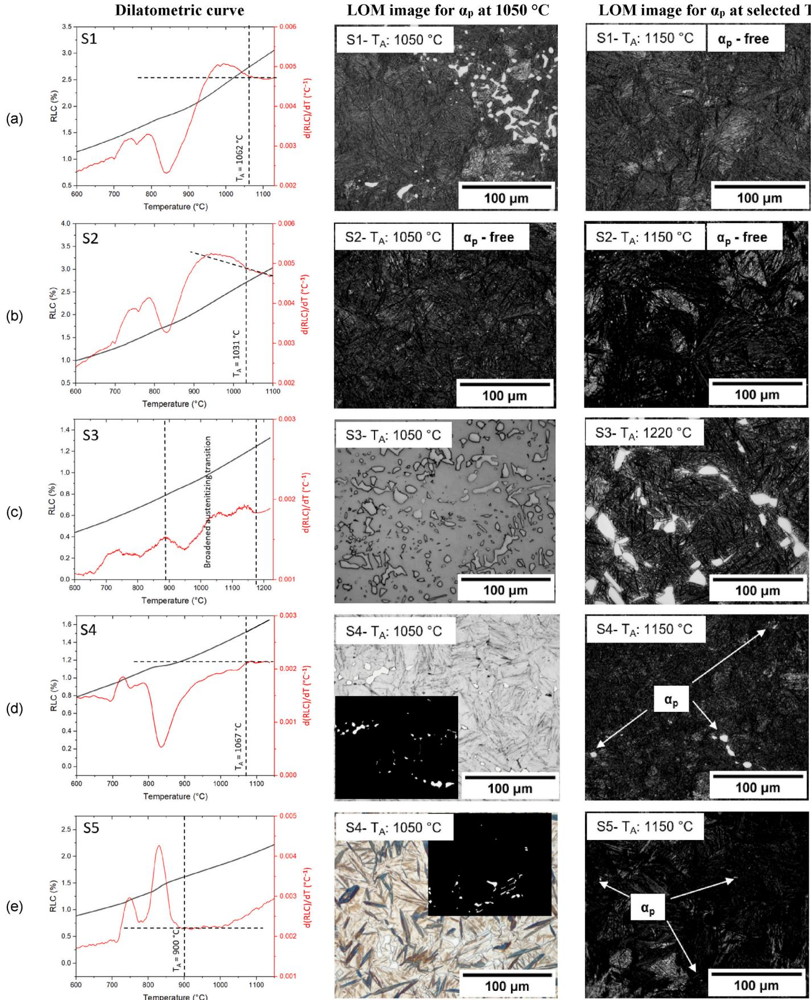  
Fig. 3. Dilatometric determination of the austenitizing response and LOM verification of polygonal ferrite $( \mathfrak { a } _ { \mathfrak { p } } )$ for steels S1–S5 (a–e). Left column: Heating RLC–T curves (black) with first derivatives d(RLC)/dT (red). The operational $\mathrm { T _ { A } }$ is marked by the vertical dashed line at the temperature where the derivative peak decay and linearity is first restored; for S3 a broadened austenitizing transition is indicated. Middle column: LOM at 1050 ◦C (benchmark), evidencing ${ \mathfrak { X } } _ { \mathrm { p } }$ retention in S1, S3, S4 and S5, while S2 is $\alpha _ { \mathrm { p } } .$ -free at this temperature. Right column: LOM at the selected $\mathrm { T _ { A } }$ (1150 ◦C for S1, S2, S4, S5; 1220 ◦C for S3). $\alpha _ { \mathrm { p } }$ is eliminated in S1 and S2 and reduced to trace levels in S4 and S5. whereas S3 retains a noticeable $\alpha _ { \mathrm { p } }$ fraction even at elevated $\mathrm { T } _ { \mathrm { A } } .$

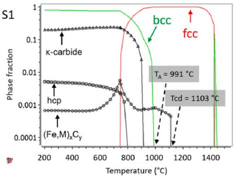  
(a)

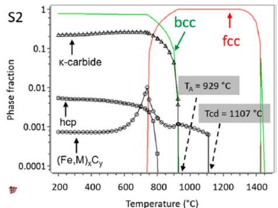  
(b)

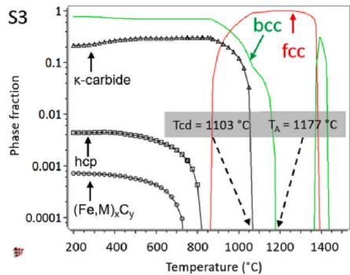  
(c)

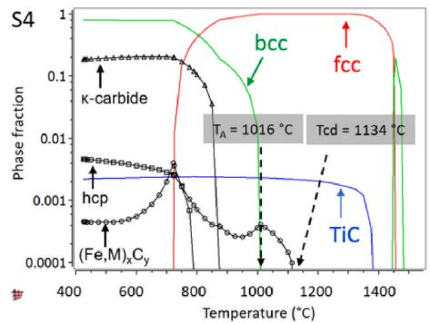  
(d)

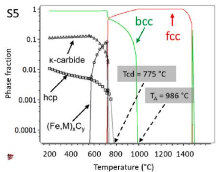  
(e)

Fig. 4. MatCalc equilibrium phase-fraction–temperature diagrams for S1–S5. The maps show bcc (green), fcc (red) and the κ -carbides, MC, hcp, TiC appears only in S4 (blue). Grey boxes mark the ferrite-free $\mathrm { T _ { A } }$ and the carbide-dissolution temperature Tcd indicate dissolution sequences.  
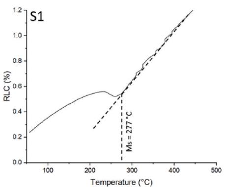  
(a)

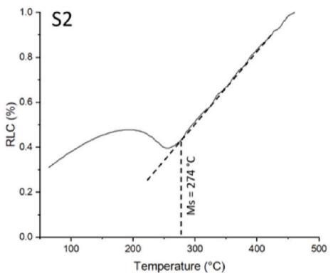  
(b)

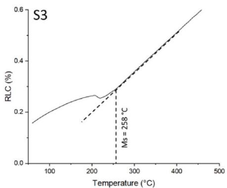  
(c)

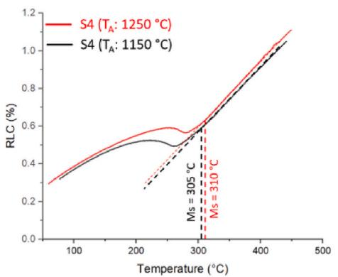  
(d)

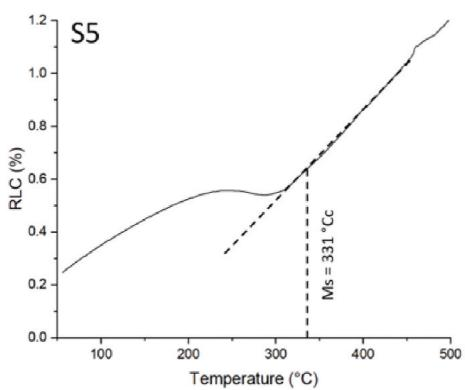  
(e)  
Fig. 5. Determination of martensite-start temperature (Ms) from cooling dilatometry (RLC–T). The tangent–intersection of the linear contraction segment (dashed lines) defines Ms. (a) S1, (b) S2, (c) S3, (d) S4, (e) S5.

For the S3 steel, Ms was determined as $2 5 8 ~ ^ { \circ } \mathrm { C }$ at an austenitizing temperature of $1 2 2 0 \ { } ^ { \circ } \mathrm { C } ,$ representing the lowest Ms value among the steels studied. In general, an increase in the bainitic transformation time is expected as the Ms temperature decreases. As a result, during aus tempering at ${ } ^ { 3 5 0 \ ^ { \circ } \mathrm { C } , }$ with a 140 s incubation period, the bainitic transformation reached completion at approximately $1 4 { , } 0 0 0 \ \ s .$ In contrast, at $2 7 0 ~ ^ { \circ } \mathrm { C }$ with a 120 s incubation time, the transformation duration extended to approximately 43,000 s. A distinctive feature of the S3 steel is the presence of a slow bainite growth period following the initial incubation phase, lasting nearly 3000 s at T of $2 7 0 ^ { \circ } \mathrm { C }$ and 1500 s $\mathrm { a t T _ { B } o f 3 5 0 ^ { \circ } C . }$ Consequently, the relatively high Al content (8.08 wt.%) in the steel suggests that Al no longer exerts an accelerating influence on bainite formation under these conditions, despite having a similarly short incubation time to steels S1 and S2. This behavior is attributed to the alloy’s dual-phase microstructure, as discussed in Section 3.4.3.

S4 steel exhibited Ms of 305 ◦C at $1 1 5 0 ~ ^ { \circ } \mathrm { C }$ and $3 1 0 ~ ^ { \circ } \mathrm { C }$ at 1250 ◦C. Among the investigated steels, S4, except for S5, exhibited the shortest and the roughly same incubation time, with 50–60 s across all param eters. The complete bainitic transformation times for S4 were deter mined as 3000 s at $1 1 5 0 ~ ^ { \circ } \mathrm { C }$ austenitization and $3 5 0 ~ ^ { \circ } \mathrm { C }$ austempering, 3500 s at $3 2 0 ^ { \circ } \mathrm { C } ,$ , and 2600 s at $1 2 5 0 ^ { \circ } \mathrm { C } .$ . While microalloying accelerates the bainitic transformation, further reductions in transformation time are limited by bainitic sheaf impingement arising from the increased density of phase boundaries (discussed in section 3.4.4.).

S5 steel, characterized by an Ms of 331 ${ } ^ { \circ } \mathrm { C } ,$ contains relatively low Cand Al contents (0.60 wt.% C and 3.92 wt.% Al, respectively). The incubation period was completed within 10 s, followed by a rapid bai nitic transformation. Complete bainitic transformation was observed at $3 3 5 ~ ^ { \circ } \mathrm { C }$ after 700 s and at 365 ◦C after 1000 s during austempering. According to the work of [15], steels containing approximately 5 wt.% Al (with 0.67–0.94 wt.% C) exhibited incubation times between 10 and 30 s and a 2000–6000 s transformation time. In contrast, steels with approximately 3 wt.% Al (with 0.77–0.95 wt.% C) showed incubation times ranging from 100 to 800 s and a 2900–9000 s transformation time. In comparison to these alloys, S5 steel with 3.92 wt.% Al may be considered to represent a near-stoichiometric composition that provides optimal transformation kinetics. In addition to Al content, the relatively lower C concentration (0.60 wt.%) in S5 also contributes to the accel eration of the bainitic transformation. Carbon is known to stabilize austenite and delay the transformation, whereas its reduction facilitates faster transformation of bainite. This is consistent with the observed shorter transformation times in S5 compared to other alloys with higher carbon levels, Additionally, the presence of 0.78 wt.% Ni did not adversely affect the bainitic transformation kinetics. Similar to the S4 steel, the ${ \mathfrak { d } } _ { \mathfrak { p } }$ content was maintained at a minimal level due to the austenite-stabilizing effect of Ni, without any detrimental impact on the transformation behavior.

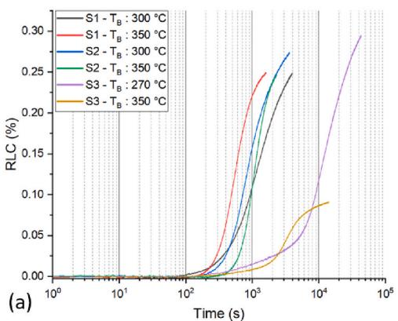

## 3.3. Mechanical properties

Mechanical test results of the investigated parameters are given in $\mathrm { F i g . } 7$ and critical points are discussed.

Across the studied alloys, the HV30 hardness values ranged between 450 and 500 HV30, with higher values observed at lower ${ \mathrm { T } } _ { \mathrm { B } } ,$ except the steel S4. Yield strength $( \mathrm { R } _ { \mathrm { p } 0 . 2 } ) { } _ { : }$ , except S3 and S4, was also found to be higher at lower bainitic transformation temperatures, and correlated with UTS. The maximum $\mathrm { R } _ { \mathrm { p 0 . 2 } }$ values were recorded as 1225 MPa for sample S1 at $\mathrm { { T _ { B } } }$ of 300 ◦C and minimum as 945 MPa for sample S3 $\operatorname { a t } \mathrm { T } _ { \mathrm { B } } \operatorname { o f } 2 7 0 ^ { \circ } \mathrm { C } \mathrm { T } _ { \mathrm { B } } .$

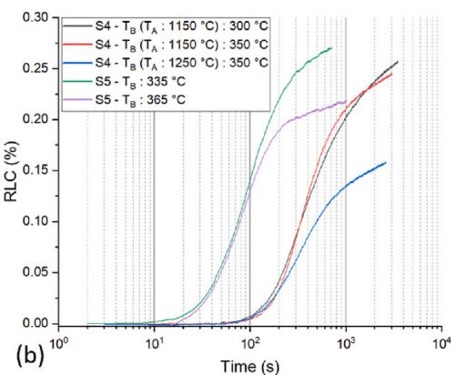

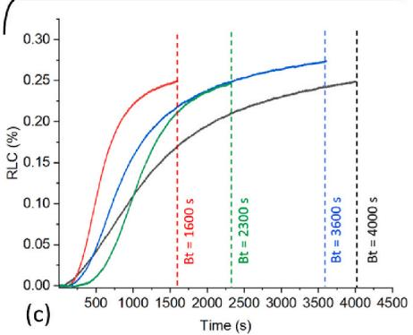

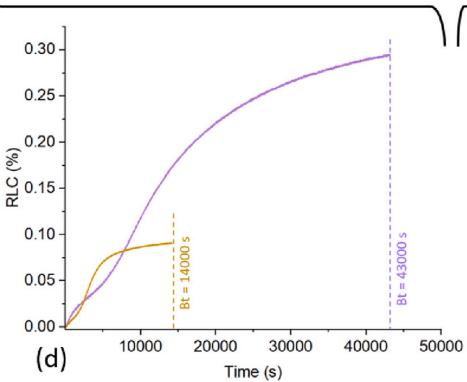

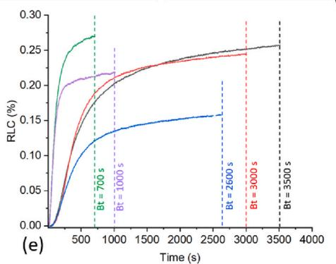  
Fig. 6. Bainitic transformation kinetics measured by dilatometry, plotted as relative length change (%) versus time. Figure (a–b) use a logarithmic time axis; subfigures (c–e) replot the same data on a linear time axis to aid readability of transformation times. (a) Al ≥ 6 wt.%: S1–S3. (b) Al < 6 wt.%: S4–S5. (c) Linear-time view of panel (a) for S1 and S2. (d) Linear-time view isolating the slowest transformation from panel (a) for S3 (extended time). (e) Linear-time view of panel (b) for S4 and S5. Vertical dashed lines mark the approximate bainite finish time for each condition.

The mechanical performance of the S1 and S2 steels exhibited only minor differences, indicating that a 0.1 wt.% variation in carbon content has a negligible effect on the overall mechanical response. Upon aus tempering at ${ } ^ { 3 0 0 } \ { } ^ { \circ } { \bf C } ,$ both alloys achieved high UTS values, approxi mately 1600 MPa for S1 and 1590 MPa for S2, with El of 6.8 % and 7.0 $^ { \% , }$ respectively. These correspond to PSE (product of strength and elongation) values of 10,880 MPa⋅% and 11,130 MPa⋅%. Increasing $\mathrm { { T _ { B } } }$ to $3 5 0 ^ { \circ } \mathrm { C }$ reduced the UTS to nearly 1380 MPa for both steels, while the El improved to 8.7 % for S1 and 9.4 % for S2, resulting in increased PSE values of \~12,000 and 12,970 MPa⋅%, respectively. For the S3 steel, El was 8.2 % at 350 ◦C (UTS: 1360 MPa), yielding a PSE of 11,150 MPa⋅%. However, at ${ 2 7 0 } \ ^ { \circ } \mathrm { C } ,$ , slightly above the Ms temperature, ductility drop ped to 2.4 % despite an increase in UTS to 1450 MPa, resulting in a low PSE of only \~3480 MPa⋅%, confirming a significant ductility-strength trade-off. The steep drop in ductility at low $\mathrm { { T _ { B } } }$ is consistent pro nounced strain partitioning when approaching Ms.

In the case of Ti-micro-alloyed S4, austenitizing at 1250 ◦C followed by austempering at 350 ◦C resulted in a UTS of approximately 1410 MPa with an El of 8.3 %, corresponding to a PSE of 11,700 MPa⋅%. Alter natively, austenitizing at $1 1 5 0 ~ ^ { \circ } \mathrm { C }$ resulted in UTS values of 1360 MPa and 1470 MPa with El of 10 % and 9.1 % at $3 2 0 ^ { \circ } \mathrm { C }$ and $3 5 0 ^ { \circ } \mathrm { C } ,$ , leading to higher PSE values of 13,600 and 13,380 MPa⋅%, respectively. At aus tenitization at $1 1 5 0 ~ ^ { \circ } \mathrm { C }$ followed by austempering at $3 5 0 ~ ^ { \circ } \mathrm { C } ,$ S4 steel demonstrated a slight improvement in El (10 %). Nonetheless, its UTS (1360–1470 MPa) remained lower than those of S1 and S2 under equivalent thermal conditions. However, due to the higher El in S4, its PSE was in fact comparable or even superior to that of S1 and S2, indicating that S4 offers a better strength–ductility balance despite its lower carbon content (0.87 wt.%).

Steel S5 exhibited UTS ranged from 1315 MPa with 8.7 % El at 365 ◦C (PSE: 11,450 MPa⋅%) to 1530 MPa with 7.0 % El at 335 ◦C (PSE: 10,710 MPa⋅%). In the study of [15], alloys containing ≈3 wt.% Al exhibited UTS values between 1400 and 2000 MPa and El ranging from 9 % to 12 %, corresponding to PSE values in the range of approximately 12,600 to 24,000 MPa⋅%. In contrast, steels with ≈5 wt.% Al showed UTS values between 1300 and 1850 MPa and El values of 4 %–9.5 %, resulting in PSE values of roughly 5200 to 17,575 MPa⋅%. In this context, the UTS–El performance of the S5 steel can be positioned in termediate between steels containing 3 wt.% and 5 wt.% $\mathbf { A l } ,$ and pos sessing comparatively higher C contents (ranging from 0.67 wt.% to 0.94 wt.%).

In summary, within the tested window: (i) $\mathrm { { T _ { B } } }$ primarily tunes the UTS–El trade-off via plate thickness and retained-austenite stability; (ii) the 8.08 wt.% Al design is detrimental to ductility at lower T ; (iii) C variations near 1 wt.% are secondary to Al level in setting that balance; and (iv) Ti + Ni alloying in S4 compensates for lower C by elevating El and thus PSE, offering the best overall balance among the studied steels.

## 3.4. Microscopic investigation

## 3.4.1. Quantitative microstructural analysis

In this section, the microstructural properties were investigated to gain a deeper understanding of their bainitic transformation behavior and mechanical properties. The quantitative results of the $\alpha _ { \mathrm { p } } , \mathrm { L t } ( \mathrm { t } ) , V _ { \gamma }$ , and ε are listed in Table 3.

$V _ { \gamma }$ is strongly influenced by the extent of bainite transformation. As the bainite content increases with Al addition, the resulting higher C concentration in the untransformed austenite tends to enhance its chemical stability, reducing the likelihood of the related phase trans formation from austenite; hence, incomplete reaction can occur in the corresponding micro-regions [2,8]. In steels S1, S2, and S3, bainitic transformation at higher $\mathrm { T } _ { \mathrm { B } } \left( 3 5 0 ^ { \circ } \mathrm { C } \right)$ resulted in significant $V _ { \gamma } ,$ reaching up to 34 $^ { \% , }$ which exhibits a more pronounced incomplete character compared to those obtained at lower T temperatures, with $V _ { \gamma }$ ranging between 27 % and 29 %. In contrast, in the steels S4 and S5, which were developed with lower C–Al alloying levels, the effect of $\mathrm { { T _ { B } } }$ was more limited on the $V _ { \gamma } ,$ , remaining below 30 %. (see Table 3 for $V _ { \gamma }$ values).

As observed in examples from the literature, Lt(t) decreases with lower austempering temperatures, which tends to increase the UTS while reducing El [1,15,35,36]. Consistent with these reports, in this study, average Lt(t) values range from 34 to 41 nm at low $\mathrm { { T _ { B } } }$ and 55–68 nm at high T overall, represented this correlation. For S4, Lt(t) was not significantly influenced by the variations in austenitization temperature and correlated micro-alloying, remaining within the range of 56–58 nm (see Table 3 for Lt(t) values). This is primarily attributed to the similar density of phase boundaries and lattice defects, neutralize grain-boundary-mediated pathways.

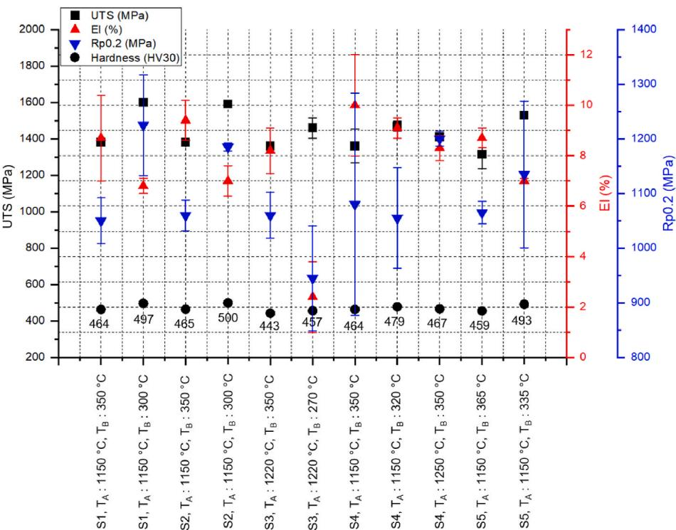  
Fig. 7. Mechanical properties of the investigated steels under various austenitization $\mathrm { ( T _ { A } ) }$ and austempering $\left( \mathrm { { T _ { B } } } \right)$ conditions. UTS (MPa), $\mathrm { R } _ { \mathrm { p 0 } . 2 }$ (MPa), El (%), and hardness (HV30) are presented.

(b)  
Table 3  
Microstructural parameters $( \alpha _ { \mathrm { p } } , \mathrm { L t } ( \mathrm { t } ) , V _ { \gamma } , \varepsilon \gamma ,$ εα) of the investigated steels under different $\mathrm { T _ { A } }$ and $\mathrm { { T _ { B } } }$ conditions.

<table><tr><td>Alloy</td><td>Parameter</td><td> $\alpha_p$  (%)</td><td>Lt(t)(nm)</td><td>SD (Lt(t))</td><td> $V_\gamma$  (%)</td><td> $\varepsilon\gamma$  (%)</td><td> $\varepsilon\alpha$  (%)</td></tr><tr><td rowspan="2">S1</td><td> $T_A: 1150 °C, T_B: 350 °C$ </td><td>-</td><td>55</td><td>23</td><td>34</td><td>0.35</td><td>0.45</td></tr><tr><td> $T_A: 1150 °C, T_B: 300 °C$ </td><td></td><td>35</td><td>11</td><td>27</td><td>0.50</td><td>0.45</td></tr><tr><td rowspan="2">S2</td><td> $T_A: 1150 °C, T_B: 350 °C$ </td><td>-</td><td>68</td><td>28</td><td>34</td><td>0.45</td><td>0.44</td></tr><tr><td> $T_A: 1150 °C, T_B: 300 °C$ </td><td></td><td>34</td><td>11</td><td>29</td><td>0.47</td><td>0.44</td></tr><tr><td rowspan="2">S3</td><td> $T_A: 1220 °C, T_B: 350 °C$ </td><td>8.2</td><td>58</td><td>23</td><td>34</td><td>0.55</td><td>0.50</td></tr><tr><td> $T_A: 1220 °C, T_B: 270 °C$ </td><td></td><td>40</td><td>10</td><td>29</td><td>0.54</td><td>0.33</td></tr><tr><td rowspan="3">S4</td><td> $T_A: 1150 °C, T_B: 350 °C$ </td><td>&lt;1.0</td><td>56</td><td>18</td><td>25</td><td>0.31</td><td>0.44</td></tr><tr><td> $T_A: 1150 °C, T_B: 320 °C$ </td><td></td><td>36</td><td>12</td><td>26</td><td>0.58</td><td>0.60</td></tr><tr><td> $T_A: 1250 °C, T_B: 350 °C$ </td><td></td><td>58</td><td>18</td><td>29</td><td>0.35</td><td>0.44</td></tr><tr><td rowspan="2">S5</td><td> $T_A: 1150 °C, T_B: 365 °C$ </td><td>&lt;1.0</td><td>55</td><td>15</td><td>26</td><td>0.42</td><td>0.43</td></tr><tr><td> $T_A: 1150 °C, T_B: 335 °C$ </td><td></td><td>41</td><td>14</td><td>19</td><td>0.51</td><td>0.45</td></tr></table>

At the reported ε levels, both bainitic ferrite and γr phases in S2 and S5 steels exhibit similar ε values in the range of 0.44–0.47 %. For S1 at $\mathrm { { T } _ { B } }$ of ${ 3 0 0 } ^ { \circ } \mathrm { C } ,$ for S3 at T of $3 5 0 ^ { \circ } \mathrm { C } ,$ , and S4 at $\mathrm { T } _ { \mathrm { A } }$ of 1150 ◦C followed by austempering at $3 2 0 \ ^ { \circ } \mathrm { C } ,$ no significant ε difference was observed be tween the phases. However, for S1 and S4 steels at T of $3 5 0 ^ { \circ } \mathrm { C } ,$ the εα was notably higher, ranging between 0.30 and 0.45 %. It showed that the degree of heterogeneous dislocation distribution was clearer at these parameters. In S3 at $2 7 0 \ ^ { \circ } \mathrm { C } ,$ the phase-resolved micro-strain differed markedly between γr and bainitic ferrite (εγ: 0.54 % vs. εα: 0.33 %), consistent with pronounced strain partitioning. Under this condition, the heterogeneity of the dislocation distribution became more pro nounced. Such an imbalance promotes early localization and $\gamma$ to bai nitic ferrite transformation, thereby limiting ductility; accordingly, the average elongation decreased to as low as 2.4 % in tensile testing (see Table 3 for ε values).

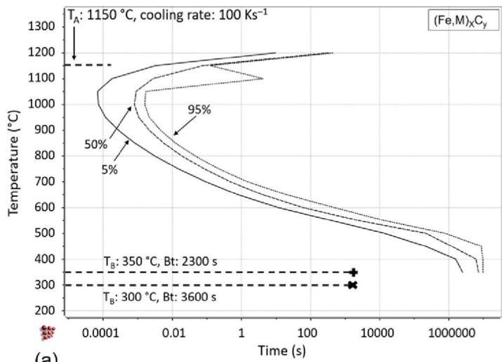  
(a)

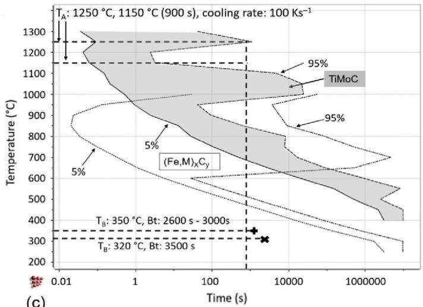  
(c)

## 3.4.2. TTP-based precipitation characteristics

The TTP diagrams of the S1, S3, S4, and S5 steels are presented in Fig. 8. Due to negligible differences between the S1 and S2 steels, only the S1 steel is shown. $( \mathrm { F e , M ) _ { x } C _ { y } }$ particles precipitate during cooling due to their extremely high nucleation kinetics between approximately 700 ◦C and 1150 ◦C in S1 and S3, and between $7 0 0 ^ { \circ } \mathrm { C }$ and $1 0 0 0 ^ { \circ } \mathrm { C }$ in S5. As a result, avoiding their formation becomes impossible. In contrast, for S4, initial nucleation occurs rapidly between $7 0 0 ~ ^ { \circ } \mathrm { C }$ and $9 5 0 ~ ^ { \circ } \mathrm { C } ,$ but is subsequently suppressed due to the counter-coarsening effect of the Ti–Mo–C precipitate system. Additionally, due to limited diffusivity during austempering, their secondary precipitation requires extremely long durations and stays constant. TTP curves also indicated a slight increase in $( \mathrm { F e , M ) _ { x } C _ { y } }$ in S3 compared to S1 and S2. However, this minor stoichiometric shift in the TTP curve nose, attributed to the higher Al content, appears to have a negligible impact on the mechanical properties.

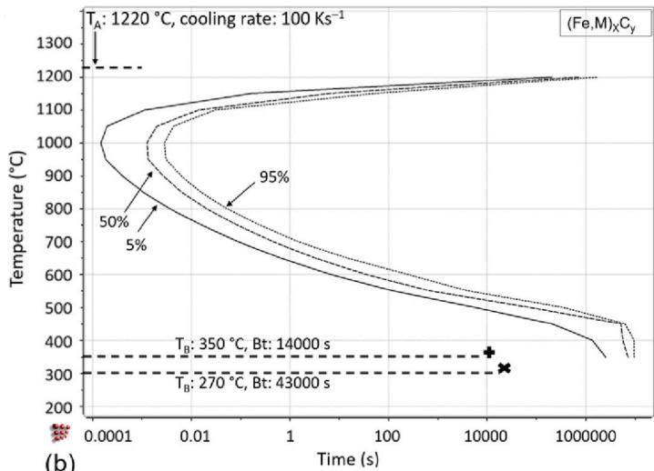

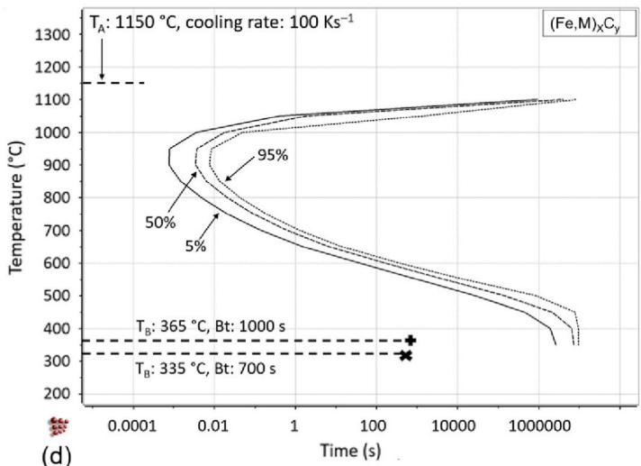  
Fig. 8. TTP diagrams simulated using MatCalc for the investigated steels: (a) S1 (also approximately representative for S2), (b) S3, (c) S4, (d) S5 2228

## 3.4.3. Discussion of ≥6 % Al-alloyed steels (S1, S2, S3)

Fe C is known as a ductility-decreasing precipitate due to its brittle nature, which reduces the steel matrix’s ability to undergo plastic deformation by acting as a stress concentrator that promotes crack initiation and propagation, resulting in lower elongation [2,37]. How ever, in the study of [38] on the high-C steel, it was demonstrated that the accelerated nucleation of Fe C precipitates improved ductility. In other studies were shown that controlling the particle size and achieving a spherical morphology of Fe C can enhance ductility [39,40]. In our research, it can be claimed that accelerated nucleation of and spherical nature of these cementite-like $( \mathrm { F e , M ) _ { x } C _ { y } }$ precipitates showed no micro-void formation (see Fig. 9), hence evaluated as having negligible effect on the mechanical properties. The presence of Si within the Fe C crystal, as revealed by EDX analysis see Fig. 9 (j), can be interpreted as the result of entrapment within the lattice due to rapid cooling, since under equilibrium conditions, Si is not expected to dissolve in Fe C, hence have suppressing effect on them [2]. Furthermore, the existence of Mo in these precipitates can have enhanced their stability, thereby inhibiting void formation.

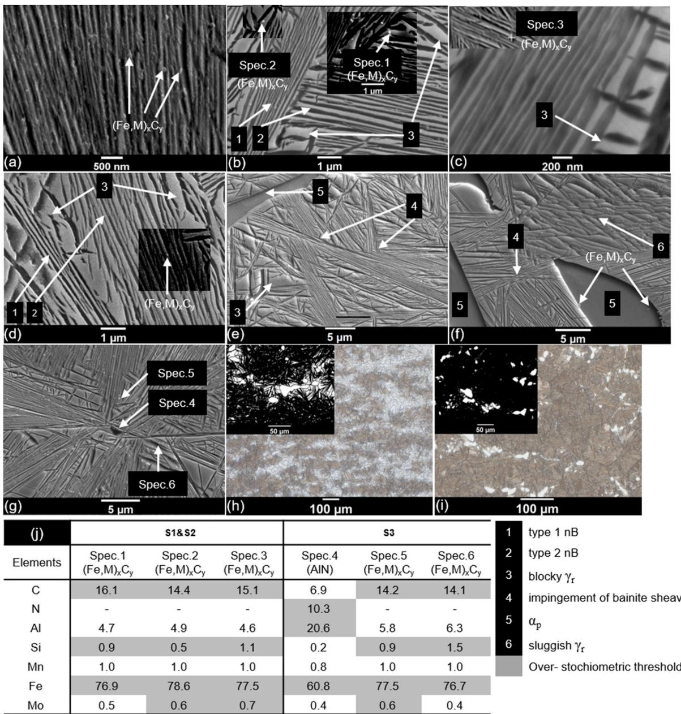  
Note: Due to EDX limitations in carbon measurement, carbon content was only considered to detect $( \mathsf { F e } , \mathsf { M } ) _ { \mathsf { x } } \mathsf { C } _ { \mathsf { y } } .$  
Fig. 9. Microscopy of steels S1, S2 and S3 under different T : (a) SEM for S1, T : 300 ◦C, (b) SEM for S1, T : 350 ◦C, (c) SEM for S2, T : 300 ◦C, (d) SEM for S2, T : 350 °C. (e) SEM for S3, Tp: 350 °C. (f) SEM for S3, Tp: 270 °C. (g) SEM (for EDX analysis) S3, T&: 270 °C. (h) LOM for S3, TB: 270 °C, Bt: 25,200 s. (i) S3, T&: 270 °C, Bt 43,200 s, (j) EDX for (b), (c), and (g).

The observed particles exhibit a rounded morphology inconsistent with spinodal decomposition, indicating a nucleation-driven formation mechanism. Given the apparent absence of significant Al within the particles, their composition is more consistent with cementite-like (Fe, $\mathbf { M } ) _ { \mathbf { x } } \mathbf { C } _ { \mathbf { y } }$ carbides modified by the presence of $\mathbf { M } = \mathbf { S } \mathbf { i } , \mathbf { M } \mathbf { o }$ . These carbide are located near the γr–bainitic ferrite phase boundaries and were only detectable due to their localized brightness under SEM, despite spatial resolution limitations during EDX analysis. The observation of these precipitates was achieved for steels S1, S2, and S3 as seen in Fig. 9.

E2 -type stoichiometric perovskite κ-carbide was not directly examined microscopically in this study. The absence of observable κ-carbide structures is attributed to the limited Mn content (≈1 wt.%), which is insufficient to stabilize such phases. As a result, no plate-like morphology was detected, and the remaining κ-carbides are presumed to exist in the matrix as nanoscale, embedded, non-stoichiometric $\mathrm { L } 1 _ { 2 ^ { - } }$ type structures.

At $\mathrm { { T _ { B } } }$ of 350 ◦C, the standard deviation Lt(t) increased, indicating the presence of bainitic structures with a broader range of thicknesses, such as nB Type 1 and Type 2, alongside blocky γr regions located between them (see Fig. 9). This structural phenomenon is particularly pro nounced in the S1, S2, and S3 steels (see Table 3 for the SD difference between the temperatures of $\mathrm { T _ { B } ) }$ . This heterogeneity promotes the for mation of interlocked bainitic morphologies consisting of different bainite types. For S4, this correlation is lower, and it is negligible for S5. This indicates that the lower alloying concept suppresses variative Lt(t). This can be considered as an El improving factor as shown in afore mentioned Fig. 7.

For steel S3, a modified austenitization approach was adopted due to the unavoidable presence of ${ \mathfrak { d } } _ { \mathfrak { p } }$ (8.2 %). The ferrite plates are named based on their morphology, as their α or δ nature remains unclear. The structures are observed to be occasionally idiomorphic but predomi nantly allotriomorphic (see LOM in Fig. 9(h) and (i)).

Although ${ \mathfrak { d } } _ { \mathfrak { p } }$ can potentially serve as nucleation sites for bainitic transformation, thereby accelerating transformation kinetics [41], the low C solubility of pre-existing ${ \mathfrak { d } } _ { \mathfrak { p } }$ leads to significant C-partitioning into the adjacent austenite, resulting in C-enrichment [42]. This partitioning locally stabilizes the adjacent austenite, thereby inhibiting austeni te–bainite transformation by increasing the energy barrier around ${ \mathfrak { d } } _ { \mathfrak { p } }$ plates [43,44]. Consequently, the lack of sufficient driving force for the austenite – bainitic ferrite displacive transformation leads to the partially decomposed sluggish γr in some micro-regions (see Fig. 9 (f)) [45]. Indeed, while initial nucleation was observed at $\alpha _ { \mathrm { p } ^ { \ast } }$ –austenite in terfaces (see Fig. 9 (h), (i)), the bainite growth could not be propagated and stalled at many of these sites, resulting in transformation-free re gions that required significantly longer holding times to achieve com plete bainitic transformation. This behavior is particularly evident in the LOM images at $2 7 0 ~ ^ { \circ } \mathrm { C }$ for 25,200 s (see LOM Fig. 9 (h)), where the transformation remained incomplete; consequently, a prolonged dura tion of 43,200 s was required to achieve near-complete transformation (see Fig. 9 (i)). Furthermore, at ${ 2 7 0 } ^ { \circ } \mathrm { C } ,$ where the Lt(t) is reduced from 58 nm to 40 nm, the higher average εγ (0.33 %) compared to the ferritic phases (0.58 %) (see Table 3). The significantly higher ε compared to the adjacent ferritic phases suggests that dislocation accumulation is particularly pronounced in the metastable γr, leading to the formation of highly brittle phase boundaries and potential stress spiking regions. These factors explain the severe drop in El at that parameter.

## 3.4.4. Discussion of Ti-micro-alloyed steel (S4)

In the study of [46,47], TiMoC exhibits favorable wettability char acteristics with the steel matrix in reinforced austenitic high-Mn steels, contributing to enhanced interfacial bonding. Despite a reduction in El, approximately 16 % in the reinforced variant compared to 35 % in conventional steels, the change in UTS and $\mathrm { R } _ { \mathrm { p } 0 . 2 }$ was negligible. These results are intrinsic to the powder metallurgy processing route employed. On the other hand, in our study, the self-nucleated TiMoC complex phase was expected to exhibit superior thermodynamic and structural stability relative to discrete TiC and MoC precipitate systems according to the findings of [48]. Within the S4 steel design framework, incorporation of TiMoC was used to mitigate the formation of $( \mathrm { F e , M ) _ { x } C _ { y } , }$ MoC, and probably κ-carbide phases commonly exists in analogous alloy systems. Additionally, facilitating refined microstructural evolution would help transformation kinetics be accelerated, while the TiMoC architecture further enables controlled coarsening, offering potential improvements in El. These precipitates accelerate bainite nucleation by providing initial nucleation sites for bainite sheaves, leading to a shorter incubation time compared to steels S1, S2, and S3. However, due to the impingement of bainite sheaves (see Fig. 10) caused by an increased number of various phase boundaries [49–51], the progression of bainite transformation after the incubation period was gradually suppressed in S4 compared to S1 and S2 (see Fig. 6).

Nonetheless, the S4 steel exhibited the best average and maximum El of 10 and 12 % at $\mathrm { T _ { A } } 1 1 5 0 ^ { \circ } \mathrm { C }$ and $\mathrm { T } _ { \mathrm { B } } \colon 3 5 0 \ ^ { \circ } \mathrm { C } .$ , which are slightly higher than S1and S2 as aforementioned (see Fig. 7). This shows that the sup pression of El was not determined due to the existence of TiMoC on the phase and grain boundaries.

As expected, $( \mathrm { F e , M ) _ { x } C _ { y } }$ and MoC precipitates were less present in the

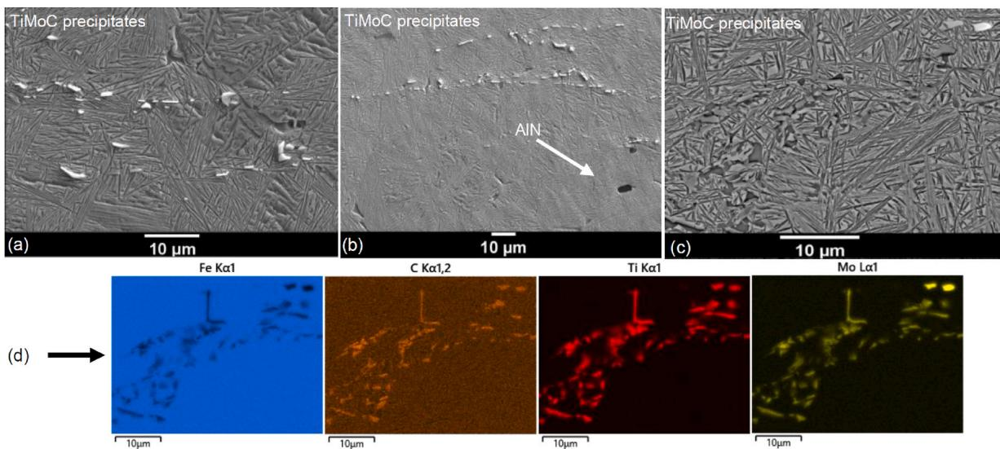  
Fig. 10. SEM and EDX analysis of steel S4 after different heat treatment conditions: (a) SEM for S4, $\mathrm { T } _ { \mathrm { A } } \colon 1 2 5 0 ^ { \circ } \mathrm { C } ,$ T : 350 ◦C (b) SEM for S4, $\mathrm { T _ { A } } { : 1 1 5 0 } ^ { \circ } \mathrm { C } , \mathrm { T _ { B } } { : 3 5 0 } ^ { \circ } \mathrm { C } \left( \mathrm { c } \right)$ SEM for S4, $\mathrm { T } _ { \mathrm { A } } \colon 1 1 5 0 ~ ^ { \circ } \mathrm { C } ,$ T : 320 ◦C (d) EDX mapping of (c).

(c)

final microstructure compared to steels S1, S2 and $^ { S 3 , }$ due to the sup presing effect of TiMoC. The longitudinal alignment of TiMoC pre cipitates indicates their formation during the cooling phase after casting, followed by deformation during subsequent hot forming, indicating that secondary precipitation played a negligible role (Fig. 10 (a), (b), (c)). These findings are compatible with the results of TTP (see Fig. 8 (c)). To achieve the desired microstructure through the precipitation of Ti–Mo carbides along with a controlled amount of free TiC, an austenitization temperature of $1 2 5 0 ~ ^ { \circ } \mathrm { C }$ was selected. This temperature was also spe cifically chosen because it suppressed partially the impingement asso ciated with the extremely small prior austenite grain sizes observed at $1 1 5 0 \ ^ { \circ } \mathrm { C } ,$ thereby facilitating relatively faster phase transformations. Furthermore, a primary characteristic of Ti–Mo–C complex carbides is the absence of micro-defects within the microstructure (Fig. 10 (a), (b), (c)). As illustrated by the EDX mapping, a depletion of Fe was detected within the complex carbides, further confirming their composition (see Fig. 10 (d)).

## 3.4.5. Discussion of relatively low C–Al alloyed steel (S5)

In S5, the moderate Al–C level together with a small Ni addition promotes very rapid bainitic transformation when austempered slightly above Ms, yielding a predominantly bainitic microstructure with filmlike γr and only isolated secondary constituents (see Fig. 8 (d)). The EBSD maps substantiate this fast kinetics by revealing a fine, well connected bainitic ferrite network with minimal impingement.

The IPF maps (Fig. 11 (d), (e)) for $\mathrm { { T _ { B } } }$ at $3 3 5 ^ { \circ } \mathrm { C }$ show narrow packets of bainitic ferrite laths with small, scattered lenticular martensite (labelled M). The packets exhibit intra-packet orientation clustering, as expected for laths sharing a parent variant, separated by frequent high angle packet/block boundaries. The corresponding KAM maps (Fig. 11 $( g ) ,$ (h)) display bands of elevated local misorientation along lath/ packet boundaries and at sheaf tips; in the martensite-focused field (Fig. 11 (h)) local KAM hot-spots occur adjacent to M, consistent with the high density of geometrically necessary dislocations generated by low-temperature displacive growth. Although dilatometry gave Ms of ${ } ^ { 3 3 1 } \ { } ^ { \circ } \mathrm { C } ,$ the sporadic M plates at 335 ◦C (Ms+4 K) are compatible with stress-assisted transformation and local thermal/compositional hetero geneities, i.e. Ms is distributed at the microscale. XRD at this condition indicates the highest micro-strain in austenite (εγ: 0.51 %), slightly above ferrite (εα: 0.45 %), and a lower retained-austenite fraction (19 %) (Table 3). These features explain the higher strength but reduced ductility measured at 335 ◦C (UTS: 1530 MPa, El: 7 %): finer plates and concentrated defect fields raise strength, while the lower γr content limits TRIP-assisted strain hardening.

The IPF map (Fig. 11 (f)) for at $\mathrm { { T _ { B } } }$ of $3 6 5 ^ { \circ } \mathrm { C }$ reveals slightly coarser bainitic packets and a trace of allotriomorphic ferrite (labelled F), while martensite is absent. The global KAM field (Fig. 11 (i)) is marginally higher on average than at 335 ◦C (mean KAM \~ 0.905◦ vs 0.825◦; me dian 0.789◦ vs 0.692), whereas local KAM maxima are more pronounced near M at 335 ◦C. KAM is step-size sensitive; the maps were acquired at different magnifications $( 2 5 \mathbf { k } \times \mathbf { v s } 2 0 \mathbf { k } \times \mathbf { ) } .$ , so small differences in ab solute values should be interpreted with this measurement sensitivity in mind. XRD corroborates the microstructural evolution. The retained austenite fraction increases to \~26 % and the phase micro-strains converge (εγ: 0.42 %, εα: 0.43 %), consistent with reduced lattice cur vature at the higher transformation temperature and improved defor mation uniformity. The mechanical response follows accordingly (UTS: 1315 MPa, El: 8.7 %).

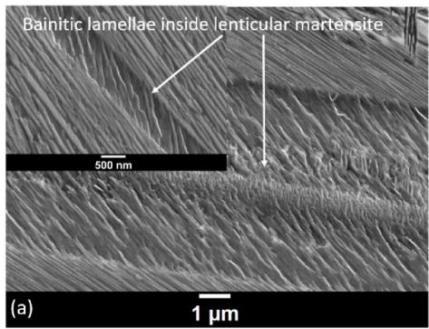

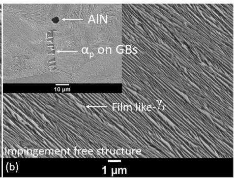

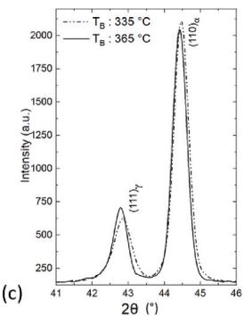

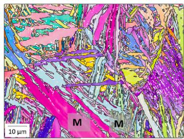  
(d)

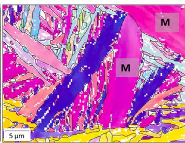  
(e)

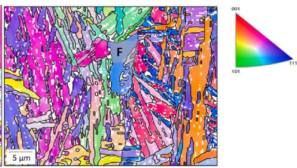  
(f)

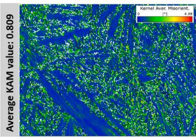  
(g)

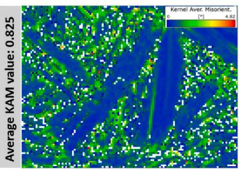  
(h)

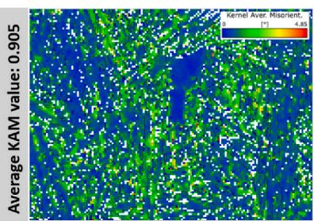  
(i)  
Fig. 11. S5 microstructure analysis: (a) SEM for T : 335 ◦C, (b) SEM for T : 365 ◦C, (c) XRD for T : 335 ◦C shows α+γr with no resolvable martensite. EBSD IPF (d–f) and KAM (g–i): 335 ◦C (d, e, g, h) → fine bainite with local KAM spikes near M; 365 ◦C (f, i) → slightly coarser bainite with trace F and marginally higher global KAM.

Lenticular martensite is only sporadically observed by SEM/EBSD at 335 ${ } ^ { \circ } \mathrm { C } ,$ and the XRD pattern shows no resolvable martensite peaks (see Fig. 11 (c)), implying a volume fraction below the diffractometric detectability under the present conditions [52]. γr is largely film-like at bainite lath boundaries; because these films are near or below the EBSD step size, EBSD under-counts $\gamma \mathbf { r }$ relative to XRD, hence XRD is taken as quantitative for phase fractions. In contrast to the higher-Al grades, S5 shows no SEM-resolvable $( \mathrm { F e , M ) _ { x } C _ { y } }$ after austempering, in line with the TTP assessment and the lower alloying level; the relatively symmetric XRD peak shapes further indicate limited precipitation-induced broadening.

The EBSD–XRD–SEM set provides a coherent picture: lowering $\mathrm { { T _ { B } } }$ from 365 ◦C to 335 ◦C refines the bainitic plates, concentrates local lattice curvature near martensite and lath interfaces, and reduces/ stiffens $\gamma \mathbf { r } ;$ conversely, 365 ◦C yields slightly coarser plates, marginally higher global KAM, and a larger γr fraction with lower micro-strain. The outcome is a tunable strength–ductility balance that mirrors the me chanical data. In S5, the combination of moderate $\mathbf { A l } ,$ reduced C, and a small Ni addition produces a trace amount of αp microstructure with scarce martensite, rapid bainite formation, and a clean interface network. $\mathrm { T } _ { \mathrm { B } }$ effectively sets the γr/KAM balance without complications from extensive sheaf impingement or secondary precipitation.

## 4. Conclusion

This work systematically compares bainitic transformation kinetics and tensile behavior across five low-density Al–C steels with varied C–Al levels and Ti microalloying, supported by LOM, SEM /EDX, XRD, EBSD, and MatCalc simulations. The conclusions are as follows.

1. Bainitic Transformation Kinetics: Steel S5 exhibited the fastest bai nitic transformation ( Bt: 700–1000 s), whereas S3 (with the highest Al content ≈8 wt.%) was the slowest (Bt: 14,000–43,000 s, depending on austempering temperature). In S3, the presence of ${ \mathfrak { X } } _ { \mathfrak { p } }$ promotes local carbon enrichment and stabilization of surrounding austenite, which impedes bainite nucleation and growth and ex plains its slowest transformation. Steels S1 and S2 fell into an intermediate-fast range (Bt: 1600–4000 s), and Ti-micro-alloyed S4 showed initially rapid nucleation but was slowed by bainitic sheaf impingement (Bt: 3000–3500 s). Notably, the transformation time was not affected by a small Ni addition (0.78 wt.% in S4 and S5).

2. UTS-El (PSE) Performance: Despite compositional differences, several alloys achieved high combinations of UTS and El. Ti-alloyed S4 attained the best product of strength and elongation (PSE ≈ 13.6 GPa·%) under optimal conditions $( \mathrm { a t T _ { A } o f 1 1 5 0 ^ { \circ } C , a t T _ { B } o f 3 5 0 ^ { \circ } C } ) _ { \mathrm { \Omega } }$ Alloy S2 achieved a similar peak performance (PSE ≈ 13.0 GPa⋅% at $\mathrm { { T _ { B } } }$ of $3 5 0 ~ ^ { \circ } \mathrm { C } )$ . In contrast, S3 at a low austempering temperature $( 2 7 0 ^ { \circ } \mathrm { C } )$ exhibited a severe loss of ductility $( \mathrm { E l } \approx 2 . 4 \% )$ , leading to a minimum PSE of only ≈ 3.5 GPa⋅%. S5, despite its rapid bainite formation, showed moderate strength–ductility values, with PSE in the range of ≈10.7–11.5 GPa⋅%.

3. Precipitation Characteristics: Primary carbides of type $( \mathrm { F e , M ) _ { x } C _ { y } }$ were widely observed in steels S1, S2, and S3 without any associated micro-void formation. These precipitates had negligible direct in fluence on tensile properties, consistent with thermodynamic simu lations indicating their formation occurred above the bainitic hold temperature. Their stabilization is attributed to rapid cooling and the presence of residual elements (e.g. Mo, Si) in the particles, supporting the interpretation that they are primarily formed during prior processing rather than during austempering.

4. Effect of Ti Microalloying: In the S4 steel, Ti additions led to the coarsening of MoC into more complex TiMoC precipitates, predom inantly formed during above austempering temperatures. No new secondary precipitates were detected during austempering (within SEM resolution) as also evident from TTP calculation. The presence of Ti-rich carbides suppressed the formation of more deleterious Fe C or unmodified MoC particles and promoted grain refinement. How ever, S4 exhibited similar bainitic transformation kinetics and a slightly improved UTS–El balance relative to the steels S1 and S2.

5. Lower $\underline { { \mathbf { C } } } \underline { { - } } \underline { { \mathbf { A l } } }$ alloying approach: The ${ \mathrm { l o w } } { \mathrm { - } } { \mathrm { C } } ,$ moderate-Al alloy S5 developed a fine, uniform bainitic microstructure with minimal sheaf impingement. When austempered near its Ms $( \mathrm { T } _ { \mathrm { B } } \colon 3 3 5 \ ^ { \circ } \mathrm { C } ,$ , Ms: 331 ${ } ^ { \circ } \mathrm { C } ) ,$ S5 showed very narrow bainitic-ferrite lath packets with only sparse lenticular martensite and localized misorientation hot-spots at lath/martensite interfaces. This refined microstructure facilitated a very short transformation time (700 s, the fastest among all steels). Under these conditions, S5 achieved high strength (UTS: 1530 MPa) albeit at the expense of ductility (El: 7 %).

## Author contributions

Serkan Turan: conceptualization, investigation, formal analysis, methodology, software, validation, visualization, writing – original draft, writing – review & editing. Johannes Buhl: supervision, formal analysis, writing – review & editing. Heinz Palkowski: conceptualiza tion, formal analysis, funding acquisition, project administration, su pervision, writing – review & editing.

## Data availability statement

The data that support the findings of this study are available from the corresponding author upon reasonable request.

## Declaration of competing interest

The authors declare that they have no known competing financial interests or personal relationships that could have appeared to influence the work reported in this paper.

## Acknowledgement

Funded by the Deutsche Forschungsgemeinschaft (DFG, German Research Foundation) – Project Number: 451823328.

## References

[1] Garcia-Mateo C, Caballero FG. Ultra-high-strength bainitic steels. ISIJ Int 2005;45: 1736–40. https://doi.org/10.2355/isijinternational.45.1736

[2] Caballero F, Bhadeshia H, Mawella K, et al. Very strong low temperature bainite. Mater Sci Technol 2002;18:279–84. https://doi.org/10.1179/ 026708301225000725.

[3] Kumar A, Singh A. Mechanical properties of nanostructured bainitic steels. Materialia 2021:15:101034 https://doi org/10.1016/i mtla 2021.101034

[4] Akram M, Palkowski H, Soliman M. High-strength low-cost nano-bainitic steel. J Mater Eng Perform 2020;29:2418–27. https://doi.org/10.1007/s11665-020- 04771-4.

[5] Chen S. Rana R. Low-density steels. 2021, p. 211–89

[6] Tian J, Xu G, Zhou M, et al. Effects of Al addition on bainite transformation and properties of high-strength carbide-free bainitic steels. J Iron Steel Res Int 2019;26. https://doi.org/10.1007/s42243-019-00253-7

[7] Zambrano OA. A general perspective of Fe–Mn–Al–C steels. J Mater Sci 2018;53: 14003–62. https://doi.org/10.1007/s10853-018-2551-6

[8] Khaple S. Golla BR. Prasad VVS. A review on the current status of Fe-Al based ferritic lightweight steel. Def Technol 2023;26:1–22. https://doi.org/10.1016/j. dt.2022.11.019.

[9] Tian J, Xu G, Zhou M, et al. The effects of Cr and Al addition on transformation and properties in low-carbon bainitic steels. Metals 2017;7:40. https://doi.org/ 10.3390/met7020040.

[10] Pramanik S, Suwas S. Low-density steels: the effect of Al addition on microstructure and properties. J Occup Med 2014;66:1868–76. https://doi.org/ 10.1007/s11837-014-1129-2.

[11] Franceschi M, Bertolini R, Fabrizi A, et al. Effect of ausforming temperature on bainite morphology in a 3.2% Si carbide-free bainitic steel. Mater Sci Eng, A 2023; 864:144553. https://doi.org/10.1016/j.msea.2022.144553.

[12] Hu J. Low-density nanostructured bainitic steel with fast transformation rate and high impact-toughness. Mater Lett 2020;261:127105. https://doi.org/10.1016/j. matlet.2019.127105.

[13] Soliman M, Mostafa H, El-Sabbagh AS, Palkowski H. Low temperature bainite in steel with 0.26 wt% C. Mater Sci Eng, A 2010;527:7706–13. https://doi.org/ 10.1016/i.msea.2010.08.037.

[14] García-Mateo C, Caballero FG. The role of retained austenite on tensile properties of steels with bainitic microstructures. Mater Trans 2005:46:1839–46. https://doi org/10.2320/matertrans.46.1839.

[15] Akram M, Soliman M, Palkowski H. Nano-bainitic steels: acceleration of transformation by high aluminum addition and its effect on their mechanical properties. Metals 2021:11:1210. https://doi.org/10.3390/met11081210.

[16] Herrmann J, Inden G, Sauthoff G. Deformation behaviour of iron-rich ironaluminum alloys at low temperatures. Acta Mater 2003;51:2847–57. https://doi org/10.1016/S1359-6454(03)00089-2.

[17] Kang J, Li YJ, Wang XH, et al. Design of a low density Fe-Mn-Al-C steel with high strength-high ductility combination involving TRIP effect and dynamic carbon partitioning. Mater Sci Eng, A 2019;742:464–77. https://doi.org/10.1016/j. msea.2018.11.044.

[18] Jacques PJ, Girault E, Harlet Ph, Delannay F. The developments of cold-rolled TRIP-assisted multiphase steels. Low silicon TRIP-assisted multiphase steels. ISIJ Int 2001;41:1061–7. https://doi.org/10.2355/isijinternational.41.1061.

[19] Hu F, Wu K-M, Zheng H. Influence of Co and Al on bainitic transformation in super bainitic steels. Steel Res Int 2013;84:1060–5. https://doi.org/10.1002/ srin.201200334.

[20]. El-Fallah GMAM. Ooi SW. Bhadeshia HKDH. Effect of nickel aluminide on the bainite transformation in a Fe-0.45C-13Ni–3Al–4Co steel. and associated properties. Mater Sci Eng, A 2019;767:138362. https://doi.org/10.1016/j. msea.2019.138362.

[21] Kim C, Hong H-U, Jang JH, et al. Reverse partitioning of Al from κ-carbide to the γ-matrix upon Ni addition and its strengthening effect in Fe–Mn–Al–C lightweight steel. Mater Sci Eng, A 2021;820:141563. https://doi.org/10.1016/j. msea.2021.141563.

[22] San Martín D, Kuntz M, Caballero F, Garcia-Mateo C. A new systematic approach based on dilatometric analysis to track bainite transformation kinetics and the influence of the prior austenite grain size. Metals 2021;11:324. https://doi.org 10.3390/met11020324.

[23] Xu Y. Xu G. Mao X. et al. Method to evaluate the kinetics of bainite transformation in low-temperature nanobainitic steel using thermal dilatation curve analysis. Metals 2017:7:330.https://doi org/10.3390/met7090330

[24] Garcia-Mateo C, Jimenez JA, Lopez-Ezquerra B, et al. Analyzing the scale of the bainitic ferrite plates by XRD, SEM and TEM. Mater Char 2016;122:83–9. https:/ doi.org/10.1016/j.matchar.2016.10.023.

[25] Ruiz-Jimenez V, Jimenez JA, Caballero FG, Garcia-Mateo C. Bainitic ferrite plate thickness evolution in two nanostructured steels. Materials 2021;14:4347. https:/ doi.org/10.3390/ma14154347.

[26] Cheng W-C, Cheng C-Y, Hsu C-W, Laughlin DE. Phase transformation of the L12 phase to kappa-carbide after spinodal decomposition and ordering in an Fe–C–Mn–Al austenitic steel. Mater Sci Eng, A 2015;642:128–35. https://doi.org/ 10.1016/j.msea.2015.06.096.

[27] Choo WK. Kim JH. Yoon JC. Microstructural change in austenitic Fe-30.0wt%Mn-7.8wt%Al-1.3wt%C initiated by spinodal decomposition and its influence on mechanical properties. Acta Mater 1997;45:4877–85. https://doi.org/10.1016/ S1359-6454(97)00201-2

[28] Elkot MN, Sun B, Zhou X, et al. On the formation and growth of grain boundary κ-carbides in austenitic high-Mn lightweight steels. Materials Research Letters 2024:12:10–6. https://doi.org/10.1080/21663831.2023.2284321

[29] Standard practice for X-ray determination of retained austenite in steel with near random crystallographic orientation (withdrawn 2022). https://store.astm.org/ e0975-13.html. [Accessed 2 April 2025]

[30] Kang S, Pierce D, Matlock DK, et al. Quench and partitioning steels. In: Caballero FG. editor. Encyclopedia of materials: metals and alloys. Oxford: Elsevier: 2022, p. 84–94

[31] Ingber J, Kunert M. Prediction of the martensite start temperature in high-carbon steels. Steel Res Int 2022;93:2100576. https://doi.org/10.1002/srin.202100576.

[32] Izumiyama M, Tsuchiya M, Imai Y. Effects of alloying element on supercooled A3 transformation. J Jpn Inst Metals 1970;34:291–5. https://doi.org/10.2320/ jinstmet1952.34.3 291

[33] Lee S-J, Jung M. Prediction of martensite start temperatures of highly alloyed steels. Arch Metall Mater 2021:107-11. https://doi.org/10.24425. amm.2021.134765.

[34] Shirakami Y. Masumura T. Tsuchivama T. Nanba S. Effect of aluminum addition on martensitic transformation in medium carbon steel. In: 28th congress of the international federation for heat treatment and surface engineering, IFHTSE 2023 28th JFHTSE 2023 congress: 2023.

[35] Garcia-Mateo C, Paul G, Somani MC, et al. Transferring nanoscale bainite concept to lower C contents: a perspective. Metals 2017;7:159. https://doi.org/10.3390 met7050159.

[36] Wu H, Yu J, Wang Z, et al. Understanding the effect of austempering temperature on the crystallographic features and mechanical properties of low-carbon bainitic steel. Crystals 2024:14:1085. https://doi.org/10.3390/cryst14121085.

[37] Tsybenko H, Tian C, Rau J, et al. Deformation and phase transformation in polycrystalline cementite (Fe3C) during single- and multi-pass sliding wear. Acta Mater 2022;227:117694. https://doi.org/10.1016/j.actamat.2022.117694.

[38] Ali M, UlHaq E, Ibrahim A, et al. Increase in ductility of high carbon steel due to accelerated precipitation of cementite. Met Sci Heat Treat 2017;59:294–6. https:// doi.org/10.1007/s11041-017-0145-6

[39] Hayakawa K, Ogawa T, He L, et al. Improvement in the strength–ductility balance of tempered martensite steel by controlling cementite particle size distribution. J Mater Eng Perform 2024;33:6675–85. https://doi.org/10.1007/s11665-023- 08428-w.

[40] Jia N, Shen YF, Liang JW, et al. Nanoscale spheroidized cementite induced ultrahigh strength-ductility combination in innovatively processed ultrafine grained low alloy medium-carbon steel. Sci Rep 2017;7:2679. https://doi.org/ 10.1038/s41598-017-02920-9

[41] Yu X, Liu W, He K, et al. Experimental and modelling research on the effect of prior ferrite on bainitic transformation in medium-carbon bainitic steel. Crystals 2024; 14:487. https://doi.org/10.3390/cryst14060487.

[42] Tanaka S, Shirahata H, Shigesato G, Takahashi M. Carbon enrichment of austenite during ferrite – bainite transformation in low-alloy-steel. ISIJ Int 2023;63:543–52. https://doi.org/10.2355/isijinternational.ISIJINT-2022-392.

[43] Van Bohemen SMC, Sietsma J. Martensite Formation in partially and fully austenitic plain carbon steels. Metall Mater Trans A 2009;40:1059–68. https://doi. org/10.1007/s11661-009-9796-2.

[44] Goulas C. Mecozzi MG. Sietsma J. Bainite Formation in medium-carbon low-silicon spring steels accounting for chemical segregation. Metall Mater Trans A 2016:47: 3077–87, https://doi.org/10.1007/s11661-016-3418-6.

[45] Saha Podder A. Bhadeshia HKDH. Thermal stability of austenite retained in bainitic steels. Mater Sci Eng, A 2010:527:2121–8. https://doi.org/10.1016/j msea.2009.11.063.

[46] Agote I, Guti´errez M, Sargsyan A, Erauskin JI. SHS-produced Fe-(TiMo)C master alloy for reinforcement of manganese steel. Int J Self-Propag High-Temp Synth 2010;19:17–22. https://doi.org/10.3103/S1061386210010036.

[47] Erauskin JI, Sargyan A, Arana JL. Reinforcement of austenitic manganese stee with (TiMo) carbide particles previously synthesized by SHS. ISIJ Int 2009:49 582–6. https://doi.org/10.2355/isijinternational.49.582.

[48], Jang JH. Lee C-H. Heo Y-U. Suh D-W, Stability of (Ti, M)C (M = Nb. V. Mo and W carbide in steels using first-principles calculations. Acta Mater 2012:60:208–17 https://doi.org/10.1016/j.actamat.2011.09.051.

[49] Chen Z, Zhao X, Qi J, et al. Effect of austenite grain size on the bainitic transformation in a 690 MPa grade high-strength multi-functional construction steel. Metals 2022;12:577. https://doi.org/10.3390/met12040577.

[50] Zhu JG, Sun X, Barber GC, et al. Bainite transformation-kinetics-microstructure characterization of austempered 4140 steel. Metals 2020;10:236. https://doi.org 10.3390/met10020236

[51] Kim JH, Gu G, Hong S-H, et al. Acceleration of bainitic transformation in 0.28C-3.8Mn-1.5Si steel utilizing chemical heterogeneity. Scr Mater 2024:239:115779 https://doi.org/10.1016/i.scriptamat.2023.115779

[52] Wiskel JB, Lu J, Omotoso O, et al. Characterization of precipitates in a microalloyed steel using quantitative X-ray diffraction. Metals 2016;6:90. https:/ doi.org/10.3390/met6040090.