# Effect of annealing temperature on the microstructure and tensile properties of Fe–10Mn–10Al–0.7C low-density steel

Chao Zhao, Renbo Song ⁎, Leifeng Zhang, Fuqiang Yang, Tai Kang

School of Materials Science and Engineering, University of Science and Technology, Beijing, Xueyuan Road 30, Beijing 100083, PR China

## a r t i c l e i n f o

Article history: Received 14 October 2015 Received in revised form 27 November 2015 Accepted 28 November 2015 Available online 30 November 2015

Keywords: Low-density steel Annealing κ-Carbide Tensile properties

## a b s t r a c t

The microstructure evolution and tensile properties of the Fe–10Mn–10Al–0.7C low-density steel annealed at the temperature range from $7 0 0 ~ ^ { \circ } \mathrm { C }$ to $1 2 0 0 ^ { \circ } \mathrm { C }$ for 1 h were investigated in the present study. The phases in the annealed specimens mainly included ferrite $( \alpha ) ,$ austenite ( ) and -carbide $( \kappa ) .$ The dissolution temperature for κ-carbide is between 850 °C and 900 °C. At the annealing temperature of $7 0 0 ^ { \circ } \mathrm { C } ,$ all the γ phase transformed to α phase and κ-carbide by eutectoid reaction. As the annealing temperature rose from 700 °C to 900 ${ } ^ { \circ } C , \alpha$ phase and κ-carbide fraction decreased and γ phase fraction increased, and ultimate elongation increased, while ultimate strength and yield strength had a decreasing trend. The γ phase fraction in the specimen dominated the ultimate elongation, and the κ-carbide strengthened the specimen and weakened ductility. As the annealing temperature rose from 900 °C to 1200 °C, the phase fraction change was small but the grain size increased greatly. The rapid growth of the grains was the main reason why ultimate tensile strength and ultimate elongation decreased with the increase of annealing temperature over 900 °C. The steel designed here possessed a density of 6.80 g/cm3, which is about 13% lower than pure iron.

© 2015 Elsevier Ltd. All rights reserved.

## 1. Introduction

The demand for increasing the efficiency of fuel and decreasing the emission of exhaust gas has become more and more prominent in automotive industry, as considered from both environment and energy source aspects. Reducing the weight of automobiles is a good idea for the demand and much effort has been done to improve the strength and ductility of steels used for automotive industry, which will reduce the weight of automobiles by reducing the necessary thickness of steels [1,2]. Twinning induced plasticity (TWIP) steel and transformation induced plasticity (TRIP) steel are representative high-strength steels, containing a high amount of Mn [3–12]. Adding or increasing the Al content in the steel will decrease the density of the steel as Al has a low density. Since low-density high-strength steels can reduce the weight of automobiles more efficiently, Fe–Mn–Al–C steel with a high amount of Al has attracted much attention [1,13,14].

The phases in Fe–Mn–Al–C steels mainly include ferrite, austenite, and κ-carbide [1,15–20]. The κ-carbide has a perovskite structure, and can form by decomposition of austenite or the ordering process in austenite [2,21,22]. The structure of κ-carbide is based on the face-centered cubic crystal lattice, with Fe or Mn atoms occupying the face-centered positions, Al atoms occupying the cornered positions and C atoms occupying the body-centered positions. The space group of κ-carbide is Pm3m. In addition, B2 and $\mathsf { D } 0 _ { 3 }$ ordered phases may also appear in the steel [23]. The space groups of B2 phase and $\mathsf { D } 0 _ { 3 }$ phase are Pm3m and Fm3m, respectively. B2 phase is based on body centered cubic crystal lattice, Fe or Mn atoms occupying cornered positions, and Al atoms occupying centered positions (the positions of Fe or Mn atoms and the positions of Al atoms are equivalent). For the structure of $\mathsf { D } 0 _ { 3 }$ phase, it can be regarded as that every other position occupied by Al atom in the B2 structure is replaced by Fe or Mn atom. Sketches of the structures of the ordered phases are given by Ha et al. [23]. Mn and C are austenitic stabilizing elements, while Al is a strong ferrite forming element. Ferrite is inevitable in the steel with a high Al concentration [1]. Temperature may largely affect the microstructure of the steel, and then affect the mechanical properties. Frommeyer et al. studied the steel Fe–26/ 28Mn–10/12Al–1.0/1.2C composed of ferrite, austenite and nano-sized κ-carbide dispersed in the austenite, whose enhanced ductility is attributed to the homogeneous shear band formation, and the existence of nano-sized κ-carbide coherent to the austenitic matrix [24]. In the steel Fe–27Mn–12Al–0.8C studied by Park, there are B2 and $\mathsf { D } 0 _ { 3 }$ ordered phases in ferrite and κ-carbide in austenite, which are considered to contribute to the high work hardening rate by acting as obstacles for dislocation glide [23]. Another steel with degraded Mn, Al and C contents, Fe–20Mn–9Al–0.6C, studied by Park et al. reveals no or undetectable ordered phase in the duplex microstructure and has lower ultimate strength than Fe–27Mn–12Al–0.8C [23,25]. Ding et al. investigated steels Fe–12Mn–8Al–0.8C and Fe–18Mn–10Al–(0.8–1.2)C, which contain Mn content less than 20 wt.% and Al content more than 8 wt.%, and results show that, the ductility of Fe–18Mn–10Al–0.8C which composed of ferrite and austenite is less than that of Fe–18Mn–10Al–1.2C which composed of austenite and dispersed κ-carbide when temperature is higher than $9 5 0 ^ { \circ } \mathrm { C } ,$ while Fe–12Mn–8Al–0.8C composed of ferrite, austenite and dispersed κ-carbide exhibits similar ultimate strength and ductility with Fe–18Mn–10Al–0.8C [26,27]. The ductility of the fully austenitic steels usually seems to be superior to that of the steels containing ferrite, and the nano-size κ-carbide dispersed in the austenite may promote the ductility [17,28–30].

Although lots of investigations have been done on the microstructure and mechanical properties of low-density high-strength Fe–Mn– Al–C steels, most of them are focused on the steels containing Mn content near or more than 20 wt.%, and the microstructure and mechanical properties of the steels containing a high Al and a relative low Mn and C contents should be studied. Thus, a low-density steel Fe–10Mn–10Al– 0.7C is designed and the microstructure and tensile properties after annealed at various temperatures of the steel are investigated in the present study.

## 2. Experimental

A 20 kg ingot of a Fe–10Mn–10Al–0.7C steel was prepared by vacuum induction melting method. The ingot was heated to $1 2 0 0 ~ ^ { \circ } \mathrm { C }$ and then forged to forging blank with cross section of about 40 mm × 60 mm. After homogenized at $1 2 0 0 ~ ^ { \circ } \mathrm { C }$ for 1 h, the forging blank was hot-rolled to the plate of 3 mm thickness, with the finishing rolling temperature around $8 8 0 ^ { \circ } \mathrm { C } _ { \scriptscriptstyle 1 }$ and then water quenched to about $3 0 0 ^ { \circ } \bar { \mathrm { C } } .$ . The hot-rolled plate was annealed at various temperatures ranging from $7 0 0 ~ ^ { \circ } \mathrm { C }$ to $1 2 0 0 ~ ^ { \circ } \mathrm { C }$ for the same time, 1 h, followed by water quenching. The hot rolling and annealing conditions are shown in Fig. 1.

The chemical composition of the hot rolled steel was measured to be 10.4 wt.% Mn, 9.7 wt.% Al, 0.70 wt.% C, and Fe balance. The density of the steel was measured by a densitometry based on Archimedes Principles. The density of the present steel is about $6 . 8 0 \mathrm { g } / \mathrm { c m } ^ { 3 }$ , which is about 13% lower than pure Fe.

The constituent phases were identified at first by the X-ray diffraction (XRD, Rigaku, D/Max-RB) analysis with a Cu target operated at 40 kV and 150 mA. Microstructures were examined by optical microscope (OM, Zeiss AxioCam MRc5), field-emission scanning electron microscopy (FE-SEM, FEI Quanta 450) operated at an acceleration voltage of 20 kV and transmission electron microscopy (TEM, JEOL 2100) operated at an acceleration voltage of 200 kV. The SEM is equipped with an energy dispersive spectrometer (EDS), which can be used to examine the chemical composition of the points or areas of interest. The specimens for OM and SEM observations were mechanically polished and then etching by 8% Nital. Thin foils for TEM observation were prepared by twin-jet polishing in a mixture of 10% perchloric acid and 90% alcohol $\tt a t - 3 0 ^ { \circ }$ C at an applied potential of 30 V. The volume fraction of phases was determined from XRD data using direct comparison method [31, 32]. The grain sizes of specimens were measured from SEM micrographs with the aid of the ImageJ software.

Specimens with a gage length of 50 mm and a gage width of 12.5 mm for tensile test were machined from the annealed and water quenched plate. Room temperature tensile test were performed by a universal testing machine (CMT 4105) at the initial strain rate of $3 \times 1 0 ^ { - 4 } \varsigma ^ { - 1 }$ , and the tensile axis was parallel to the rolling direction.

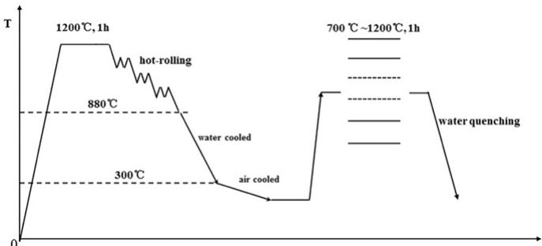  
Fig. 1. Hot rolling and annealing conditions of the steel.

## 3. Results

## 3.1. Equilibrium phase diagram

The phase diagram of the Fe–10Mn–10Al–0.7C steel was calculated by Thermo-Calc software with database TCFE7, and fractions of the equilibrium phases (ferrite (α), austenite (γ) and κ-carbide (κ)) when the temperature is over $5 5 0 ~ ^ { \circ } \mathrm { C }$ are shown in Fig. 2. According to Fig. 2, ferrite is expected to form first during solidification, and then austenite forms by peritectic reaction [33]. After solidification, the phase fraction of ferrite will decrease and that of austenite will increase with the decrease of temperature until the temperature reaches around $1 0 0 0 ^ { \circ } \mathrm { C } ,$ where the fraction of ferrite is lowest. When the temperature is lower than about $1 0 0 0 ^ { \circ } \mathrm { C } ,$ the fraction of ferrite decreases with the decrease of temperature. However, the phase fractions do not change much until temperature becomes lower than $8 2 3 ^ { \circ } \mathrm { C } ,$ , where κ-carbide appears by eutectoid reaction $\gamma  \alpha + \kappa .$ Apparently, a part of body-centered cubic (BCC) ferrite will always exist without transforming to facecentered (FCC) austenite, and this part of ferrite is often referred to as δ-ferrite [34,35]. The δ-ferrite usually exhibits coarse grains in the microstructure [13,34]. In the present study, δ-ferrite is not separately treated with α-ferrite. There is difference in the phase fractions and the eutectoid temperature for κ-carbide between the result calculated by Thermo-Calc and that measured from the steel, which will discussed later. The differences may come from that, the steel in the study is not in equilibrium state, and that the calculated fractions are based on the atomic fraction, while the measured fraction from XRD results is based on the volume fraction [34].

## 3.2. Microstructure evolution

The microstructure of hot rolled specimen (marked as $\ " \mathrm { H R } ^ { \prime \prime } )$ is shown in Fig. 3. Fig. 3(a) and (b) is OM micrographs of RD–ND (rolling direction–normal direction) plane, RD–TD (rolling direction–transverse direction) plane, respectively. As shown in Fig. 3(a), typical banded structure is presented, and coarse ferrite formed during the early stage of solidification steel is obviously observed. It is easy to see that the microstructure is very inhomogeneous in Fig. 3(b), and, large α phase area (the continuous area that mainly contains α phase, while there are also some γ phase or κ-carbide dispersed) and γ phase area (the continuous area that mainly contains γ phase, while there are also some α phase or κ-carbide dispersed) can be used to describe the microstructure. SEM micrograph in Fig. 3(c) clearly shows the κ-carbide along ferrite/austenite (α/γ) and ferrite/ferrite $\left( \alpha / \alpha \right)$ boundaries. EDS is used to confirm the α phase, γ phase, and κ-carbide, since α phase is Al-rich, γ phase is Mn-rich and C-rich, while κ-carbide is Mn-rich and Al-rich [15,18,34].

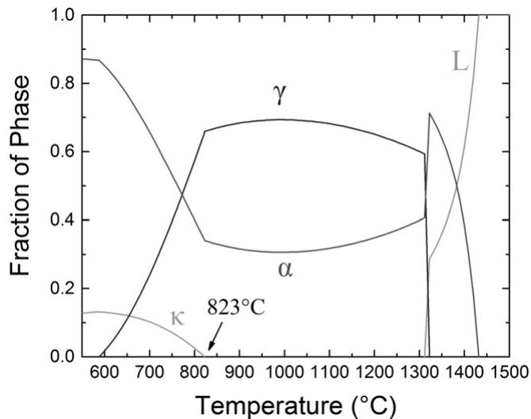  
Fig. 2. Fractions of the equilibrium phases (ferrite (α), austenite (γ) and κ-carbide (κ)) calculated by Thermo-Calc.

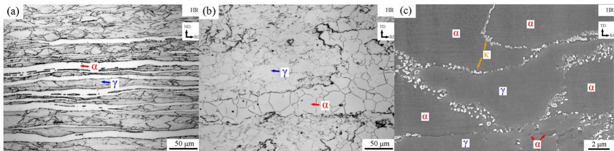  
Fig. 3. Microstructure of the hot-rolled specimen (a) OM micrograph of RD-ND plane, (b) OM micrograph of RD-TD plane, and (c) SEM micrograph of RD-TD plane (RD represent rolling direction, ND represent normal direction, and TD represent transverse direction).

XRD results of hot rolled and annealed specimens are shown in Fig. 4. The peaks of κ-carbide are seen in specimen annealed at $7 0 0 ^ { \circ } \mathrm { C } ,$ 800 °C and $8 5 0 ^ { \circ } \mathrm { C } ,$ and no obvious peaks of γ phase can be seen in the specimen annealed at $7 0 0 ^ { \circ } \mathrm { C } .$ . In the hot rolled specimen, peaks of κ- carbide are not seen, probably due to the low volume fraction of κ- carbide, or the coherency of κ-carbide and α matrix [36]. Lattice parameters can be calculated from the XRD profiles, and results show that the lattice parameter of α phase changes in the range 2.89–2.91 Å, the lattice parameter of γ phase changes in the range 3.65–3.67 Å, and the lattice parameter of κ-carbide changes in the range 3.76–3.79 Å. The lattices of α phase and γ phase have been slightly expanded by Mn, Al and C atoms, and being larger than the lattices of α phase and γ phase in Fe–3.5Mn–5.8Al–0.35C, respectively [34]. It is said that the lattice of κ-carbide is mainly governed by the interstitial element, C, while the increment of Al would also bring expansion to the κ lattice and because Mn has a larger atomic radius than Fe, the substitute of Fe by Mn in κ- carbide would also cause slight expansion in the κ-carbide lattice [15, 34]. The lattice expansion of α phase and γ phase, which are the main phase constituents in the steel, will contribute to the low density of the steel.

Optical micrographs of specimens annealed at $8 0 0 ~ ^ { \circ } \mathrm { C } , 8 5 0 ~ ^ { \circ } \mathrm { C }$ and 900 °C are shown in Fig. 5. Banded structure and long strip α phase remain, as can be seen in Fig. 5(a), (c) and (e), which shows microstructures of RD–ND section of specimens annealed at $8 0 0 ~ ^ { \circ } \mathrm { C } , 8 5 0 ~ ^ { \circ } \mathrm { C }$ and $9 0 0 ^ { \circ } \mathrm { C } ,$ respectively. From microstructures of RD–TD section of the specimens, the evolution of κ-carbide can be clearly seen. When annealed at $8 0 0 ^ { \circ } \mathrm { C } ,$ as shown in Fig. 5(d), κ-carbide distributes mainly between α phase area and γ phase area, or distributes along α/α boundaries in the large α phase area, while some κ-carbide can be seen to disperse in the γ phase area. When the annealing temperature rises to $8 5 0 ^ { \circ } \mathrm { C } ,$ κ-carbide in the γ phase area has disappeared, and κ-carbide near the γ phase area has significantly reduced. However, κ-carbide dispersed continuously along α/α boundaries still exists without much change. When annealed $\mathsf { a t 9 0 0 } ^ { \circ } \mathsf C ,$ as shown in Fig. 5(f), no obvious κ-carbide can be seen, that is to say, κ-carbide has almost dissolved into α matrix and γ matrix. So, the actual temperature for κ-carbide to dissolve is between $8 5 0 ~ ^ { \circ } \mathrm { C }$ and $9 0 0 ^ { \circ } \mathrm { C } .$

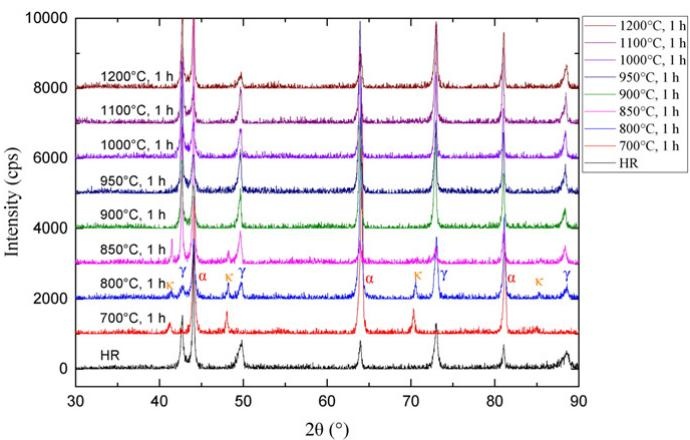  
Fig. 4. XRD results of hot rolled and annealed specimens.

Fig. $6 ( \mathsf { a } )$ through (g) shows microstructures of RD-TD section of specimens annealed at various temperatures ranging from $7 0 0 ^ { \circ } \mathrm { C }$ to $1 1 0 0 ^ { \circ } \mathrm { C } ,$ and Fig. 6(h) shows the microstructure of RD–ND section of the specimen annealed at $1 2 0 0 ^ { \circ } \mathrm { C }$ (In order to show the microstructure more clearly, RD-TD section is selected for the specimen annealed at $1 2 0 0 ^ { \circ } \mathrm { C } . )$ . When annealed at $7 0 0 \ ^ { \circ } C \ ( { \mathrm { F i g . ~ } } 6 ( { \mathsf { a } } ) )$ , γ phase has almost decomposed to lamellar κ-carbide and α matrix by the eutectoid reac tion $\gamma \to \alpha + \kappa . \mathrm { F i g . } 7 ( \mathsf { a } )$ shows the TEM bright-field (BF) image of the specimen annealed at $7 0 0 ^ { \circ } \mathrm { C } ,$ and Fig. 7(b) is the selected area diffraction pattern and of the lamellar κ-carbide and α matrix, together with its index, which indicates the Nishiyama–Wasserman $( \mathsf { N { - } } \mathsf { W } )$ orientation relationship between κ-carbide and α matrix. Fig. 7(c) is the $( 2 0 0 ) _ { \mathrm { { r } } }$ dark-field (DF) image taken from [100] direction. However, not all the κ-carbide has orientation relationship with α matrix, and for example, the κ-carbide with globular shape or short-rod like shape in Fig. 7(d) shows no orientation relationship with α matrix. The coher ency between κ-carbide and α phase can be destroyed during the coars ening of κ-carbide, and before annealing, some κ-carbide has already existed in the matrix and may have no orientation with the matrix Fig. 6(b) is the SEM micrograph of the specimen annealed at $8 0 0 ^ { \circ } \mathsf { C } ,$ and compared with the κ-carbide in the specimen annealed at $7 0 0 ^ { \circ } \mathrm { C }$ $\left( \mathrm { F i g . } 6 ( \mathsf { a } ) \right)$ ), the size of κ-carbide is larger, the fraction of κ-carbide is lower, and the shape is closer to globular. Fig, 8(a) shows the TEM BE image of the specimen annealed at $8 0 0 ~ ^ { \circ } \mathrm { C }$ and Fig. 8(b) shows the SADPs of phases in $\mathrm { F i g . } 8 ( \mathsf { a } )$ . Several areas are examined and no orienta tion relationship is found between κ-carbide and its neighboring α phase. Fig. $6 ( c )$ clearly shows the increase of phase fraction and decrease of κ-carbide fraction in the γ phase area of specimen annealed at $8 5 0 ~ ^ { \circ } \mathrm { C }$ compared with the specimen annealed at $8 0 0 ^ { \circ } \mathsf { C } ,$ and this trend is clearer than that shown by the comparison of OM micrographs of the two specimens (Fig. 5(b) and (d)). When the annealing temperature is between $9 0 0 ^ { \circ } \mathsf { C }$ and $1 1 0 0 ^ { \circ } \mathrm { C }$ , no obvious κ-carbide can be seen in the matrix (Fig. $6 ( \mathrm { d } )$ through (g)), while grain sizes of α phase and γ phase increase apparently. The average grain size change of each phase with the annealing temperature ranging from $9 0 0 ^ { \circ } \mathsf { C }$ to $1 2 0 0 ^ { \circ } \mathrm { C } ,$ which is obtained from SEM micrographs. is shown in Fig, 9. The ferrite (marked as $\mathbf { \alpha } _ { \mathbf { \lambda } } \mathbf { \alpha } _ { \mathbf { \lambda } }$ that mainly with relatively small grain size distributed among γ grains is treated separately with the ferrite (marked as $\mathbf { \alpha } \propto _ { 2 } )$ mainly distributed continuously with banded shape and large grain size because of their large difference in average grain size. It is not diffi cult to understand that the contiguous α with banded shape is mainly the ferrite that solidified first during casting. The grain size of $\alpha _ { 2 }$ which continuously distributed and the grain size of γ phase increase quickly with the rising of annealing temperature higher than $9 0 0 ^ { \circ } \mathsf { C } ,$ while the grain size of $\alpha _ { 2 }$ which is mainly distributed among γ grains does not increase quickly with the rising of annealing temperature until the temperature is over $1 0 0 0 ^ { \circ } \mathrm { C } .$ Additionally, the banded structure becomes less contiguous at higher temperatures (Figs. 5(a), (c), (e) and 6(h)), and this is in accordance with that in the steel Fe–20Mn–9Al–0.6C [25].

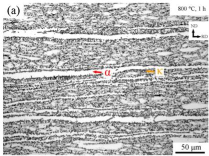

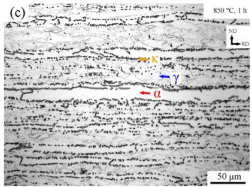

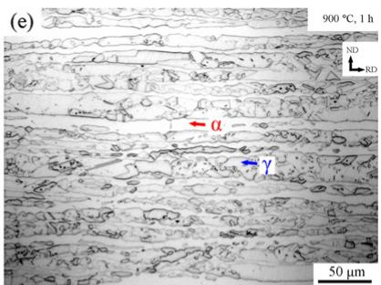

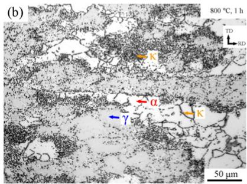

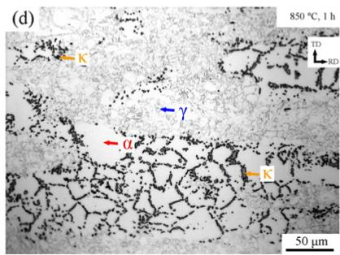

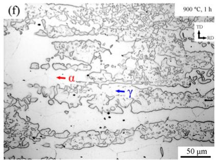  
Fig. 5. OM micrographs of specimens annealed at (a)(b) 800 °C, (c)(d) 850 °C and (e)(f) 900 °C. The (a)(c)(e) show the microstructures of RD–ND section of the specimens, and (b)(d)(f) show the microstructures of RD-TD section of the specimens.

Although no obvious κ-carbide is found distributed in the matrix when the annealing temperature is in the range $9 0 0 \ ^ { \circ } \mathrm { C } \ \mathrm { t o } \ 1 1 0 0 \ ^ { \circ } \mathrm { C }$ $( \mathrm { F i g . 6 ( d ) }$ through (g)), κ-carbide is indeed found along some boundaries between large α grains in α area in the annealing temperature range $9 0 0 ~ ^ { \circ } \mathrm { C }$ to $1 2 0 0 ~ ^ { \circ } \mathrm { C }$ , as shown in $\mathrm { F i g . } 1 0 ( \mathsf { a } )$ through (d). TEM is used to confirm the κ-carbide along the $\alpha / \alpha$ boundaries. Fig. 11(a) is the TEM BF micrograph of the specimen annealed at $1 1 0 0 ^ { \circ } \mathrm { C }$ , and the SADP of boundary κ-carbide and α matrix are shown in Fig. 11(b). Fig. 12(a) shows the TEM BF micrograph of the specimen annealed at $1 2 0 0 ^ { \circ } \mathrm { C }$ and the corresponding SADP in Fig. 12(b) shows the N–W orientation relationship between κ-carbide and α matrix. However, the (200) DF micrograph taken from $[ 1 1 0 ] _ { \kappa }$ direction $( \mathrm { F i g . } 1 2 ( \mathrm { c } ) )$ shows only part of the boundary κ-carbide, which indicates the large misorientation between the neighboring κ-carbide particles. The boundary κ- carbide is believed to form during the quenching when annealing temperature is over the dissolution temperature of κ-carbide, which is between $8 5 0 ~ ^ { \circ } \mathrm { C }$ and $9 0 0 ^ { \circ } \mathbb { C } .$ In the specimen annealed at $1 2 0 0 ^ { \circ } \mathrm { C } ,$ , there are needle shaped or plate shaped particles in some large α grains (Fig. 6(h) and Fig. 10(d)). The particle forms during the quenching, and basically has the FCC structure, and many investigations on the particles in the steels with a high Al content have been done by Hwang et al. [37–41]. EDS line scanning is done during SEM observation of the specimens annealed at $8 0 0 ~ ^ { \circ } \mathrm { C }$ and $9 0 0 ^ { \circ } \mathsf { C }$ to examine the elements concentrations in different phases, as shown in Fig. 13(a) and (b). In the specimen annealed at $8 0 0 ^ { \circ } \mathrm { C } ,$ Mn content is higher while Al content is lower in α phase compared with those in γ phase, and Mn and Al content in κ-carbide is the highest, higher than those in α phase or γ phase. The results are in accord with the normal conclusion well.

The volume fraction change of each phase with the temperature, which is determined from the XRD measurement results, is shown in Fig. 14. The general trend is similar with that calculated by Thermo-Calc, which is shown in Fig. 1. No γ phase is detected when annealing temperature is $7 0 0 ^ { \circ } \mathrm { C }$ , and no κ-carbide is detected when the annealing temperature is $9 0 0 ^ { \circ } \mathbb { C } .$ As has been obtained from the OM micrographs in Fig. 5, the dissolution temperature for κ-carbide is between $8 5 0 ~ ^ { \circ } \mathrm { C }$ and $9 0 0 ^ { \circ } \mathsf C ,$ which is higher than that $( 8 2 3 ^ { \circ } \mathrm { C } )$ calculated by Thermo-Calc (Fig. 1). When the anneal temperature changes from $7 0 0 ~ ^ { \circ } \mathrm { C }$ to $9 0 0 ^ { \circ } \mathsf { C } ,$ , the volume fractions of α phase and κ-carbide decrease, and the fraction of γ phase increases. At $9 0 0 ^ { \circ } \mathsf { C } ,$ the γ phase fraction is about 60%. After the dissolution of κ-carbide, the volume fraction of γ phase first increase slightly and then decrease slightly with the increment of annealing temperature, and the fraction of γ phase reaches largest around the annealing temperature of $1 0 0 0 ^ { \circ } \mathrm { C } .$ The volume fraction of γ phase changes only in the small range of 57% to 63% when the annealing temperature is between $9 0 0 ^ { \circ } \mathsf { C }$ and $1 2 0 0 ^ { \circ } \mathrm { C }$ . The boundary κ- carbide that was seen in Fig. 10 cannot be detected by XRD, probably due to that the fraction of boundary κ-carbide is too small. In addition, TEM analysis (not shown here) indicates that no obvious superlattice spots can be seen in the SADPs of α phase or γ phase in all the annealed specimens, and although some weak superlattice spots can be seen in the SADPs of some grains; they are all too weak to obtain the DF images. So ordering of atoms in α phase or γ phase is not expected during annealing at the temperature range $7 0 0 { - } 1 2 0 0 ^ { \circ } \mathrm { C }$ for 1 h, while ordering may occur during quenching, whereas the time is too short for the ordering to well develop.

## 3.3. Tensile properties and fracture mechanisms

The engineering stress–engineering strain curves obtained from the tensile test of the annealed specimens are shown in Fig. 15(a), and the corresponding true stress–true strain curves together with work hardening rate curves are shown in Fig. 15(b). The annealed specimens show continuous yielding phenomenon except the specimen annealed at $7 0 0 ^ { \circ } \mathrm { C } .$ . For the specimen annealed at $7 0 0 ^ { \circ } \mathrm { C } ,$ the work hardening rate curve is calculated only after the yielding period. The engineering stress–engineering strain curve of the specimen annealed at higher temperature tends to lay under the curve of the specimen annealed at lower temperature (Fig. 15(a)), and of course, the trend is the same for the true stress–true strain curves (Fig. 15(b)). However, the trend for work hardening rate curves is not the same. For the specimens annealed at $7 0 0 ^ { \circ } \mathrm { C } , 8 0 0 ^ { \circ } \mathrm { C }$ and $8 5 0 ~ ^ { \circ } \mathrm { C } ,$ , with κ-carbide distributed in the α or γ matrix, the work hardening rates of the specimens are in the reverse order of the annealing temperatures when true strain is less than about 5%. While for the specimens annealed at or over $9 0 0 ^ { \circ } \mathsf { C } ,$ with no obvious κ-carbide in the α or γ matrix, the work hardening rates are lower than those of the specimens annealed at $7 0 0 ^ { \circ } \mathrm { C } , 8 0 0 ^ { \circ } \mathrm { C }$ or $8 5 0 ^ { \circ } \mathrm { C }$ when true strain is less than about 5%. Although the specimens annealed at $7 0 0 ^ { \circ } \mathrm { C } , 8 0 0 ^ { \circ } \mathrm { C } _ { 1 }$ , and $8 5 0 ~ ^ { \circ } \mathrm { C }$ bear a high work hardening rate at the early stage, their work hardening rates decrease quickly until failure occurs. For specimens annealed at $9 0 0 ~ ^ { \circ } \mathrm { C }$ and $9 5 0 ^ { \circ } \mathrm { C } ,$ they possess similar work hardening rate, while specimen annealed at $9 5 0 ~ ^ { \circ } \mathrm { C }$ snapped earlier.

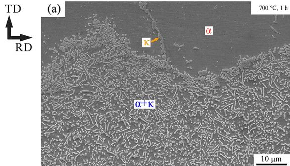

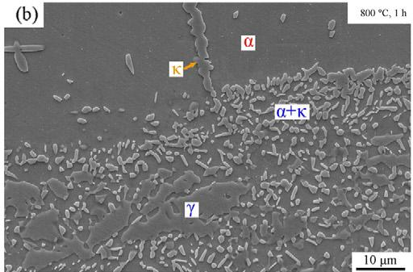

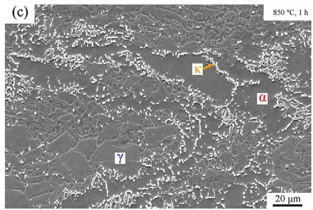

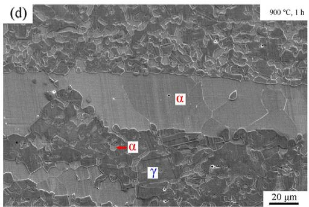

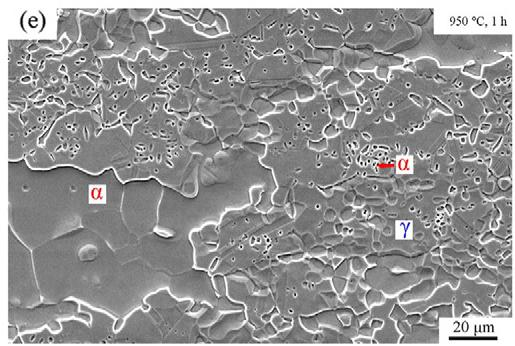

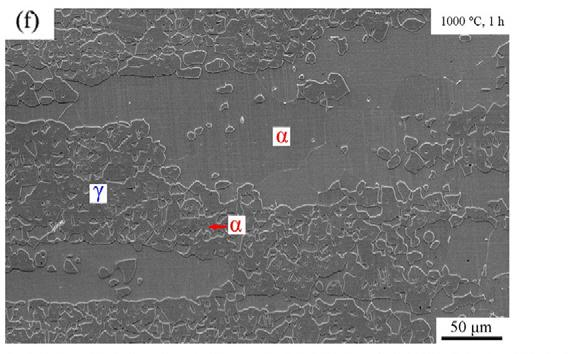

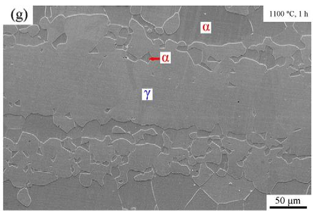

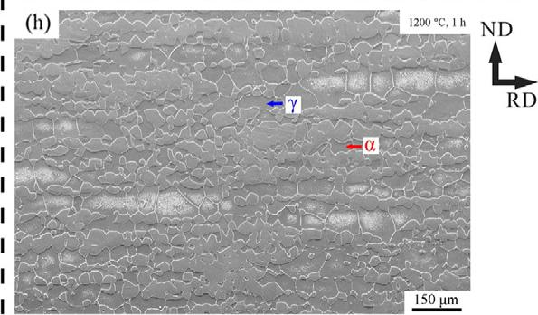  
Fig. 6. SEM micrographs of specimens annealed at $( \mathbf { a } ) 7 0 0 ^ { \circ } \mathrm { C } ,$ (b) 800 °C, (c) 850 °C, (d) 900 °C, (e) 950 °C, (f) 1000 °C, (g) 1100 °C and (h) 1200 °C. The (a) through (g) show microstructures of RD–TD section of the specimens, while (h) shows the microstructure of RD–ND section of the specimen.

The ultimate strength, yield strength, ultimate elongation, and the product of strength and ductility (ultimate strength × ultimate elongation), are shown in Table 1, and curves of the changes of above tensile properties against annealing temperature are shown in Fig. 16. The product of strength and ductility reaches best when the annealing temperature is $9 0 0 ~ ^ { \circ } C .$ After annealed at $9 0 0 ~ ^ { \circ } C$ for 1 h, the ultimate strength, yield strength, ultimate elongation, and the product of strength and ductility, are 855 MPa, 651 MPa, 36.6%, 31 GPa%, respectively. From Fig. 15, it can be seen that the ultimate strength and yield strength have the general trend of decreasing with the increase of the annealing temperature, and the ultimate elongation first increase when the annealing temperature rises from $7 0 0 ^ { \circ } \mathrm { C }$ to $9 0 0 ^ { \circ } \mathsf { C }$ and then decrease with the temperature rises from $9 0 0 ^ { \circ } \mathrm { C }$ to $1 2 0 0 ^ { \circ } \mathrm { C } .$ The change of ultimate elongation is very violent especially in the annealing temperature range $8 0 0 ~ ^ { \circ } \mathrm { C }$ to $1 0 0 0 ^ { \circ } \mathrm { C } ,$ and the change of the product of strength and ductility is mainly decided by the change of ultimate elongation.

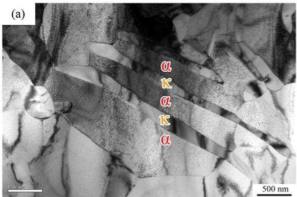  
(b)

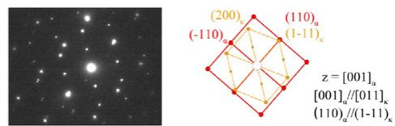

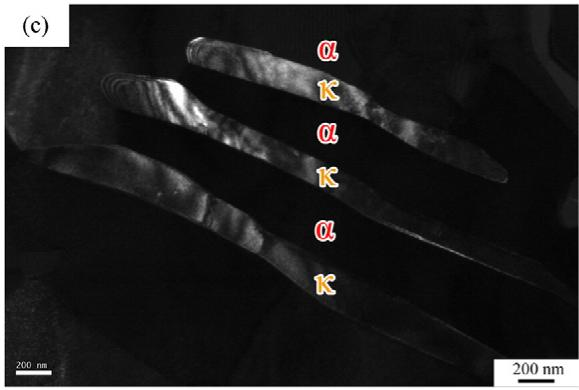

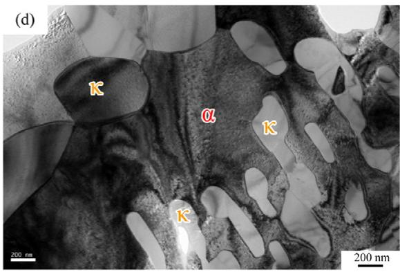  
Fig. 7. TEM micrographs of specimen annealed at $7 0 0 ^ { \circ } \mathrm { C } ; ( \mathsf { a } )$ BF image, (b) SADP of (a) from [110] and its index, (c) (200) DF image of (a), and (d) BF image of globular or short-rod like κ dispersed in α matrix.

No obvious TRIP or TWIP phenomenon is found during the tensile test, according to the examination of microstructure after deformation by TEM (not shown here). In order to investigate the fracture mode of the specimens, the SEM fractographs of the specimens annealed at $8 0 0 ^ { \circ } \dot { \mathsf C } , 9 0 0 ^ { \circ } \mathsf C$ and $1 0 0 0 ^ { \circ } \mathrm { C }$ are shown in Fig. 17(a) through (f). Large secondary cracks are well developed in all the specimens, according to Fig. $1 7 ( \mathsf { a } ) , ( \mathsf { c } )$ , and (e), which shows the fractographs at low magnification of the specimen annealed at $8 0 0 ^ { \circ } \mathrm { C } , 9 0 0 ^ { \circ } \mathrm { C } ,$ and $1 0 0 0 ^ { \circ } \mathrm { C } ,$ respectively. The large secondary cracks are believed to be related with the banded microstructure. Fig. 17(a) and (b) is the fractographs of the specimen annealed at $8 0 0 ^ { \circ } \mathrm { C }$ , and Fig. 17(b) is the fractograph at high magnification. The fracture in the specimen annealed at $8 0 0 ~ ^ { \circ } \mathrm { C }$ takes place by a mixture mode of ductile fracture and quasi-cleavage fracture. The dimpled area is mainly produced by the ductile transgranular fracture of γ, and the river pattern is mainly produced by the quasi-cleavage of α phase. The κ-carbide distributed in the matrix and along the grain boundaries is sure to contribute to the cleavage fracture from grain boundaries. For the specimens annealed at $9 0 0 ^ { \circ } C$ (Fig. 17(c) and (d))

and at 1000 °C (Fig. 17(e) and (f)), the fracture mode is predominant by the mixture of the ductile fracture of γ phase and the quasicleavage fracture of α phase. However, the ductile fracture area in specimen annealed at $9 0 0 ^ { \circ } \mathrm { C }$ (Fig. 17(d)) is more obvious than that in specimen annealed at $1 0 0 0 ^ { \circ } \mathrm { C } .$ The effect of the boundary κ-carbide along some large α grains on the fracture of specimen annealed at $9 0 0 ~ ^ { \circ } C$ and $1 0 0 0 ^ { \circ } \mathrm { C }$ cannot be obtained from Fig. $1 7 ( \mathrm { c } )$ through (e).

## 4. Discussion

The microstructures of the steel after annealing for 1 h at the temperature range 700 °C to $1 2 0 0 ^ { \circ } \mathrm { C }$ in the present study are basically composed of ferrite (α), austenite (γ) and κ-carbide, and the banded structure still exists after the annealing. The morphology, distribution and volume fraction of the α phase, γ phase and κ-carbide affect the tensile properties of the steel. The evolution of the microstructure and its effect on the tensile properties are discussed here.

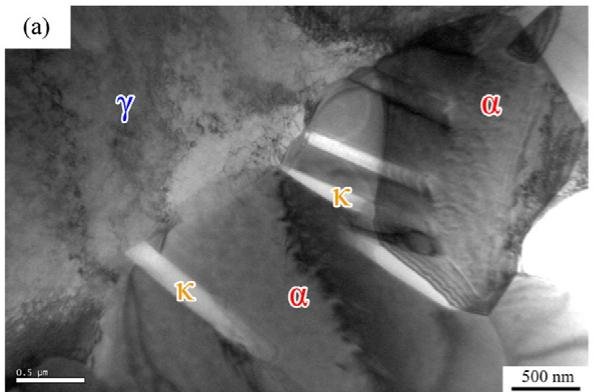

(b)  
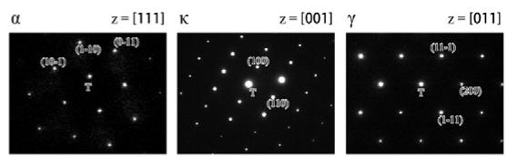  
Fig. 8. TEM micrograph of specimen annealed at 800 °C: (a) BF image, and (b) SADPs of α, γ, and κ in (a).

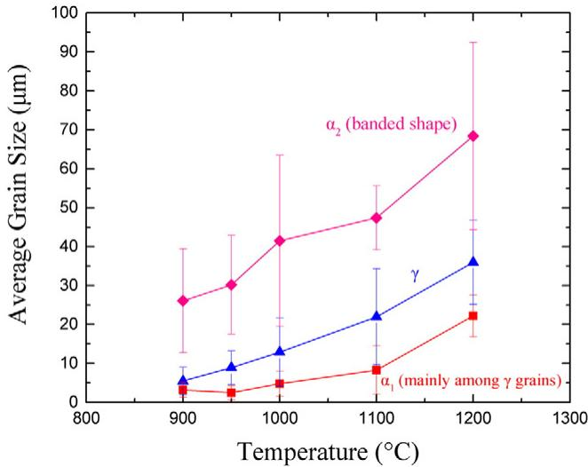  
Fig. 9. Average grain size change of each phase with the annealing temperature ranging from 900 °C to 1200 °C (here, the ferrite marked as α refers to the ferrite that mainly distributed among γ grains, and the ferrite marked as α refers to the ferrite that mainly continuously distributed with banded shape and large grains; they are separately treated since the difference of their average grain sizes is large. The error bars represent the standard deviations.)

## 4.1. Microstructure evolution during annealing at various temperatures

The γ phase has almost totally decomposed to α phase and κ- carbide by eutectoid reaction $\gamma \to \alpha + \kappa$ after annealing at $7 0 0 ^ { \circ } \mathrm { C }$ for 1 h, and the N–W orientation relationship is found mainly between some lamellar κ-carbide and the α matrix (Fig. 7). When annealed at $8 0 0 ^ { \circ } { \mathrm { C } } { \mathrm { ~ o r } } 8 5 0 ^ { \circ } { \mathrm { C } } ,$ the γ phase volume fraction is about 29% and 39%, respectively. The κ-carbide and α phase fraction decreases, while the γ phase fraction increases with annealing temperature rising from 700 $^ \circ \mathsf { C }$ to $9 0 0 ^ { \circ } \mathrm { C } .$ The N–W orientation relationship has been hardly found between κ-carbide and α matrix when annealing temperature reaches $8 0 0 ^ { \circ } \mathrm { C } \left( \mathrm { F i g . } 8 \right)$ . In the annealing temperature range from 700 to 850 ${ } ^ { \circ } \mathbb { C } ,$ the γ phase becomes more stable with the increase of temperature, so the γ phase fraction increases with the increase of temperature. The morphology of κ-carbide tends to be larger and closer to globular shape (Fig. 6(a) through (c)), which originates from the higher diffusion speed of elements and growth speed of κ-carbide at higher temperatures. For the sake of lowering the strain energy, the growth of κ- carbide favors to be along the plane of boundary between κ-carbide and α matrix with orientation relationship at first, and with the grow up of κ-carbide, the lattice coherency and orientation relationship will be destroyed. This is why the orientation relationship is easy to found between the lamellar κ and α matrix in the specimen annealed at 700 ${ } ^ { \circ } { \mathsf { C } } ,$ and becomes harder to be found or has disappeared when the annealing temperature rises from $7 0 0 ^ { \circ } \mathrm { C }$ to $8 0 0 ^ { \circ } \mathrm { C }$

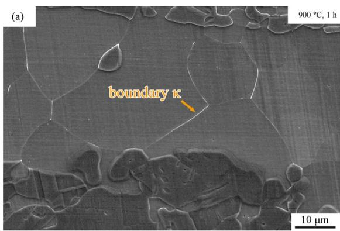

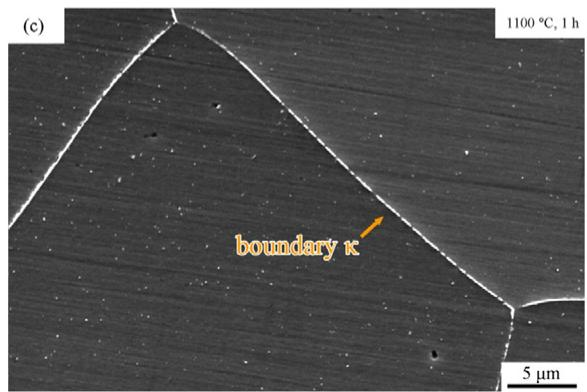

Among α phase, γ phase and κ-carbide in the same specimen, the Mn and Al contents in κ-carbide are the highest. Compared with in α phase, Mn content is higher, while Al content is lower in the γ phase (Fig. 13). There are competitions for Mn and C between neighboring α phase and κ-carbide, and for Al between neighboring γ phase and κ- carbide. With the increase of annealing temperature, the κ-carbide distributed at or near the boundary of α phase and γ phase dissolves first and the κ-carbide along $\alpha / \alpha$ boundaries of large grains dissolves last. It indicates that the dissolution temperature of κ-carbide along α/α boundary is higher than that along $\alpha / \gamma$ boundary in the present steel, which is relatively lean in Mn content and rich in Al content. This may mainly come from that the Al content in the κ-carbide at α/α boundary is slightly higher than that at $\alpha / \gamma$ boundary due to the nonuniform of the microstructure, and it has been pointed out that the effect of Al on raising the solvus of κ-carbide is larger in austenitic Fe–Mn–Al–C steels [42].

The κ can be obviously seen in the specimen annealed at $8 5 0 ~ ^ { \circ } \mathrm { C }$ (Figs. 5(c), (d) and $6 ( \mathrm { c } ) )$ , and cannot be obviously seen in the specimen annealed at $9 0 0 ^ { \circ } \mathrm { C }$ (Figs. 5(e), (f) and 6(d)). When the annealing time is

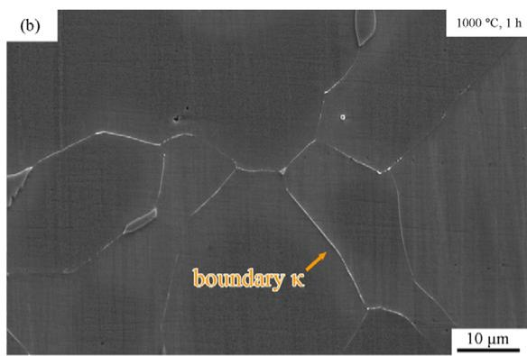

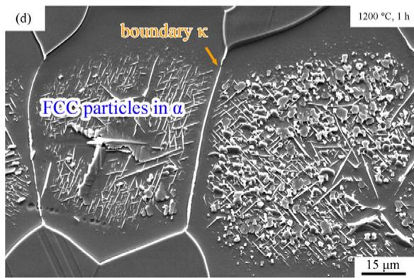  
Fig. 10. SEM micrographs of some boundary areas in the specimen annealed at the temperature of (a) 900 °C, (b) 1000 °C, (c) 1100 °C and (d) 1200 °C.

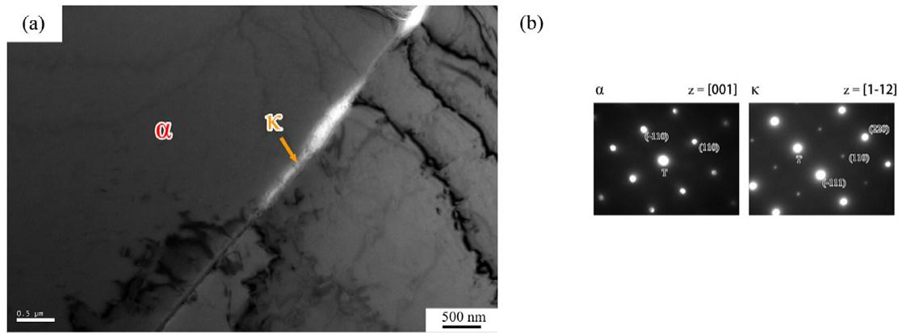  
Fig. 11. TEM micrographs of the boundary κ in the specimen annealed at 1100 °C: (a) BF micrograph, (b) SADP of α, and κ.

1 h, the actual dissolution temperature for κ is between $8 5 0 ^ { \circ } \mathrm { C }$ and 900 ${ } ^ { \circ } \mathbb { C } ,$ while the dissolution temperature of κ in the equilibrium phase diagram calculated by Thermo-Calc is about $8 2 3 ^ { \circ } \mathsf C ,$ which is lower. This may be attributed to not only the error of the thermodynamic calculation, but also the difference between equilibrium and disequilibrium system.

When the annealing temperature is over $9 0 0 ^ { \circ } \mathsf { C } ,$ the fraction of γ phase change moderately, first increases from about $6 0 \% \mathrm { a t } 9 0 0 ^ { \circ } \mathrm { C }$ to about 63% at $1 0 0 0 \ ^ { \circ } \mathrm { C } ,$ and then decreases to about 57% at 1200 $^ { \circ } \ C$ (Fig. 14). The boundary κ-carbide in the specimens annealed at the temperature of or over 900 °C (Figs. 10, 11 and 12) is thought to form during quenching. With the increase of temperature, the Mn and C elements, together with Al element in the α phase with large grains segregate to the boundary and form κ-carbide. In some large α grains in the specimen annealed at $1 2 0 0 ~ ^ { \circ } \mathrm { C } ,$ , the needle-like or plate-like FCC particles (Fig. 10(d)), are thought to come from the quick transformation from BCC to FCC. It is easy to know that the needle-like or plate-like particles are competing for Mn or C elements with boundary κ-carbide, since the needle-like or plate-like particles tend to disappear when becoming close to grain boundary.

The changes of the average grain size of α phase and γ phase are rapid. When discuss the grain sizes, the α phase is classified into $\mathbf { \alpha } _ { 1 } ,$ which is mainly distributed among γ grains, and $\alpha _ { 2 } ,$ which mainly continuously distributed with banded shape and large grains. When the annealing temperature rises from $9 0 0 ^ { \circ } \mathsf { C }$ to $1 2 0 0 ^ { \circ } \mathrm { C } ,$ the average grain size of γ phase increases from 5.5 μm to 36.0 μm, and that of $\alpha _ { 2 }$ increases from 26.1 μm to 68.4 μm (Fig. 9). While the grain size of $\alpha _ { 1 }$ even decreases from 3.2 μm to 2.5 μm when annealing temperature rises from 900 °C to $9 5 0 ^ { \circ } \mathrm { C } ,$ and then the grain size of α increase from 2.5 μm to 22.2 μm when temperature rises from $9 5 0 ~ ^ { \circ } \mathrm { C }$ to 1200 °C (Fig. 9). In the steel Fe–20Mn–9Al–0.6C studied by Hwang et al. [25], the temperature effect on the grain growth is larger in γ phase than α phase, however, in the present steel, this is something different when α phase is classified into $\alpha _ { 1 }$ that mainly distributed among γ grains and $\alpha _ { 2 }$ that mainly continuously distributed with banded shape. As a characteristic of the present steel, the grain can grow up quickly with the increase of

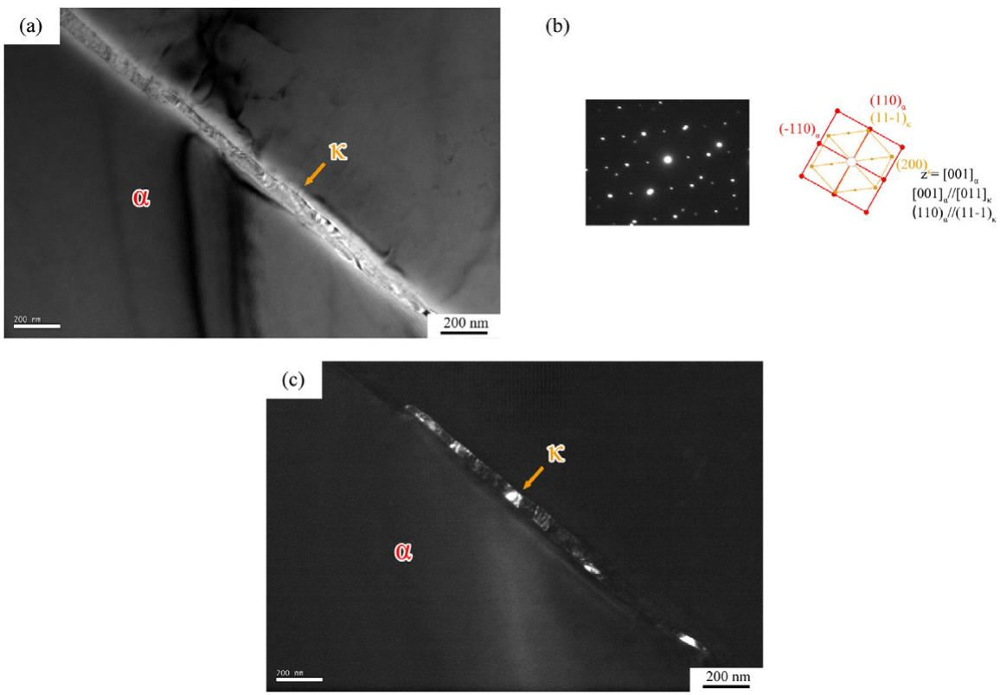  
Fig. 12. TEM micrographs of the boundary κ in the specimen annealed at 1200 °C: (a) BF micrograph, (b) SADP of α and κ, and (c) (200)κ DF micrograph taken from [110]κ direction

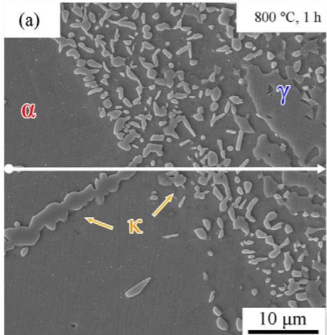

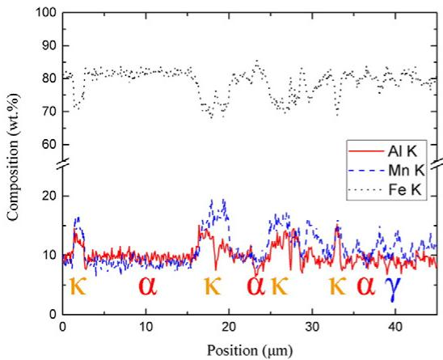

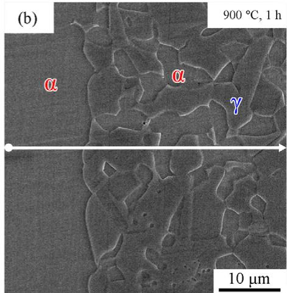

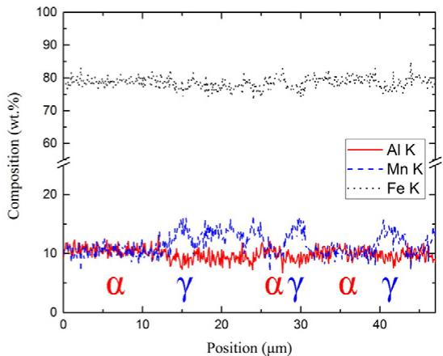  
Fig. 13. SEM EDS line scanning results of specimens annealed at (a) 800 ${ } ^ { \circ } { \mathsf { C } } ,$ and (b) 900 °C

temperature, and the difference of temperature effect on the grain growth of $\alpha _ { 2 }$ and γ phase is hard to tell. While for $\alpha _ { 1 } ,$ the grain size is decreased when the annealing temperature rises from $9 0 0 ~ ^ { \circ } \mathrm { C }$ to 950 ${ } ^ { \circ } \mathbb { C } ,$ then increase slower than γ phase until annealing temperature reaches $1 1 0 0 ^ { \circ } \mathrm { C } ,$ and then increase at the similar speed with γ phase. The grain size is affected not only by recovery, recrystallization, and growth after recrystallization, but also by the phase transformation and the movement of phase boundary. When the annealing temperature rises from $9 0 0 ^ { \circ } \mathsf { C }$ to $9 5 0 ^ { \circ } \mathrm { C } _ { \scriptscriptstyle { 1 } }$ , the α phase fraction decreases slightly (Fig. 14), and the movement of $\alpha / \gamma$ phase boundary toward α phase side has a more significant effect on the grain size of $\alpha _ { 1 } ,$ which is mainly distributed among γ grains and has a small initial grain size. From Fig. 6(d) and (e), which is the SEM micrograph of the specimen annealed at $9 0 0 ~ ^ { \circ } \mathrm { C }$ and $1 0 0 0 ^ { \circ } \mathrm { C }$ , respectively, the size decrease of the $\alpha _ { 1 }$ grains among γ grains is evident with the annealing temperature rising from $9 0 0 ^ { \circ } \mathsf { C }$ to $9 5 0 ^ { \circ } \mathrm { C }$

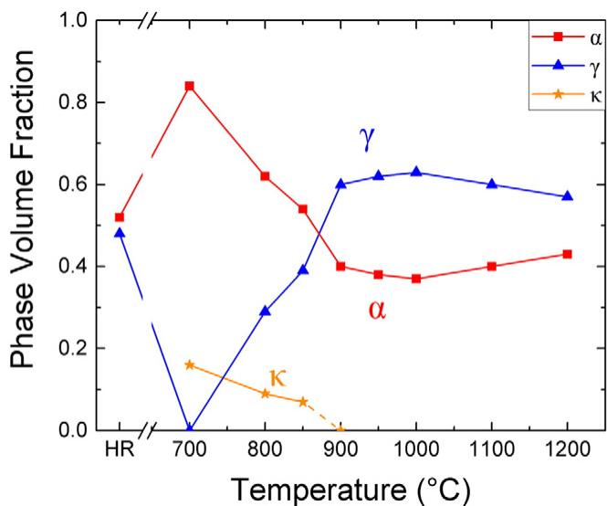  
Fig. 14. The volume fraction change of each phase with the temperature (The κ-carbide cannot be detected by XRD in the specimen annealed at 900 °C.)

## 4.2. Correlation between tensile properties and microstructure

The tensile strength of γ phase is usually higher than that of α phase, and a high content of α phase is often detrimental to mechanical properties $\left[ 1 7 , 4 3 , 4 4 \right]$ . The grain sizes and morphologies of phases have a great effect on the tensile strength of annealed steels [34,45]. The ultimate tensile strength and yield strength of the steel in the present study has a trend of decrease with the increment of annealing temperature, and the ultimate elongation first increase with the increment of annealing temperature when temperature is lower than 900 °C and then decrease when annealing temperature is over $9 0 0 ~ ^ { \circ } \mathrm { C }$ (Fig. 16), and the trend of the product of strength and ductility of the annealed specimens against temperature resembles the trend of ultimate elongation. The tensile properties are closely related with the microstructure of the annealed specimens.

Yield phenomenon, which is usually seen in the ferrite steels [46], only appears in the specimen annealed at $7 0 0 ~ ^ { \circ } \mathrm { C } .$ In the specimen annealed at $7 0 0 ^ { \circ } \mathrm { C } ,$ the γ phase has almost totally transformed into α phase and κ-carbide, and the microstructure is composed of large α grains, continuous -carbide along grain boundaries, and areas

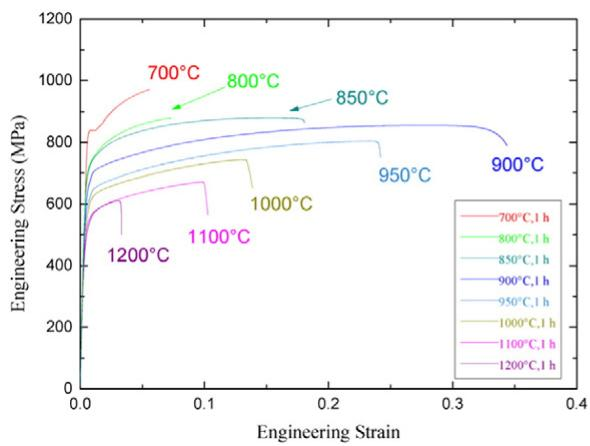

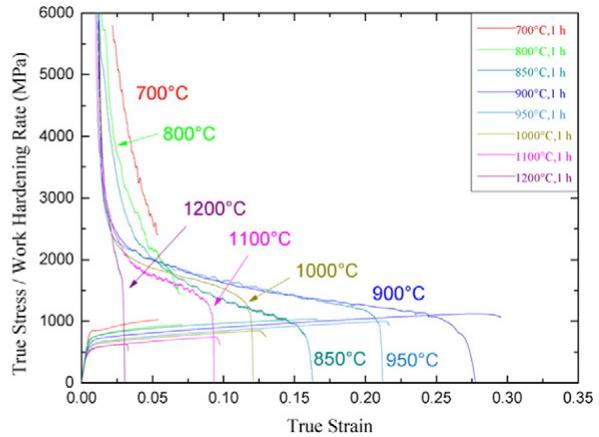  
Fig. 15. (a) Engineering stress–engineering strain curves of the annealed specimens, and (b) true stress–true strain curves together with work hardening rate curves

containing lamellar κ-carbide within γ matrix $\left( \mathrm { F i g . } 6 ( \mathsf { a } ) \right)$ . Although the lamellar κ-carbide in the α matrix may contribute to the strength and ductility by secondary phase strengthening and by preventing the prolongation of microcracks that initiated from α/κ interface where strain would concentrate, the continuous distributed κ-carbide along the grain boundaries of large α grains are readily cracked and preferred to crack by cleavage fracture during tensile deformation [47]. So the ultimate strength of the specimen annealed at $7 0 0 ~ ^ { \circ } \mathrm { C }$ is relatively high and the ultimate elongation is low (Fig. 16). When annealing temperature is $8 0 0 ^ { \circ } \mathrm { C } ,$ the microstructure is composed of α phase, γ phase and κ-carbide (Fig. 6(b)). Compared with the specimen annealed at $7 0 0 ^ { \circ } \mathrm { C }$ (Fig. 6(a)), the fraction of κ-carbide has decreased, and the size of κ- carbide has coarsened, which indicates that the strengthening and ductility from κ-carbide will be weakened in the specimen annealed at 800 ${ } ^ { \circ } \mathbb { C } .$ The κ-carbide still continuously distributed along the large α grains will decrease the ductility. However, the γ phase in the microstructure can increase the ductility. Additionally, at higher annealing temperature, the elimination of dislocations inherited from the hot rolling process is better developed, which normally will decrease the strength and increase the ductility. Thus, the ultimate strength of the specimen annealed at $8 0 0 ~ ^ { \circ } \mathrm { C }$ decreases and the ultimate elongation increases slightly (Fig. 16). For the specimen annealed at $8 5 0 ~ ^ { \circ } \mathrm { C } ,$ the quick increase of the ductility may mainly attributed to the increase of $\gamma$ phase fraction. When the annealing temperature reaches $9 0 0 ^ { \circ } \mathsf { C } ,$ κ- carbide dissolves during annealing, and there is only some boundary κ-carbide of very small size formed during quenching and distributed along some large α grains (Figs. 6(d) and $1 0 ( \mathsf { a } ) ,$ . The ultimate elongation is 36.6%, and the ductility of the specimen is the best of all the annealed specimens. The ductility of the specimen annealed at $9 0 0 ^ { \circ } \mathsf { C }$ would be better if no boundary κ-carbide is formed during quenching. The work hardening rate in the early stage is higher in the specimen annealed at 850 °C and decreases quickly to be lower than the specimen annealed at $9 0 0 ^ { \circ } \mathrm { C }$ in the later stage (Fig. 15(b)). This is because that, in the specimen annealed at $8 5 0 ^ { \circ } \mathrm { C } ,$ the κ-carbide is harder to deform than α phase and γ phase, and serves as strong obstacle for deformation, leading to a high work hardening rate in the early stage, while the γ phase fraction is lower, and microcracks will also be easier to initiated around the κ-carbide, making the work hardening rate decrease more quickly, and causing the reduction of ultimate elongation in the later stage.

Table 1  
Ultimate strength, yield strength, ultimate elongation, and the product of strength of strength and ductility of the specimens annealed at various temperatures.

<table><tr><td>Annealing temperature (°C)</td><td>Ultimate strength (MPa)</td><td>Yield strength (MPa)</td><td>Ultimate elongation (%)</td><td>Product of strength and ductility (GPa%)</td></tr><tr><td>700</td><td>971</td><td>837</td><td>4.8</td><td>5</td></tr><tr><td>800</td><td>877</td><td>702</td><td>7.8</td><td>7</td></tr><tr><td>850</td><td>879</td><td>693</td><td>21.7</td><td>19</td></tr><tr><td>900</td><td>855</td><td>651</td><td>36.6</td><td>31</td></tr><tr><td>950</td><td>804</td><td>581</td><td>26.6</td><td>21</td></tr><tr><td>1000</td><td>763</td><td>557</td><td>16.2</td><td>12</td></tr><tr><td>1100</td><td>671</td><td>518</td><td>12</td><td>8</td></tr><tr><td>1200</td><td>611</td><td>495</td><td>4.8</td><td>3</td></tr></table>

For the annealing temperature range $7 0 0 ^ { \circ } \mathrm { C }$ to $9 0 0 ^ { \circ } \mathrm { C } ,$ , the ductility is mainly enhanced by the increase of the fraction of ductile γ phase with the increase of annealing temperature. The difference in the deformation behavior between α phase and γ phase can be seen from the SEM fractograph of the specimen annealed at $8 0 0 ~ ^ { \circ } \mathrm { C }$ (Fig. 17(a) and (b)) and $9 0 0 ^ { \circ } C$ (Fig. 17(c) and (d)). From the size of the fracture structure, the ductile fracture area is thought to be mainly caused by γ phase, while the quasi-fracture area is thought to be mainly caused by α phase.

When the annealing temperature is over $9 0 0 ~ ^ { \circ } C ,$ the ultimate strength and ultimate tensile strength continuously decrease with the increase of annealing temperature (Fig. 16(a)). The phase fractions of α phase and γ phase change only a little in a narrow range (Fig. 14), which should not be the main reason to cause such a large change in the ultimate strength and ductility. Although the boundary κ-carbide formed during quenching is believed to be detrimental to ductility, it exists in all the specimen annealed at or over $9 0 0 ^ { \circ } \mathbb { C } .$ The average grain size changes of α phase and γ phase shown in $\mathrm { F i g . 9 }$ are believed to be the main reason for the change of tensile properties when annealing temperature is over $9 0 0 ^ { \circ } \mathrm { C } .$ According to Hall–Petch relation [48,49], the strength of the steel will stronger with smaller grain size. For the annealing temperatures of $9 0 0 ^ { \circ } \mathsf C$ and $9 5 0 ^ { \circ } \mathrm { C } ,$ , although the $\alpha _ { 1 }$ that mainly distributed among γ grains is even smaller in size than that in the

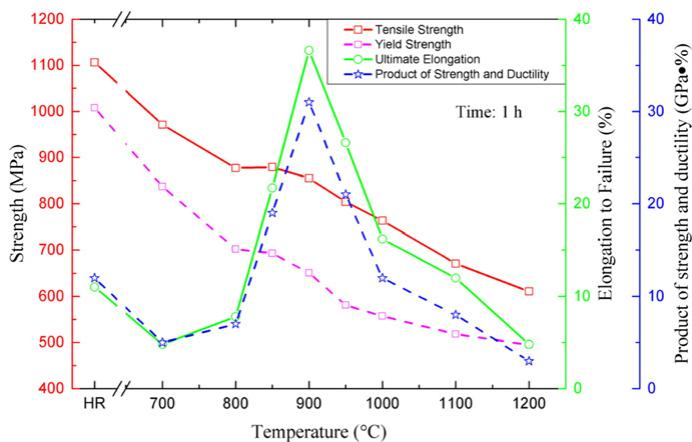  
Fig. 16. Curves of ultimate strength, yield strength, ultimate elongation, and the produce of strength and ductility against annealing temperature.

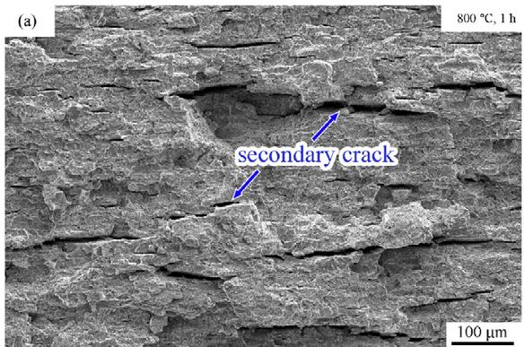

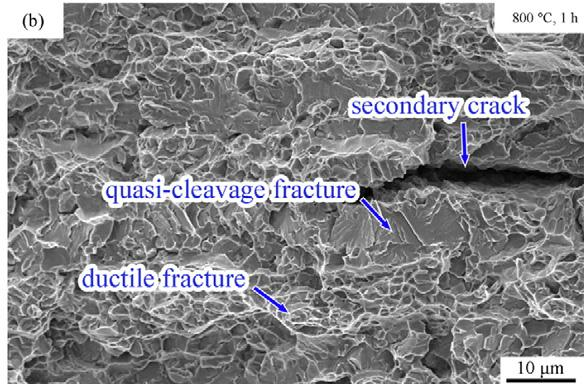

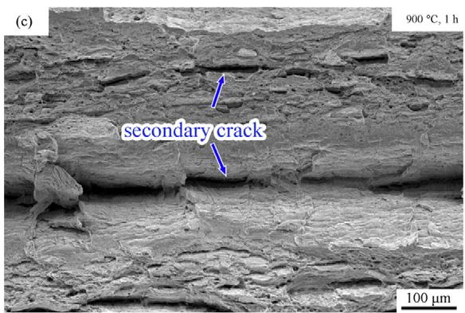

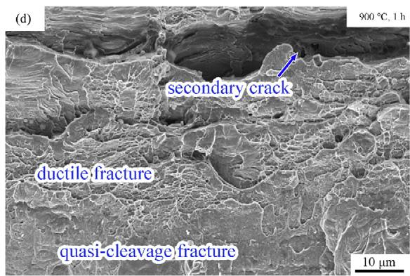

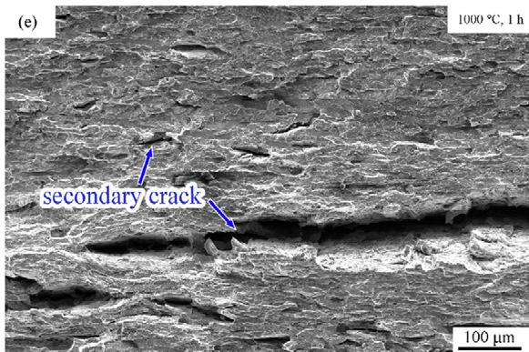

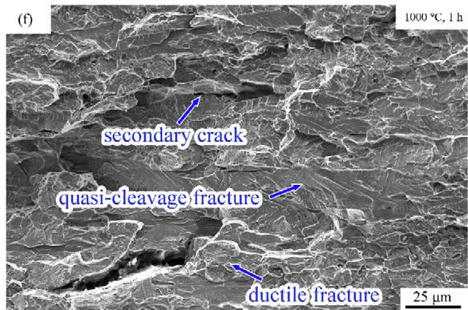  
Fig. 17. SEM fractographs of the specimens annealed at (a)(b) 800 °C, (c)(d) 900 °C, and (e)(f) 1000 °C.

specimen annealed at $9 0 0 ^ { \circ } \mathrm { C } ,$ the $\alpha _ { 2 }$ that mainly distributed with banded shape and the γ grains in the specimen annealed at $9 5 0 ^ { \circ } \mathrm { C }$ are much larger in size, and as a result, the ultimate tensile strength and ultimate elongation of specimen annealed at $9 5 0 ~ ^ { \circ } \mathrm { C }$ are lower than those of the specimen annealed at $9 0 0 ^ { \circ } \mathsf C$ . When the annealing temperature is over $9 5 0 ^ { \circ } \mathrm { C } ,$ the grain size of both α phase and γ phase increases with the increase of temperature, and naturally, the yield strength, ultimate tensile strength and ultimate elongation will decrease with the increase of temperature. The SEM fractograph (Fig. 17(e) and(f)) shows that the ductile fracture area has already lessened and becomes not apparent in the specimen annealed at $1 0 0 0 ^ { \circ } \mathrm { C } .$ Additionally, in the specimen annealed at $1 2 0 0 ^ { \circ } \mathrm { C }$ (Figs. 6(h) and 10(d)), the needle-like or plate-like particles in some large α grains will undoubtedly promote cracking.

The relatively good tensile properties of the present steel can be obtained after annealing at $9 0 0 ~ ^ { \circ } \mathrm { C }$ for 1 h, when the ultimate strength, yield strength, ultimate elongation, and the product of strength of strength and ductility, are 855 MPa, 651 MPa, 36.6%, and 31 GPa%, respectively. Tensile properties of the present steel, together with tensile properties of several Fe–Mn–Al–C steels investigated by other researchers [25–27,50] are shown in Table 2. It should be noted that the κ-carbide in the Fe–18Mn–10Al–1.2C, Fe–18Mn–10Al-–0.8C and Fe– 12Mn–8.0Al-0.8C is dispersed in the austenite matrix, which usually promotes planar glide during deformation and contributes to strength. The ultimate strength and ultimate elongation of the present steel are not as good as the other listed steels. In Table 2, it can be easily noticed that the ultimate elongations of the steels containing α phase (Fe– 20Mn–9Al–0.6C, Fe–18Mn–10Al–0.8C and Fe–12Mn–8.0Al–0.8C) are lower than those of the steels containing no α phase (Fe–28Mn–10Al– 1.0C and Fe–18Mn–10Al–1.2C). The ultimate elongation is lowest among the steels in Table 2. Considering the highest α phase fraction in the present steel among the steels, the boundary κ-carbide between some large α grains, and the inhomogeneous microstructure, it is understandable why the ultimate elongation of the present steel is lowest among the steels. There is nearly no κ-carbide dispersed in the γ matrix of the present steel, and the ultimate strength of the present steel is lower than that of Fe–18Mn–10Al–0.8C and Fe–12Mn–8.0Al–0.8C. Since Mn content in the present steel is designed to be low, the C content may need to be increased to improve the mechanical properties. According to the comparison between Fe–18Mn–10Al–1.2C and Fe– 18Mn–10Al–0.8C investigated by Ding et al., the loss of strength by the reduction of Mn content may be compensated by addition of C content. In addition, tensile properties of the present steel are affected more easily by heat treatment temperature than Fe–20Mn–9Al–0.6C [25]. Anyhow, the investigation of the tensile properties and microstructure of the present steel, Fe–10Mn–10Al–0.7C, is important for the future designs and investigations of Mn-lean Fe–Mn–Al–C steels.

Table 2  
Ultimate strength, yield strength, ultimate elongation, and the product of strength of strength and ductility of several Fe–Mn–Al–C steels.

<table><tr><td>Fe-Mn-Al-C steel (wt.%)</td><td>Ultimate strength (MPa)</td><td>Yield strength (MPa)</td><td>Phase</td><td>Ultimate elongation (%)</td><td>Product of strength and ductility (GPa %)</td></tr><tr><td>Fe-28Mn-10Al-1.0C [50]</td><td>873</td><td>572</td><td> $\gamma$ </td><td>98.9</td><td>86</td></tr><tr><td>Fe-20Mn-9Al-0.6C [23]</td><td>830</td><td>535</td><td> $\gamma + \alpha$  (34%)</td><td>45.6</td><td>38</td></tr><tr><td>Fe-18Mn-10Al-1.2C [26]</td><td>875</td><td>702</td><td> $\gamma + \kappa$ </td><td>77.4</td><td>68</td></tr><tr><td>Fe-18Mn-10Al-0.8C [26]</td><td>966</td><td>801</td><td> $\gamma + \kappa + \alpha$  (24%)</td><td>44</td><td>43</td></tr><tr><td>Fe-12Mn-8.0Al-0.8C [27]</td><td>920</td><td>670</td><td> $\gamma + \kappa + \alpha$  (21%)</td><td>46.4</td><td>43</td></tr><tr><td>Fe-10Mn-10Al-0.7C (present steel)</td><td>855</td><td>651</td><td> $\gamma + \alpha$  (40%) + boundary  $\kappa$ </td><td>36.6</td><td>31</td></tr></table>

## 5. Conclusions

In the present study, a Mn-lean Fe–Mn–Al–C low-density steel with the chemical composition Fe–10Mn–10Al–0.7C (wt.%) is annealed at the temperature range $7 0 0 ^ { \circ } \mathrm { C }$ to 1200 °C for 1 h. The microstructure evolution during annealing and the relationship between tensile properties and microstructure of the annealed specimens are investigated.

(1) The density of the steel is 6.80 g/cm3, about 13% lower than that of pure iron. The largest product of strength and ductility, 31 GPa%, is achieved at the annealing temperature of $9 0 0 ^ { \circ } \mathsf { C } ,$ when the ultimate strength, yield strength, and ultimate elongation are 855 MPa, 651 MPa and 36.6%, respectively.

(2) The phases presented in the annealed steel mainly include ferrite (α), austenite (γ) and κ-carbide (κ). The dissolution temperature of κ-carbide is between 850 °C and 900 °C. When annealed at 700 ${ } ^ { \circ } { \mathsf { C } } ,$ γ phase transforms to κ-carbide with lamellar morphology and α phase by eutectoid reaction. With the increase of temperature, the γ phase fraction first increases, and reaches largest, about 63% at around $1 0 0 0 ^ { \circ } \mathrm { C }$ , and then decreases slightly. The boundary κ-carbide formed during quenching exists in all the specimens annealed at the range $9 0 0 ~ ^ { \circ } \mathrm { C }$ to $1 2 0 0 ^ { \circ } \mathrm { C } .$ Generally, the α grains and γ grains grow up quickly when the annealing temperature is over 900 °C.

(3) The ultimate strength of the annealed specimens has a decreasing trend with the increase of temperature, while the ultimate elongation first increases until anneal temperature reaches 900 ${ } ^ { \circ } \mathbb { C } ,$ and then decreases with the continued increase of temperature. The change of ultimate strength is sharp, so the window for controlling the tensile properties is relatively small.

(4) At the annealing temperature between $7 0 0 ~ ^ { \circ } \mathrm { C }$ and 900 °C, the ductility of the specimens is mainly controlled by the fraction of γ phase. Although the κ-carbide can contribute to the strength, microcracks preferred to initiate around κ-carbide, which is detrimental to the tensile properties. At the annealing temperature between $9 0 0 ^ { \circ } \mathsf { C }$ and $1 2 0 0 ^ { \circ } \mathrm { C } _ { \cdot }$ , since the change of phase fractions is very moderate, the grain sizes, instead of phase fraction change, have a significant effect on the tensile properties. The ultimate strength and ultimate elongation both decrease with the increase of grain sizes when increasing the annealing temperature.

## References

[1] D.S.A.N. Hansoo Kim, Fe–Al–Mn–C lightweight structural alloys: a review on the microstructures and mechanical properties, Sci. Technol. Adv. Mater. 14 (2013) 14205

[2] R. Rana, C. Lahaye, R.K. Ray, Overview of lightweight ferrous materials: strategies and promises, JOM-US 66 (2014) 1734–1746.

[3] D. Barbier, N. Gey, S. Allain, N. Bozzolo, M. Humbert, Analysis of the tensile behavior of a TWIP steel based on the texture and microstructure evolutions, Mater. Sci. Eng. A 500 (2009) 196–206.

[4] J. Jin, Y. Lee, Strain hardening behavior of a Fe–18Mn–0.6C–1.5Al TWIP steel, Mater. Sci. Eng. A 527 (2009) 157–161.

[5] L.A. Dobrzański, W. Borek, Structure and properties of high-manganese TWIP, TRIP and TRIPLEX steels, Aust. J. Multi-Disciplinary Eng. 9 (2013).

[6] A. Gr, O. Ssel, U. Kr, L. Ger, G. Frommeyer, L.W. Meyer, High strength Fe–Mn–(Al, Si) TRIP/TWIP steels development—properties—application, Int. J. Plast. 16 (2000) 1391–1409.

[7] L.A. Dobrzański, W. Borek, Mechanical properties and microstructure of highmanganese TWIP, TRIP and TRIPLEX type steels, J. Achiev. Mater. Manuf. Eng. 55 (2012) 230–238.

[8] H. Ding, Z. Tang, W. Li, M. Wang, D. Song, Microstructures and mechanical properties of Fe–Mn-(Al, Si) TRIP/TWIP steels, J. Iron Steel Res. Int. 13 (2006) 66–70.

[9] M.C. McGrath, D.C. Van Aken, N.I. Medvedeva, J.E. Medvedeva, Work hardening behavior in steel with multiple TRIP mechanisms, Metall. Mater. Trans. A 44 (2013) 4634–4643.

[10] V. Torabinejad, A. Zarei-Hanzaki, S. Moemeni, A. Imandoust, An investigation to the microstructural evolution of Fe–29Mn–5Al dual-phase twinning-induced plasticity steel through annealing, Mater. Design 32 (2011) 5015–5021.

[11] A. Imandoust, A. Zarei-Hanzaki, S. Heshmati-Manesh, S. Moemeni, P. Changizian, Effects of ferrite volume fraction on the tensile deformation characteristics of dual phase twinning induced plasticity steel, Mater. Design 53 (2014) 99–105.

[12] M.H. Razmpoosh, M. Shamanian, M. Esmailzadeh, The microstructural evolution and mechanical properties of resistance spot welded Fe–31Mn–3Al–3Si TWIP steel, Mater. Design 67 (2015) 571–576.

[13] S.S. Sohn, S. Lee, B.J. Lee, J.H. Kwak, Microstructural developments and tensile properties of lean Fe–Mn–Al–C lightweight steels, JOM-US 66 (2014) 1857–1867.

[14] I. Zuazo, B. Hallstedt, B. Lindahl, M. Selleby, M. Soler, A. Etienne, et al., Low-density steels: complex metallurgy for automotive applications, JOM-US 66 (2014) 1747-1758.

[15] Y. Kimura, K. Handa, K. Hayashi, Y. Mishima, Microstructure control and ductility improvement of the two-phase γ-Fe/κ-(Fe, Mn)3AlC alloys in the Fe–Mn–Al–C quaternary system Intermetallics 12 (2004) 607–617.

[16] X.J. Liu, S.M. Hao, L.Y. Xu, Y.F. Guo, H. Chen, Experimental study of the phase equilibria in the Fe-Mn-Al system, Metall, Mater. Trans. A 27 (1996) 2429–2435

[17] A. Etienne, V. Massardier-Jourdan, S. Cazottes, X. Garat, M. Soler, I. Zuazo, et al., Ferrite effects in Fe-Mn-Al-C triplex steels. Metall, Mater. Trans. A 45 (2014) 324–334.

[18] J. Seol, D. Raabe, P. Choi, H. Park, J.H. Kwak, C. Park, Direct evidence for the formation of ordered carbides in a ferrite-based low-density Fe–Mn–Al–C alloy studied by transmission electron microscopy and atom probe tomography, Scripta Mater. 68 (2013) 348–353.

[19] H. Lee, S.S. Sohn, S. Lee, J. Kwak, B. Lee, Thermodynamic analysis of the effect of C, Mn and Al on microstructural evolution of lightweight steels, Scripta Mater, 68 (2013) 339–342.

[20] B.B. Lindahl, M. Selleby, The Al–Fe–Mn system revisited—an updated thermodynamic description using the most recent binaries, Calphad 43 (2013) 86–93.

[21] W. Song, W. Zhang, J. von Appen, R. Dronskowski, W. Bleck, κ-Phase formation in Fe–Mn–Al–C austenitic steels, Steel Res. Int. 86 (2015) 1161–1169.

[22] W.J. Lu, X.F. Zhang, R.S. Qin, κ-Carbide hardening in a low-density high-Al high-Mn multiphase steel, Mater. Lett. 138 (2015) 96–99.

[23] M.C. Ha, J. Koo, J. Lee, S.W. Hwang, K. Park, Tensile deformation of a low density Fe– 27Mn–12Al–0.8C duplex steel in association with ordered phases at ambient temperature, Mater. Sci. Eng. A 586 (2013) 276–283.

[24] G. Frommeyer, U. Bruex, Microstructures and mechanical properties of highstrength Fe–Mn–Al–C light-weight TRIPLEX steels, Steel Res. Int. 77 (2006) 627-633

[25] S.W. Hwang, J.H. Ji, E.G. Lee, K. Park, Tensile deformation of a duplex Fe–20Mn–9Al– 0.6C steel having the reduced specific weight, Mater. Sci. Eng. A 528 (2011) 5196–5203.

[26] H. Ding, D. Han, Z. Cai, Z. Wu, Microstructures and mechanical behavior of Fe– 18Mn–10Al–(0.8–1.2)C steels, JOM-US 66 (2014) 1821–1827.

[27] Z.Q. Wu, H. Ding, H.Y. Li, M.L. Huang, F.R. Cao, Microstructural evolution and strain hardening behavior during plastic deformation of Fe–12Mn–8Al–0.8C steel, Mater. Sci. Eng. A 584 (2013) 150–155.

[28] L. Zhang, R. Song, C. Zhao, F. Yang, Work hardening behavior involving the substructural evolution of an austenite–ferrite Fe–Mn–Al–C steel, Mater. Sci. Eng. A 640 (2015).225-234

[29] F. Yang, R. Song, Y. Li, T. Sun, K. Wang, Tensile deformation of low density duplex Fe– Mn-Al-C steel Mater, Design (2015) 32-39.

[30] Zhang L, Song R, Zhao C, Yang F, Xu Y, Peng S. Evolution of the microstructure and mechanical properties of an austenite–ferrite Fe–Mn–Al–C steel. Mater. Sci. Eng. A. 2015;183–93.

[31] A.K. De, D.C. Murdock, M.C. Mataya, J.G. Speer, D.K. Matlock, Quantitative measurement of deformation-induced martensite in 304 stainless steel by X-ray diffraction, Scripta Mater. 50 (2004) 1445–1449.

[32] K. Norrish, R.M. Taylor, Quantitative analysis by X-ray diffraction, Clay Miner. Bull. 5 (1962) 98–109.

[33] C. Lee, Y. Lee, The solidification mode of Fe–Mn–Al–C lightweight steel, JOM-US 66 (2014) 1794–1799.

[34] S.S. Sohn, B.J. Lee, S. Lee, N.J. Kim, J.H. Kwak, Effect of annealing temperature on microstructural modification and tensile properties in 0.35 C–3.5 Mn–5.8 Al lightweight steel, Acta Mater. 61 (2013) 5050–5066.

[35] P.H.S. Cardoso, C. Kwietniewski, J.P. Porto, A. Reguly, T.R. Strohaecker, The influence of delta ferrite in the AISI 416 stainless steel hot workability, Mater. Sci. Eng. A 351 (2003) 1–8.

[36] S.Y. Shin, H. Lee, S.Y. Han, C. Seo, K. Choi, S. Lee, et al., Correlation of microstructure and cracking phenomenon occurring during hot rolling of lightweight steel plates, Metall. Mater. Trans. A 41 (2010) 138–148.

[37] W.B. Lee, F.R. Chen, C. Wan, Interface structure of BCC/18R martensite in Fe–Al–Mn– C alloy, Mater, Sci, Forum 189–190 (1995) 241–248.

[38] K.H. Hwang, W.S. Yang, T.B. Wu, C.M. Wan, J.G. Byrne, Long-period stacking-fault structure of the needle-like phase in a duplex Fe-Mn-Al-C alloy. Acta Metall Mater. 39 (1991) 825–831.

[39] K. Hwang, C. Wan, J.G. Byrne, Phase transformation in a duplex Fe–Mn–Al–C alloy, Mater. Sci. Eng. A 132 (1991) 161–169.

[40] W. Cheng, C. Liu, Y. Lai, The role carbon plays in the martensitic phase transforma tion of an Fe–Mn–Al alloy, Scripta Mater. 48 (2003) 295–300

[41] W.B. Lee, C. Fu-Rong, S.K. Chen, G.B. Olson, C.M. Wan, Transmission electron microscopy studies of the crystallography of B.C.C./18R martensite in Fe–Mn–Al–C, Acta Metall. Mater. 43 (1995) 21–30.

[42] M.C. Li, H. Chang, P.W. Kao, D. Gan, The effect of Mn and Al contents on the solvus of κ phase in austenitic Fe–Mn–Al–C alloys, Mater. Chem. Phys. 59 (1999) 96–99.

[43] R. Rana, C. Liu, R.K. Ray, Evolution of microstructure and mechanical properties during thermomechanical processing of a low-density multiphase steel for automotive application, Acta Mater. 75 (2014) 227–245.

[44] K. Park, Tensile deformation of low-density Fe–Mn–Al–C austenitic steels at ambient temperature, Scripta Mater. 68 (2013) 375–379.

[45] C. Seo, K.H. Kwon, K. Choi, K. Kim, J.H. Kwak, S. Lee, et al., Deformation behavior of ferrite–austenite duplex lightweight Fe–Mn–Al–C steel, Scripta Mater. 66 (2012) 519–522.

[46] K. Lee, S. Park, Y.S. Choi, S. Kim, T. Lee, K.H. Oh, et al., Dual-scale correlation of mechanical behavior in duplex low-density steel, Scripta Mater. 69 (2013) 618–621.

[47] S.Y. Han, S.Y. Shin, S. Lee, N.J. Kim, J. Kwak, K. Chin, Effect of carbon content on cracking phenomenon occurring during cold rolling of three light-weight steel plates, Metall. Mater. Trans. A 42 (2011) 138–146.

[48] Petch J. Steel Inst., 174, 25 (1953). (c) EO Hall. Proc. Phys. Soc. London B1951. p. 747.

[49] N. Hansen, Hall–Petch relation and boundary strengthening, Scr. Mater. 51 (2004) 801–806.

[50] J.D. Yoo, S.W. Hwang, K.T. Park, Origin of extended tensile ductility of a Fe–28Mn– 10Al–1C steel, Metall. Mater. Trans. A 40 (2009) 1520–1523.