Xuan Li, Renbo Song⁎, Naipeng Zhou, Jiajia Li

School of Materials Science and Engineering, University of Science and Technology Beijing, Beijing 100083, China

## A R T I C L E I N F O

Keywords: Fe-Mn-Al-C steel Microstructure Tensile behavior TRIP efect

## A B S T R A C T

The microstructure and tensile behavior of Fe-8Mn-6Al-0.2C low density steel were investigated in the present study. The results show that, after being solution treated at 900 °C for 1 h, the steel has a duplex microstructure consisting of ferrite and \~ 30% austenite, and it exhibits an excellent combination in mechanical properties, with a tensile strength of 846 MPa and a total elongation of 32%, which were attributed to significant contribution of TRIP efect and three stages work hardening behavior. During tensile test, the work hardening behavior can be defined as three-stage characteristics, in which the stage 2(S2) was linked to the TRIP efect. In S2, with the increase of tensile strain, austenite volume fraction decreased while martensite volume fraction increased gradually. During this process, some austenite grains, positioned at grain boundaries among multiple ferrite grains, were the first ones to transform, while, some austenite grains, located between ferrite laths or embedded in large ferrite grains were often found to undergo rotations. The TRIP efect and the high dislocation density in ferrite and martensite significantly contributed to the excellent mechanical property. In addition, the volume fraction of small angle grain boundaries increased greatly, with a value of over 51% being observed at the true strain of 0.27. The steel possessed a density of 6.95 g/cm3, which is about 11% lower than pure iron.

## 1. Introduction

The Fe-Mn-Al-C system was recently studied as a promising automotive steel because of its low density, high strength and extended ductility [1,2]. The extraordinary comprehensive performance was contributed to the microstructural evolution, mechanical performance as well as the deformation mechanism. It is generally acknowledged that, the dominant deformation mechanisms of Fe-Mn-Al-C low density steels can be classified to transformation-induced plasticity (TRIP), twining-induced plasticity (TWIP) and dislocation gliding (DG) [3–12].

As for medium Mn (5–12%), medium Al (1–8%) Fe-Mn-Al-C steel, a duplex phase of ferrite + austenite has been obtained due to the addition of Al, while austenite is utilized as a secondary phase in ferrite matrix. Thus, the excellent mechanical properties are largely attributed to the TRIP efect of retained austenite. It has been reported that such hardening mechanism is determined by reactions with the adjacent ferrite and mechanical stability [13,14], and the austenite stability was associated with element composition, grain size, grain morphology and so on [15,16]. Moreover, the orientation of retained austenite (Schmid factors) was proved an important factor in determining the mechanical stability of retained austenite upon deformation, in addition to the heterogeneity of grain size [11]. Besides, deformation mechanism can be changed by the increasing of strain rate [12].

From the perspective of med-Mn, med-Al Fe-Mn-Al-C steel, much research has been focused on the evaluation of alloy design, microstructural evolution and process control, emphasizing the improvement of properties that TRIP efect has bring for it. For example, Li et al. [17] reported that, because of significant contribution of TRIP efect and high dislocation density in austenite, Fe-6.1Mn-1.6Al-0.2 C steel can achieve a tensile strength of 1038 MPa and a total elongation of 42% after water quenching from 625 °C. Park et al. [18] compared the microstructure and tensile behavior of two duplex low-density steel containing diferent Mn content, an alloy obtained under a specific heat treatment condition showed TRIP efect, which yielded excellent mechanical properties of a high tensile strength of > 900 MPa and a high total elongation of > 50%.

However, few studies have been carried out to reveal the austenite/ martensite transformation rule retained austenite during the deformation in Fe-Mn-Al-C TRIP steels [19,20]. In general, types of retained austenite grains can be divided into three kinds. The first type of austenite grains were positioned at the ferrite triple edges. The second type contained twin faults, and the third type was completely embedded in a single ferrite grain [21].

In this study, the microstructure and tensile behavior of Fe-8Mn-6Al-0.2C low density steel were investigated with respect to transformation characteristic and mechanical stability of retained austenite. Additionally, the work hardening behavior and fracture mechanism were analyzed here.

Table 1  
Chemical composition of the investigated alloys (wt%).

<table><tr><td>C</td><td>Mn</td><td>Al</td><td>P</td><td>S</td><td>Fe</td></tr><tr><td>0.15</td><td>7.35</td><td>6.00</td><td>&lt; 0.005</td><td>0.01</td><td>Bal.</td></tr></table>

## 2. Experimental

The chemical composition of the steel used in this study is listed in Table 1. The steel was casted using a vacuum induction furnace and heated at $1 1 5 0 ~ ^ { \circ } \mathrm { C }$ for 2 h, and then hot forged to rods with a section plane of 35 mm × 70 mm × 100 mm, which is followed by air cooling to room temperature. Then, was after being homogenized at $1 2 0 0 ^ { \circ } \mathrm { C }$ for $^ { 2 \mathrm { h } , }$ the ingot was hot rolled to 3 mm thickness steel sheet through 6 passes. The start rolling and finish rolling temperatures were $1 1 5 0 ~ ^ { \circ } \mathrm { C }$ and $8 5 0 ^ { \circ } \mathrm { C } ,$ respectively. The hot-rolled steel was subsequently water quenched to $5 5 0 ^ { \circ } \mathrm { C } ,$ , followed by air cooling to room temperature. Finally, solution treatment experiments were performed at 700–1000 °C for 1 h with a water quenching followed. For convenience, the speci mens being solution treated at 700, 800, 900 and $1 0 0 0 ^ { \circ } \mathrm { C }$ are referred to as H70, H80, H90 and H100, respectively. For tensile tests, speci mens with a gauge width of 12.5 mm and a gauge length of 50 mm were machined from the solution-treated sheets along the longitudinal di rection. The microstructure was analyzed by scanning electron microscopy (SEM), transmission electron microscopy (TEM) and electron back-scatter difraction (EBSD). Energy dispersive spectrometer (EDS) was used to investigate the element distribution in austenite and ferrite. The volume fraction of austenite was determined by X-ray difraction (XRD) with $\mathrm { C u K } _ { \mathrm { a } }$ radiation, and the direct comparison method was adopted, in which the integrated intensities of the peaks of (200)α and (211) are recognized as ferrite, and those of the peaks of (220) and (311)γ are regarded as austenite [22]. The density of the steel was measured by a densitometry based on the Archimedes Principle. The density of the present steel is about 6.95 g/cm3, which is about 11% lower than pure Fe. The C content in austenite was measured by the XRD method using the following equation [23]:

$$
\alpha_ {\gamma} = 3. 5 7 8 + 0. 0 3 3 0 \mathrm{X} _ {\mathrm{C}} + 0. 0 0 5 6 \mathrm{X} _ {\mathrm{Al}} + 0. 0 0 0 9 5 \mathrm{X} _ {\mathrm{Mn}}\tag{1}
$$

where $\alpha _ { \gamma }$ is austenite lattice parameter, in $\mathbf { A } ,$ , and $\Chi _ { \mathrm { C } } , \mathrm { X _ { M n } }$ and $\mathbf { X } _ { \mathbf { A l } }$ are concentrations of $\mathrm { C } ,$ Mn and $\mathbf { A l } ,$ respectively, in wt%. The austenite lattice parameter $( \alpha _ { \gamma } )$ was determined from a d-spacing of (220) position.

## 3. Results

## 3.1. Microstructure

The microstructure of the hot-rolled steel after being solution treated at 700–1000 °C for 1 h is shown in Fig. 1. For H70 (shown in Fig. 1a), nearly all the original austenite phase decomposed to martensite and spheroidal M C -carbide, with a volume fraction of 12.2% being retained. $\mathbf { M } _ { 5 } \mathbf { C } _ { 2 }$ -carbide phase widely distributed both at -ferrite grain boundaries and among martensite laths. For H80 (shown in Fig. 1b), $\mathbf { M } _ { 5 } \mathbf { C } _ { 2 }$ -carbide disappeared, martensite has reverse-transformed to austenite. Large amount of strip ferrite, which is termed as α-ferrite in order to distinguish it from -ferrite that is formed at high tem perature, was observed. For H90, with the solution temperature increasing to ${ 9 0 0 } ^ { \circ } \mathrm { C } ,$ the microstructure of specimen was mainly consisted of α-ferrite, δ-ferrite and austenite, as shown in Fig. 1c. Besides, the morphology of -ferrite changed from strip shape into fine blocky shape and the volume fraction of austenite increased to 33.8%. For H100, martensite appeared again with only 12.9% austenite retained. The calculated austenite volume fractions for these steels are listed in Table 3. The phases were distinguished according to the Vickers microhardness as is presented in Table 2. And $\mathrm { M } _ { 5 } \mathrm { C } _ { 2 }$ -carbide was identified

according to EDS.

## 3.2. Properties and work hardening behavior

After tensile tests, the mechanical performance is shown in Table 3. In H70, ultimate tensile strength (UTS) was 778.3 MPa, while total elongation (TE) was 23%. For H80, TE increased apparently but UTS decreased. In comparison, H90 steel had much higher UTS of 846.4 MPa and also an enhanced TE of 32%. H100 owns the first-rank UTS of 860.3 MPa but the worst TE of 15%. With the increase of solution temperature, yield strength (YS) decreases gradually, which was 642.1 MPa, 587.8 MPa, 473.6 MPa and 398.3 MPa, respectively.

True stress-strain curves and the corresponding work hardening rate-true strain curves are plotted in Fig. 2. As shown in Fig. 2a, there is no yield point phenomenon occurring under all the solution treatment conditions. With the increase of solution temperature, both the critical stress for uniform deformation and the work hardening rate decreased obviously. However, for H90, true stress increased abruptly at a true strain $\mathbf { o f } \sim 0 . 0 3 ,$ , and both the UTS and TE were the highest among the four steels. As shown in Fig. 3b, the steels possesses an obvious threestage work hardening (WH) characteristics: in stage 1, WH rate decreased rapidly, which was mainly associated with the deformation of ferrite; In stage 2, the slight decrease of the WH rate is a consequence of the strong hardening mechanism, such as TRIP or TWIP efect [24]; In stage 3, the WH rate decreased quickly again, and this was presumably associated with the deformation localization of ferrite or martensite. For H90, the formation of mechanical twining were not observed from SEM analyses. It can be inferred that, possibly, TRIP efect was the main mechanism for high tensile strength and excellent ductility. In stage 2, the WH rate increased with strain in the true strain range 0.03–0.15, because martensitic transformation took place when a critical stress was attained. After true strain of 0.15, the WH rate began to decrease gently, which was the consequence of a potential competition between the increased stress and stress relaxation induced by the TRIP efect.

## 3.3. Tensile behavior and austenite stability

In order to observe the TRIP efect, the EBSD analysis was carried out on H90 under diferent true strains of 0.03, 0.10, 0.20 and, 0.27, respectively. Fig. 3 shows the superimposed maps of phase distribution map and band contrast map, which can be used not only to distinguish ferrite and austenite grains from martensite grains, but also to measure the volume fractions of austenite. Martensite grains usually show a poor band contrast because of their high dislocation density, indicated in black. Austenite was marked in green and ferrite was marked in gray. At various strain stages, the calculated austenite volume fractions were 31.4%, 22.3%, 10.1% and 4.7%, respectively. It can be concluded that deformation induced martensite transformation occurred continuously with the increase of true strain, which was consistent with the above inference. Both blocky and lath-like retained austenite grains were observed at a true strain of 0.03. Blocky retained austenite was mainly located at the triple junction boundaries, as shown in square region, while lath-like retained austenite was always distributed between fer rite laths or embedded in a single ferrite grain, as shown in ellipse region. Along with the deformation, blocky austenite grains disappeared gradually and only a few were retained at a true strain of 0.20. However, at a true strain of 0.27, almost the whole retained austenite was lath-like austenite. In addition, a large portion of small angle grain boundaries (green line) yielding to 51% was observed at this strain rate, while the values of those under other strains (0.03, 0.10 and 0.20 in turn) were 26%, 31%, 45%, respectively. It has been reported that abundant small angle grain boundaries can significantly improve the deformation ability of the material [25].

Besides, the orientation of retained austenite relative to the loading direction (Schmid factors) was also investigated, and the Schmid factor maps are presented in Fig. 4. The Schmid factor were always used to measure the relative ease with each grain slips. It is well known that grains with the higher Schmid factor will undergo deformation faster because the slip planes in these grains do not need to undergo much rotation before the resolved shear stress reaches a critical value [26]. In this paper, the grains with a high Schmid factor were indicated in red, whereas those with a very low Schmid factor were indicated in blue using rainbow coloring. As shown in Fig. 4a, the relative volume fraction of retained austenite with Schmid factors of 0.45–0.48 was more than 70% at the true strain of 0.03. When the true strain increased to 0.10, the average factor decreased apparently, the majority retained austenite had Schmid factors of 0.39 0.42. With true strain increased to 0.20. over 60% retained austenite had Schmid factors smaller than 0.40, the average Schmid factor of the retained austenite is less than

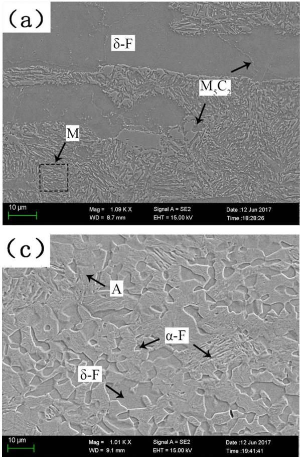

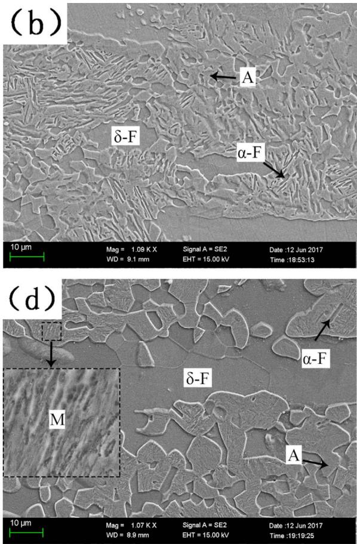  
Fig. 1. SEM micrographs of the (a) H70, (b) H80, (c) H90, (d) H100.

Table 2  
Vickers microhardness of diferent phases.

<table><tr><td>Phase</td><td>Vickers microhardness, HV</td></tr><tr><td>Austenite</td><td>275 ± 10</td></tr><tr><td>δ-ferrite</td><td>314 ± 15</td></tr><tr><td>α-ferrite</td><td>374 ± 10</td></tr><tr><td>Martensite</td><td>438 ± 15</td></tr></table>

Table 3  
Tensile properties and volume fraction of austenite of the solution treated specimens.

<table><tr><td>Specimen</td><td>Solution temperature (°C)</td><td>YS (MPa)</td><td>UTS (MPa)</td><td>TE (%)</td><td> $f_{\gamma}$ (%)</td></tr><tr><td>H70</td><td>700</td><td>642.1</td><td>778.3</td><td>23.0</td><td>12.2</td></tr><tr><td>H80</td><td>800</td><td>587.8</td><td>724.5</td><td>30.5</td><td>20.7</td></tr><tr><td>H90</td><td>900</td><td>473.6</td><td>846.4</td><td>32.0</td><td>33.8</td></tr><tr><td>H100</td><td>1000</td><td>398.3</td><td>860.3</td><td>15.0</td><td>12.9</td></tr></table>

0.34. However, at the true strain of 0.27, the volume fraction of retained austenite with Schmid factors less than 0.34 decreased to 5%. This means retained austenite possessing relatively small Schmid factors tends to remain untransformed during tensile deformation. This tendency is clearly depicted in Fig. 4e.

## 3.4. Fracture mechanism

Fig. 5a shows the fracture morphology of H90 steel, which possesses the common features of quasi-cleavage fracture under diferent solution treatment conditions. There were some flat "class cleavage" facets, micropores, tear edges, secondary cracks and a little dimples. The river pattern was short and curved with less tributaries, and the herringbone crack showed the direction of crack propagation. Generally, the failure mode of quasi-cleavage fracture is thought to be a mixed fracture characteristics, in which the ductile fracture area is mainly deduced from austenite deformation and that the quasi-fracture area is mainly correlated with ferrite deformation [27]. Fig. 5b and c present typical TEM microsgraphs of H90 in the vicinity of fracture area. It is obvious that a small amount of austenite was still remaining after the strong TRIP efect during tensile deformation. Moreover, high density dislocation were observed in both ferrite and martensite, which could play an active role in enhancing the mechanical property.

## 4. Discussions

## 4.1. The relationship between microstructure and mechanical performance

The mechanical performance varied with diferent solution temperature, which is definitely related to the microstructural evolution. Due to the Al addition, a duplex microstructure of -ferrite and austenite was obtained at high temperature. Some δ-ferrite phase was b Contents of Mn and Al measured from the EDS analysis.

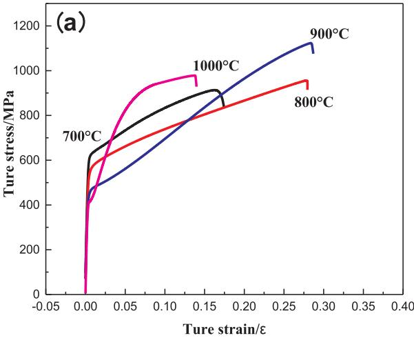

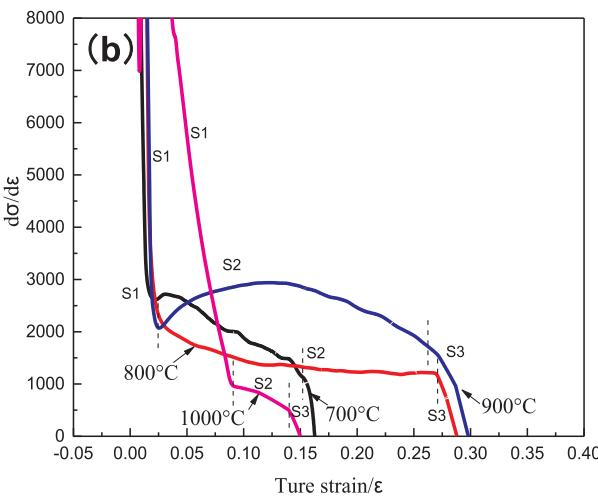  
Fig. 2. (a) True stress-strain curves, (b) work hardening rate.

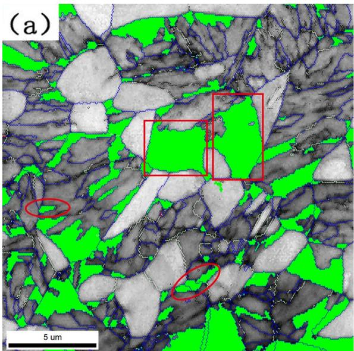

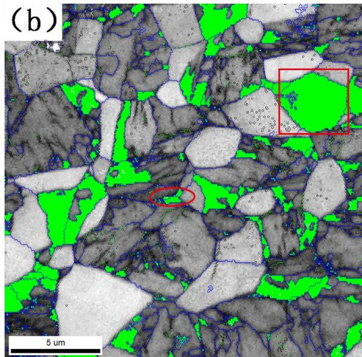

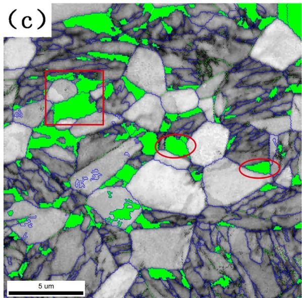

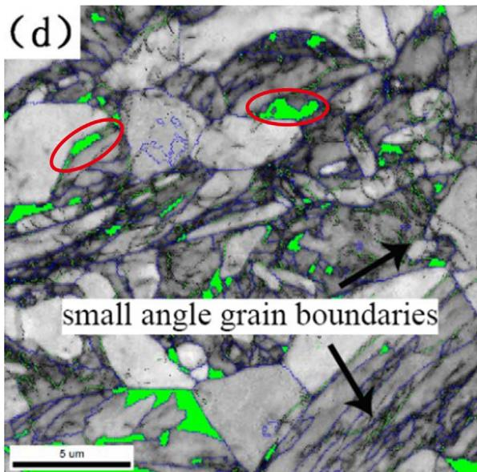  
Fig. 3. The combined band contrast maps and phase identification maps under diferent true strain (a) 0.03, (b) 0.10, (c) 0.20, (d) 0.27. (For interpretation of the references to color in this figure, the reader is referred to the web version of this article)

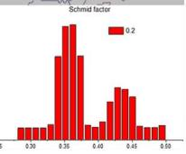

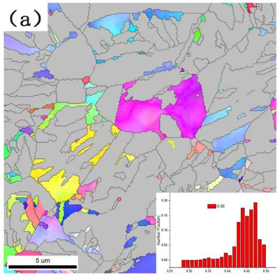

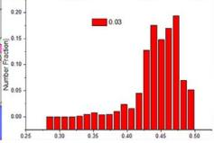

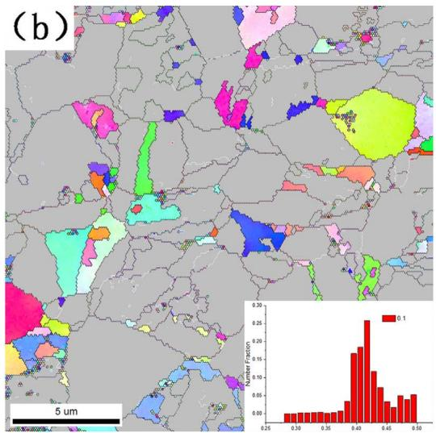

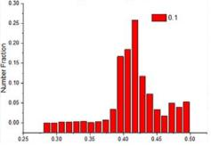

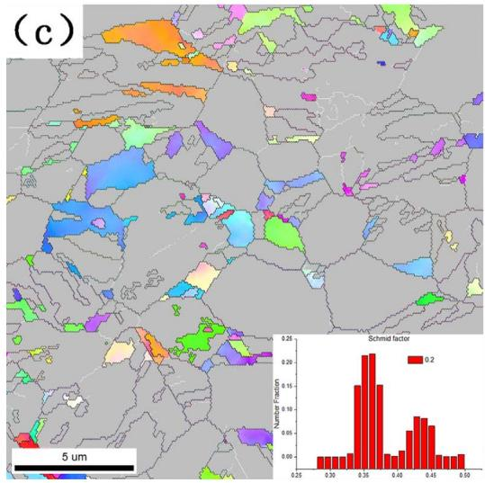

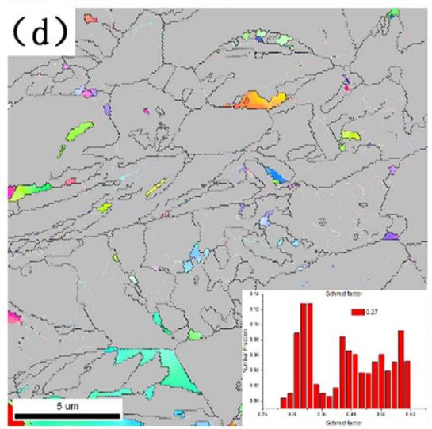

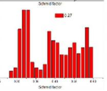

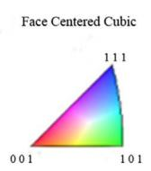

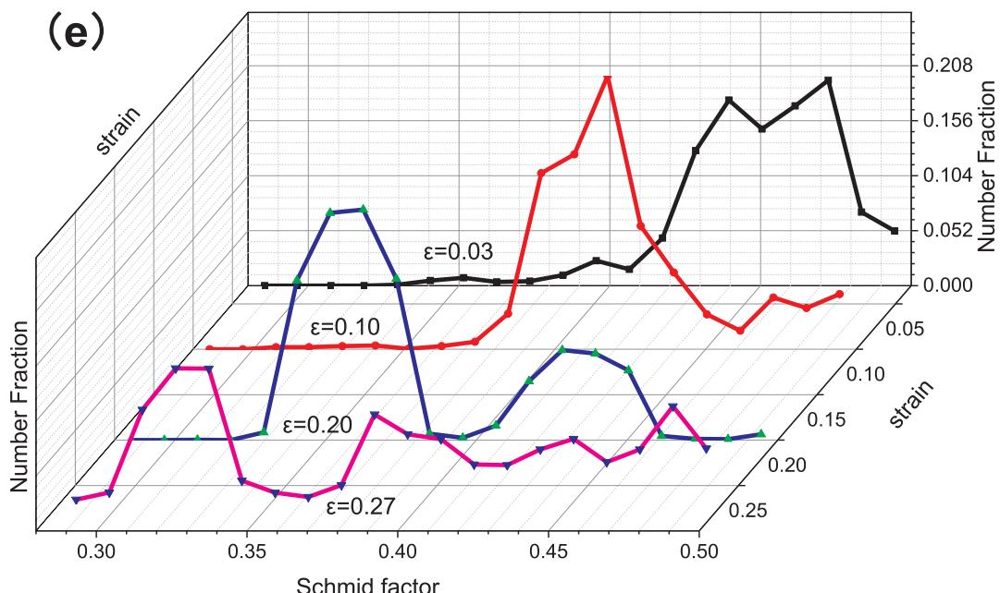  
Fig. 4. The combined band contrast maps and Schmid factor maps under diferent true strain (a) 0.03, (b) 0.10, (c) 0.20, (d) 0.27, (e) the changed trend of Schmid factor under diferent strain. (For interpretation of the references to color in this figure, the reader is referred to the web version of this article).

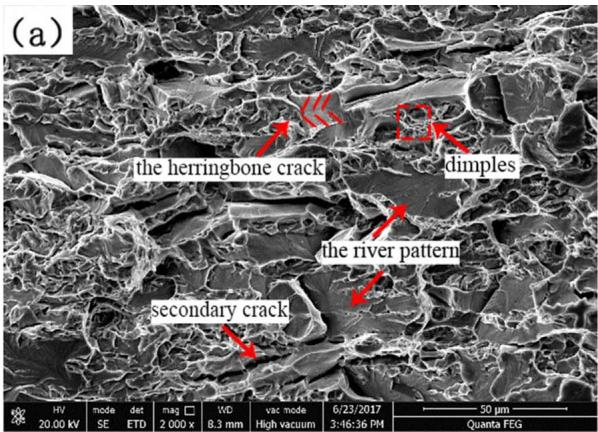

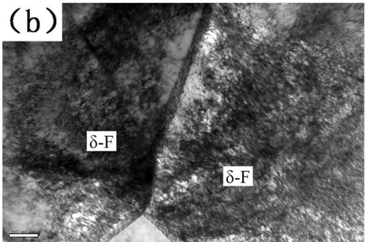

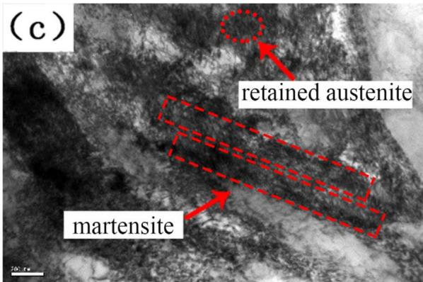  
Fig. 5. SEM fractograph and TEM microsgraphs after tensile deformation in H90 steel. (a) fractograph, (b) dislocation morphology in ferrite, (c) dislocation morphology in martensite.

(a)  
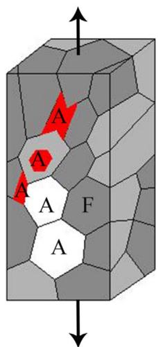

(b)  
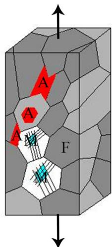  
Fig. 6. A schematic illustration of martensitic transformation in experimental steel. (a) before deformation, (b) deformation induces austenite rotation and transformation (A austenite, F-ferrite, M-martensite). (For interpretation of the references to color in this figure, the reader is referred to the web version of this article).

Table 4  
The elements fraction and M , $\mathbf { M } _ { \mathbf { d } 3 0 }$ temperature.

<table><tr><td>Specimen</td><td> $C^a$  (mass%)</td><td> $Mn^b$  (mass%)</td><td> $Al^b$  (mass%)</td><td> $M_s$  (°C)</td><td> $M_{d30}$  (°C)</td></tr><tr><td>H70</td><td>0.556</td><td>8.91</td><td>5.22</td><td>33</td><td>168</td></tr><tr><td>H80</td><td>0.479</td><td>8.85</td><td>5.1</td><td>67</td><td>204</td></tr><tr><td>H90</td><td>0.391</td><td>8.34</td><td>4.67</td><td>120</td><td>249</td></tr></table>

retained during the subsequent solution treatment process, while austenite transformed to diferent phases under various conditions. For H70, UTS was high attributed to the secondary phase and martensite strengthening, while TE was low because of low austenite fraction. For H80, with the austenite volume fraction increasing to 20.7%, TE increased apparently but UTS decreased. For H90, the excellent combination of UTS and TE was obtained not only attributed to the most austenite fraction with higher hardenability than that of ferrite but uniform microstructure. As is seen, banded ferrite grains had been crushed and separated, austenite grains kept equiaxed and the uni formity was enhanced dramatically. Furthermore, good coordination of austenite and ferrite during deformation was another vital factor to improve mechanical performance [28]. For H100, the best UTS was attributed to the appearing of martensite while lowest austenite volume fraction led to the worst TE. With the increase of solution temperature, YS decreases gradually. On the one hand, plastic deformation generally begins with the softest phase, higher austenite volume fraction will induce plastic deformation easily, and high solution temperature forces the softening of microstructure, leading to yield more prone to occur. On the other hand, it can be explained by asymmetric distribution of ferrite and coarsening of the grains due to the Hall–Petch relation.

## 4.2. The deformation mechanism in association with austenite stability

Two types of austenite grains were carefully analyzed in the present work. Some austenite grains were blocky with a high Schmid factor, and were positioned at the ferrite triple edges. The other ones were lath-like and were located between ferrite laths or embedded in a single ferrite grain with a lower Schmid factor. Fig. 6 shows a schematic il lustration of martensitic transformation during tensile deformation for the experimental steel, in which martensite were marked in blue, ferrite delineated in gray, blocky austenite in white and lath-like austenite in red. With the increase of tensile strain, the blocky austenite took the initiative to transform into martensite, which can be attributed to the higher localized stress. It has been accepted that there exist high free energy and atomic activity at grain boundaries and phase boundaries. Consequently, a triaxial state of stress and more strain can be favored on these blocky austenite grains during deformation. In this case, martensitic transformation is prone to take place at ferrite triple junc tion boundaries [29]. However, for lath-like austenite grains with lower Schmid factor, they would undergo rotations firstly during deformation, which were dependent on the crystallographic orientation of the grains with respect to the straining direction.

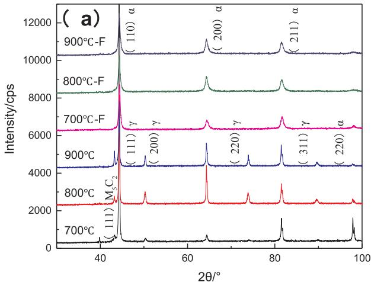

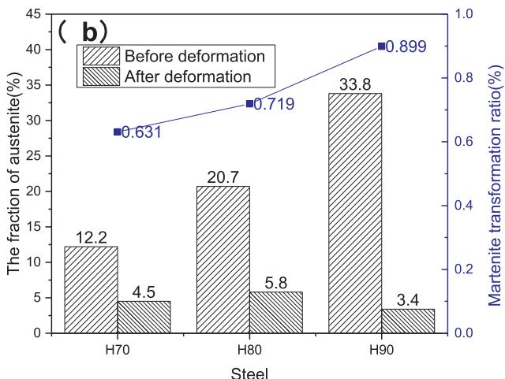  
Fig. 7. (a) The XRD profiles and (b) the corresponding austenite fractions for the steels before and after tensile deformation. Note that, in b, the martensitic transformation ratios for the three steels are also plotted. (F - after fraction).

From the perspective of dislocation glide, both the austenite and ferrite were deformed by the dislocation slip at the beginning of deformation. Next, martensite was independently formed inside austenite grain, not only acting as a barrier for dislocation glide but also as a site for dislocation accumulation and as a source of partial dislocations. As the deformation continues, dislocation multiplied constantly in martensite, while wavy glide in ferrite leading to the formation of com plicated dislocation structure. This is why high density dislocation were observed in both ferrite and martensite, as shown in Fig. 5b and c. Thus, the dynamic recovery and dislocation climbing were restricted, and the strength performance were enhanced eventually [30–33].

Austenite stability among H70\~H90 steel was discussed here, which can be explained by the diference in chemical composition of austenite. Table 4 shows the contents of elements of austenite and $\mathbf { M } _ { s } ,$ $\mathbf { M } _ { \mathbf { d } 3 0 }$ temperature in diferent specimen. Content of C measured from the XRD analysis and Contents of Mn and Al measured from the EDS analysis. $\mathbf { M } _ { s }$ is the martensitic transformation starting temperature, and $\mathbf { M } _ { \mathbf { d } 3 0 }$ is the temperature at which point 50% of austenite has been transformed into martensite at a true strain of 30%: where the elemental contents are in mass percentage [34,35]. According to Eqs. (2) and (3), the calculated $\mathbf { M } _ { s }$ and $\mathbf { M } _ { \mathbf { d } 3 0 }$ temperatures difer in various solution conditions: H90 were ${ 1 2 0 ~ ^ { \circ } \mathrm { C } }$ and ${ 2 4 9 } ^ { \circ } \mathrm { C } ,$ H80 were $6 7 ^ { \circ } \mathrm { C }$ and 204 ${ } ^ { \circ } \mathbf { C } ,$ and H70 were $3 3 ^ { \circ } \mathrm { C }$ and 268 °C, respectively. Due to the lower C and Mn contents, the corresponding temperature in H90 was much higher than that in other cases. It can be concluded that C content plays a significant role in austenite stability, and that lower C content enables austenite a metastable state to induce martensite transformation in this paper.

$$
\mathrm{M} _ {\mathrm{s}} (^ {\circ} \mathrm{C}) = 5 3 9 - 4 2 3 \mathrm{C} - 3 0. 4 \mathrm{Mn} - 1 2. 1 \mathrm{Cr} - 1 7. 7 \mathrm{Ni} - 7. 5 \mathrm{Mo} + 1 0 \mathrm{Co} - 7. 3 \mathrm{Si}\tag{2}
$$

$$
\mathrm{M} _ {\mathrm{d} 3 0} (^ {\circ} \mathrm{C}) = 4 9 7 - 4 6 2 (\mathrm{C} + \mathrm{N}) - 2 0 \mathrm{Ni} - 1 8. 5 \mathrm{Mo} - 1 3. 7 \mathrm{Cr} - 8. 1 \mathrm{Mn} - 9. 2 \mathrm{Si}\tag{3}
$$

The austenite volume fractions were measured by XRD analysis before and after deformation, as illustrated in Fig. 7. Fig. 7a plotted the XRD profile and the calculated results are plotted in Fig. 7b. In all steels, the austenite volume fraction decreased after tensile tests. As the solution temperature increasing in the range $7 0 0 { - } 9 0 0 \ { ^ { \circ } } \mathrm { C } ,$ the martensite transformation ratio increased gradually, with a peak value of 89.9% in H90. This also suggests an enhanced TRIP efects in association with a metastable stability of austenite.

## 5. Conclusions

In the present study, the tensile behavior of Fe-8Mn-6Al-0.2C low density steel was investigated in relation to microstructural evolution and deformation mechanisms, showing the operation of TRIP efect.

(1) The hot-rolled steel solution treated at $9 0 0 ~ ^ { \circ } \mathrm { C }$ for 1 h, possessing a dual-phase microstructure consisting of ferrite and over 30% austenite, exhibited best combination of mechanical properties, and was characterized by excellent combination of UTS of 836.4 MPa, YS of 473.6 MPa, and TE of 32%.

(2) The TRIP efect and the high dislocation density in ferrite and martensite significantly contributed to the excellent combination in mechanical performance. The considerable C and Mn enrichment in austenite, as well as its high volume fraction, enables the metastable austenite to transform into martensite during tensile de formation. Because of the variation in element partitioning, the martensitic transformation ratio increased with the solution temperature in the range $7 0 0 { - } 9 0 0 \ { ^ { \circ } } \mathrm { C }$ . Moreover, $\mathbf { M } _ { s }$ temperature was another factor influencing the austenite stability.

(3) During tensile test, the steel exhibited an obvious three-stage work hardening characteristics, in which the S2 was linked to the TRIP efect. With the increase of tensile strain, the austenite volume fraction decreased while martensite volume fraction increased gradually. The austenite grains positioned at grain boundaries between multiple ferrite grains took the initiative to transform, whereas some other austenite grains, which were located in ferrite laths or embedded in larger ferrite grains, were often found to undergo rotations. In addition, the volume fraction of small angle grain boundaries increased greatly, with a value of over 51% being observed at the true strain of 0.27.

## References

[1] J.B. Seol, D. Raabe, P. Choi, H.S. Park, J.H. Kwak, C.G. Park, Scr. Mater. 68 (2013) 348-353.

[2] H. Kim, D.W. Suh, N. Kim, J. Sci. Technol. Adv. Mater. 14 (2013) 014205.

[3] K.T. Park, G. Kim, S.K. Kim, W.L. Sang, W.H. Si, S.L. Chong, Met. Mater. Int. 16 (2010) 1 6.

[4] L.A. Dobrzański, W. Borek, Aust. J. Mul-Dis. Eng. 9 (2013) 58 69.

[5] L.A. Dobrzański, W. Borek, J. Achiev. Mater. Manuf. Eng. 55 (2012) 733 759.

[6] M C Mcgrath D C V Aken NI Medvedeva JE Medvedeva Metall Mater Trans A 44 (2013).4634–4643

[7] A. Imandoust, A. Zarei-Hanzaki, S. Heshmati-Manesh, S. Moemeni, P. Changizian, Mater, Des, 53 (2014) 99–105.

[8] M.H. Razmpoosh, M. Shamanian, M. Esmailzadeh, Mater. Des. 67 (2015) 571–576.

[9] J. Krajnik, K. Wojciechowski, B. Perzyna, Z. Krzyzański, A. Laczkowski, [9] J. Krajnik, K. Wojciechowski, B. Perzyna, Z. Krzyzański, A. Laczkowski

B. Jachimowicz, D. Kaźmierczak, K. Nowicka, Mater. Sci. Eng. A 586 (2013) 276–283.

[10] P. Lan, J. Zhang, Mater. Sci. Eng. A 700 (2017) 250–258.

[11] Y.B. Xu, Y. Zou, Z.P. Hu, D.T. Han, S.Q. Chen, R.D.K. Misra, Mater. Sci. Eng. A 698 (2017) 126–135.

[12] X.F. Zhang, H. Yang, D.P. Leng, L. Zhang, Z.Y. Huang, G. Chen, J. Iron Steel Res. 23 (2016).963–972

[13] S.S. Sohn, K. Choi, J.H. Kwak, N.J. Kim, S. Lee, Acta Mater. 78 (2014) 181–189.

[14] Sunggeun Lee, Soonken Nam, Int. J. Mod. Phys. A 26 (2011) 1073–1096.

[15] S.S. Sohn, B.J. Lee, S. Lee, N.J. Kim, J.H. Kwak, Acta Mater. 61 (2013) 5050–5066.

[16] P.J. Gibbs, E.D. Moor, M.J. Merwin, B. Clausen, J.G. Speer, D.K. Matlock, Metall. Mater. Trans. A 42 (2011) 3691 3702.

[17] Z.C. Li, H. Ding, R.D.K. Misra, Z.H. Cai, Mater. Sci. Eng. A 682 (2017) 211–219.

[18] S.J. Park, B. Hwang, K.H. Lee, T.H. Lee, D.W. Suh, H.N. Han, Scr. Mater. 68 (2013) 365 369.

[19] F. Yang, R. Song, Y. Li, T. Sun, K. Wang, Mater. Des. 76 (2015) 32–39.

[20] J.K. Kim, B.C.D. Cooman, Mater. Sci. Eng. A676 (2016) 216–231.

[21] G.K. Tirumalasetty, M.A.V. Huis, C. Kwakernaak, J. Sietsma, W.G. Sloof, H.W. Zandbergen. Acta Mater. 60 (2012) 1311–1321.

[22] A. Dosho, K. Kakefuda, US, 2008, US7443952.

[23] S.S. Babu, E.D. Specht, S.A. David, E. Karapetrova, P. Zschack, M. PeetH, K.D.H. Bhadeshia, Metall. Mater. Trans. A 36 (2005) 3281–3289.

[24] Z.C. Li, R.D.K. Misra, Z.H. Cai, H.X. Li, H. Ding, Mater. Sci. Eng. A 673 (2016) 63–72.

[25] J.L. Liu, F. Xue, S.K. JI, Chin. Electr. Microsc. Soc. 25 (2006) 360 361.

[26] P. Kwon, S. Fujieda, K. Shinoda, S. Suzuki, Proced. Eng. 10 (2011) 2214–2219.

[27] C. Zhao, R. Song, L. Zhang, F. Yang, T. Kang, Mater. Des. 91 (2016) 348–360.

[28] L. Zhang, R. Song, C. Zhao, F. Yang, Y. Xu, S.G. Peng, Mater. Sci. Eng. A 643 (2015) 183–193.

[29] T.K. Shan, S.H. Li, W.G. Zhang, Z.G. Xu, Mater. Des. 29 (2008) 1810–1816

[30] U.F. Kocks, H. Mecking, Prog. Mater. Sci. 48 (3) (2003) 171–273

[31] G. Dini, R. Ueji, A. Najafizadeh, S.M. Monir-Vaghefi, Mater. Sci. Eng. A 527 (2010) 2759 2763.

[32] P. Zhou, M.X. Huang, Metall. Mater. Trans. A 46 (2015) 5080–5090.

[33] L.F. Zhang, R.B. Song, C. Zhao, F.Q. Yang, Mater. Sci. Eng. A 640 (2015) 225–234.

[34] R.D.K. Misra, S.W. Thompson, T.A. Hylton, A.J. Boucek, Metall. Mater. Trans. A 32 (2001) 745 760.

[35] J.Y. Choi, W.H. Si, C.H. Min, K.T. Park, Metall. Mater. Trans. A 20 (2014) 893–898.