# Excellent mechanical properties and underlined deformation twinning mechanism of a low-carbon low-density cryogenic steel

Qingfeng Kang , Zexi Zhang , Ziyuan Gao , Cunyu Wang , Jianxiong Liang , Zhengdong Liu , Yuqing Weng , Wenquan Cao \*

Special Steel Department, Central Iron and Steel Research Institute (CISRI), Beijing, 100081, China

## A R T I C L E I N F O

Keywords: Low-carbon low-density steel Excellent cryogenic toughness Deformation twinning Short-range ordering High stacking fault energy

## A B S T R A C T

The mechanical properties and deformation behaviors of a low-carbon low-density steel of Fe35Mn6Al0.1C are studied under both room temperature (RT) and liquid nitrogen temperature (LNT). It is found that the yield strength, tensile strength, total elongation are 251 MPa, 580 MPa and 52 % at RT, which increase 497 MPa, 945 MPa and to 75.5 % at LNT. The Charpy V-notch impact energy is 331±4 J at RT, which remains an excellent value of 254 ± 6 J at LNT, indicating an excellent combination of strength and ductility at LNT. The micro structural evolutions are examined by EBSD in SEM and TEM, it is shown that the RT tensile deformation is mainly controlled by the dislocation substructure refinement accompanied by deformation twinning just before the necking However the LNT deformation is controlled by both dislocation substructure refinement and deformation twinning with twinning started just after yielding. The multiple strain hardenings are divided into four stages with strain increasing at LNT, rather than two stages phenomena at RT. Deformation twinning is found in the specimen after \~28 % tensile strain at RT, whereas it is found in the specimen after \~10 % tensile deformation at LNT. which is seldom reported in low-density steel in literature. Based on the analysis of the relation between work hardening behaviors and microstructure evolution, the high stacking fault energy (SFE) twinning and its orientation dependence are mainly attributed to the stress concentration induced by planar dislocation substructure. The exceptional combination of strength and toughness at LNT makes the low-carbon low-density steel of Fe35Mn6Al0.1C to be a promising cryogenic steel.

## 1. Introduction

Light weight steel as one of the new generation materials has been paid much more attention in recent two decades due to its combination of excellent mechanical properties and low-density, with the aim to understand the deformation mechanism in scientific research and explore the possibility of industry application [1–6]. However, much work has been focused on the chemical design [3,7–10], the deforma tion mechanism [11–14] and the strengthening and toughening behaviors of the low-density steel [3,15–18], such as the austenitic low-density steel with high carbon, high manganese and high aluminum, the dual-phase low-density steel with relative lower contents of carbon, manganese and aluminum, and the ferritic low-density steel with lowest content of carbon, manganese and aluminum. Amongst these three kinds of low-density steel, the austenitic low-density steel is widely studied due its lowest density and the excellent combination of

strength and ductility [5,6,18–20].

The austenitic low-density steel with chemical composition of 0.5–1.5%C, 25–35%Mn and 6–11%Al has been thoroughly demonstrated in literature for the application in the automobile industry [2,5, 15,19,21]. It is shown that the yield strength varied from 400 to 1000 MPa, tensile strength varied from 600 to 1000 MPa with total elongation in the range of 40–80 %. The excellent mechanical properties are mainly attributed to the thinning of the slip band spacing enclosed by the planar dislocations in the easy gliding plans [2,14,21]. It is reported that the tensile deformation behavior of austenite-based duplex Fe-Mn-Al-C steels is primarily dominated by the behavior of the austenitic matrix [5,12]. Due to the deformation incompatibility between the two phases, the main crack sources originate from the FCC/BCC interfaces in duplex steels [4,18]. In addition, it is reported that the austenite grains can be refined by a small quantity of ferrite [1] and the mechanical properties of austenite-based duplex low-density steels can be improved through solution treatment $[ 1 , 2 , 5 ]$ . It is reported that the addition of carbon and aluminum would results in a significant increase of stacking fault energy (SFE) [22–24], which is usually beneficial to the formation of the dislocation cell by the cross glide of the screw component of [25]. In order to resolve this contrary, the term “glide plane softening” is proposed and well interpreted by the interaction between dislocation and short-range order (SRO) or clustering [14,26]. Another interesting phenomenon is the twinning in the austenitic low-density steel, which however usually take places in the austenite steel with relative lower SFE $\mathrm { \Upsilon } 2 0 { - } 4 5 \mathrm { m J } { \cdot } \mathrm { m } ^ { - 2 } ,$ , such as the TWIP steel. It is reported [13,27] that deformation twinning is found in the region near the grain boundary at high strain during the tensile deformation of the austenitic low-density steel with SFE about $7 9 { - } 1 0 8 \ \mathrm { m J { \cdot } m ^ { - 2 } }$ , which is explained by the local stress concentration enabling the critical stress for dislocation gliding larger than that of twinning. However, other factors could also result in the formation of the deformation twinning, such as deformation temperature, grain orientation, Schmid factor, SRO and planar slip [27–33].

Comparing with the extensive work has been done in the low-density steel, few studies has been found for the low-density steel with lowcarbon content. This research trend may be explained by the fact that high carbon content could result in much more reduction of the density of the low-density. Low temperature mechanical behavior of microalloyed and controlled-rolled Fe-Mn-Al-C-X alloys steel and also the relative high strength and ductility as demonstrated in literature. However, with increasing of the carbon content, the tendency of the precipitation of κ-carbide is enhanced, which would impair the toughness and be detrimental to the welding properties of the high-carbon low-density steel. It is reported that a very high toughness about 200 J [34] in the cryogenic temperature could be obtained in the low-density steel with a carbon content of 0.3 %, which making these low-carbon low-density steel suitable to the application as a cryogenic steel. However, no detailed research on the microstructure evolution and mechanical responses have been done, which is essential to the application of the low-carbon low-density steel in the cryogenic temperature.

In this study, the austenite-based duplex low-density steel with of 0.1%C, 35%Mn and 6.0%Al with SFE $( \gamma _ { S F E } )$ of 62.64 mJ⋅m− 2 is designed and fabricated. The mechanical properties and the microstructure at both room temperature and cryogenic temperature are explored for this austenitic low-density steel. It could be expected that both extensive deformation twinning and dislocation gliding could take place due to the high stack fault energy and short-range ordering as found in the high carbon low-density steel. The deformation microstructure of deforma tion twinning and dislocation structure will be characterized by the EBSD, TEM and XRD and the mechanical response of both tensile properties and impact toughness will be examined by the tensile test and Charpy impact test. Our objective is to reveal the microstructure evolution during tensile deformation process at both ambient temperature and cryogenic temperature and its effects on the mechanical properties. Both strengthening and toughening mechanism of the low-carbon lowdensity steel will be discussed in this study.

## 2. Materials and experimental design

Ingot with nominal compositions of Fe-35Mn-6Al-0.1C-0.1Nb-0.1V-1Mo-1W (in wt.%) was prepared by vacuum induction melting with capacity of 50 Kg under high purity Ar atmosphere. The as-cast ingot was homogenized at $1 1 5 0 ^ { \circ } \mathrm { C }$ for 4 h, and subsequently hot-rolled (HR) into rods with a diameter of 16.5 mm. The HR steel rods were then solution-treated at 1050 ◦C for 2 h followed by oil quenching to obtain equiaxed grain structures with nearly equivalent grain sizes. Table 1 presents the compositions of the solution-treated samples, austenite, and ferrite. The composition of the samples was determined using wetchemical analysis. The compositions of austenite and ferrite were estimated using electron probe microanalysis, with the carbon content calculated using the lever rule [35]. The density of the investigated steel, measured using the principle of Archimedes, is reported to be 7.18

Table 1  
The compositions (wt.%) of the steel measured by wet-chemical analysis.

<table><tr><td rowspan="2"></td><td colspan="8">Element concentration (wt.%)</td></tr><tr><td>Mn</td><td>Al</td><td>C</td><td>Nb</td><td>V</td><td>Mo</td><td>W</td><td>Fe</td></tr><tr><td>specimen</td><td>35.14</td><td>5.97</td><td>0.095</td><td>0.11</td><td>0.10</td><td>1.24</td><td>0.95</td><td>Bal.</td></tr><tr><td> $\gamma$ </td><td>35.92</td><td>5.88</td><td>0.098</td><td>0.09</td><td>0.09</td><td>1.12</td><td>0.86</td><td>Bal.</td></tr><tr><td> $\alpha$ </td><td>32.44</td><td>6.83</td><td>-</td><td>0.09</td><td>0.18</td><td>1.54</td><td>1.63</td><td>Bal.</td></tr></table>

g⋅cm− ³.

The phases fraction was determined by X-ray diffraction analysis (Bruker D8 Focus) to confirm the stability of austenite after different tensile strain. The microstructure was characterized in details by scanning electron microscope (SEM) and electron back-scattered diffraction (EBSD) in a scanning electron microscope (JSM-7800 F). The original data obtained from EBSD were analyzed by the HKL channel 5. The step size of 1 μm, 300 nm, 100 nm and 30 nm were adopted for EBSD test. The deformation substructures were investigated with the transmission electron microscopy operated at 200 kV (FEI-Tecnai G2 F20).

The geometrically necessary dislocation density can be estimated with Eq. (1) from the EBSD data of the specimens after tensile deformation with different tensile strain [33]:

$$
\rho^ {G N D} = 2 \theta / u b\tag{1}
$$

in which u is the unit length for EBSD test, b is the Burgers vector, and θ is the average KAM value of the selected area.

In order to measure the dislocation density in the specimens after tensile deformation with different tensile strain, the average values of crystallite size D and micro-strain $\langle \varepsilon ^ { 2 } \rangle ^ { 1 / 2 }$ were estimated according to the Williamson–Hall equation [36,37] by using the profiles of $( 1 1 1 ) _ { \gamma } ,$ (200) and (220) diffraction peaks after Gaussian curve fitting. The dislocation densities ρ could be estimated by the following equation [36, 37]:

$$
\rho = \frac {3 \sqrt {2 \pi} \langle \varepsilon^ {2} \rangle^ {1 / 2}}{D b}\tag{2}
$$

where ε is the average micro-strain, D is average crystallite size, b is the Burgers vector (0.26 nm).

Tensile tests were carried out on standard tensile specimens, with gauge length of 25 mm and diameter of 5 mm, cut from the rods of the water quenched steel samples with the tensile axis direction parallel to the rod axis. The stress strain responses and corresponding strain hardening rates of the solution-treated specimens were investigated from tensile tests carried out at an initial strain rate of $1 . 0 \times 1 0 ^ { - 3 } \bar { \mathrm { s } } ^ { - 1 }$ at room temperature (RT) and liquid nitrogen temperature (LNT) using an MTS tensile machine. At least three tensile specimens were deformed until fracture to confirm reproducibility. To reveal the microstructural evolution during straining, interrupted tensile tests to engineering strains of 3 %, 10 %, 20 %, 28 %, 38 % and 55 % were performed. The toughness of the samples was measured by the Charpy V-notch impact test on the standard samples (55 mm in length, 10 mm in width, 10 mm in thickness, and a V-notch depth of 2 mm) and the test recording the force-displacement curves and energy-displacement curves at RT and LNT.

## 3. Results

## 3.1. Initial microstructures

The microstructure of the starting materials after solution-treated at 1050 ◦C for 2h is characterized by EBSD to reveal the phases, grain size, dislocation and texture, which is shown in Fig. 1(a–c). The phase map is shown in Fig. 1(a) with face-centered cubic (FCC) γ austenite as the matrix embedded with a small fraction of body-centered cubic (BCC) α phase. The volume fraction of the α phase is approximately 3 %, with an average grain size of about 4.7 μm, uniformly distributed along the austenite grain boundaries. It can be seen that equiaxed γ grain structures included many annealing twin boundaries depicted by white color. The average grain size defined with misorientation angle no less than $_ { 1 5 ^ { \circ } }$ is about 10.8 μm. The dislocation density in this starting material is revealed by the KAM values in Fig. 1(b), which is related to the geometric necessary dislocation (GND) and its average density is measured to be is $1 . 6 \times \dot { 1 } 0 ^ { 1 3 } \mathrm { m } ^ { - 2 }$ . The inverse pole figure (IPF) map along the forging direction is shown in Fig. 1(c), indicating a very weak texture in the starting material.

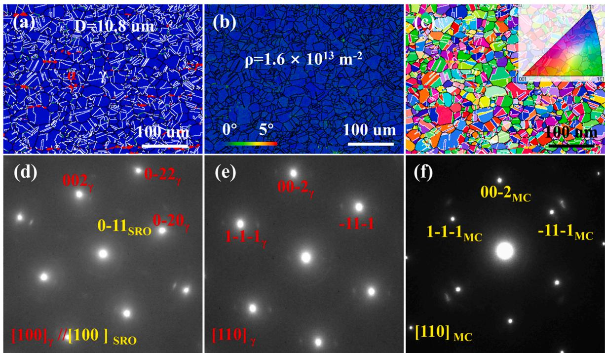  
Fig. 1. Microstructure of the solution-treated steel. (a) EBSD phase map. (b) EBSD KAM map. (c) EBSD IPF map along the rolling direction. (d, e, f) Selected area diffraction patterns along the [100] , $[ 1 1 0 ] _ { \gamma } ,$ and $[ 1 1 0 ] _ { \mathrm { M C } }$ zone axis, respectively.

The microstructure of the starting materials after solution-treated at 1050 ◦C for 2 h is characterized by TEM to reveal the possible nanoprecipitation. Selected area electron diffraction patterns along the $[ 1 0 0 ] _ { \gamma } , [ 1 1 0 ] _ { \gamma } ,$ and [110] zone axis, are shown in Fig. 1 (d), (e) and (f), respectively. It can be seen from Fig. 1(d) that the extremely weak superlattice spots near the [0-11] diffraction patterns are observed, which cannot be observed in the corresponding dark field image. This weak superlattice diffraction spots have been revealed to be an $\mathbf { L } 1 _ { 2 }$ type short-range ordering (SRO) in previous studies [3.14.21.27.38]. Satellite reflections can be observed near some of the main γ diffraction spots. Some previous studies indicated that satellite reflections adjacent to the {200} and {220} primary diffraction spots originate from lattice modulation caused by concentration fluctuations of solute Al and C atoms [21,39]. Furthermore, based on examination of the precipitated phase by the electrolytic extraction method, it is found that V is completely dissolved in the steel, Nb, Mo and W is partially dissolved in the steel, with approximately 0.047 (wt.%) Nb, 0.017 (wt.%) Mo, and 0.024 (wt.%) W existing in MC carbide.

## 3.2. Mechanical properties

Fig. 2 (a) shows the typical tensile engineering stress-strain curves of the steels deformed ${ 2 0 ~ ^ { \circ } \mathrm { C } }$ and $- 1 9 6 \ ^ { \circ } \mathrm { C } .$ It is illustrated that both the strength and ductility of the specimens tensile deformed − ${ } ^ { - 1 9 6 } { } ^ { \circ } \mathrm { C }$ steel is significantly higher than that deformed at room temperature, indicating that the strength-ductility trade-off is evaded via low temperature. The tensile mechanical properties of these steels were given in Table 2. As shown in this table, the 0.2 % offset yield strength (YS) increases from 251 to 497 MPa, and the ultimate tensile strength (UTS) increases from 580 MPa to 945 MPa as the temperature decreases from room temperature to liquid nitrogen temperature. It is also displayed that the low temperature leads to the increase in the uniform elongation (UEL) from 38.5 % to 56.0 % and the enhancement in the total elongation (TEL) from 52.0 % to 75.5 %. The Charpy V-notch (CVN) impact energy reflects the toughness of the material, which is $3 3 1 \pm 4 \mathrm { ~ J ~ }$ at room temperature and $2 5 4 \pm 6 \mathrm { ~ J ~ }$ at cryogenic temperature, indicating an excellent toughness at both RT and LNT for the low-carbon low-density steel.

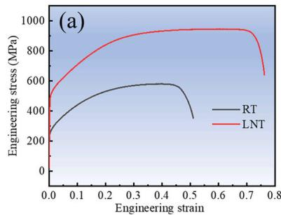

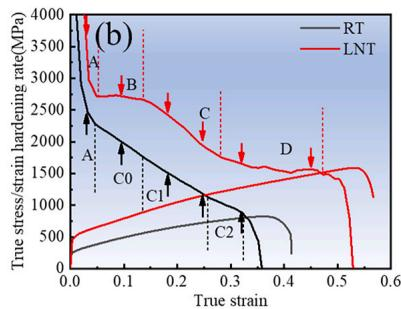

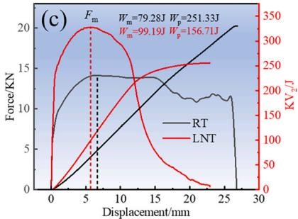  
Fig. 2. Mechanical properties at RT and LNT: (a) Tensile engineering stress-strain curves. (b) True stress-strain curves and corresponding strain hardening rate curves. (c) Force-displacement curves and energy-displacement curves.

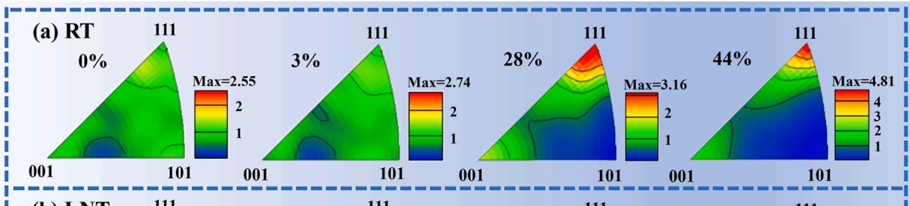

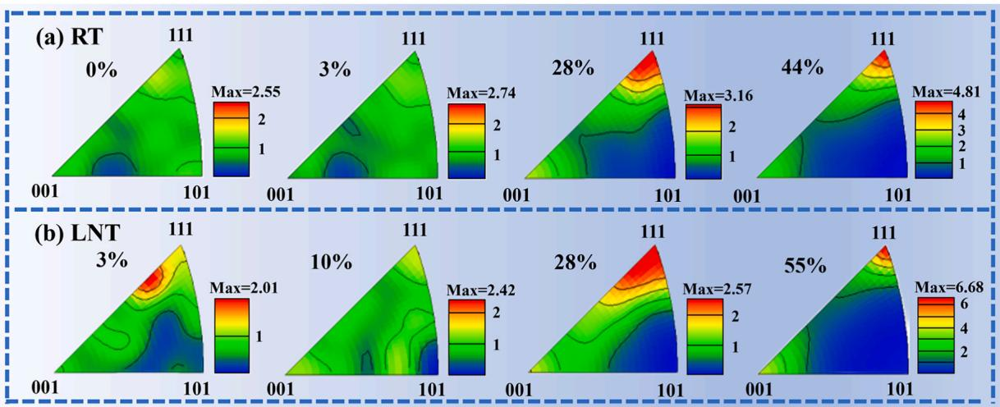

Table 2  
Mechanical properties at RT and LNT.

<table><tr><td>Test temperature</td><td>Ultimate tensile strength, MPa</td><td>Yield strength, MPa</td><td>Uniform elongation, %</td><td>Total elongation, %</td><td>Reduction of area, %</td><td>CVN impact energy, J</td></tr><tr><td>RT</td><td>580 ± 6</td><td>251 ± 3</td><td>38.5 ± 0.5</td><td>52.0 ± 0.5</td><td>78 ± 0.5</td><td>331 ± 4</td></tr><tr><td>LNT</td><td>945 ± 8</td><td>497 ± 5</td><td>56.0 ± 0.5</td><td>75.5 ± 0.5</td><td>80 ± 1</td><td>254 ± 6</td></tr></table>

The true stress-strain curves along with the corresponding strain hardening rate curves at RT and LNT were displayed in ${ \mathrm { F i g . ~ 2 ~ ( b ) } }$ . As shown in Fig. 2 (b), the strain hardening curves at RT and LNT can be divided into two and four stages, respectively, which indicates that the hardening behavior at RT and LNT is governed by different mechanisms, which will be interpreted based on the microstructure examination in the discussion section. To further understand the differences in impact toughness at RT and LNT, the instrumented impact test was applied to reveal the different impact energy contribution from the crack initiation and crack propagation. The results were displaced in Fig. 2(c) by the impact force-displacement curves and energy-displacement curves, in which the impact energy was calculated by the integration of the force displacement curve, which was taken as the impact energy. The crack initiation energy $W _ { m }$ is defined by the integration of the forcedisplacement curve from zero force to the maximum force Fm, and the crack propagation energy $W _ { p }$ is defined by the integration of the forcedisplacement curve from the maximum force Fm to the fracture force. The total impact energy is calculated as the sum of crack initiation energy and the crack propagation energy as shown in Fig. 2(c). It is very interesting that crack initiation is almost the same of \~80–100 J for both room temperature deformation and cryogenic temperature deformation. However, the crack propagation energy is changed significantly from 251 J at room temperature to 156 J at cryogenic temperature. This means that the Charpy impact at both temperature is governed by crack propagation energy.

## 3.3. EBSD analysis of tensile microstructural evolution

The texture evolutions of austenite along tensile axis (tensile axis is shorten as TA) during tensile deformation at RT and LNT are examined by EBSD and the results shown in Fig. 3(a) and (b). The IPF of the tensile samples at room temperature are calculated from the orientation data measured by an in-situ EBSD tension experiments. It can be seen that a weak texture of the austenite as shown in Fig. 3(a) before the tensile test, but the texture strength increases gradually with increasing of the tensile deformation strain. Finally, a very strong <111>//TA texture and weak ${ < } 1 0 0 { > } / / \mathrm { T A }$ texture were observed in the samples tensile deformed at RT as shown in Fig. 3(a). Similar texture evolution is found in the samples tensile deformed at cryogenic temperature as shown in Fig. 3(b). It should be pointed out, the texture strength of ${ < } 1 1 1 { > } / / \mathrm { T A }$ texture component at room temperature is slightly higher than that deformed at cryogenic temperature. However, the texture strength of <111>//TA texture component at the maximum uniform elongation at cryogenic temperature is significantly higher than that deformed at room temperature, which is clearly resulted from the higher tensile deformation strain at cryogenic temperature.

Fig. 4 displays the black, red, blue and green lines representing the evolution of the average $\{ 1 1 1 \} ~ < 1 1 0 > _ { \gamma }$ Schmid factor and {111} ${ < } 1 1 2 { > } _ { \gamma }$ Schmid factor with deformation at RT, {111} ${ < } 1 1 0 > _ { \gamma }$ Schmid factor and {111} $< 1 1 2 > _ { \gamma }$ Schmid factor with deformation at LNT, respectively. It can be seen that the average $\{ 1 1 1 \} < 1 1 0 > _ { \gamma }$ Schmid factor at RT achieved its maximum value near 3 % tensile strain, while the average $\{ 1 1 1 \} < 1 1 2 > _ { \gamma }$ Schmid factor at RT showed a decrease at the same strain level. This means that in the early stage of deformation, the activation of dislocation slip is easier than that of twinning. Upon increasing the strain, the average {111} $< 1 1 2 > _ { \gamma }$ Schmid factor surpassed the {111} ${ < } 1 1 0 > _ { \tau }$ average Schmid factor at RT, which attributed to the development of ${ < } 1 1 1 { > } / / \mathrm { T A }$ and ${ < } 1 0 0 { > } / / \mathrm { T A }$ textures. It is very interesting that both the average {111} ${ < } 1 1 0 > _ { \gamma }$ Schmid factor and the $\{ 1 1 1 \} < 1 1 2 > _ { \gamma }$ Schmid factor at LNT reach their maximum values at approximately 10 % engineering strain. This means that dislocation slip and twinning are easier to occur in the early stage of deformation at LNT.

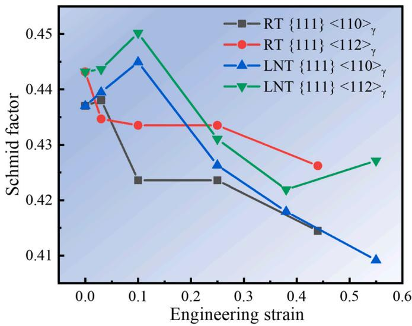  
Fig. 4. Schmid factor evolution as a function of tensile deformation strain at both RT and LNT.  
Fig. 3. IPFs of austenite along the TA direction after different tensile strain and examined by EBSD. (a) 0 %, 3 %, 28 % and 44 % engineering strains at RT. (b) 3 %, 10 %, 28 % and 55 % engineering strains at LNT.

Fig. 5 shows the orientation dependence of deformation mechanism of our studied steel deformed at both RT and LNT. It can be seen that the deformation mechanisms are strongly dependent on the crystal orientation, such as ${ < } 0 0 1 { > } / / \mathrm { T A }$ orientation with angle deviation of approximately 15◦ (type I), <111>//TA orientation with angle deviation of approximately 15◦ (type III) and the rest apart from type I and III (type II) as defined by I. Gutierrez-Urrutia [40]. Fig. 5(a1) illustrates the correlation between deformation twinning and grain orientation after 38 % tensile deformation at room temperature. Similar to the study by I. Gutierrez Urrutia et al., twins are more likely to occur in the type II and type III grains. Due to the very small fraction of the grains with deformation twinning, the tensile deformation of our studied steel at RT is controlled by dislocation gliding.

Fig. 5(b1, c1, d1) illustrates the correlation between deformation twinning and grain orientation at 28 %, 38 %, and 55 % engineering strain at LNT, respectively. Similar to room temperature deformation, twins are more readily formed in type II and type III grains. As shown in Fig. 5(b1, b2, c1, c2, d1, d2), plenty deformation twins could be found in the microstructure when the studied steel is deformed at LNT. And the deformation twinning fraction increased with the increasing of the deformation strain. Thus, the deformation twinning plays an important role in the deformation behaviors of our studied low-carbon low-density steel at LNT temperature, which is strongly dependent on the grain orientations. It can be observed in Fig. 5(c2) that type II grains tend to form single orientation twinning, while type III grains tend to form multiple orientation twinning.

Fig. 6 further illustrates the relationship between glide traces and grain subdivision. Interestingly, two types of dislocation glide traces as shown in Fig. 6(a–c) and (d-f), double dislocation glide traces and single dislocation slip traces, are formed. It can be seen that type II grains exhibit a propensity for the single slip traces, Type III grains demonstrate a tendency to develop double glide traces, whereas only a small fraction of type I grains exhibit slip traces. The study of Fe-30.5Mn-2.1Al-1.2C (wt.%) steel [41] at 0.1 true strain demonstrates that grains with orientations close to <111>//TA and ${ < } 0 0 1 { > } / / \mathrm { T A }$ are prone to forming a Taylor lattice, while grains with orientations oriented along the line between ${ < } 0 0 1 { > } / / \mathrm { T A }$ and ${ < } 1 1 1 { > } / / \mathrm { T A }$ directions are inclined to form high-density dislocation walls. However, in low-carbon low-density steel, the deformation microstructure of grains close to ${ < } 0 0 1 { > } / / \mathrm { T A }$ is featured by the formation of the dislocation cells. This microstructure difference between present steel and Fe-30.5Mn-2.1Al-1.2C (wt.%) steel may be resulted from low-carbon content and high deformation rate, which promote the cross glide in grains with ${ < } 1 0 0 { > } / / \mathrm { T A } .$

## 3.4. TEM analysis of tensile microstructural evolution

For the understanding of the deformation behaviors of our studied steel at RT, the deformation microstructures are examined by TEM after different deformation strain and the results are displayed in Fig. 7. It can be seen, when the strain reaches to 3 %, complex dislocation configu rations are formed, such as dislocation nodes, multiple dislocations and dislocation pairs (Fig. 7(a)), which are supposed to be related to planar slip [21]. After 10 % deformation, Lomer-Cottrell (LC) locks and the high-density dislocation walls (HDDWs) are formed (Fig. 7(b and c)), which are regularly observed in other FCC materials [21,42]. After 20 % strain, the so-called Taylor lattices, cell blocks (CBs) and dislocation cells (DCs) are formed along {111} slip plane (Fig. 7(d–f)). It should be noted that Taylor lattice is not popular compared to dislocation cell and cell block. This implies that dislocations are more prone to cross slip. Furthermore, grains (type I) oriented close to ${ < } 1 0 0 { > } / / \mathrm { T A }$ are more prone to forming dislocation cells (Fig. 7(f)), while grains (type II and III) oriented away from <100>//TA are more likely to develop cell blocks (Fig. 7(e)). Fig. 7(g–j) shows that the CBs and DCs are refined as the strain increases to 28 %. The refinement of cell blocks also has been observed in TWIP and lightweight steels [40.41]. A small amount of deformation twinning has been formed along the cell block walls (CBWs), as shown in Fig. 7(g and h). Furthermore, a few microbands (Fig. 7(j)) are found, which is an indication of stress localization.

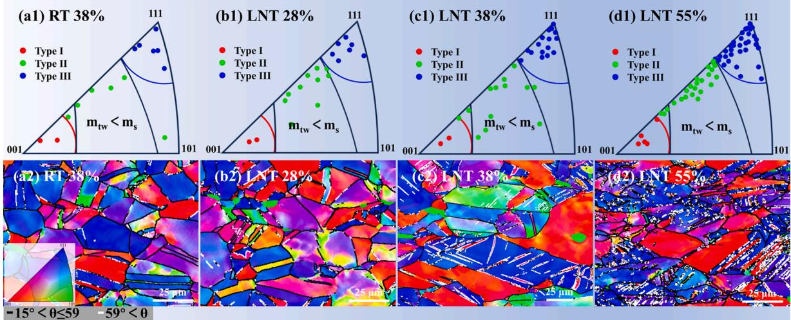  
Fig. 5. The dependence behaviors dependence on the crystal orientation of the low-carbon low-density steel during tensile deformation at both RT and LNT. (a1, b1, $\mathbf { c } 1 , \mathbf { d } 1 )$ Inverse pole maps along the TA direction displaying grain orientations with red, green and blue dots corresponding to type I, II and III grains, respectively, in which the orientations with m < m are labeled. (a2, b2, c2, d2) Inverse pole maps along the TA direction. (For interpretation of the references to color in this figure legend, the reader is referred to the Web version of this article.)

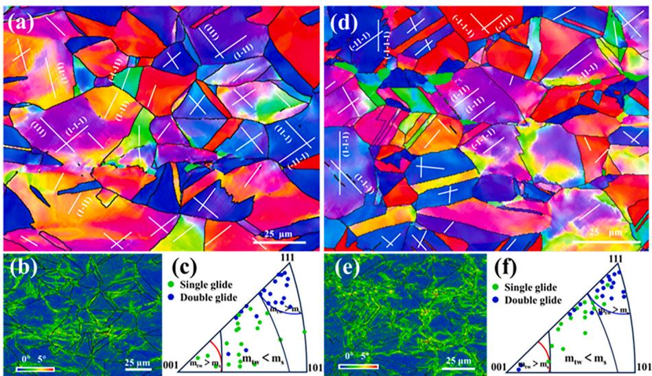  
Fig. 6. Dislocation glide induced grain subdivision in samples of 28 % engineering strains at RT (a–c) and LNT (d–f). (a, d) IPF maps along the TA direction. (b, e) KAM maps. (c, f) Inverse pole figure along the TA direction displaying sub-grain orientation map with dislocation glide traces (green dots: single glide; black dots: double glide). (For interpretation of the references to color in this figure legend, the reader is referred to the Web version of this article.)

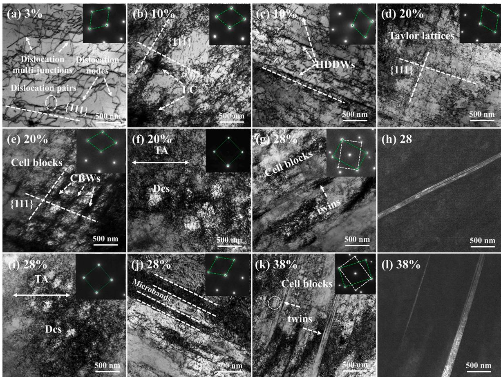  
Fig. 7. TEM images of deformation induced microstructure at different tensile strains at RT, indicating occurrence of deformation twinning at 28 % tensile strain: (a) 3 %, (b, c) 10 %, (d–f) 20 %, (g–j) 28 %, (k, l) 38 %.

Although deformation twins paralleling to the primary slip plane are further developed at 38 % strain level, the proportion of deformation twins is still very low (Fig. 7(k, l)), which is consistent with the finding by EBSD as shown in Fig. 5(a1, a2).

Deformation-induced microstructures at LNT are also examined by TEM and the results are shown in Fig. 8. Upon reaching a strain of 3 %, complex planar slip features, dislocation pairs, nodes, and multiple dislocations emerged, as displayed in Fig. 8 (a). Unlike at room temperature, the occurrence of extended dislocation pairs at lowtemperature indicates that low temperature facilitates planar glide. It is particularly intriguing that stacking faults are formed at the annealed twin boundaries, as displayed in the inset of Fig. 8(b). This implies that

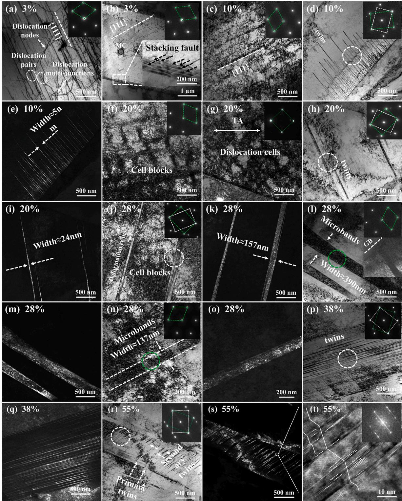  
Fig. 8. TEM images of deformation induced microstructure at different tensile strains at LNT, indicating the occurrence of deformation twin at 10 % tensile strain: (a, b) 3 %, (c–e) 10 %, (f–i) 20 %, (j–o) 28 %, (p, q) 38 %, (r–t) 55 %.

low temperature has facilitated the formation of stacking faults at early deformation. At a strain of 10 %, the features of complex planar slip are further pronounced, as depicted in Fig. 8(c). Fig. 8(d and e) illustrates that deformation twins have been nucleated at annealed twin bound aries upon reaching an approximate strain of 10 %. Typically, the width of twin bundles is about 5 nm for 10 % strain (Fig. 8(e)), which cannot be detected by EBSD. It should be noted that, unlike the deformation twins formed at room temperature through high-density dislocations, these deformation twins formed at low strain are closely related to the stacking faults formed at the annealed twin boundaries. Upon straining to 20 %, dislocation cell blocks (Fig. 8(e)), and dislocation cells (Fig. 8 (g)), are produced respectively in grains oriented away from <100>// TA and close to <100>//TA, which is similar to observation at room temperature. Furthermore, at 20 % strain, deformation twins and dislocation cells have been developed in the interior of the grains, but the proportion of twins is still very low (Fig. 8(h and i)), indicating a competition between dislocation gliding and deformation twinning in this stage.

Similar to the dislocation substructure at RT, the dislocation cell blocks are refined at 28 % strain level at LNT (Fig. 8(j)). Table 3 displays the average sizes of the dislocation substructures at room temperature and under liquid nitrogen. It can be observed that at equivalent strains, the sizes of dislocation substructures are reduced under liquid nitrogen compared to room temperature conditions (Table 3). This implies that the dislocation density is higher at liquid nitrogen temperature under the same strain conditions. Upon reaching an engineering strain of 28 %, while twins are further activated, their prevalence remains relatively low, as illustrated in Fig. 8(j and k). In addition, a small amount of wide microbands (Fig. 8(l, m)) and fine microbands $\left( \mathrm { F i g . ~ \ 8 ( n , ~ \ o ) } \right)$ are observed. The broad microbands can attain widths of approximately 390 nm, and the fine microbands measure around 137 nm in width, as shown in Fig. 8(l, n), respectively. It can be observed that these broad microbands and fine microbands originate from grain boundaries and within the grains, respectively, as illustrated in the inset of Fig. 8(l) and (o). Some studies indicate that the Fe-Mn-Al-C low-density steel $[ 2 0 , 4 1$ 43], high manganese steel [29] and 316L stainless steel [44] exhibited plastic localization phenomena related to microbands during room-temperature or liquid nitrogen temperature deformation. As the strain is further increased to 38 %, a significant number of deformation twins are activated, as shown in Fig. 8(p, q). When the strain is reached 55 %, closing to the maximum force strain, a large number of secondary twins are activated, as displayed in Fig. 8(r, s). Fig. 8 (t) shows that, compared to primary deformation twinning, secondary twins contain more stacking faults.

Based on the microstructure evolution examination as shown in ${ \mathrm { F i g . ~ } } ( 7 , 8 ) ,$ it could be reasonably assumed that the deformation twinning takes place at about 10 % tensile strain at LNT. However, the deformation twinning is taken place at tensile strain of 28 % at RT, indicating a strong dependence of deformation twinning on both deformation strain and deformation temperature.

## 3.5. Deformation structure of impact specimens at both RT and LNT

To further understand the suppression or elimination of the ductile to brittle transition in impact toughness from RT to LNT, the surface morphology of the impact fracture and the structure in the vicinity of the fracture at RT (Fig. 9(a–e)) and LNT (Fig. 9(f–j)) are analyzed, as shown in Fig. 9. For the RT sample, a large number of subordinate cracks and large necking are seen (Fig. 9(a)), whereas only a small number of subordinate cracks and small necking are seen in the cryogenic sample (Fig. 9(f)). This means that a multitude of subordinate cracks and large necking contribute to the high crack propagation energy at room temperature.

Stress, dislocation density and dislocation substructure size in different strains at RT and LNT.

<table><tr><td>Engineering strain (%)</td><td>3.0</td><td>10.0</td><td>20.0</td><td>28.0</td><td>38.0</td><td>55.0</td></tr><tr><td>True strain, %</td><td>3.0</td><td>9.5</td><td>18.2</td><td>24.7</td><td>32.2</td><td>43.8</td></tr><tr><td>True stress (RT), MPa</td><td>339</td><td>483</td><td>635</td><td>723</td><td>800</td><td>-</td></tr><tr><td>True stress (LNT), MPa</td><td>598</td><td>778</td><td>1007</td><td>1148</td><td>1280</td><td>1463</td></tr><tr><td> $\rho^{GND}$  (RT-EBSD-α),  $10^{14} \text{ m}^{-2}$ </td><td>0.71</td><td>3.05</td><td>5.64</td><td>7.92</td><td>8.99</td><td>-</td></tr><tr><td> $\rho$  (RT-XRD),  $10^{14} \text{ m}^{-2}$ </td><td>0.64</td><td>2.42</td><td>4.96</td><td>6.96</td><td>8.03</td><td></td></tr><tr><td> $\rho^{GND}$  (LNT-EBSD-α),  $10^{14} \text{ m}^{-2}$ </td><td>0.97</td><td>2.59</td><td>5.95</td><td>6.93</td><td>9.17</td><td>9.73</td></tr><tr><td> $\rho$  (LNT-XRD),  $10^{14} \text{ m}^{-2}$ </td><td>0.72</td><td>2.94</td><td>5.66</td><td>7.90</td><td>9.31</td><td>13.32</td></tr><tr><td>CBs or DCs size (RT), nm</td><td>-</td><td>-</td><td>448 ± 74</td><td>282 ± 56</td><td>-</td><td>-</td></tr><tr><td>CBs or DCs size (LNT), nm</td><td>-</td><td>-</td><td>429 ± 76</td><td>242 ± 54</td><td>-</td><td>-</td></tr></table>

The EBSD characterizations are carried out in in the typical crack propagation zone, as indicated by the black dots in the inset of Fig. 9 (b–g). To gain a deeper understanding of the substructure following impact deformation, TEM analysis is also performed, as shown in Fig. 9 (d–i). Fig. 9(b–g) illustrates that the samples are highly stable under both room temperature and liquid nitrogen temperature, with no phase transformation occurring in the austenite. Dislocation substructures at both temperatures are characterized by the dislocation cells or cell blocks (Fig. 9(d–i), which is similar to the dislocation substructure under tension. It can be observed that low temperature can promote the formation of deformation twins, as shown in ${ \mathrm { F i g . ~ } } 9 ( \mathbf { c } , \mathbf { d } , \mathbf { h } ,$ i). Although twins are more readily activated under low-temperature impact, they do not burst as in TWIP steels, leading to a non-significant contribution of twins to the impact energy. Additionally, the red arrows in Fig. 9(g) display the presence of distinct fine cracks around the voids generated by the detachment of α for cryogenic impact sample. This indicates that the $\gamma / \alpha$ interface is served as the crack initiation site for cryogenic impact sample, which may contribute to a decrease in crack propagation energy at low temperature. The impact energy is reduced about 30 % from 331J at room temperature to 254 J at liquid nitrogen temperature due to the existence of 3.0 % percent of the α-phase in the austenite matrix. $\mathrm { F i g . } 9 ( \mathbf { e } , \mathbf { j } )$ shows that the fracture surfaces are mainly composed of dimples of micrometer or sub-micrometer at RT and LNT,indicating that both temperatures are ductile fracture. Therefore, although the presence of the $\gamma / \alpha$ interface leads to a slight decrease in impact energy at low temperatures compared to room temperature, the refined austenite grains [1,29], absence of κ-carbides [5,32], and stability of austenite [29] endow this austenite-based duplex lightweight steel with high impact toughness at the both temperatures.

## 4. Discussion

4.1. Advantages to be one of the cryogenic steels and stacking fault energy assessment of the low-carbon low-density steel

The cryogenic steel is a special steel applied under the condition with very low temperature, specially the LNT. The selection of the cryogenic steel is very conservative, requiring not only the excellent cryogenic toughness but also the high ductility to assure the safety of the cryogenic equipment during shipping and storage [45]. Thus, the asthenic steel such as the high-Mn TWIP-steel rather than the conventional 9Ni steel is much more welcome due to its high cryogenic toughness and excellent ductility at LNT [45,46].

For the revealing of the advantages of our designed low-carbon lowdensity steel, the properties of the cryogenic steel were collected from literature and compared with our new designed steel as shown in Fig. 12. It can be seen from Fig. 10(a) that the Charpy impact energy and specific yield strength of the steel at liquid nitrogen temperature and those of other steels (converted to full size $1 0 \times 1 0 \times 5 5 \mathrm { m m } )$ . It can be observed that, compared to high carbon lightweight steel [47,48] and TWIP steel [46], the designed low-carbon lightweight steel exhibits a higher Charpy impact energy. In contrast to low-carbon high manganese steel [29] and 304-stainless steels [49], the designed low-carbon lightweight steel demonstrates a superior specific yield strength. 304-stainless steel is mechanically unstable and undergoes martensitic transformation at low temperatures, leading to a significant reduction in its impact energy. Although the duplex structure plays a crucial role in the fracture behavior of steel, the presence of a small amount of ferrite can significantly refine the austenite grains, which substantially enhances its impact toughness [29]. Moreover, compared to martensite, ferrite is more readily deformed, which may alleviate stress concentration at the $\gamma / \alpha$ interface to some extent. The strength and toughness of our designed lightweight steel are comparable to those of the Al0.1CoCrFeNi high-entropy alloy [50]. The ductility and the specific yield strength of the steel at liquid nitrogen temperature and those of other steels are shown in Fig. 10(b). The ductility of our studied steel is in the same level comparing with the austenite TWIP steel, but nearly 3 times higher than that of the 9Ni-steel, indicating a strong resistance of deformation induced rupture. Furthermore, although 9Ni-steel has been well recognized as a cryogenic alloy [51], the price of our designed low-carbon low-density steel is much lower that of the conventional 9Ni-steel, due to its low-cost elements alloying and simple high temperature solution heat treatment as revealed in the experiment section in this research. There are still challenges of high Ni alloy cost and complex heat treatment processes. Similarly, other stainless steel and high-entropy alloy is more expensive because of their high Co or Ni alloying design. Based on above comparison, the advantages of low-density, excellent cryogenic toughness and ductility and low-cost of our designed low-carbon low-- density steel are very impressive comparing with other cryogenic steels. These advantages make this steel to be one of the promising materials as cryogenic application.

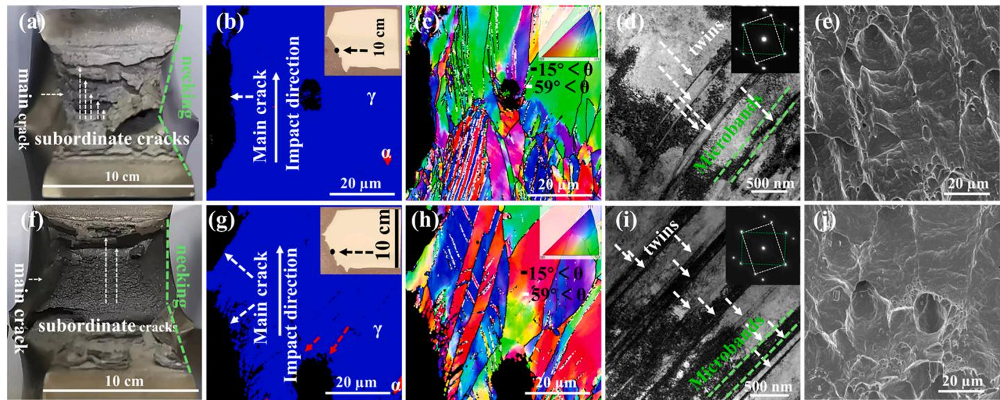  
Fig. 9. Deformation microstructure of samples after impact testing at RT (a–e) and LNT (f–g). (a, f) Macroscopic fracture appearance after testing. (b, g) Phase maps near the fracture surface. (c, h) IPF map along the impact direction near the fracture surface. (d, i) TEM maps of the region approximately 1000um from the fracture surface. (e, j) Fracture surface maps.

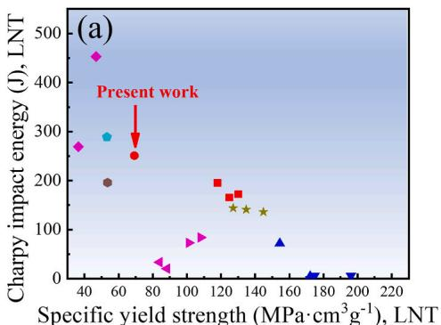

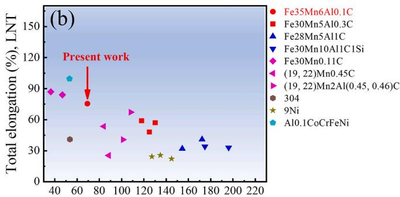  
Specific yield strength (MPa·cm $^ 3 \mathrm { g } ^ { - 1 } )$ , LNT  
Fig. 10. Comparison of our studied lightweight steel with reported low-carbon low-density steel [34], high carbon lightweight steel [47,48]. low-carbon high manganese steel [29], TWIP steel [46], 304 stainless steels [49], 9Ni steel [51], and HEAs [50] at liquid nitrogen temperature. (a) Charpy impact energy versus specific yield strength. (b) Total elongation versus specific yield strength.

In order to understand the excellent cryogenic properties of the lowcarbon low-density steel as mentioned above, the stacking fault energy and austenite stability are calculated and discussed as follows. It is well recognized that the addition of aluminum into the low-density steel could increase the stack fault energy significantly, which in turn suppressed the occurrence of twins in the low-density steel [22,24].

However, deformation twinning is not only found in the specimens tensile deformed at room temperature as shown in Figs. 4 and $^ { 8 , }$ in the specimens tensile deformed at liquid nitrogen temperature as shown in Figs. 5 and 9, and in the impact deformed specimens at both RT and LNT as shown in Fig. 11. However, due to the low content of carbon of 0.10 % and relative low aluminum content of 6 %, the stacking fault energy and the austenite stability should be assessed for the tendency of deformation twinning and or deformation induced phase transformation during deformation process.

The SFE $( \gamma _ { S F E } )$ and $\Delta G ^ { \gamma \to \varepsilon }$ of the austenite in our low-carbon lightweight steel were evaluated based on the well-accepted thermodynamic approach [52,53]:

$$
\gamma_ {S F E} = 2 \rho \Delta G ^ {\gamma \rightarrow \varepsilon} + 2 \sigma\tag{3}
$$

where $\gamma _ { S F E }$ is for stacking fault energy, ρ is the molar surface density along {111} planes, $\Delta G ^ { \gamma \to \varepsilon }$ is the molar Gibbs energy of the phase transformation from γ to ε, and σ is the interfacial energy per unit area of the $\gamma / \varepsilon$ phase boundary. According to the approximate model of solid solution, The Gibbs energy difference of the $\Delta G ^ { \gamma \to \varepsilon }$ in Fe-Mn-Al-C alloy can be expressed as [24,53]:

Table 4  
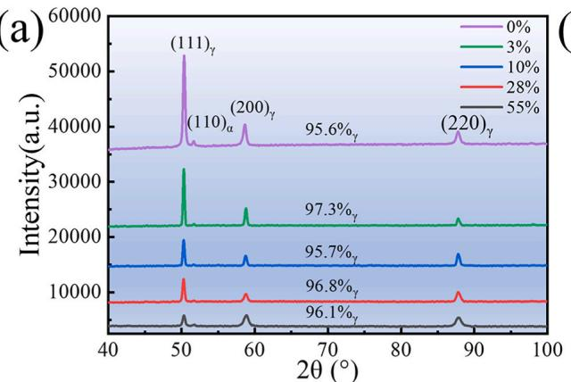

(b)  
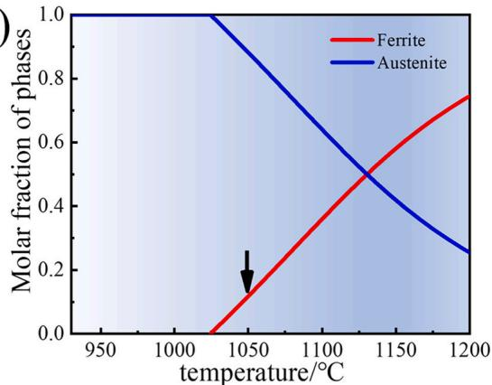  
Fig. 11. Austenite phase stability of our studied low-carbon low-density steel checked by XRD examination and phase diagram calculation. (a) XRD profiles of the specimens after different tensile strains at LNT and (b) Phase diagram calculated by Thermal-Calc software (using TCFE12 database).

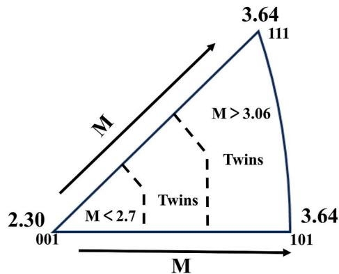  
Fig. 12. Taylor factor M distribution sketch along the TA direction in this steel.

γ and $\Delta G ^ { \gamma \to \varepsilon }$ at RT and LNT.

<table><tr><td>Temperature</td><td> $\gamma_{SFE}/mJ\cdot m^{-2}$ </td><td> $\Delta G^{z\rightarrow\varepsilon}/J\cdot mol^{-1}$ </td></tr><tr><td>RT</td><td>62.64</td><td>804.22</td></tr><tr><td>LNT</td><td>49.46</td><td>576.90</td></tr></table>

The SFE $( \gamma _ { S F E } )$ and $\Delta G ^ { \gamma \to \varepsilon }$ of the designed lightweight cryogenic steel at LNT are 49.46 mJ $\cdot \mathbf { m } ^ { - 2 }$ and $5 7 6 . 9 0 \ { \bar { J } } \ { \mathrm { m o l } } ^ { - { \bar { 1 } } } .$ . Austenitic steels with medium stacking fault energy (SFE) of 20–45 mJ⋅m− 2 are typically prone to the formation of deformation twins [2,24]. When the SFE is below 20 mJ⋅m− 2 and above 45 mJ⋅m− 2, twins are replaced by martensitic transformation and dislocations slip, respectively. Based on this calculation, the SFEs are higher than that of the requirement of the taking place of the deformation twinning.

$$
\Delta G _ {F e M n A l C} ^ {\gamma \rightarrow \varepsilon} = X _ {F e} \Delta G _ {F e} ^ {\gamma \rightarrow \varepsilon} + X _ {M n} \Delta G _ {M n} ^ {\gamma \rightarrow \varepsilon} + X _ {A l} \Delta G _ {A l} ^ {\gamma \rightarrow \varepsilon} + X _ {C} \Delta G _ {C} ^ {\gamma \rightarrow \varepsilon} + X _ {F e} X _ {M n} \Omega_ {F e M n} ^ {\gamma \rightarrow \varepsilon} + X _ {F e} X _ {A l} \Omega_ {F e A l} ^ {\gamma \rightarrow \varepsilon} + X _ {F e} X _ {C} \Omega_ {F e C} ^ {\gamma \rightarrow \varepsilon} + X _ {M n} X _ {A l} \Omega_ {M n A l} ^ {\gamma \rightarrow \varepsilon} + X _ {M n} X _ {C} \Omega_ {M n C} ^ {\gamma \rightarrow \varepsilon} + X _ {A l} X _ {C} \Omega_ {A l C} ^ {\gamma \rightarrow \varepsilon} + \Delta G _ {M a g} ^ {\gamma \rightarrow \varepsilon}\tag{4}
$$

where $X _ { i }$ is the atomic molar fraction and Ω is the mixing energy. In the current lightweight steel, the possible interactions of Mn-Al and Al-C are negligible [24]. $\Delta G _ { m a g } ^ { \gamma \to \varepsilon }$ is the magnetic transformation Gibbs energy, which can be solved by formulas (5) ⁓ (8) [53].

$$
\Delta G _ {m a g} ^ {\gamma \rightarrow \varepsilon} = \Delta G _ {m a g} ^ {\varepsilon} - \Delta G _ {m a g} ^ {\gamma}\tag{5}
$$

$$
\Delta G _ {m a g} ^ {\gamma o r \varepsilon} = R T l n (\beta^ {(\gamma o r \varepsilon)} + 1) f (\tau^ {(\gamma o r \varepsilon)})\tag{6}
$$

where R is the gas constant, T is the test temperature $( \mathrm { T } = 2 9 3$ or 77K), $T _ { N } ^ { \gamma o r \varepsilon }$ is N\`eel temperature, $\beta$ is the magnetic moment, and $f ( \tau ^ { ( \gamma o r \varepsilon ) } )$ ) is a function of the scaled N\`eel temperature $( \tau ^ { ( \gamma o r \varepsilon ) } = T / \ T _ { N } ^ { \gamma o r \varepsilon } )$

$$
f (\tau) = - \left(\frac {\tau^ {- 5}}{1 0} + \frac {\tau^ {- 1 5}}{3 1 5} + \frac {\tau^ {- 2 5}}{1 5 0 0}\right) D ^ {- 1}, i f \tau > 1\tag{7}
$$

$$
f (\tau) = 1 - \left[ \frac {7 9 \tau^ {- 1}}{1 4 0 p} + \frac {4 7 4}{4 9 7} (p ^ {- 1} - 1) \left(\frac {\tau^ {3}}{6} + \frac {\tau^ {9}}{3 1 5} + \frac {\tau^ {1 5}}{6 0 0}\right) \right] D ^ {- 1}, i f \tau \leqslant 1\tag{8}
$$

where $p = 0 . 2 8$ and $D = 2 . 3 4 $ for FCC [38]. By using thermodynamic functions and parameters listed in literature [38].

The calculated $\gamma _ { S F E }$ and $\Delta G ^ { \gamma \to \varepsilon }$ at RT and LNT were recorded in Table $4 .$ It can be seen that the SFE $( \gamma _ { S F E } )$ and $\Delta G ^ { \gamma \to \varepsilon }$ of the designed lightweight cryogenic steel at RT are $6 2 . 6 4 \mathrm { m J } \cdot \mathrm { m } ^ { - 2 }$ and $8 0 4 . 2 2 \mathrm { J } \mathrm { m o l } ^ { - 1 }$

In order to check the austenite stability of our designed low-carbon low-density steel, the phase identification is done by XRD and reexamined by the calculation of the phase diagram using thermal-Calc software. Both results are demonstrated in Fig. 11. It can be seen from Fig. 11(a) that the XRD profiles of the LNT deformed specimens do not vary with the deformation strain, showing the volume fraction of about 97 % and the existence of the BCC-phase with a small fraction. It can be seen that the volume fraction of both phase in the low-carbon lowdensity steel are very stable even when it was deformed at LNT. The stability of the phase is also proved that a small fraction of the BCC phase is presented in phase diagram as shown in Fig. 11(b).

Based on the calculation of the stacking fault energy, the phase fraction at LNT and the phase diagram as shown above, the stability of our designed low-carbon low-density steel is very high, which theoret ically cannot be deformed by deformation twinning and phase transformation from austenite to martensite. However, deformation twins are taken place both at RT and LNT, indicating a controversy between SFE prediction twins and experimental observation for our studied lowcarbon low-density steel, which is strongly dependent on the deformation strain, deformation temperature (as shown in Figs. 9 and 10), crystal orientation of the grains (as shown in Fig. 7) and will be discussed in section 4.2.

## 4.2. Deformation twinning mechanism of low-density steel with high SFE

Austenitic steel with medium SFE $( 2 0 { - } 4 5 \mathrm { m J { \cdot } m } ^ { - 2 } )$ is typically prone to the formation of deformation twins [2,24]. The spontaneous formation of deformation twinning is unlikely occurred in the low-density steel because of its high stacking fault energy, especially at room temperature [11,12,14]. Interestingly, our designed high-stacking fault energy lightweight steel, with a room temperature SFE of 62.64 mJ⋅m− 2 and a liquid nitrogen temperature SFE of 49.46 $\mathrm { m J } { \cdot } \mathrm { m } ^ { - 2 }$ , has been generated deformation twins at both room temperature and liquid nitrogen temperature. The deformation twinning from this study is demonstrated strongly dependent on the deformation temperature and crystal orientation. In order to understand this interesting point, the critical stress for deformation twinning is calculated based on different deformation principles as follows. The critical stress of twinning (σ ) can be estimated via a mean-field model [13,33].

$$
\sigma_ {t} = M \left(\frac {\Gamma}{b} + \frac {G b}{D}\right)\tag{9}
$$

where M is the Taylor factor for a randomly textured polycrystal $( M =$ 2.2 based on the Sachs models [54], M = 2.7 based on the crystal plasticity finite element model [55] and M = 3.06 based on the Taylor model under an assumption of random orientation [54] and $M = 3 . 6 4$ for both orientation of ${ < } 1 1 1 { > } / / \mathrm { T A }$ and $< 1 1 0 > / / \mathrm { T A } , \ T$ is the SFE $( 6 2 . 6 4 \mathrm { m J } { \cdot } \mathrm { m } ^ { - 2 }$ and 49.46 $\mathrm { m J } { \cdot } \mathrm { m } ^ { - 2 }$ at RT and LNT, respectively), G is the polycrystal shear modulus (68 GP [56]), b is the magnitude of the Bur gers vector of the partial dislocation (0.147 nm [33]), and D is the grain size $( \sim 1 0 . 8 ~ \mu \mathrm { m } )$ . The critical twinning stress is calculated according to Eq. (9) with different models and orientations and the results are given in Table 5. Furthermore, Table 5 also displays the critical twinning stress estimated by a Hall-Petch-type relation which is well applied in TWIP steel [57,58].

$$
\sigma_ {t} = \frac {1}{m} \left(\frac {\gamma}{b} + \frac {K}{D ^ {0 . 5}}\right)\tag{10}
$$

Where m is the average Schmid factor (0.326) [58], b is the Burgers vector $( 2 . 5 \times 1 0 ^ { - 1 0 }$ m), γ is the SFE, K is Hall-Petch constant (0.350 $\mathbf { M P a } { \cdot } \mathbf { m } ^ { 0 . 5 } ) ,$ K is estimated by linear fitting of yield strength (267, 258, 251 and 245 MPa) and $\scriptstyle { \frac { 1 } { D ^ { 0 . 5 } } } ( D$ is average grain size (8.2, 9.3, 10.8 and 12.1 μm)) using solid solution temperatures of 1000 ${ } ^ { \circ } \mathrm { C } ,$ 1025 ${ } ^ { \circ } \mathrm { C } ,$ $1 0 5 0 ^ { \circ } \mathrm { C }$ and $1 0 7 5 ^ { \circ } \mathrm { C } .$ . The $K _ { G B ( \gamma ) }$ value we estimated is very close to those of TWIP steels (0.357 $\mathrm { M P a } { \cdot } \mathrm { m } ^ { 0 . 5 }$ [59] and 0.330 MPa⋅m0.5 [60]).

It is quite interesting that the experimental critical twinning stresses at RT is about 723 MPa, which is far smaller than the critical twinning stress of 939/1153/1306/1096 MPa calculated from Sachs models/ crystal plasticity finite element model/Taylor model/Hall-Petch-type relation. Similarly, experimental critical twinning stresses at LNT is about 778 MPa, which is very close to the critical tinning stress calculated from the Sachs model, but far smaller than that of 910/1032/934 MPa calculated from crystal plasticity finite element model/Taylor model/Hall-Petch-type relation. It seems that the deformation twinning can be predicted by the Sachs model, which is mainly determined by the stacking fault energy at LNT. However, this explanation based on Sach model cannot interpret the twinning dependence on not only orientation of ${ < } 1 1 1 { > } / / \mathrm { T A }$ and ${ < } 1 1 0 { > } / / \mathrm { T A }$ but on the deformation strain. The Taylor factor M distribution sketch along the TA direction in this steel is shown in Fig. 12. It can be seen that twinning is primarily activated in high Taylor factor grains (type II and III). Therefore, it is reasonable to speculate that SFE is not the only decisive factor controlling the twinning process for our designed low-carbon low-density steel.

Estimated and experimental critical twinning stresses in this steel at both temperatures.

<table><tr><td>Temperature</td><td> $\sigma_t (M = 2.2)/MPa$ </td><td> $\sigma_t (M = 3.06)/MPa$ </td><td> $\sigma_t (M = 2.7)/MPa$ </td><td> $\sigma_t = \frac{1}{m} \left( \frac{\gamma}{b} + \frac{K}{D^{0.5}} \right)$ </td><td>Experimental $\sigma_t/MPa$ </td></tr><tr><td>RT</td><td>939</td><td>1306</td><td>1153</td><td>1096</td><td>723</td></tr><tr><td>LNT</td><td>742</td><td>1032</td><td>910</td><td>934</td><td>778</td></tr></table>

The grain orientation dependence of twinning has also been observed in TWIP steel and high carbon low aluminum lightweight steel $[ 2 8 , 4 0 , 4 1 ]$ . Deformation twinning of type III grain is commonly explained via Schmid law of twin dislocation slip [58]:

$$
\tau_ {t w / s} = \sigma \cos \Phi \cos \lambda\tag{11}
$$

where $\tau _ { t w / s }$ is twin stress/dislocation slip stress, $m _ { t w / s } =$ cos $\phi$ cos λ is the twin/dislocation slip Schmid factor, σ is the macroscopic stress in MPa, Φ is the angle between the twinning plane normal/dislocation slip plane normal and the tensile axis, and λ is the angle between the twinning shear direction/dislocation slip direction and the tensile axis. It can be observed that massive twinning is activated in the grains with orientation type III assume higher twinning Schmid factor than that of dislocation Schmid factor. However, Schmid law cannot explain the twinning behavior of type I and II grains. Only a small number of deformation twinning is formed at grain boundary in type I grains, though their Schmid factor for dislocation gliding is lower than that for deformation twinning activation. Type II grains do not obey Schmid law, but they do exhibit a large amount of deformation twinning. Gutierrez-Urrutia and Raabe attributed the deformation twinning in these unfavorably oriented grains (type II) in TWIP steel to stress concentrations induced by the impact of twins in neighboring grains [58]. However, they did not consider the influence of dislocation structures on the flow stress. In fact, type II grains, which generate twins, are scarcely impacted by the twins of adjacent grains, as displayed in Fig. 5(c1-c3).

Such twinning observed in this high SFE steel is similar to that found in Cu–10Mn (at. %) alloy [31], Fe-22Mn-x $\left( \mathbf { x } = 0 , 3 , 6 \right) \mathrm { A l } \mathbf { - } 0 . 6 \mathrm { C }$ [62] and Fe30Mn11Al1.2C(wt.%) steels [27]. Twinning cannot be activated for copper in traditional deformation processes, but the incorporation of 10 at. % Mn can induce twin formation. The authors attributed this to the presence of SRO, which promotes planar slip causing that critical twinning stress can be easily reached by stress concentration [31]. Park et al. [62] also attributed planar slip to the glide softening associated with SRO. In addition, they have qualitatively proved that the interaction between dislocation and SRO can lower the critical stress for twinning in the Fe-22Mn-x $( \mathbf { x } = 3 , 6 ) \ : \mathrm { A l } – 0 . 6 \mathrm { C }$ steel [62]. Ren et al. [27] obtained similar findings that the high flow stress induced by dislocation planar slip and the reduction in critical twinning stress due to the presence of SRO may be the causes of the twinning phenomenon. In current work, the microstructure contains SRO (Fig. 1(d)). Furthermore, no typical mechanical antiphase domain boundaries (APBs) bounded by two partials are observed in this steel. The short-range order in our designed steel is similar to that of Fe-22Mn-x (x = 3,6) Al-0.6C steel [62]. Thus, the short-range order in our steel may reduce the stacking fault energy and critical twinning stress rather than increasing them. Type II and III grains form cell block walls with planar slip character istics, which lead to stress concentration required for twinning nucleation and growth (Fig. 7(g–k)). Type I grains form uniform dislocation cells. which are not conducive to the formation of the high stress required for twinning growth. The shear stress arising from stress con centration at these cell block walls significantly exceeds the macroscopic shear stress. The homogeneous dislocation cell structure in type I grains effectively disperses the macroscopic shear stress. Thus, type II and III grains, which are not favorable for twin activation, paradoxically generate a substantial number of twins. Conversely, type I grains, which are conducive to twin initiation, only produce a small number of twins at the grain boundaries, which are governed by the twin nucleation stress. Therefore, the high stacking fault energy (SFE) twinning and its orientation dependence are mainly attributed to the stress concentration induced by planar dislocation substructure.

## 4.3. Multistage hardening behaviors and flow stress contribution

As it is shown in Fig. 2(b), the work hardening rate in stage A is sharply decreased with increasing of tensile strain at both RT and LNT. This sharp decreasing phenomenon could be easily interpreted by the dislocation accumulation and recovery [30,61]. However, the work hardening rate at LNT is much higher than that at RT, which could be attributed to the increased lattice friction stress with decreasing of deformation temperature as reported found in TWIP steel [30]. This explanation is consistent with our calculation that the lattice friction stresses are 143 MPa for RT deformation but 389 MPa for LNT defor mation as revealed in subsequent calculations.

Stage B hardening at LNT is characterized by almost constant in the strain hardening rate. For low aluminum, high carbon lightweight steels, the Taylor lattice observed at low strains is ascribed to the solute carbon effect on diminishing the frequency of dislocation cross-glide [41]. Fig. 8 (a–c) shows that the cross-slip of dislocations is notably enhanced, which diminishes the propensity for the formation of a Taylor lattice. Therefore, the formation of a Taylor lattice is not favored in the designed lightweight steel. Consequently, the approximately constant strain hardening rate exhibited during this phase cannot be explained by the Taylor lattice. At 3 % engineering strain, distinct stacking faults are produced at the annealed twin boundaries (Fig. 8(b)). Upon reaching 10 % engineering strain, pronounced deformation twins are evident at the annealed twin boundaries (Fig. 8(c)), a result of the previously formed stacking faults (Fig. 8(b)). As detailed in Section 4.2, the true stress at 10 % engineering strain has surpassed the calculated lower bound of the critical twinning stress. Furthermore, during this phase, an increasing trend in the {111} ${ < } 1 1 2 { > } _ { \eta }$ Schmid factor is observed, which augments the twinning partition stress and favors twin activation. Consequently, the nearly constant high strain hardening rate observed in this stage is primarily attributed to the activation of twin at the annealed twin boundary.

Stage C is characterized by a continuous decrease in strain hardening rate associated with the refinement of the dislocation substructure. As discussed in Section 4.2, typical dislocation cells are formed in type I grains, while dislocation blocks are produced in Type II and Type III grains. This hardening mechanism, driven by the refinement of the dislocation substructure, manifests as a sustained reduction in the strain hardening rate [41]. Although this stage has reached the lower limit of critical stress under liquid nitrogen condition, the continuous decrease in the {111} ${ < } 1 1 2 > ~ \forall$ Schmid factor results in less active twinning development. Consequently, the strain hardening behavior in this stage is primarily governed by the refinement of the dislocation substructure.

During the initial phase of Stage D, the true stress at 38 % engineering strain under liquid nitrogen temperature (LNT), reaching 1280 MPa, has substantially surpassed the critical twinning stress of Taylor model. As a result, primary twins are substantially activated under these elevated stress conditions. Upon further straining to 55 %, the primary deformation twins are further enhanced, and the secondary twins are also significantly activated. The twin boundaries serve as effective barriers to dislocation motion [28,30,33], significantly contributing to the sustained hardening response observed during Stage D. Therefore, the continuous strain hardening in Stage D is ascribed to the extensive activation of primary and secondary twins.

It is widely known that during the deformation process, twin boundary effectively acted as barriers to dislocation glide by reducing their mean free path, known as the “dynamic Hall Petch effect” [28,30, 33,59]. However, Liang and Zhi et al. [63,64] demonstrated that dislocation evolution dominated the work hardening rate of TWIP steels instead of twins. Tang et al. [30] held that dislocation hardening and TWIP effects worked synergistically. Therefore, it is necessary to further clarify the contribution of twins and dislocations to work hardening. The ferrite content constitutes about 3 %. Therefore, the flow stress is estimated by Eq. (12):

$$
\sigma_ {m o d} = 0. 9 7 \sigma_ {m o d (\gamma)} + 0. 0 3 \sigma_ {m o d (\alpha)}\tag{12}
$$

The flow stress of $\sigma _ { m o d ( \gamma ) }$ and $\sigma _ { m o d ( \alpha ) }$ after yielding can be predicted by Eqs. (13) and (14) [30,40,58]:

$$
\sigma_ {m o d (\gamma)} = \sigma_ {f (\gamma)} + \sigma_ {G B (\gamma)} + \sigma_ {t w i n (\gamma)} + \sigma_ {d i s (\gamma)} ^ {\varepsilon} - \sigma_ {d i s (\gamma)} ^ {0}\tag{13}
$$

$$
\sigma_ {m o d (\alpha)} = \sigma_ {Y S (\alpha)} + \sigma_ {d i s (\alpha)} ^ {\varepsilon} - \sigma_ {d i s (\alpha)} ^ {0}\tag{14}
$$

where $\sigma _ { m o d ( \gamma ) }$ is the predicted flow stress of austenite, $\sigma _ { f ( \gamma ) }$ is austenite lattice friction stress, $\sigma _ { G B ( \gamma ) }$ is austenite initial grain boundary strengthening contribution, $\sigma _ { t w i n ( \gamma ) }$ is austenite deformation twinning contribution, $\sigma _ { d i s ( \gamma o r \alpha ) } ^ { \varepsilon }$ and $\sigma _ { d i s ( \gamma o r \alpha ) } ^ { 0 }$ are the strengthening contribution from dislocations at ε strain and 0 strain, $\sigma _ { Y S ( \alpha ) }$ is the ferrite yield strength.

Grain-boundary strengthening is calculated with the classical Hall-Petch formula (Eq. (15)) [65,66], the Hall-Petch coefficient $K _ { G B ( \gamma ) }$ (0.350 MPa m0.5) is used. Initial grain boundary strengthening is about 108 MPa.

$$
\sigma_ {G B (\gamma)} = K _ {G B (\gamma)} d ^ {- 0. 5}\tag{15}
$$

Lattice friction stress is calculated by Eq. (16) [30], in which $\sigma _ { Y S ( \gamma ) }$ is yield strength. The lattice friction stresses at RT and LNT are 143 MPa and 389 MPa, respectively.

$$
\sigma_ {f (\gamma)} = \sigma_ {Y S (\gamma)} - \sigma_ {G B (\gamma)}\tag{16}
$$

The contribution of twin stress can be described by the following equation $[ 3 0 , 6 7 ]$ , where F is the volume fraction of twins in type II and III grains, 0.8 is the average fraction of type II and III grains at 55 % engineering strain, l is the average twin spacing, $K _ { t w i n ( \gamma ) }$ is the Hall-Petch coefficient of twinning (0.350 MPa⋅m0.5 [58]).

$$
\Delta \sigma_ {t w i n (\gamma)} = 0. 8 F K _ {t w i n (\gamma)} l ^ {- 0. 5}\tag{17}
$$

F in Eq. (16) can be estimated by the stereological analysis of Fullman (Eq. (18)) [30,68], where e is the average thickness of twins. The twin boundary volume fraction is usually estimated by TEM [30,68,69].

$$
\frac {1}{l} = \frac {1}{2 e} \frac {F}{1 - F}\tag{18}
$$

Based on TEM image, l and e were measured to be 182 nm and 72 nm, respectively, when engineering strain is 55 % at LNT. Utilizing Eqs. (17) and (18), twin strengthening contribution is calculated to be 290 MPa.

The dislocation hardening $( \sigma _ { d i s ( \gamma o r \alpha ) } )$ can be calculated by Taylor equation (Eq. (19)) [70], where M is the Taylor factor, α is a constant used to measure the interaction strength of dislocations, G is the shear modulus, b is the magnitude of the Burgers vector, and ρ is the dislocation density. For ferrite, M is 2.8, α is 0.2, G is 80.7 GPa, b is 0.248 nm [71,72]. Due to the ferrite content being only about 3 %, it is not possible to estimate its dislocation density using the XRD method. Therefore, ferrite dislocation density is estimated using $\rho ^ { G N D }$ (Table 3) and contribution of ferrite dislocation strengthening to the flow stress is displayed in Table 6.

The strengthening contribution of $\sigma _ { d i s }$ and $\sigma _ { t w i n }$ strengthening to the flow stress.

<table><tr><td>Engineering strain (%)</td><td>3.0</td><td>10.0</td><td>20.0</td><td>28.0</td><td>38.0</td><td>55.0</td></tr><tr><td>True strain (%)</td><td>3.0</td><td>9.5</td><td>18.2</td><td>24.7</td><td>32.2</td><td>43.8</td></tr><tr><td> $\sigma_{dis(\gamma)}$ , (RT), MPa</td><td>48</td><td>207</td><td>347</td><td>434</td><td>474</td><td>-</td></tr><tr><td> $\sigma_{dis(\alpha)}$ , (RT-GND), MPa</td><td>1</td><td>4</td><td>6</td><td>8</td><td>8</td><td>-</td></tr><tr><td> $\sigma_{dis(\gamma)}$ , (LNT), MPa</td><td>58</td><td>240</td><td>379</td><td>469</td><td>504</td><td>646</td></tr><tr><td> $\sigma_{dis(\alpha)}$ , (LNT-GND), MPa</td><td>2</td><td>4</td><td>6</td><td>7</td><td>8</td><td>9</td></tr><tr><td> $\sigma_{twin(\gamma)}$ , (LNT), MPa</td><td>-</td><td>-</td><td>-</td><td>-</td><td>-</td><td>290</td></tr></table>

Table 7  
σ at two strain levels using different α values at RT.

<table><tr><td> $\alpha$ </td><td>Engineering strain (%)</td><td> ${\sigma }_{\text{diff }}$ (MPa)</td></tr><tr><td>0.136</td><td>10</td><td>152</td></tr><tr><td>0.136</td><td>20</td><td>280</td></tr><tr><td>0.26</td><td>10</td><td>88</td></tr><tr><td>0.26</td><td>20</td><td>146</td></tr><tr><td>0.40</td><td>10</td><td>15</td></tr><tr><td>0.40</td><td>20</td><td>25</td></tr></table>

$$
\sigma_ {d i s (\gamma o r \alpha)} = M \alpha G b \rho^ {0. 5}\tag{19}
$$

For austenite, M is 3.06, α is 0.4 [63], G is 68 GPa [56], b is 0.26 nm, and the dislocation density ρ is shown in Table 3. It should be noted that different α values have been used for calculation, such as 0.136 [64], 0.26 [37,73], and 0.4 [63]. Therefore, different α Values of 10 % and 20 % engineering strain at RT are verified by Eqs. 18 and 19 in our study, as shown in Table 7. σ is the difference between the experimental measured stress $( \sigma _ { e x p } )$ and modelling stress $( \sigma _ { m o d } )$ , which can be calculated by Eq. (20) [30]:

$$
\sigma_ {d i f f} = | \sigma_ {e x p} - \sigma_ {m o d} |\tag{20}
$$

According to the results in Tables 7 and it is evident that when α is $0 . 4 ,$ the $\sigma _ { d i f f }$ is the smallest among the three commonly used α values. The contributions of $\sigma _ { t w i n } ,$ , and $\sigma _ { d i s }$ to flow stress calculated with the above method are shown in Table 6. It can be seen that the contribution of a small amount of ferrite to the flow stress is very minimal. less than 10 MPa. Therefore, in the calculation of the flow stress, the contribution of ferrite is neglected. The flow stress is calculated based on the fully austenitic structure,as shown in Fig. 13(a and b). It can be observed that the calculated contributions of dislocations and twins to the flow stress are in excellent agreement with the measured values (Fig. 13(a and b)). At room temperature, only a small number of deformation twins are generated at high strains; hence, deformation is primarily controlled by dislocation hardening, which is the main driving force for strain hard ening. In contrast, under liquid nitrogen conditions, a synergistic effect between dislocation hardening and twinning mechanisms is observed (the shaded area in Fig. 13(b) represents the contribution of twins). with both contributing to the material’s strain hardening behavior. In sum mary, this study provided a valuable insight into the TWIP effect and dislocation substructure inducing complex deformation mechanisms in cryogenic lightweight steels.

## 5. Conclusion

In this research, the low-carbon low-density steel of Fe-35Mn-6Al 0.1C (wt.%) was designed and its microstructure evolution and mechanical response at both RT and LNT were examined systematically. Different from the extensively studied low-density steel with a high carbon content around $1 . 0 \% ,$ massive deformation twinning was found not only in the tensile deformation mode but in the impact deformation mode, which gives the combination of excellent strength, ductility and V-notch impact toughness at both RT and LNT. Based on the study of the microstructure evolution at both RT and LNT, the factors affecting the deformation twinning, including SFE, temperature, crystallographic orientation, Schmid factor, and planar glide were analyzed thoroughly. The main conclusions can be summarized as follows.

(a)  
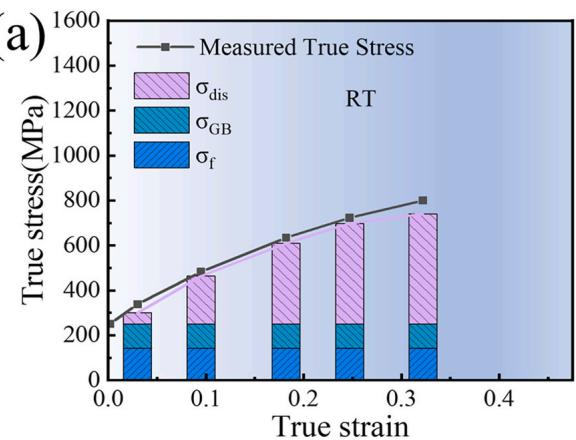

1 In present low-carbon low-density steel, a two-stage deformation mechanism is observed for RT deformation and four-stage deformation mechanism is revealed for LNT deformation. Its RT behavior is dominated by dislocation planar slip, cells or cell blocks forming and refinement, followed with twinning occurring just before the necking at RT. However, its LNT deformation behavior is found to be started with the dislocation planar slip firstly, primary twinning secondly, cells or cell blocks forming and refinement and finally second deformation twinning at LNT, indicating a strong deformation twinning dependence on deformation temperature and deformation strain.

2. Regarding to the deformation twinning, the type III grains with orientation ${ < } 1 1 1 { > } / / \mathrm { T A }$ direction are more inclined to develop double orientation twins. But few deformed twinning is activated in type I grains with orientation ${ < } 0 0 1 { > } / / \mathrm { T A }$ and the type II grains with orientation far from type III and I are more susceptible to the formation of single orientation twins. Regarding to the dislocation substructure, the type III grains are characterized by a tendency to form double dislocation glide traces. The type I grains are distinguished by the formation of typical dislocation cells. The type II grains exhibit a preference for the development of single dislocation glide traces.

3. The working hardening behaviors and strengthening contribution are strongly affected by the microstructure evolution at both RT and LNT. Multiple strain hardening mechanisms of the lightweight cryogenic steel were observed at LNT. It is revealed that an almost constant hardening rate was obtained in the early stage of deformation due to the primary deformation twinning. Then a continuous decrease of the hardening rate resulting from the heavily activated cross slip. For high strain, a constant work hardening is reached again due to the extensive activation of primary twinning and secondary twinning, which in turn facilitates multi-stage strain hardening. During deformation at room temperature, dislocation hardening but not the deformation twinning is the principal contributor to strain hardening.

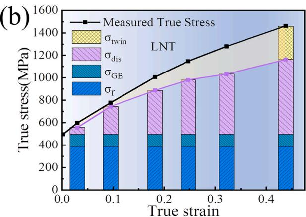  
Fig. 13. Contributions of various strengthening mechanisms to flow stress at different temperatures: (a) Room temperature (RT). (b) Liquid nitrogen temperature (LNT).

4. An excellent combination of the strength, ductility and impact toughness is obtained in the designed low-carbon low-density steel. It is shown that yield strength, tensile strength, ductility and impact tough are 251 MPa, 580 MPa, 50 % and 331J at RT, and 497 MPa, 945 MPa, 75.5 % and 254J at LNT, which is superior than that not only the conventional 9Ni-steel due to both excellent mechanical properties but the low-cost, but better than that of the conventional austenitic steel due to it low-density. Thes advantages make the designed low-carbon low-density steel of Fe–35Mn–6Al–0.1C (wt.%) to be one of the promising candidates of the cryogenic steel in the future.

5. The high stacking fault energy (SFE) twinning and its orientation dependence are mainly attributed to the stress concentration induced by planar dislocation substructure. Type II and III grains form cell block walls with planar slip characteristics, which led to stress concentration required to activate twinning. Type I grains formed uniform dislocation cells, which are not conducive to the formation of high stress required to activate twinning. The interaction between dislocation and SRO may lower the critical twinning stress and promote planar slip of dislocations.

## CRediT authorship contribution statement

Qingfeng Kang: Writing – original draft, Methodology, Formal analysis, Data curation. Zexi Zhang: Validation, Methodology, Investigation. Ziyuan Gao: Supervision, Methodology, Investigation. Cunyu Wang: Software, Resources, Data curation. Jianxiong Liang: Software, Resources, Project administration. Zhengdong Liu: Validation, Resources, Methodology. Yuqing Weng: Resources, Methodology, Conceptualization. Wenquan Cao: Writing – review & editing, Supervision, Resources, Methodology, Funding acquisition, Conceptualization.

## Declaration of competing interest

The authors declare that they have no known competing financial interests or personal relationships that could have appeared to influence the work reported in this paper.

## Acknowledgement

This research is supported by the Natural Nature Science Foundation of China with granted item number of 51871062 and 51371052.

## Data availability

Data will be made available on request.

## References

[1] H. Wang, C. Wang, J. Liang, A. Godfrey, Y. Wang, Y. Weng, W. Cao, Effect of alloying content on microstructure and mechanical properties of Fe–Mn–Al–C lowdensity steels, Mater. Sci. Eng., A 886 (2023) 145675, https://doi.org/10.1016/j. msea.2023.145675.

[2] H. Wang, Z. Cao, Z. Gao, C. Wang, J. Liang, A. Godfrey, L. Zhang, G. Wu, W. Cao, Synergetic strengthening from dynamic slip band-grain boundary interaction in a low-density FeMnAlC steel, Mater. Sci. Eng., A 862 (2023) 144498, https://doi. org/10.1016/j.msea.2022.144498.

[3] K.H. Yang, W.K. Choo, Evidence of carbon ordering and morphology change in a cubic carbide phase, Phil. Mag. Lett. 62 (1990) 221–226, https://doi.org/10.1080/ 09500839008215062.

[4] F. Yang, R. Song, Y. Li, T. Sun, K. Wang, Tensile deformation of low density duplex Fe–Mn–Al–C steel, Mater. Des. 76 (2015) 32–39, https://doi.org/10.1016/j. matdes.2015.03.043

[5] S. Chen, R. Rana, A. Haldar, R.K. Ray, Current state of Fe-Mn-Al-C low density steels, Prog. Mater. Sci. 89 (2017) 345–391, https://doi.org/10.1016/j. pmatsci,2017.05.002.

[6] S. Bai, Y. Chen, X. Liu, H. Lu, P. Bai, D. Li, Z. Huang, J. Li, Research status and development prospect of Fe–Mn–C–Al system low-density steels, J. Mater. Res. Technol. 25 (2023) 1537–1559, https://doi.org/10.1016/j.jmrt.2023.06.037.

[7] L. Bartlett, D. Van Aken, High manganese and aluminum steels for the military and transportation industry, J. Miner. Met. Mater. Soc. 66 (1989) 1770–1784, https:/ doi.org/10.1007/s11837-014-1068-y, 2014.

[8] L. Zhang, R. Song, C. Zhao, F. Yang, Work hardening behavior involving the substructural evolution of an austenite–ferrite Fe–Mn–Al–C steel, Mater. Sci. Eng., A 640 (2015) 225–234, https://doi.org/10.1016/j.msea.2015.05.108.

[9] S.S. Sohn, B.-J. Lee, S. Lee, N.J. Kim, J.-H. Kwak, Effect of annealing temperature on microstructural modification and tensile properties in 0.35 C-3.5 Mn–5.8 Al lightweight steel, Acta Mater. 61 (2013) 5050–5066, https://doi.org/10.1016/j. actamat.2013.04.038.

[10] R. Rana, C. Liu, R.K. Ray, Low-density low-carbon Fe–Al ferritic steels, Scripta Mater. 68 (2013) 354–359, https://doi.org/10.1016/j.scriptamat.2012.10.004.

[11] J.D. Yoo, S.W. Hwang, K.-T. Park, Origin of extended tensile ductility of a Fe-28Mn-10Al-1C steel, Metall. Mater. Trans. A 40 (2009) 1520–1523, https://doi. org/10.1007/s11661-009-9862-9.

[12] G. Frommeyer, U. Brüx, Microstructures and mechanical properties of high strength Fe-Mn-Al-C light-weight TRIPLEX steels, Steel Res. Int. 77 (2006) 627–633, https://doi.org/10.1002/srin.200606440

[13] Z. Wang, W. Lu, F. An, M. Song, D. Ponge, D. Raabe, Z. Li, High stress twinning in a compositionally complex steel of very high stacking fault energy, Nat. Commun. 13 (2022), https://doi.org/10.1038/s41467-022-31315-2.

[14] E. Welsch, D. Ponge, S.M. Hafez Haghighat, S. Sandlobes,¨ P. Choi, M. Herbig, S. Zaefferer, D. Raabe, Strain hardening by dynamic slip band refinement in a high Mn lightweight steel, Acta Mater. 116 (2016) 188–199, https://doi.org/10.1016/j. actamat.2016.06.037.

[15] P. Ren, X.P. Chen, C.Y. Wang, Y.X. Zhou, W.Q. Cao, Q. Liu, Evolution of microstructure, texture and mechanical properties of Fe–30Mn–11Al–1.2C low density steel during cold rolling, Mater. Char. 174 (2021) 111013, https://doi.org/ 10.1016/imatchar2021.111013

[16] F. Wang, M. Song, M.N. Elkot, N. Yao, B. Sun, M. Song, Z. Wang, D. Raabe, Shearing brittle intermetallics enhances cryogenic strength and ductility of steels, Science 384 (2024) 1017–1022, https://doi.org/10.1126/science.ado2919.

[17] Y.F. An, X.P. Chen, L. Mei, X.N. Tan, P. Ren, X.Y. Zhang, W.Q. Cao, Overcoming the strength-ductility trade-off dilemma in austenitic lightweight steel via stepwise controllable intragranular dual nanoprecipitation, Mater. Sci. Eng., A 908 (2024) 146773, https://doi.org/10.1016/j.msea.2024.146773.

[18] J. Chen, J. Ren, Z. Liu, Deformation microstructures as well as strengthening and toughening mechanisms of low-density high Mn steels for cryogenic applications J. Mater. Res. Technol. 13 (2021) 947–961, https://doi.org/10.1016/j. jmrt.2021.05.018.

[19] Z. Gao, Q. Kang, X. An, H. Wang, C. Wang, W. Cao, Enhanced mechanical properties of a Fe-Mn-Al-C austenitic low-density steel by increasing hot-rolling reduction, Mater. Char. 204 (2023) 113237, https://doi.org/10.1016/j. matchar.2023.113237

[20] I. Gutierrez-Urrutia. A. Shibata, Effect of deformation temperature on strain localization phenomena in an austenitic Fe-30Mn-6.5Al-0.3C low-density steel. Acta Mater. (2023) 119566, https://doi.org/10.1016/j.actamat.2023.119566.

[21] H. Zhi, J. Li, W. Li, M. Elkot, S. Antonov, H. Zhang, M. Lai, Simultaneousl enhancing strength-ductility synergy and strain hardenability via Si-alloying in medium-Al FeMnAlC lightweight steels, Acta Mater. 245 (2023) 118611, https:// doi.org/10.1016/i.actamat.2022.118611.

[22] W. Song, T. Ingendahl, W. Bleck, Control of strain hardening behavior in high-Mn austenitic steels, Acta Metall. Sin. 27 (2014) 546–556, https://doi.org/10.1007/ s40195-014-0084-9

[23] W. Song, W. Zhang, J. von Appen, R. Dronskowski, W. Bleck, κ-Phase formation in Fe-Mn-Al-C austenitic steels, Steel Res. Int, 86 (2015) 1161–1169, https://doi.org 10.1002/srin 201400587

[24] A. Saeed-Akbari, J. Imlau, U. Prahl, W. Bleck, Derivation and variation in composition-dependent stacking fault energy maps based on subregular solution model in high-manganese steels. Metall, Mater, Trans. A 40 (2009) 3076–3090 https://doi org/10.1007/s11661-009-0050-8

[25] D. Kuhlmann-Wilsdorf, Q: dislocations structures — how far from equilibrium? A: very close indeed, Mater. Sci. Eng., A 315 (2001) 211–216, https://doi.org/ 10.1016/s0921-5093(01)01204-7

[26] V. Gerold, H.P. Karnthaler, On the origin of planar slip in f.c.c. alloys, Acta Metall. 37 (1989) 2177–2183, https://doi.org/10.1016/0001-6160(89)90143-0.

[27] P. Ren, X.P. Chen, M.J. Yang, S.M. Liu, W.Q. Cao, Effect of early stage of κ-carbides precipitation on tensile properties and deformation mechanism in high Mn-Al–C austenitic low-density steel, Mater. Sci. Eng., A 857 (2022) 144132, https://doi

[28] H. Beladi, I.B. Timokhina, Y. Estrin, J. Kim, B.C. De Cooman, S.K. Kim, Orientation dependence of twinning and strain hardening behaviour of a high manganese twinning induced plasticity steel with polycrystalline structure. Acta Mater. 59 (2011) 7787–7799, https://doi.org/10.1016/j.actamat.2011.08.031.

[29] Y. Wang, Y. Zhang, A. Godfrey, J. Kang, Y. Peng, T. Wang, N. Hansen, X. Huang, Cryogenic toughness in a low-cost austenitic steel, Commun Mater 2 (2021), https://doi.org/10.1038/s43246-021-00149-8

[30] L. Tang, L. Wang, M. Wang, H. Liu, S. Kabra, Y. Chiu, B. Cai, Synergistic deformation pathways in a TwIP steel at crvogenic temperatures: in situ neutron diffraction. Acta Mater, 200 (2020) 943–958, https://doi,org/10.1016/j. actamat.2020.09.075.

[31] X. Ma, J. Chen, Y. Liu, X. Wang, S. Huang, Z. Chen, Effect of short-range order on microstructure. texture and strain hardening of cold drawn Cu-10 at.%Mn alloy Mater, Char. 135 (2018). 32–39 https://doi org/10.1016/i matchar 2017.11.024

[32] I. Kalashnikov, O. Acselrad, A. Shalkevich, L.C. Pereira, Chemical composition optimization for austenitic steels of the Fe-Mn-Al-C system, J. Mater. Eng. Perform. 9 (2000) 597–602, https://doi.org/10.1361/105994900770345430.

[33] B.C. De Cooman, Y. Estrin, S.K. Kim, Twinning-induced plasticity (TWIP) steels, Acta Mater. 142 (2018) 283–362, https://doi.org/10.1016/j.actamat.2017.06.046.

[34] Y.G. Kim, Y.S. Park, J.K. Han, Low temperature mechanical behavior of microalloved and controlled-rolled Fe-Mn-Al-C-X allovs. Metall. Trans. A 16 (1985) 1689–1693, https://doi.org/10.1007/bf02663026.

[35] J.H. Hwang, T.T.T. Trang, O. Lee, G. Park, A. Zargaran, N.J. Kim, Improvement of strength – ductility balance of B2-strengthened lightweight steel, Acta Mater. 191 (2020) 1–12, https://doi.org/10.1016/j.actamat.2020.03.022.

[36] G.K. Williamson, R.E. Smallman III, Dislocation densities in some annealed and cold-worked metals from measurements on the X-ray debye-scherrer spectrum, Phil. Mag. 1 (1956) 34–46. https://doi.org/10.1080/14786435608238074

[37] G. Dini, R. Ueji, A. Najafizadeh, S.M. Monir-Vaghefi, Flow stress analysis of TWIP steel via the XRD measurement of dislocation density, Mater. Sci. Eng., A 527 (2010) 2759–2763, https://doi.org/10.1016/i.msea.2010.01.033

[38] J.D. Yoo, K.-T. Park, Microband-induced plasticity in a high Mn–Al–C light steel, Mater. Sci. Eng., A 496 (2008).

[39] W.K. Choo, J.H. Kim, J.C. Yoon, Microstructural change in austenitic Fe-30.0wt% Mn-7.8wt%Al-1.3wt%C initiated by spinodal decomposition and its influence on mechanical properties, Acta Mater. 45 (1997) 4877–4885, https://doi.org/ 10.1016/s1359-6454(97)00201-2.

[40] I. Gutierrez-Urrutia, D. Raabe, Dislocation and twin substructure evolution during strain hardening of an Fe–22wt.% Mn–0.6wt.% C TWIP steel observed by electron channeling contrast imaging, Acta Mater. 59 (2011) 6449–6462, https://doi.org/ 10.1016/j.actamat.2011.07.009.

[41] I. Gutierrez-Urrutia, D. Raabe, Multistage strain hardening through dislocation substructure and twinning in a high strength and ductile weight-reduced Fe–Mn–Al–C steel, Acta Mater. 60 (2012) 5791–5802, https://doi.org/10.1016/j. actamat.2012.07.018

[42] J. Wang, J. Zou, H. Yang, X. Dong, P. Cao, X. Liao, Z. Liu, S. Ji, Ultrastrong and ductile (CoCrNi)94Ti3Al3 medium-entropy alloys via introducing multi-scale heterogeneous structures, J. Mater. Sci. Technol. 135 (2023) 241–249, https://doi. org/10.1016/j.jmst.2022.06.048.

[43] L. Gutierrez-Urrutia. A. Shibata. K. Tsuzaki, Microstructural study of microbands ir a Fe-30Mn-6.5Al-0.3C low-density steel deformed at cryogenic temperature by combined electron channeling contrast imaging and electron backscatter diffraction, Acta Mater. 233 (2022) 117980, https://doi.org/10.1016/j. actamat.2022.117980.

[44] C. Zhang, D. Juul Jensen, T. Yu, Microstructure and texture evolution during cold rolling of 316L, stainless steel, Metall, Mater, Trans. A 52 (2021) 4100–4111. https://doi.org/10.1007/s11661-021-06367-6.

[45] O. Gr¨assel, L. Krüger, G. Frommeyer, L.W. Meyer, High strength Fe–Mn–(Al, Si) TRIP/TWIP steels development — properties — application, Int. J. Plast. 16 (2000) 1391-1409 https://doi org/10.1016/s0749-6419(00)00015-2

[46]. S.S, Sohn. S. Hong, J. Lee, B.-C. Suh. S.-K. Kim. B.-J. Lee, N.J. Kim, S. Lee, Effects of Mn and Al contents on cryogenic-temperature tensile and Charpy impact properties in four austenitic high-Mn steels, Acta Mater. 100 (2015) 39–52, https://doi.org/ 10.1016/i.actamat.2015.08.027.

[47] R.K. You, P.-W. Kao, D. Gan, Mechanical properties of Fe-30Mn-10Al-1C-1Si alloy, Mater. Sci. Eng., A 117 (1989) 141–148, https://doi.org/10.1016/0921-5093(89) 90095-6.

[48] K.T. Luo. P.-W. Kao. D. Gan. Low temperature mechanical properties of Fe–28Mn–5Al–1C alloy, Mater. Sci. Eng., A 151 (1992) L15–L18, https://doi.org/ 10.1016/0921-5093(92)90195-7.

[49] C. Zheng, W. Yu, Effect of low-temperature on mechanical behavior for an AISI 304 austenitic stainless steel, Mater. Sci. Eng., A 710 (2018) 359–365, https://doi.org/ 10.1016/i.msea.2017.11.003

[50] D. Li, Y. Zhang, The ultrahigh charpy impact toughness of forged AlxCoCrFeNi high entropy alloys at room and cryogenic temperatures, Intermetallics 70 (2016) 24–28, https://doi.org/10.1016/j.intermet.2015.11.002.

[51] J.R. Strife, D.E. Passoja, The effect of heat treatment on microstructure and cryogenic fracture properties in 5Ni and 9Ni steel, Metall. Trans. A 11 (1980) 1341–1350. https://doi.org/10.1007/bf02653488

[52] S. Curtze, V.-T. Kuokkala, Dependence of tensile deformation behavior of TWIP steels on stacking fault energy, temperature and strain rate, Acta Mater. 58 (2010) 5129–5141. https://doi.org/10.1016/i.actamat.2010.05.049.

[53] S. Curtze, V.-T. Kuokkala, A. Oikari, J. Talonen, H. H¨anninen, Thermodynamic modeling of the stacking fault energy of austenitic steels, Acta Mater. 59 (2011) 1068–1076, https://doi.org/10.1016/j.actamat.2010.10.037.

[54] R. Asaro, V. Lubarda, Mechanics of Solids and Materials, Cambridge University Press. 2006, https://doi.org/10.1017/cbo9780511755514.

[55] Y. Tadano, M. Kuroda, H. Noguchi, Quantitative re-examination of Taylor model for FCC polycrystals, Comput. Mater. Sci. 51 (2012) 290–302, https://doi.org 10.1016/i.commatsci.2011.07.024.

[56] Z. Wang, W. Lu, H. Zhao, C.H. Liebscher, J. He, D. Ponge, D. Raabe, Z. Li, Ultrastrong lightweight compositionally complex steels via dual-nanoprecipitation, Sci. Adv. 6 (2020) eaba9543, https://doi.org/10.1126/sciadv.aba9543.

[57] M.A. Meyers, O. Vohringer,¨ V.A. Lubarda, The onset of twinning in metals: a constitutive description, Acta Mater. 49 (2001) 4025–4039, https://doi.org/ 10.1016/s1359-6454(01)00300-7

[58] I. Gutierrez-Urrutia, S. Zaefferer, D. Raabe, The effect of grain size and grain orientation on deformation twinning in a Fe–22wt.% Mn–0.6wt.% C TWIP steel, Mater. Sci. Eng., A 527 (2010) 3552–3560, https://doi.org/10.1016/j. msea.2010.02.041.

[59] F. de las Cuevas, M. Reis, A. Ferraiuolo, G. Pratolongo, L.P. Karjalainen, J. Alkorta, J. Gil Sevillano, Hall-petch relationship of a TWIP steel, KEM 423 (2009) 147–152. https://doi.org/10.4028/www.scientific.net/kem.423.147.

[60] K.M. Rahman, V.A. Vorontsov, D. Dye, The effect of grain size on the twin initiation stress in a TWIP steel, Acta Mater. 89 (2015) 247–257, https://doi.org/10.1016/j. actamat.2015.02.008.

[61] U.F. Kocks, H. Mecking, Physics and phenomenology of strain hardening: the FCC case, Prog. Mater. Sci. 48 (2003).

[62] K.-T. Park, K.G. Jin, S.H. Han, S.W. Hwang, K. Choi, C.S. Lee, Stacking fault energy and plastic deformation of fully austenitic high manganese steels: effect of A addition, Mater. Sci. Eng., A 527 (2010) 3651–3661, https://doi.org/10.1016/j. msea.2010.02.058.

[63] H. Zhi, C. Zhang, S. Antonov, H. Yu, T. Guo, Y. Su, Investigations of dislocation type evolution and strain hardening during mechanical twinning in Fe-22Mn-0.6C twinning-induced plasticity steel, Acta Mater. 195 (2020) 371–382, https://doi. org/10.1016/j.actamat.2020.05.062.

[64] Z.Y. Liang, Y.Z. Li, M.X. Huang, The respective hardening contributions of dislocations and twins to the flow stress of a twinning-induced plasticity steel, Scripta Mater. 112 (2016) 28–31, https://doi.org/10.1016/j. scriptamat.2015.09.003.

[65] H. Conrad, G. Schoeck, Cottrell locking and the flow stress in iron, Acta Metall. 8 (1960) 791–796, https://doi.org/10.1016/0001-6160(60)90175-9.

[66] A. Etienne, V. Massardier-Jourdan, S. Cazottes, X. Garat, M. Soler, I. Zuazo, X. Kleber. Ferrite effects in Fe-Mn-Al-C triplex steels. Metall and Mat Trans A 45 (2013) 324–334. https://doi.org/10.1007/s11661-013-1990-6.

[67] R.S. Ganji, P. Sai Karthik, K. Bhanu Sankara Rao, K.V. Rajulapati, Strengthening mechanisms in equiatomic ultrafine grained AlCoCrCuFeNi high-entropy alloy studied by micro-and nanoindentation methods, Acta Mater. 125 (2017) 58-68. https://doi.org/10.1016/i.actamat.2016.11.046

[68] R.L. Fullman, Measurement of particle sizes in opaque bodies, J. Miner. Met. Mater. Soc. 5 (1989) 447–452, https://doi.org/10.1007/bf03398971, 1953.

[69] P. Zhou, Z.Y. Liang, R.D. Liu, M.X. Huang, Evolution of dislocations and twins in a strong and ductile nanotwinned steel, Acta Mater. 111 (2016) 96–107, https://doi org/10.1016/j.actamat.2016.03.057.

[70] O. Bouaziz, N. Guelton, Modelling of TWIP effect on work-hardening, Mater. Sci. Eng., A 319–321 (2001) 246–249, https://doi.org/10.1016/s0921-5093(00) 02019-0.

[71] D.J. Dyson, S.R. Keown, A study of precipitation in a 12 %Cr-Co-Mo steel, Acta Metall, 17 (1969) 1095–1107, https://doi.org/10.1016/0001-6160(69)90054-6

[72] T. Liu, Z. Cao, H. Wang, G. Wu, J. Jin, W. Cao, A new 2.4 GPa extra-high strength steel with good ductility and high toughness designed by synergistic strengthening of nano-particles and high-density dislocations. Scripta Mater. 178 (2019) 285–289, https://doi.org/10.1016/j.scriptamat.2019.11.045.

[73] K. Jeong, J.-E. Jin, Y.-S. Jung, S. Kang, Y.-K. Lee, The effects of Si on the mechanical twinning and strain hardening of Fe-18Mn–0.6C twinning-induced plasticity steel, Acta Mater. 61 (2013) 3399–3410, https://doi.org/10.1016/j. actamat.2013.02.031.