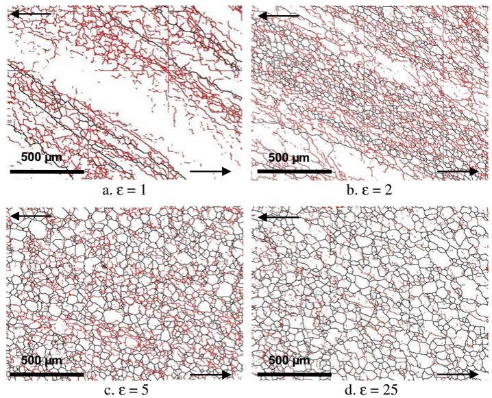
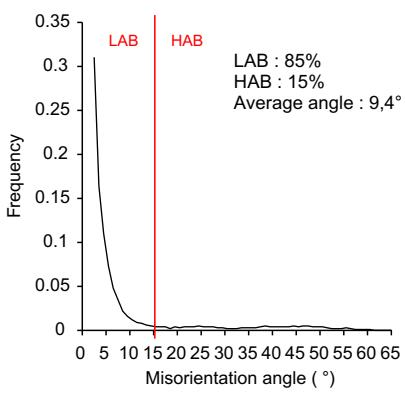
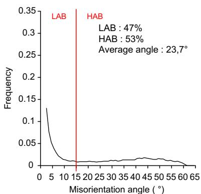
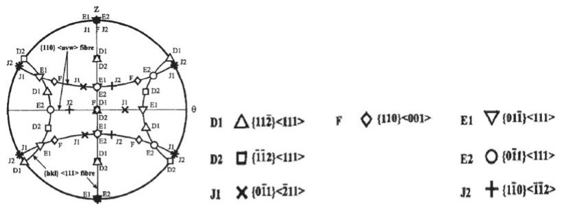
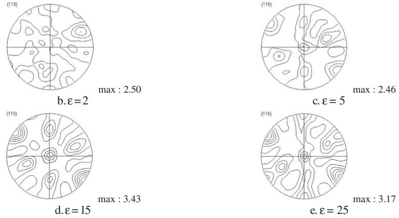
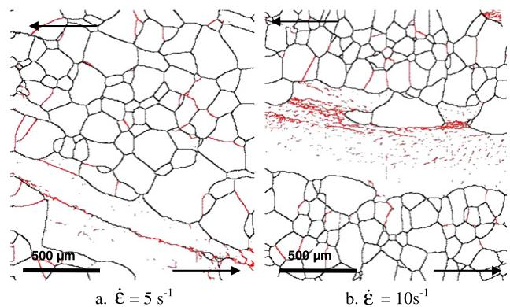
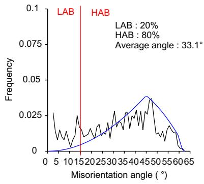
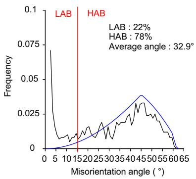
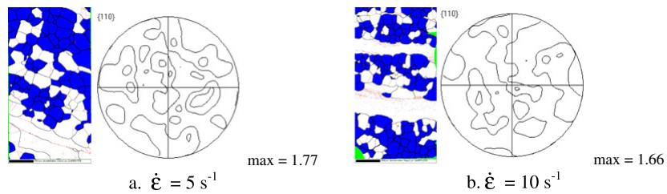
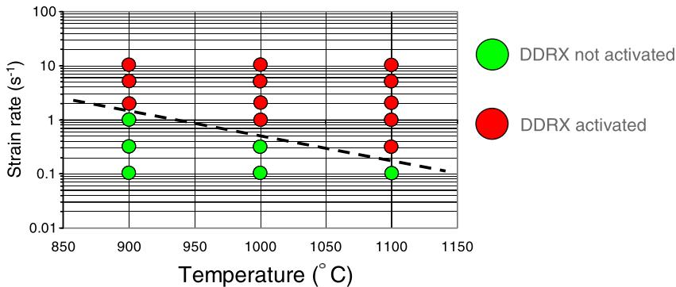

Viewpoint Paper

# Dynamic recrystallization mechanisms of an Fe–8% Al low density steel under hot rolling conditions

C. Castan,a,⇑ F. Montheilletb and A. Perladec

aArcelorMittal, R&D Packaging, Voie Romaine, BP 30320, 57283 Maizie\`res-le\`s-Metz Cedex, France bEcole des Mines, Centre SMS, CNRS UMR 5146, 158 Cours Fauriel, 42023 St-Etienne Cedex 2, France cArcelorMittal, R&D Automotive Products, Voie Romaine, BP 30320, 57283 Maizie\`res-le\`s-Metz Cedex, France

Available online 2 August 2012

Abstract—Iron–aluminium alloys display promising physical and mechanical properties. In this study, the efects of strain, strain rate and temperature on an Fe–8% Al were investigated. Hot torsion tests were performed in the temperature range 900–1100 -C and strain rate range 0.1–10 s-1. In this alloy, two types of dynamic recrystallization may operate during hot deformation: at high temperature and high strain rate, this alloy undergoes discontinuous dynamic recrystallization, whereas at lower temperature and strain rate, continuous dynamic recrystallization occurs.

 2012 Acta Materialia Inc. Published by Elsevier Ltd. All rights reserved.

Keywords: Ferritic steels; High-temperature deformation; Dynamic recrystallization; Recrystallized microstructure; Recrystallization texture

Ferritic iron–aluminium alloys display promising physical and mechanical properties, suitable to the development and design of new types of high strength lightweight steels. These properties make such alloys attractive for automotive applications due to the reduction in weight, fuel consumption and emission of exhaust gases.

The iron–aluminium solid solution up to 10 wt.% Al displays a non-ordered A2 lattice: the iron and aluminium atoms are statistically distributed in the lattice [1]. Ferritic Fe–8% Al alloys have a density of 7 g cm 3 which allows a reduction in density of 10% compared to conventional steels [2].

However, these alloys often exhibit surface defects, referred to as roping, after the deep drawing process. The origin of these defects, which consist of surface corrugations parallel to the rolling direction of the steel sheet, is mainly attributed to the inhomogeneous orientation distribution of individual grains [3]. It is thus important to understand the conditions of recrystallization during hot rolling to control the microstructure and thereby limit the occurrence of roping.

The investigated ferritic Fe–8% Al alloy was supplied by ArcelorMittal Maizie\`res and rolled in three successive passes. The cumulative deformation is equal to 1. The chemical composition of the alloy is given in Table 1.

This steel is 100% recrystallized with an initial grain size of 800 lm (equiaxed grains). The material is morphologically isotropic.

In order to characterize the mechanisms occurring during dynamic recrystallization of the hot deformed Fe–8% Al alloy, hot torsion tests were performed in a direction involving a negative shear and under argon atmosphere to reduce the oxidation phenomena, within the temperature range 900–1100 -C and strain rate range $0 . 1 { - } 1 0 \dot { \mathrm { s } } ^ { - 1 }$ . After deformation, samples were quenched immediately (0.5 s) with argon in order to retain the microstructures and avoid post-dynamic recrystallization. The cooling rate is ${ \sim } 2 0 0  { ^ \circ } \dot { \mathbf { C } }  { ^ - }  { 1 }$ during the first seconds.

For all test conditions, the analyses were performed near the surface (0.9  radius). The observation plane is hz and the z-axis is parallel to the vertical direction in the electron backscatter difraction (EBSD) maps. The microstructures were investigated by a scanning electron microscope (JEOL 6500) equipped with an EBSD system. HKL Channel 5 system software was used. Black lines and red lines are used for grain boundaries (misorientations $\theta \geqslant 1 5 ^ { \circ } )$ ) and subgrain boundaries $( 2 ^ { \circ } \leqslant \mathsf { \theta } < 1 5 ^ { \circ } )$ respectively. The arrows indicate the shear direction.

a. ε = 1  
Table 1. Chemical composition of the investigated Fe–8% Al alloy.

<table><tr><td>Composition</td><td>Al</td><td>Mn</td><td>C</td><td>Ti + Nb + V</td><td>Fe</td></tr><tr><td> $10^{-3}$  wt.%</td><td>8150</td><td>100</td><td>8.6</td><td>&lt;100</td><td>Bal.</td></tr></table>

  
Figure 1. Microstructures of samples deformed by torsion at $1 0 0 0 ^ { \circ } \mathrm { C } , 0 . 1 \mathrm { s } ^ { - 1 }$ (EBSD maps).

EBSD maps illustrating the microstructures of samples deformed by torsion at $1 0 0 0 ^ { \circ } \mathrm { C }$ and $0 . 1 \mathrm { ~ s ~ } ^ { - 1 }$ are given in Figure 1.

In the microstructure (Fig. 1a), the original grains, clearly visible, are elongated in the direction of the shear. Subgrains form preferentially close to the initial grain boundaries, which exhibit serrations. In microstructure (Fig. 1b), the original grains are more elongated along the direction of the shear. A network of subgrains forms progressively and invades the interior of the original grains. The initial large grain microstructure is progressively replaced by a much finer “recrystallized” one, while accordingly the volume fraction of grain boundaries strongly increases. Such evolution suggests that subgrain boundaries progressively transform into grain boundaries during straining. The generation of high angle boundaries (HABs) in the original grains begins according to the mechanism of continuous dynamic recrystallization (CDRX) [4]. Fragmentation is selective: some grains are more fragmented than others. In the microstructure (Fig. 1c), it becomes impossible to distinguish the initial grain boundaries and the recrystallized grain boundaries. The microstructure is thus intermediate between a subgrain and a grain structure: while grains and subgrains are entirely delimited by HABs and low angle boundaries (LABs), respectively, it will be referred to as an aggregate of crystallites, which are bounded partly by LABs and partly by HABs. Such type of behaviour was first observed in minerals such as olivine [5], and sodium and potassium chlorides [6]. Early observations on metals have been carried out on aluminium [7] and ferritic steels [8] by optical metallography and transmission electron microscopy. Like aluminium, a-iron and b-titanium alloys, ferritic steels

  
rientation ab. ε = 25  
Figure 2. Misorientation distribution functions $( 1 0 0 0 ^ { \circ } \mathrm { C } , 0 . 1 \mathrm { s } ^ { - 1 } )$

  
a. {110} pole figure displaying ideal orientations observed during a torsion test for a bcc alloy [11]

  
Figure 3. {110} pole figures of the Fe–8% Al alloy deformed by torsion.

  
Figure 4. Microstructures of samples deformed by torsion $( \varepsilon = 2 )$ at a temperature of $1 1 0 0 ^ { \circ } \mathrm { C }$ and strain rates of $5 \mathrm { { s } ^ { - 1 } }$ and $1 0 ~ \mathrm { { s } ^ { - 1 } }$ (EBSD maps).

undergo CDRX during hot deformation [4]. This behaviour is associated with high stacking fault energy materials where cross-slip of dislocations is easy and dynamic recovery is very eficient. At low or moderate strain, that is to say approximately up to the maximum of the stress–strain curve, a combination of strain hardening and dynamic recovery processes leads to a microstructural evolution analogous to the formation of cells observed during cold deformation. In this field, there is a progressive increase in dislocation density. However, unlike the case of cold deformation, this increase due to strain hardening is moderated by dynamic recovery. Thus some dislocations can be eliminated, either through the annihilation of pairs, or by absorption into the grain boundaries. Simultaneously, dislocations organize themselves to form subgrain boundaries subdividing the initial grains into subgrains, according to Holt’s theory [9]. Consequently, microstructural transformations at low and moderate strains result from a balance between strain hardening (creation of dislocations) and dynamic recovery (rearrangement and annihilation of dislocations). The average subgrain size increases with decreasing strain rate or increasing temperature and varies linearly with the inverse of the yield stress.

  
a. $\dot { \varepsilon } = 5 \mathrm { ~ s } ^ { - 1 }$

  
b. ε = 10 s−1  
Figure 5. Misorientation distribution functions (1100 -C) (the blue curve displays the MacKenzie distribution [13]).

  
Figure 6. Selected recrystallized grains and the associated {1 1 0} pole figures.

  
Figure 7. Strain rate–temperature map displaying the activation domain of the DDRX mechanism in the Fe–8% Al ferritic steel.

In addition, it has been shown that high angle boundaries present at large strains are partly remainders of the original boundaries, which have been elongated and broken up during straining. This mechanism is called geometric dynamic recrystallization (GDRX) [10]. It is associated with the development of serrations, and the subsequent “pinch-of” of some parts of those grains, when their thickness has been suficiently reduced by grain boundary movements. This mechanism is distinct from CDRX, since it requires the presence of pre-existing HABs. It is likely, however, that the two mechanisms may operate simultaneously, their respective contributions depending on the initial grain size, the strain path and the influence of grain boundary migration [4].

The occurrence of CDRX can be brought into evidence in a more quantitative way by the distributions of misorientations between neighbouring crystallites (Fig. 2). At low strain (Fig. 2a), a large fraction of misorientations are below 15-, which is due to the continuous creation of subgrain boundaries. The amount ranging between 15 and 62.8- increases significantly with strain, which can be attributed to the progressive transformation of subgrain boundaries into grain boundaries. At large strain (Fig. 2b), there is a balance between the amount of subgrain and grain boundaries.

After considering the evolution of microstructures with strain, the resulting textures were analysed. A {11 0} pole figure displaying ideal orientations commonly observed during a torsion test for a body-centred cubic (bcc) alloy is given in Figure 3a [11]. The shear plane normal is {hkl} and the shear direction is <uvw>. Figure 3 displays {1 10} pole figures of the Fe–8% Al ferritic alloy deformed by torsion.

In the case of negative shear and at large strain, the strongest component is D2: -1-12<111> which is “selfsymmetric”, i.e. made of one single ideal orientation that fulfils the symmetry conditions by itself. This is a classical result for ferritic alloys [4,12].

The maximal intensity of the D2 component is observed for e = 15.

The investigated Fe–8% Al ferritic alloy was deformed by hot torsion (e = 2) at high strain rates of $5 \mathrm { { s } ^ { - 1 } }$ and $\mathrm { \Delta } _ { 1 0 \mathrm { ~ s } ^ { - 1 } }$ and a temperature of $1 1 0 0 ^ { \circ } \mathrm { C }$ in order to study the associated microstructures and textures.

EBSD maps illustrating the microstructures of samples deformed by torsion are given in Figure 4.

On the EBSD maps, it is possible to note the presence of small and equiaxed freshly recrystallized grains which are free of substructure, thus showing the activation of another mechanism of recrystallization, and the presence of large and elongated original grains displaying internal misorientations (red lines). The microstructure appears as a mixture of “young” grains containing no substructure, and “old” grains displaying internal misorientations. In these conditions, instead of CDRX a mechanism of discontinuous dynamic recrystallization (DDRX) occurs [4]. Although ferritic alloys are highstacking-fault energy materials, it seems possible to activate the mechanism of DDRX depending on deformation conditions.

In these cases, strain rates are higher such that the duration of the tests is shorter and the dynamic recovery process described above is less efective. Strain hardening is thus stronger, which leads to local accumulations of dislocation densities in the material. The elastic energy stored is a suficient driving force to produce, at high temperature, the nucleation and growth of new grains in the hardened material. A nucleus is a small volume of material containing a low density of dislocations and separated from the surrounding matrix by HABs. It appears that several mechanisms are likely to produce nuclei, such as for example the accelerated rotation of a particular subgrain, the coalescence of adjacent subgrains or the local migration of a grain boundary into the interior of a neighbouring grain. These nuclei usually appear near original grain boundaries. New grains grow at the expense of old hardened grains; the migration of grain boundaries results in a decrease of the elastic energy of the system. The initial deformed structure is consequently quickly replaced by a recrystallized one, preventing the initiation of slower processes of CDRX [4]. With this kind of mechanism of recrystallization, the distributions of misorientations $( \operatorname { F i g . } { \dot { 5 } } )$ are totally diferent compared to the previous case (Fig. 2). Indeed, the distribution is close to that derived by MacKenzie for cubic crystals uniformly distributed in the orientation space (set of randomly oriented crystals) with few LABs and a maximum number of HABs close to $4 5 ^ { \circ }$ [13].

After considering the microstructures obtained after deformation at high strain rates, orientations of recrystallized grains with an internal misorientation below $2 ^ { \circ }$ were analysed. Figure 6 displays the selected recrystallized grains in blue and the {1 1 0} pole figures associated.

In the case of DDRX, recrystallized grains have no preferred orientations (very low intensity of the texture). This result is classically found in the literature [4].

This is a promising result going into the direction of a decrease of roping. To limit this phenomenon, it seems advantageous to favour a mechanism of DDRX in order to obtain a microstructure with recrystallized grains exhibiting random orientations.

Several torsion tests were performed in the temperature range 900– $1 1 0 0 ^ { \circ } \mathrm { C }$ and strain rate range $0 . 1 { - } \mathrm { \dot { l } } 0 \mathrm { s } ^ { - 1 }$ in order to study the activation, or not, of the DDRX mechanism.

Thanks to the study of microstructures, it is possible to conclude that a transition occurs between the CDRX mechanism and the DDRX mechanism (Fig. 7). At high temperature and high strain rate this ferritic alloy undergoes DDRX, whereas at lower temperature and strain rate, CDRX clearly takes place. There is therefore a competition between these two mechanisms as a func tion of deformation conditions.

In conclusion, although ferritic alloys are high stacking fault energy materials, two types of dynamic recrystallization may operate during hot deformation. At high temperature and high strain rate, this alloy undergoes discontinuous dynamic recrystallization (DDRX), whereas at lower temperature and strain rate, continuous dynamic recrystallization (CDRX) occurs. There is therefore, depending on the conditions of deformation, a competition between these two mechanisms.

Last but not least, to limit the roping phenomenon, which is mainly attributed to the inhomogeneous orientation distribution of individual grains, it seems advantageous to favour a mechanism of DDRX during hot rolling in order to obtain a microstructure with ran domly oriented recrystallized grains.

## References

[1] J.L. Murray Binary Alloy Phase Diagrams, vol. 1, American Society for Metals, Metals Park, OH, 1986.

[2] G. Frommeyer, E.J. Drewes, B. Engl, La Revue de Me´tallurgie 97 (10) (2000) 1245–1253.

[3] H.J. Shin, J.K. An, S.H. Park, D.N. Lee, Acta Mater. 51 (16) (2003) 4693–4706.

[4] F. Montheillet, Moving Grain Boundaries During Hot Deformation of Metals: Dynamic Recrystallization, Moving Interfaces in Solids, CISM Courses and Lectures, No. 453, Springer, Vienna/New York, 2004, pp. 203–256.

[5] J.P. Poirier, A. Nicolas, J. Geol. 83 (1975) 707–720.

[6] M. Guillope´, J.P. Poirier, J. Geophys. Res. 84 (1979) 5557–5567.

[7] Ch. Perdrix, M.Y. Perrin, F. Montheillet, Me´moires et Etudes Scientifiques de la Revue de Me´tallurgie 78 (6) (1981) 309–320.

[8] L. Lombry, C. Rossard, B.J. Thomas, Revue de Me´tal lurgie CIT 78 (12) (1981) 975–988.

[9] D.L. Holt, J. Appl. Phys. 41 (8) (1970) 3197–3201.

[10] H.J. McQueen, O. Knustad, N. Ryum, J.K. Solberg, Scripta Metall. 19 (1) (1985) 73–78.

[11] J. Baczynski, J.J. Jonas, Acta Mater. 44 (11) (1996) 4273– 4288.

[12] S.M. Lim, M. El Wahabi, C. Desrayaud, F. Montheillet, Mater. Sci. Eng. 460–461 (2007) 532–541.

[13] J.K. MacKenzie, Biometrika 45 (1958) 229–240.