www.elsevier.com/locate/scriptamat

Viewpoint Paper

# Influence of Al content and precipitation state on the mechanical behavior of austenitic high-Mn low-density steels

I. Gutierrez-Urrutia⇑ and D. Raabe

Max-Planck-Institut fu¨ r Eisenforschung, Max-Planck Str. 1, D-40237 Du¨ sseldorf, Germany

Available online 8 September 2012

Abstract—We investigate the strain hardening of two austenitic high-Mn low density steels, namely, Fe–30.5Mn–2.1Al–1.2C and Fe–30.5Mn–8.0Al–1.2C (wt.%), containing diferent precipitation states. The strain hardening of the alloy with low Al content is attributed to dislocation and twin substructures. The precipitation of intergranular M C-type carbides strongly influences the frac ture mode. We associate the strain hardening behavior of the alloy with high Al content to the precipitation of shearable nanosized j-carbides and their role in the development of planar dislocation substructures. - 2012 Acta Materialia Inc. Published by Elsevier Ltd. All rights reserved.

Keywords: Austenitic steels; Carbides; Work hardening; Dislocation structure; Electron difraction

The development of advanced lightweight steels with superior mechanical properties is the ultimate goal for structural applications in many industrial sectors, in particular in the automotive industry. These steel grades allow the manufacture of lightweight crash-resistance car body structures, leading to safer cars and a considerable reduction in fuel consumption and, hence, reduced CO emissions. In recent years, two main steel grades have been explored, namely, ferritic Fe–Al and austenitic high-Mn steels. Fe–Al alloys with an Al content up to 9 wt.% and additions of microalloying elements such as Ti, Nb and V (<0.03 wt.%) have a reduced density of -7 g cm3 and exhibit a good strength-ductility balance at room temperature (ultimate tensile strength (UTS): 500 MPa; elongation: 35%) [1,2]. The strong influence of Al content on the underlying strengthening and deformation mechanisms as well as on ordering phenomena [1–3] makes the Fe–Al system a challenge for alloy designers. High-Mn steels, with Mn content between 20 and 30 wt.% and additions of Al up to10 wt.% and C between 0.5 and 1.8 wt.%, have been recently considered as promising lightweight structural steels. These steel grades exhibit outstanding combinations of strength and ductility (UTS: 1.0–1.5 GPa; elongation: 30–80%), as well as a reduced specific weight [4–10]. The addition of Al mainly promotes the precipitation of nanosized (Fe,Mn) AlC carbides (so-called j-carbides), which control the mechanical properties [11,12]. Accordingly, the precipitation state of Fe–Mn–Al–C steels under diferent annealing conditions has been intensively studied [5,6,10–12]. However, the underlying strengthening and deformation mechanisms controlling the strain hardening behavior of these alloys are still unclear. The present study aims at clarifying the role of the precipitation state in the strain hardening mechanisms of low-density Fe–Mn–Al–C steels. For this purpose, we analyzed the deformation structure of two alloys with diferent Al content, namely, Fe–30.5Mn–2.1Al–1.2C and Fe–30.5Mn–8.0Al–1.2C (wt.%), containing diferent precipitation states. Detailed microstructural observations by electron channeling contrast imaging (ECCI) and transmission electron microscopy (TEM) were performed on the deformed samples to diferent strain levels at room temperature.

The chemical compositions of the investigated high-Mn low-density steels were Fe–30.5Mn–2.1Al–1.2Cand Fe–30.5Mn–8.0Al–1.2C (in wt.%). The materials were melted in an induction furnace under Ar atmosphere and cast to round bars, 25 mm in diameter. The cast ingots were reheated to 1200 C for 30 min, hot-rolled to 75% thickness reduction at 1100 C and water quenched. The hot-rolled materials were then solution-treated for 2 h at $1 1 0 0 ^ { \circ } \mathrm { C }$ under Ar, and finally quenched in water. Subsequent annealing treatments were performed between 450 and $6 5 0 ~ ^ { \circ } \bar { \mathrm { C } } .$ . Tensile tests were carried out at room temperature at an initial strain rate of $5 \times 1 0 ^ { - 4 } \mathrm { s ^ { - 1 } }$ in a Zwick ZH 100 tensile machine. In addition to tensile testing to failure, interrupted tensile tests to diferent strain levels were performed to study the microstructural evolution as a function of strain. The tensile samples were cylindrical, with gauges of 6 mm diameter and 40 mm length. Microstructures of the tensile deformed high-Mn steels were examined by ECCI and TEM. In all cases, the sections examined were longitudinal, i.e. the observation direction was perpendicular to the tensile axis. Deformation structures were characterized by ECCI, as in previous works [4,13–16]. We made use of a recently developed EBSD-based set-up to obtain ECCI images under controlled difraction conditions that enabled enhanced dislocation and interface contrast [17]. ECCI observations were carried out in a Zeiss Crossbeam instrument (XB 1540, Carl Zeiss SMT AG, Germany). TEM observations were conducted in a Phillips CM20 microscope. Thin foil samples were prepared by electropolishing using 30% nitric acid in methanol at $- 3 0 ~ ^ { \circ } \mathrm { C }$ and 10 V.

Figure 1 shows the engineering stress–strain curves of the Fe–30.5Mn–2.1Al–1.2C and Fe–30.5Mn–8.0Al–1.2C (wt.%) alloys, referred to as 2Al and 8Al steels, respectively, annealed to two diferent annealing states, namely, short annealing treatment (450 C/1 h) and long annealing treatment (2Al: 650 C/72 h; 8Al: 600 C/24 h). The values of yield stress (YS), UTS and uniform elongation (UE) of the curves are presented in Table 1. The stress– strain curves of the annealed 2Al steels exhibit a pronounced variation in slope at about 15% strain. At this strain level, the slope decreases but is still positive, indicating the activation of a secondary strain hardening stage [4]. This result indicates that, under the annealing conditions studied here, the 2Al steel exhibits a multiple-strain hardening behavior. Interestingly, both annealing states exhibit identical flow behavior with a slight variation in yield stress (short annealing: YS = 420 MPa; long annealing: $\mathrm { Y S } = 4 0 0 \mathrm { M P a } )$ . The main efect produced by the long annealing treatment is a significant reduction in the uniform elongation (short annealing: $\mathrm { U E } = 7 5 \% ;$ long annealing: $\bar { \mathrm { U E } } = 3 \bar { 5 } \% )$ . The stress– strain curves of the annealed 8Al steels are diferent from those of the annealed 2Al steels. First, the curves of the annealed 8Al steels do not exhibit a concave shape but are quite linear. This result indicates that, under the annealing conditions studied here, the 8Al steel contains a single hardening regime. Second, the long annealing treatment has a remarkable efect on both yield stress (short annealing: $\mathrm { Y S } = 5 4 0 \mathrm { M P a } ;$ long annealing: YS = 990 MPa) and flow behavior. In the next sections we present the most relevant microstructural features of the tensile deformed high-Mn steels characterized by ECCI and TEM, as well as their respective contributions to the strain hardening mechanisms.

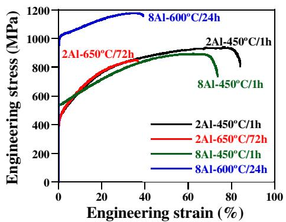  
Figure 1. Engineering stress–strain curves of the annealed 2Al and 8Al steels tensile deformed at an initial strain rate of $5 \times 1 0 ^ { - 4 } \mathrm { s ^ { - 1 } }$ . 2Al: Fe– 30.5Mn–2.1Al–1.2C (wt.%); 8Al: Fe–30.5Mn–8.0Al–1.2C (wt.%).

## 1. Low Al content (2 wt.%)

Figure 2 shows the strain hardening rates of the annealed 2Al steels. The outstanding strength–elongation balance (UTS: 935 MPa; UE: 75%) of the short annealed alloy is attributed to the multiple-stage strain hardening behavior, which is associated with dislocation substructure refinement and subsequent activation of deformation twinning at high stress levels [4]. The first hardening stage is determined by the size of the dislocation substructure, namely, Taylor lattice structures, dislocation cells and cell blocks. The contribution of the dislocation substructure to the flow stress can be written as [4,18]:

$$
\Delta \sigma = G M K b / D\tag{1}
$$

where G is the shear modulus, K is a constant, b is the magnitude of the Burgers vector, M is the Taylor factor and D is the size of the corresponding dislocation sub structure. The high carbon content (1.2 wt.%) plays a significant role in the formation of the dislocation substructure. This is ascribed to the role of solute carbon in dislocation cross-slip [4,19]. The second hardening stage is due to further refinement of the dislocation mean free path by deformation twinning (the twinning-induced plasticity efect). The contribution of twinning to hardening can be described by [4,14]:

$$
\Delta \sigma_ {\mathrm{twinning}} = K _ {\mathrm{H-P}} / (\lambda_ {\mathrm{twin}}) ^ {1 / 2}\tag{2}
$$

where $K _ { \mathrm { H - P } }$ is a constant and $\lambda _ { \mathrm { t w i n } }$ is the average twin spacing. Twin spacing is the key microstructural parameter of this hardening stage, and is determined by the twinning kinetics [14,20–22].

Figure 2 reveals that the long annealed 2Al alloy exhibits a single hardening regime. This hardening stage exactly overlaps the first hardening regime of the short annealed alloy up to a true stress of about 1 GPa, i.e. the whole first hardening regime of the short annealed sample. At 0.2 true strain, the deformed structure of the grain interior of the long annealed 2Al steel consists mainly of dislocation cell blocks with an average size of $2 7 5 \pm 5 0$ nm (Fig. 3(a)). The size of this dislocation substructure is the same as that found in the short annealed 2Al steel strained to the same stress level (cell block average size of $2 7 0 \pm 7 0$ nm at true stress of 950 MPa [4]). This result indicates that the strain hardening of the long annealed 2Al steel is controlled by the same dislocation substructure evolution as that of the first hard ening stage of the short annealed sample. As the short annealed alloy is in the solid solution state (c phase) [4] and both alloys contain a similar YS, we conclude that, in the annealing condition studied here, i.e. 650 C/72 h, the grain interior of the long annealed 2Al steel remains essentially in the solid solution state.

Table 1. Mechanical properties of studied alloys.

<table><tr><td>Material state</td><td>YS (MPa)</td><td>UTS (MPa)</td><td>UE (%)</td></tr><tr><td>2Al, 1 h/450 °C</td><td>420</td><td>935</td><td>75</td></tr><tr><td>2Al, 650 °C/72 h</td><td>400</td><td>850</td><td>35</td></tr><tr><td>8Al, 1 h/450 °C</td><td>540</td><td>895</td><td>65</td></tr><tr><td>8Al, 1 h/600 °C/24 h</td><td>990</td><td>1180</td><td>37</td></tr></table>

2Al: Fe–30.5Mn–2.1Al–1.2C (wt.%); 8Al: Fe–30.5Mn–8.0Al–1.2C (wt.%). YS: yield strength; UTS: ultimate tensile strength; UE: uniform elongation.

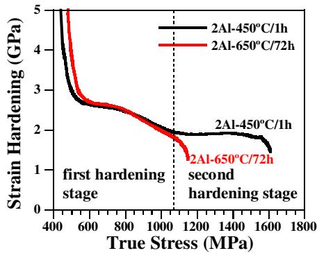  
Figure 2. Strain hardening rate vs. true stress of the annealed 2Al steels tensile deformed at an initial strain rate of $5 \times 1 0 ^ { - 4 } \mathrm { s ^ { - 1 } }$ . 2Al: Fe–30.5Mn–2.1Al–1.2C (wt.%).

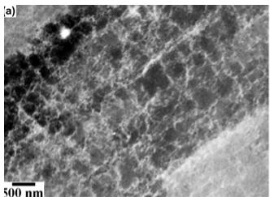

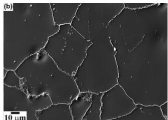

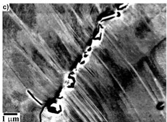

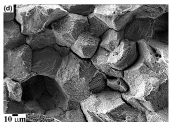  
Figure 3. Deformation structure of the long annealed 2Al steel. (a) ECCI image of dislocation cell blocks in a sample strained to 0.2 true strain. (b) Distribution of intergranular M3C-type carbides. (c) ECCI image of deformation twin–intergranular M C-type carbide interac tions in a sample strained to fracture. (d) Surface fracture revealing an intergranular fracture mode.

ECCI observations further reveal that the long annealed 2Al alloy contains a uniform distribution of coarse carbides along the grain boundaries and annealing twin interfaces, which are about 1 lm wide  3 lm long (Fig. 3(b)). According to recent thermodynamical calculations by Chin et al. [23] on the stability of carbides in the Fe–Mn–Al–C system, the intergranular carbides observed in the long annealed 2Al steel correspond to incoherent M C-type carbides. At intermediate-to-high stress levels, deformation twinning is activated: the estimated twinning stress, rtwinning, assuming c = 60 mJ $\mathrm { m } ^ { - 2 }$ , b = 0.25 nm and a Taylor factor of 2.8-3.2 [4], yields $\sigma _ { \mathrm { t w i n n i n g } } \sim \gamma / b = 6 7 0 \mathrm { - } 7 5 0 ~ \mathrm { M P a }$ This results in the development of twin bundles containing several deformation twins (Fig. 3(c)). The impingement of twin tips on coarse intergranular $\mathbf { M } _ { 3 } \mathbf { C } \mathbf { - t y p e }$ carbides produces local shear stress concentrations at carbide interfaces, enhancing an intergranular fracture mode (Fig. 3(d)). As Figure 2 shows, the fracture of the long annealed sample occurs at a macroscopic true stress of 1150 MPa, which corresponds to the onset of the second hardening regime of the short annealed alloy. As this hardening stage is associated with deformation twinning, this finding indicates that deformation twinning in the long annealed 2Al steel does not result in a further hardening regime but in the activation of a damage mechanism triggered by twin–intergranular M C-type carbide interactions. As a consequence, the long annealed sample exhibits limited elongation $( \mathrm { U E } = \bar { 3 5 } \% )$ ).

We can therefore analyze the strain hardening behavior of the long annealed 2Al alloy in terms of a composite-type microstructural model: the deformation structure of the grain interior (area 1), namely, dislocation substructures, contributes to the flow stress according to Eq. (1). This grain area is almost in the solid solution state (c phase). Segregation of solute elements, mainly carbon, to grain boundaries results in the precipitation of coarse M C-type carbides, referred to as area 2. Accordingly, in this area, the following precipitation occurs: c phase to $\gamma _ { 0 }$ phase + intergranular $\mathbf { M } _ { 3 } \mathbf { C } \mathbf { - t y p e }$ carbides. Area 2 mainly contributes to material damage. Under the annealing conditions studied here, area 1 is larger than area 2 and, hence, it controls the strain hardening behavior of the bulk material.

## 2. High Al content (8 wt.%)

Figure 4 shows the strain hardening rates of the annealed 8Al steels. The main characteristic revealed here is that the strain hardening rates of the 8Al steels are different to those of the 2Al steels. The 8Al steels exhibit less hardening capacity than the 2Al steels (at the early stages of deformation: 2Al steels -2.6 GPa; 8Al steels ${ \sim } 2 \operatorname { G P a } )$ , and contain a single hardening regime, which remains fairly constant during deformation. The figure further reveals that the short annealed 8Al steel exhibits greater hardening than the long annealed 8Al steel. It is thus clear that a high content of Al (8 wt.%) strongly modifies the strain hardening behavior of $\mathrm { F e - M n { \mathrm { - } } A l { \mathrm { - } } }$ C steels.

Figure 5 shows the dislocation patterning developed upon deformation of the annealed 8Al steels as well as the precipitation state. The short annealed 8Al steel develops planar dislocation configurations formed by Taylor lattice structures and highly dense dislocation walls (HDDWs) (Fig. 5(a)). This ECCI image shows the dislocation patterning of a short annealed 8Al steel sample tensile deformed to 0.3 true strain. Taylor lattice structures are formed by dense dislocation networks of planar dislocation arrays [24]. These dislocation structures are characteristic of metals with pronounced

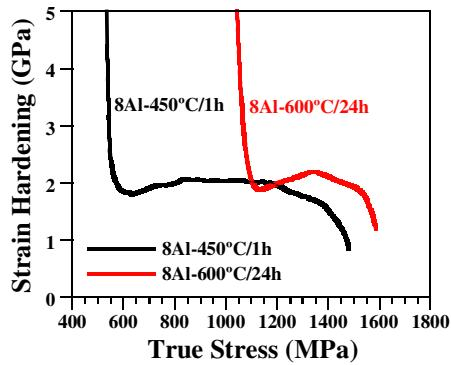  
Figure 4. Strain hardening rate vs. true stress of the annealed 8Al steels tensile deformed at an initial strain rate of $5 \times 1 0 ^ { - 4 } \mathrm { s ^ { - 1 } }$ . 8Al: Fe– 30.5Mn–8.0Al–1.2C (wt.%).

planar slip [4,18,24]. Figure 5(a) further reveals HDDWs consisting of dense dislocation sheets lying on the primary slip system and spaced between 100 and 200 nm. HDDWs are characterized by a high dislocation activity along the primary slip system, resulting in parallel dense dislocation arrays containing low dislocation densities in their interiors [4]. Figure 5(b) shows a dark-field TEM image of the precipitation state of the short annealed 8Al steel. In this annealing state, the precipitation distribution is heterogeneous, consisting of intragranular nanosized precipitates with sizes between 2 and 5 nm. Analysis of selected area difraction patterns indicates that these precipitates are j-carbides containing an L01 -type structure, with a cube/cube orientation relationship with the austenite matrix [11,12,25,26]. These j-carbides have been commonly observed in Fe–Mn– Al–C steels with high Al (between 6 and 11 wt.%) and C (between 0.5 and 1.8 wt.%) contents [5,6,27]. Detailed TEM observations of the dislocation configurations do not reveal dislocation–particle pinning events. This finding indicates that, for materials that are in the annealed state studied here, 450 C/1 h, j-carbides can be considered as weak obstacles and, due to their tiny size, are crystallographically sheared. This efect results in a moderate increment of the yield strength compared to that of the 2Al steel in solid solution $- \ \mathrm { Y S } _ { 2 \mathrm { A l \ s t e e l } } = 4 2 0 \ \mathrm { M P a }$ $\mathrm { Y S _ { 8 A l \ s t e e l } } = 5 4 0 \mathrm { \ M P a } \_$ and the development of planar dislocation substructures. The short annealed 2Al steel develops dislocation configurations similar to those observed in Figure 5(a). The formation of planar dislocation substructures in the short annealed 2Al steel was associated with the high carbon content and its influence on dislocation cross-slip [4,19]. At high stresses (true stress of 950 MPa), the frequency of cross-slip is high enough to transform the planar dislocation configurations into wavy dislocation structures, such as cells and cell blocks. In the short annealed 8Al alloy, planar dislocation substructures are stable up to high stress levels (true stress of 1.1 GPa). We attribute the enhancement of planar slip to the precipitation state, namely, to the nanosized and shearable j-carbides.

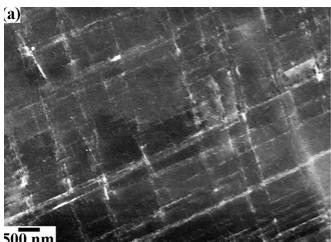

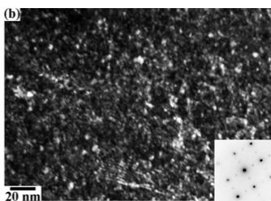

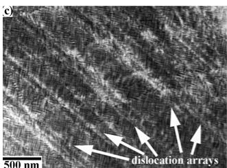

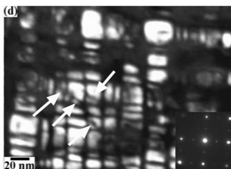  
Figure 5. Deformation structure of annealed 8Al steels. (a) ECCI image of Taylor lattice structures in a short annealed 8Al steel sample tensile deformed to 0.3 true strain. (b) Dark-field TEM image of the distribution of j-carbides in a short annealed 8Al sample. (c) ECCI image of planar dislocation arrangements in a long annealed 8Al steel sample tensile deformed to 0.15 true strain. Dislocation arrays are indicated by arrows. (d) Dark-field TEM image of the distribution of j-carbides in a long annealed 8Al sample. Sheared particles are indicated by arrows.

The long annealed 8Al steel contains a uniform distribution of intragranular cuboidal j-carbides with an average size of 10  20 nm (Fig. 5(d)). The analysis of the corresponding difraction pattern confirms that these precipitates maintain a cube/cube orientation relationship with the austenite matrix. The high volume fraction of the precipitates results in the formation of narrow matrix channels, with a width of about 2–3 nm. This precipitation state yields a remarkable increase in the yield strength compared to that of the 2Al steel in solid solution: $\mathrm { \check { Y } S _ { 2 A l ~ s t e e l } = 4 2 0 ~ M P a ; ~ Y S _ { 8 A l ~ s t e e l } = 9 9 0 ~ M P a }$ Similar precipitation states to that studied here have been reported in annealed Fe–Mn–Al–C steels between 450 and 650 C [5,6,27]. In particular, yield strength values up to 1400 MPa have been attained in ultrahigh carbon (1.8 wt.%) Fe–Mn–Al–C steels [6]. Detailed investigations of the precipitation hardening mechanisms are further required to analyze the contribution of the precipitation state to material strength. Interestingly, in spite of the low strain hardening capacity of the long annealed 8Al steel (YS: 990 MPa; UTS: 1180 MPa), the alloy exhibits a considerable high ductility (UE: 37%).

Figure 5(c) shows an ECCI image of the deformed structure of the long annealed 8Al steel tensile deformed to 0.15 true strain. This figure reveals that planar dislocation substructures consisting of dense dislocation arrays spaced between 100 and 300 nm are formed upon straining (indicated by arrows). Although a detailed investigation of the underlying deformation mechanisms is currently underway, this ECCI image indicates that plasticity is mainly concentrated through the dislocation boundaries of such substructures. TEM observations have further revealed that within the dislocation arrays, cuboidal j-carbides are frequently sheared by these dislocations (indicated by arrows in Fig. 5(d)). This result indicates that the enhancement of planar slip by the shearing of cuboidal j-carbides results in an outstanding combination of high strength (YS: 990 MPa, UTS: 1180 MPa) and ductility (UE: 37%). These findings suggest that the superior mechanical properties of the 8Al alloy can be explained in terms of the precipitation of shearable nanosized j-carbides and their role in the development of planar dislocation substructures. This agrees with previous works on the role of j-carbides in the mechanical properties of Fe–Mn–Al–C steels [9]. Further investigations are required to elucidate the dislocation–particle interactions, the role of j-carbides in the formation of planar dislocation substructures and the contribution of these dislocation substructures to strain hardening.

In summary, we have investigated the strain hardening of two austenitic high-Mn low-density steels, namely, Fe–30.5Mn–2.1Al–1.2C and Fe–30.5Mn– 8.0Al–1.2C (wt.%), under diferent annealing conditions. We explain the strain hardening behavior of the alloy with low Al content in terms of dislocation and twin substructures. The precipitation of intergranular M Ctype carbides under long annealing conditions has a strong influence on the fracture mode. We attribute the combination of high strength and ductility of the alloy with high Al content to the precipitation of shearable nanosized j-carbides and their role in the development of planar dislocation substructures upon straining. Further investigations are required to analyze the strain hardening mechanisms, specifically, the role of j-carbides in the formation of planar dislocation substructures and the contribution of these dislocation substructures to strain hardening mechanisms.

## Acknowledgment

The authors acknowledge the financial support by the German Research Foundation in the framework of the SFB 761 “steel ab initio”.

## References

[1] G. Frommeyer, E.J. Drewes, B. Engl, Rev. Metall. 97 (2000) 1245.

[2] J. Herrmann, G. Inden, G. Sauthof, Acta Mater. 51 (2003) 2847.

[3] N.S. Stolof, Mater. Sci. Eng. A 258 (1998) 1.

[4] I. Gutierrez-Urrutia, D. Raabe, Acta Mater. 60 (2012) 5791–5802.

[5] K. Choi, C.-H. Seo, H. Lee, S.K. Kim, J.H. Kwak, K.G. Chin, K.-T. Park, N.J. Kim, Scripta Mater. 63 (2010) 1028.

[6] K.M. Chang, C.G. Chao, T.F. Liu, Scripta Mater. 63 (2010) 162.

[7] J.D. Yoo, S.W. Hwang, K.-T. Park, Metall. Mater. Trans. A 40A (2009) 1520.

[8] J.D. Yoo, K.-T. Park, Mater. Sci. Eng. A 496 (2008) 417.

[9] G. Frommeyer, U. Bru¨x, Steel Res. Int. 77 (2006) 627.

[10] W.K. Choo, J.H. Kim, J.C. Yoon, Acta Mater. 45 (1997) 4877.

[11] C.Y. Chao, C.N. Hwang, T.F. Liu, Scripta Metall. Mater. 28 (1993) 109.

[12] C.N. Hwang, C.Y. Chao, T.F. Liu, Scripta Metall. Mater. 28 (1993) 263.

[13] I. Gutierrez-Urrutia, D. Raabe, Scripta Mater. 66 (2012) 992.

[14] I. Gutierrez-Urrutia, D. Raabe, Acta Mater. 59 (2011) 6449.

[15] I. Gutierrez-Urrutia, D. Raabe, Scripta Mater. 66 (2012) 343.

[16] A. Eisenlohr, I. Gutierrez-Urrutia, D. Raabe, Acta Mater. 60 (2012) 3994.

[17] I. Gutierrez-Urrutia, S. Zaeferer, D. Raabe, Scripta Mater. 61 (2009) 737.

[18] D. Kuhlmann-Wilsdorf, in: F.R.N. Nabarro, M.S. Duesbery (Eds.), Dislocations in Solids, vol. 11, Elsevier B.V., Amsterdam, 2002.

[19] K. Sekido, T. Ohmura, L. Zhang, T. Hara, K. Tsuzaki, Mater. Sci. Eng. A 530 (2011) 396.

[20] I. Gutierrez-Urrutia, S. Zaeferer, D. Raabe, Mater. Sci. Eng. A 527 (2010) 3552.

[21] J.W. Christian, S. Mahajan, Prog. Mater. Sci. 39 (1995) 1.

[22] S. Mahajan, G.Y. Chin, Acta Metall. 21 (1973) 1353.

[23] K.-G. Chin, H.-J. Lee, J.-H. Kwak, J.-Y. Kang, B.-J. Lee, J. Alloys Comp. 505 (2010) 217.

[24] D.A. Hughes, Acta Metall. Mater. 41 (1993) 1421.

[25] K. Sato, Y. Inoue, K. Tagawa, Metall. Trans. A 21A (1988) 5.

[26] K.H. Han, J.C. Yoon, W.K. Choo, Scripta Metall. 20 (1986) 33.

[27] Y. Kimura, K. Handa, H. Hayashi, Y. Mishima, Intermetallics 12 (2004) 607.