# SCIENTIFIC REPORTS

OPEN

# Nano-mechanical properties of Fe-Mn-Al-C lightweight steels

Alireza Rahnama1, Hiren Kotadia2, Samuel Clark3, Vit Janik 4 & Seetharaman Sridhar5

Received: 30 January 2018

Accepted: 18 May 2018

Published: xx xx xxxx

High Al Low-density steels could have a transformative efect on the light-weighting of steel structures for transportation. They can achieve the desired properties with the minimum amount of Ni, and thus are of great interest from an economic perspective. In this study, the mechanical properties of two duplex low-density steels, Fe-15Mn-10Al-0.8C-5Ni and Fe-15Mn-10Al-0.8C (wt.%) were investigated through nano-indentation and simulation through utilization of ab-initio formalisms in Density Functional Theory (DFT) in order to establish the hardness resulting from two critical structural features (κ-carbides and B2 intermetallic) as a function of annealing temperature (500–1050°C) and the addition of Ni. In the Ni-free sample, the calculated elastic properties of κ-carbides were compared with those of the B2 intermetallic $\mathsf { F e 3 A l - L 1 } _ { 2 }$ and the role of Mn in the κ structure and its elastic properties were studied. The Ni-containing samples were found to have a higher hardness due to the B2 phase composition being NiAl rather than FeAl, with Ni-Al bonds reported to be stronger than the Fe-Al bonds. In both samples, at temperatures of $9 0 0 ^ { \circ } C$ and above, the ferrite phase contained nano-sized discs of B2 phase, wherein the Ni-containing samples exhibited higher hardness, attributed again to the stronger Ni-Al bonds in the B2 phase. At 700°C and below, the nano-sized B2 discs were replaced by micrometre sized needles of κ in the Ni-free sample resulting in a lowering of the hardness. In the Ni-containing sample, the entire α phase was replaced by B2 stringers, which had a lower hardness than the Ni-Al nano-discs due to a lower Ni content in B2 stringer bands formed a $\ t 7 0 0 ^ { \circ } \mathsf C$ and below. In addition, the hardness of needle-like κ-carbides formed in α phase was found to be a function of Mn content. Although it was impossible to measure the hardness of cuboid κ particles in γ phase because of their nano-size, the hardness value of composite phases, e.g. γ+κ was measured and reported. All the hardness values were compared and rationalized by bonding energy between diferent atoms.

In order to reduce energy consumption and greenhouse gas emissions in the next generation automobiles, there is an increasing demand for the development of advanced high-strength steels with high strength to weight ratio1,2. With excellent mechanical properties3–8, Fe-Mn-Al-C low-density steels are promising candidates for such applications. Tese steels were originally designed to replace the stainless steels because of their good oxidation and corrosion resistance but recently they have regained interest because of the signifcant reduction in mass density due to alloying with Al, and are therefore considered as promising candidate materials for an automotive body 3,5

Teir success depends on the design of the alloy composition and processing route to enhance the precipita tion of various ordered nano-sized particles. Depending on the Al content, various types of ordered structures can form in the microstructure of low-density steels, i.e. B2, $\mathrm { L } 1 _ { 2 } , \mathrm { L } 1 ^ { \prime } { } _ { 2 } ,$ etc. B2 has a bcc structure where the Fe (Ni) atoms are positioned at the corners of the unit cell and the Al atom occupies the central position. L1′ is a per ovskite structure with the Fe AlC formula that is commonly denoted as a κ-carbide phase. Te addition of Mn into this carbide structure leads to the formation of Fe MnAlC, FeMn AlC and Mn AlC phases. Tese phases have a structure similar to the ordered fcc phase, Fe $_ { 3 } \mathrm { A l } \mathrm { - L } 1 _ { 2 } ,$ wherein the Fe atoms are located at the centre of each face and the Al atoms at the corners of the unit cell. Te additional carbon atom to this structure results in L1′ where carbon occupies the central octahedral interstitial position formed by the six Fe atoms as its nearest neighbours. Tese precipitates are formed by the ordering of alloying elements such as C, Mn, and $\mathrm { A l } ^ { 9 - 1 1 }$

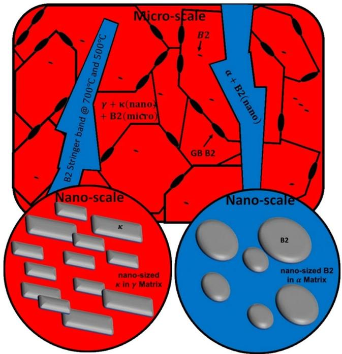  
Figure 1. Te schematic representation of ordered precipitates observed in the microstructures of steels under study.

Te morphology of the ordered precipitates were engineered in order to improve the properties of low-density steels12,13, and various experimental studies show that the overall properties of the bulk material strongly depends on the size and morphology of ordered phases14. The characteristics of ordered phases are determined by their degree of coherency with the matrix within which they form9 and the strength of these ordered phases. Consequently, many investigations show that the stifness of the bulk material depends on the composition of the ordered phases, for example, an increase in the Mn content of the κ-phase can signifcantly increase the strength of the bulk material15. Tis efect was attributed to the substitution of weaker Fe-C bonds with stronger Mn-C bonds. Tus, while engineering the structure of these steels, it is of importance to determine the properties of individual ordered phases and their contribution to the bulk mechanical properties of the low-density steels.

Our previous study11 mapped out the phases present in two duplex low-density steels, one with 5 wt.% Ni and the other being Ni-free, in the temperature range of 500 to $1 0 5 0 ^ { \circ } \mathrm { C }$ . For both the grades at temperatures from 900 to $1 0 5 0 ^ { \circ } \mathrm { C } ^ { 9 - 1 1 }$ B2 formed as micron-sized particles and grain boundary precipitates in the austenite phase and as nano-sized discs in the ferrite (see Fig. 1 (blue circle) and Fig. 2b and e). Te discs were of Ni-Al type in the Ni-containing samples but of Fe-Al type in Ni-free samples. At temperatures from 500 to $7 0 0 ^ { \circ } \mathrm { C } ,$ κ-carbides formed nano-sized blocks in the austenite phase in both Ni-containing and Ni-free samples and as micron-sized needles within the ferrite only in Ni-free sample (Fig. 1 (red circle) and Fig. 2b and f). At low annealing tempera ture between 500 and 700 °C, the ferrite phase in the 5% Ni sample was found to be replaced by B2 stringer bands. All ordered structures observed in the microstructures of the steels are summarized in Table 1.

Our previous study showed, moreover, that at lower annealing temperatures, the materials had low ductility (elongation ≈10%). Increasing the annealing temperature led to signifcant improvement of the strength-ductility balance in both the grades due to the removal of κ-carbides and the formation of nano-sized B2 disks in the ferrite phase11. Tis study also demonstrated that the room temperature mechanical properties of the samples remarkably varied with any change in the composition of precipitates. Tese fndings clearly showed that the determination of the properties of nano and micron-sized precipitates is of scientifc and technological impor tance and can be utilized for the future developments of low-density steels. Tis scientifc knowledge and exper imental trends were used as the basis for further computational modelling eforts to explain the diferences in properties based on precipitation composition and type.

Te aim of the present work is to evaluate the nanomechanical properties of each individual ordered phase and of the matrix as a function of annealing temperature and the precipitate composition. Also, the nano-mechanical composite properties of the combined ordered precipitates and the matrix were determined. Because it is technically not possible to determine the properties of individual nano-sized blocks of κ-carbides through nano-indentation, we carried out a series of frst principle calculations to determine the elastic constants and thereby the Young’s modulus of nano-sized cuboid κ-phase formed in austenite as a function of the Mn content.

## Materials and Methods

Materials. Two duplex lightweight steels Fe-15Mn-10Al-0.8C-5Ni and Fe-15Mn-10Al-0.8 C (all in wt.%) were investigated in the presented work. Tese specifc grades of steel were selected to determine and compare the nanomechanical properties of the ordered NiAl and FeAl-type B2 compounds and the κ-phase $( \mathrm { L } 1 ^ { \prime } _ { 2 } )$ , which formed in both grades. Te experimental alloys were melted in an induction furnace, solution heat-treated for 35 min at $1 2 5 0 ^ { \circ } \mathrm { \check { C } }$ in a protective argon atmosphere and then water quenched. Te materials were then cut into 3-mm (length), 3-mm (width) and 1-mm (thickness) samples. Te annealing treatments were conducted at $5 0 0 ^ { \circ } \mathrm { C } , 7 0 \bar { 0 ^ { \circ } } \mathrm { C } , 9 0 0 ^ { \circ } \mathrm { C }$ , and $1 0 5 0 ^ { \circ } \mathrm { C }$ . Te highest annealing temperature of $1 0 5 0 ^ { \circ } \mathrm { C }$ was selected to study the change in the nanomechanical properties arising from an increase in the Ni and Al content of the nanosized disk like B2 particles.

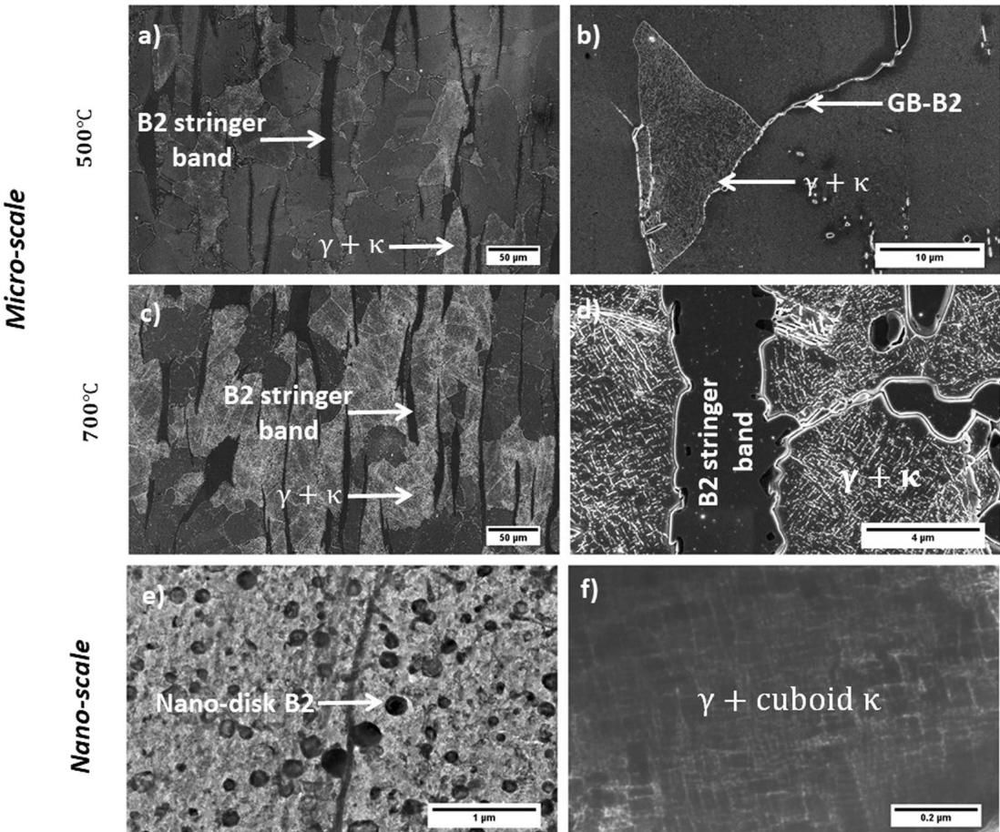  
Figure 2. Microstructural variation of low-density steels with annealing temperature. (a) SEM micrograph showing the formation of nano-sized κ-carbidess in the interior of γ grains, and the formation of B2 stringer bands (initially α phase). (b) Te formation of coarse grain boundary B2 particles (GB-B2). (c) and (d) Similar microstructure to the one formed during annealing at $5 0 0 ^ { \circ } \mathrm { C }$ was observed afer isothermal holding at $7 0 0 ^ { \circ } \mathrm { C }$ (e) TEM-bright feld image of a disk-like B2 particle in the α matrix afer annealing at higher temperatures (e.g. $9 0 0 ^ { \circ } \mathrm { C }$ and $1 { \bar { 0 } } 5 0 ^ { \circ } \mathrm { C } ) .$ . (f) TEM-bright feld image of cuboid κ particles in the γ matrix. All micrographs show the microstructure of Ni-containing sample. Te Ni-free followed the similar trend except that at lower annealing temperatures (e.g. $5 0 0 ^ { \circ } \mathrm { C }$ and $7 \bar { 0 } 0 ^ { \circ } \mathrm { C } )$ where α + needle-like κ-carbides were observed instead of B2 stringer bands.

Characterization. Te ordered phases were characterized by examination of selected-area difraction patterns (SADPs) and bright-feld (BF) images in transmission electron microscopy (TEM) JEOL 2000FX. Tin foils for TEM observation were prepared by twin-jet electro-polishing in a mixture of 10% perchloric acid and 90% ethanol with an applied potential of 25 V. Te steel specimens were, also, polished and etched in a 5% nital solution and the microstructures were observed using a Carl Zeiss Sigma Field Emission Scanning Electron Microscope (FE-SEM) operated at 20 kV. Te equipment was ftted with high-speed X-ray energy dispersive spectroscopy (EDS).

Nano-indentation. Nano-indentation tests were carried out at a constant loading/unloading rate of $5 0 0 \mu N s ^ { - 1 }$ up to a maximum load of $1 0 0 0 0 \mu N$ with a hold time of 20s. Each measurement in a particular phase was repeated at least 25 times and in arrays of $5 0 - 7 0$ indentations applied across the region of interest. Te measurements were performed for the following individual phases: solution-treated γ and α phases, B2 stringer bands, and both micro-meter sized and nano-disk B2. The hardness of the following combinations of phases was also determined because either it was impossible to measure the value of each phase individually or the combined hardness values were believed to be of interest for the future studies: γ + cuboid κ, γ + cuboid κ + microsized B2, γ + microsized B2, α + needle-shape $\kappa ,$ and α + nano-disk B2. An example of nano-indentation indents as recorded by SEM is shown in Fig. 3.

<table><tr><td>Alloy</td><td></td><td colspan="2">500°C</td><td colspan="2">700°C</td><td colspan="2">900°C</td><td colspan="2">1050°C</td></tr><tr><td rowspan="4">Fe-15Mn-10Al-0.5C-5Ni</td><td>Matrix Phase</td><td colspan="2">γ</td><td colspan="2">γ</td><td>γ</td><td>α</td><td>γ</td><td>α</td></tr><tr><td rowspan="3">Precipitates</td><td colspan="2">Cuboidal κ (&lt; 100 nm) (●)</td><td colspan="2">Cuboidal κ (&lt; 100 nm) (●)</td><td rowspan="3">Coarse B2 Particles (2–7 μm) Matrix: (◆)</td><td rowspan="3">Disc-like B2 (≈200 nm) (◆)</td><td rowspan="3">Coarse B2 Particles (2–4 μm) (◆)</td><td rowspan="3">Disc-like B2 (≈200 μm) (◆)</td></tr><tr><td colspan="2">Coarse B2 Particles (2–7 μm) (◆)</td><td colspan="2">Coarse B2 Particles (2–7 μm) (◆)</td></tr><tr><td colspan="2">B2 Stringer Bands (♣)</td><td colspan="2">B2 Stringer Bands (♣)</td></tr><tr><td rowspan="3">Fe-15Mn-10Al-0.5C</td><td>Matrix Phase</td><td>γ</td><td>α</td><td>γ</td><td>α</td><td>γ</td><td>α</td><td>γ</td><td>α</td></tr><tr><td rowspan="2">Precipitates</td><td>Coarse B2 Particles (2–4 μm) (◆)</td><td rowspan="2">Needle-like κ (width 200 ± 33 nm) (♠)</td><td>Coarse B2 Particles (2–4 μm) (◆)</td><td>Needle-like κ (width 500 ± 33 nm) (♠)</td><td rowspan="2">Coarse B2 Particles (2–4 μm) (◆)</td><td rowspan="2">Disc-like B2 (≈200 nm) (◆)</td><td rowspan="2">Coarse B2 Particles (2–4 μm) Matrix: (◆)</td><td rowspan="2">Disc-like B2 (≈200 nm) (◆)</td></tr><tr><td>Needle-like κ (width 200 ± 33 nm) (♠)</td><td>Needle-like κ (width 500 ± 33 nm) (♠)</td><td></td></tr></table>

Table 1. Phases present in the microstructure of 5 wt.% Ni and Ni-free samples as a function of annealing temperature.

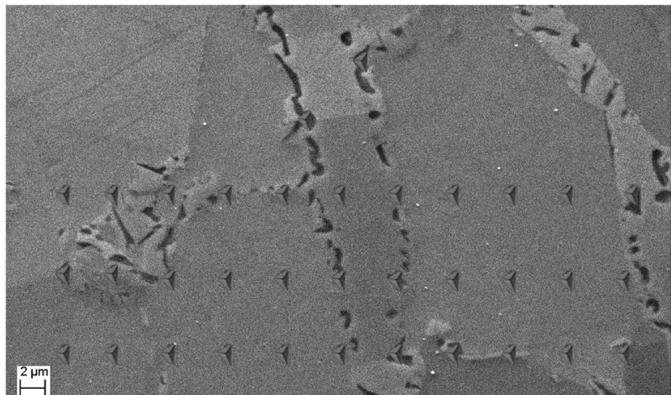  
Figure 3. Rows of nano-indentations carried out to determine the nano-hardness of diferent phases present in the microstructure.

ab-initio calculations. DFT calculations were carried out on diferent ordered phases using the method proposed by Hohenberg and Kohn16,17. Te generalized gradient approximation (GGA) of Perdew-Burke-Ernzerhof (PBE)18 in its spin-polarized manner was employed for the exchange and correlation functional. Calculations were performed using the Quantum-ESPRESSO package19,20. Ultrasof pseudo-potentials21 were created based on a modified Rappe-Rabe-Kaxiras-Joannopoulos (RRKJ) scheme according to the method of Rappe et al.22 For structure optimization, the Brillouin zone (BZ) integrations were done by an 18 × 18 × 18 Monkhorst and Pack grid23. A real-space grid with a 50 Ryd energy cut-of was used for the calculations of the charge density. Te augmentation charges were expanded up to 600 Ryd. A 30 × 30 × 30 grid with a 60 Ryd energy cut-of was used for the electronic density of states and the formation energy calculations. To calculate the bulk modulus, various unit cell volumes were simulated, and the values were ftted using a Murnaghan equation of state24. Dynamica matrices were deduced by the linear response of the electronic subsystem in the harmonic approximation. Te density of states was calculated by the tetrahedron method with a 30 × 30 × 30 mesh.

## Results and Discussion

Experimental results. Nano-indentation test results have been observed as function of four annealing temperatures (500 °C, 700 °C, 900 °C and 1050 °C) and two alloys compositions (Fe-15Mn-10Al-0.8C-5Ni and Fe-15Mn-10Al-0.8 C (all in wt.%)). Figure 4 shows the load-depth curves along with corresponding hardness values for the bulk α and γ phases (without precipitates) as well as the composite bulk phases containing diferently ordered precipitates. It is important to note that the nanoindentation technique as performed in this study is unable to measure the hardness of isolated nano-sized precipitates, but measures instead the hardness of the nano sized features within a surrounding matrix, and therefore vield a compound hardness value of the matrix with particles. In the present study, we observed two B2 phase with distinct morphology: B2 with fat interfaces and sharp edges with an average size of ≈1.4 μm formed in the γ-phase and disk-like precipitates with a size of a few hundred nanometres formed in α-phase. Additionally, κ -carbide formed in the γ phase had a cuboid shape with sizes of less than 100 nm and those formed in α-phase had a needle-like shape with an average size of ≈ 1.5 μm.

Te measured hardness values of various phases are all summarized in Table 2. Te basic trends from Fig. 4 and Table 2 are listed below for the α and γ phases. Te results for the hardness of the α phase and the composites formed with the α phase were found to be as follows:

1. Te hardness value of α was approximately 3 GPa in the solution-treated materials (Ni and Ni-free).

2. Te hardness values for the Ni-free sample were measured to be 5.3 GPa for α + needle-shape κ in the sample annealed at $5 0 0 ^ { \circ } \mathrm { C }$ and 6.7 GPa for α+ needle-shape κ in the sample annealed at $7 0 0 ^ { \circ } \mathrm { C } .$ . κ-particles precipitated at $7 0 0 ^ { \circ } \mathrm { C }$ contained higher Mn (≈24.8 wt.%) compared to those formed at $5 0 0 ^ { \circ } \mathrm { C } ( \approx 1 8 . 4 w t . \% )$ meaning that a higher annealing temperature afects the formation energy, lattice parameter and magnetization of κ-phase resulting in the formation of harder κ particles. Tis was confrmed by our ab-initio cal culations which are discussed later in this paper. At higher temperatures, when the precipitates changed to FeAl-type B2, the hardness increased to $8 . 9 \dot { G } P a$ for α + B2 and 8.3 GPa in the samples annealed at $9 0 0 ^ { \circ } \mathrm { C }$ and 1050 °C Al content of the particles ranged from 22.8 to 24.6 wt.%.

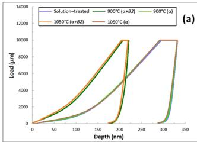

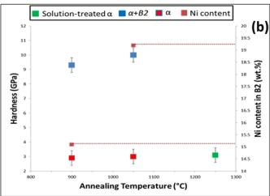

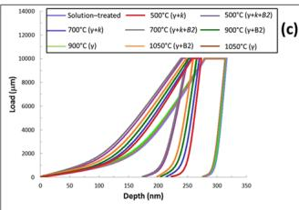

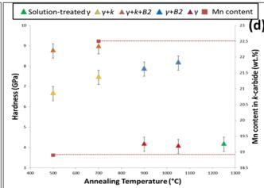

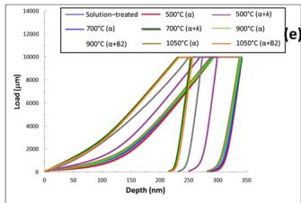

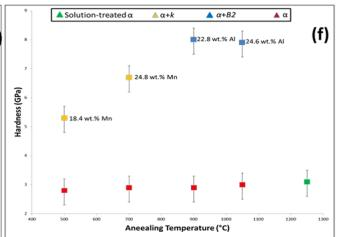

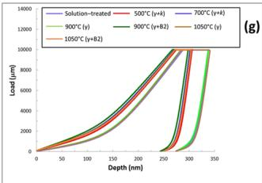

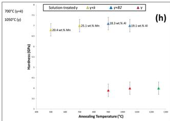  
Figure 4. (a) Te load-depth curves of α phase and its composites in Ni-containing sample and (b) the corresponding hardness values. (c) Te load-depth curves of austenite and its composites in Ni-containing sample and (d) their corresponding hardness values. (e) Te load-depth curves of α and its composites in Ni free sample and (f) the corresponding hardness values. (g) Te load-depth curves for γ phase and its composites in Ni-free sample and (h) their corresponding hardness values

<table><tr><td>Alloy</td><td>Temperature °C</td><td colspan="8">Hardness (GPa)</td></tr><tr><td rowspan="6">Fe-15Mn-10Al-0.5C-5Ni</td><td>Phases</td><td> $\gamma$ </td><td> $\alpha$ </td><td> $\gamma + \kappa$ </td><td> $\alpha + \kappa$ </td><td> $\gamma + \mathrm{B}2$ </td><td> $\alpha + \mathrm{B}2$ </td><td>B2 Stringer</td><td> $\gamma + \kappa + \mathrm{B}2$ </td></tr><tr><td>Solution Treated</td><td>4.2</td><td>3.1</td><td>—</td><td>—</td><td>—</td><td>—</td><td>—</td><td>—</td></tr><tr><td>500</td><td>—</td><td>—</td><td>6.7 (●)</td><td>—</td><td>—</td><td>—</td><td>10.1 (♣)</td><td>8.8 (●◆)</td></tr><tr><td>700</td><td>—</td><td>—</td><td>7.5 (●)</td><td>—</td><td>—</td><td>—</td><td>10.6 (♣)</td><td>9 (●◆)</td></tr><tr><td>900</td><td>4.1</td><td>2.9</td><td>—</td><td>—</td><td>7.9 (◆)</td><td>11.7(◆)</td><td>—</td><td>—</td></tr><tr><td>1050</td><td>4</td><td>3</td><td>—</td><td>—</td><td>8.2 (◆)</td><td>13.5 (◆)</td><td>—</td><td>—</td></tr><tr><td rowspan="6">Fe-15Mn-10Al-0.5 C</td><td>Phases</td><td> $\gamma$ </td><td> $\alpha$ </td><td> $\gamma + \kappa$ </td><td> $\alpha + \kappa$ </td><td> $\gamma + \mathrm{B}2$ </td><td> $\alpha + \mathrm{B}2$ </td><td>B2 Stringer</td><td> $\gamma + \kappa + \mathrm{B}2$ </td></tr><tr><td>Solution Treated</td><td>4</td><td>3</td><td>—</td><td>—</td><td>—</td><td>—</td><td>—</td><td>—</td></tr><tr><td>500</td><td>—</td><td>—</td><td>6.8 (♠)</td><td>5.3 (♠)</td><td>—</td><td>—</td><td>—</td><td>—</td></tr><tr><td>700</td><td>—</td><td>—</td><td>7 (♠)</td><td>6.7 (♠)</td><td>—</td><td>—</td><td>—</td><td>—</td></tr><tr><td>900</td><td>3.8</td><td>2.9</td><td>—</td><td>—</td><td>7.2 (◆)</td><td>8.9 (◆)</td><td>—</td><td>—</td></tr><tr><td>1050</td><td>4</td><td>3</td><td>—</td><td>—</td><td>7 (◆)</td><td>8.3 (◆)</td><td>—</td><td>—</td></tr></table>

Table 2. Summary of the hardness values for various individual phases and that of the combinations of phases.

3. For the Ni-containing samples, the precipitates changed for all annealing temperatures to NiAl-type B2 and the measured hardness values were for the composite structures: 11.7 GPa for $\alpha + \mathrm { B } 2$ for samples annealed at ${ 9 0 0 ^ { \circ } } \mathrm { C } ,$ and13.5 GPa for α + B2 for samples annealed at $1 0 5 0 ^ { \circ } \mathrm { C } .$ At lower temperatures, the B2 precipitates changed to stringer bands and resulted in hardness values of 10.1 GPa for samples annealed at $5 0 0 ^ { \circ } \mathrm { C }$ and $1 0 . 6 G \dot { P } a$ for stringer bands annealed at $7 0 0 ^ { \circ } \mathrm { C }$ . It was found that the variation of hardnes values of B2 in Ni-containing sample is a function of Ni content. Increasing annealing temperature resulted in an increase in the Ni content of B2 particles which ultimately led to an increment in the hardness values. To summarize the results for the hardness of the γ phase and the composites formed with the γ phase:

4. Te hardness was found to be approximately 4.2 GPa and 4.0 GPa for the solution-treated single γ-phase in both Ni and Ni-free samples respectively.

5. For the Ni-containing samples the hardness was measured to be 6.7–7.5 GPa for γ + cuboid κ and 8.8 −9GPa for the γ + cuboid $\kappa + \mathtt { B } 2$ composite phase for samples annealed at $5 0 0 { - } 7 0 0 ^ { \circ } \mathrm { C }$ respecively. At higher annealing temperatures $9 0 0 { - } 1 \dot { 0 } \dot { 5 } 0 ^ { \circ } \mathrm { C }$ only B2 precipitated and the measured hardness values were $7 . 5 - 8 . 2 G P a \gamma + \mathrm { B } 2$ for the sample annealed at 900 and $1 0 5 0 ^ { \circ } \mathrm { C }$ respecitively.

6. For the Ni-free sample, the hardness values were, 6.8–7 GPa for γ + cuboid κ annealed at $5 0 0 ^ { \circ } \mathrm { C }$ and

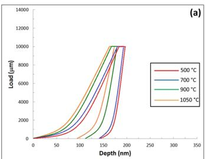

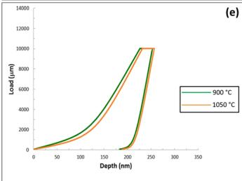

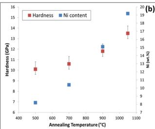

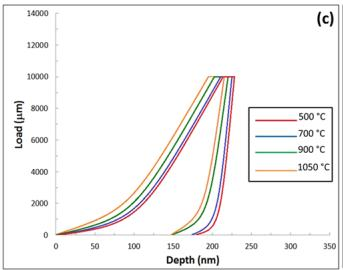

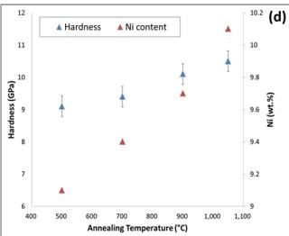

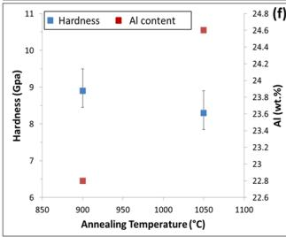

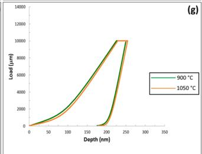

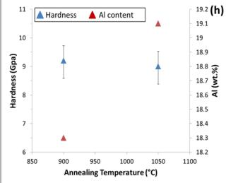  
Figure 5. (a) Te load-depth curves of NiAl-type nanosized disk-like B2 phase formed within an α matrix in the Ni-containing sample for the four annealing treatments and (b) the corresponding hardness values. (c) T load-depth curves of coarse B2 particles precipitated in the γ matrix in the Ni-containing sample and (d) their corresponding hardness values. (e) Te load-depth curves of NiAl-type nanosized disk-like B2 phase formed within an α matrix in the Ni-free sample for the four annealing treatments and (f) the corresponding hardness values. (g) Te load-depth curves of coarse B2 particles precipitated in the γ matrix in the Ni-free sample and (h) their corresponding hardness values.

700 °C. At higher annealing temperatures B2 was the only phase to precipitate but the hardness did not change signifcantly (7.2 GPa for γ + B2 in the sample annealed at 900 °C and 7 GPa for the γ + B2 in the same sample at 1050 °C.

Te trends listed in 1–6 suggests that the hardness increases in the composite structures resulting from higher temperature annealing, when precipitates are predominantly B2 and the highest hardness is found in the structure disk-like B2 formed in the ferrite (hardness value = 10 GPa). According to Orowan mechanism, the increase in shear stress (Δτ) is proportional to the inverse of the precipitates’ diameter: $\Delta \tau \propto \mathrm { R } ^ { - 1 2 5 }$ . In other words, as the size of precipitates decreases the resistance to shear increases. Tus, the higher hardness values obtained at higher annealing temperatures can be also attributed to the formation of uniformly distributed nano-sized disk-like B2 particles which increase the shear resistance of the α-matrix10. It can be seen that the hardness of γ + (nanosized-κ-carbide) + (microsized-B2) composite reached a higher value than γ + micron sized B2 composite. Tis is despite the fact that the κ-carbides are known to not be as resistant to shear as B2 intermetallic compounds. Terefore, the addition of brittle nano-sized κ-carbide to γ + micron sized B2 composite increase the hardness further.

Te hardness values of the coarse NiAl-type B2 particles precipitated in the γ phase of Ni-containing sample was less than those of the corresponding precipitates in the α (Fig. 5d). Tis phenomenon occurs mainly due to the Ni atoms primarily accumulated in the α phase to form the B2 stringer bands at the two lower annealing temperatures. At higher annealing temperatures, more Ni atoms were available to form the nanosized-B2 particles in the α phase. Terefore, hardness values increase from 9.1 GPa (Ni: 8.2 wt.%) at $5 0 0 ^ { \circ } \mathrm { C }$ to 10.5 GPa (Ni: 10.1 wt.%) at 1050 °C.

However, for Ni-free sample, the values of coarse FeAl-type B2 particles in the γ and nano-sized B2 particles did not differ significantly (Fig. 5h). The values were recorded to be 9.2 GPa for annealing at 900°C (8.9 GPa for nanosized B2 in α formed during the same treatment) and 9 GPa for annealing at $1 0 5 0 ^ { \circ } \bar { \mathrm { C } }$ (8.3 GPa for the same phase in α precipitated during the same treatment). Te Al content of B2 particles formed in γ phase was less than those formed in α (Al is an α stabiliser) and this was anticipated to lead to an increase in the hardness of the par ticles. For a detailed discussion on the efects of size and morphology of ordered precipitates on the mechanical properties oflow-density steels, the reader is referred to refs10,11

Te nanoindentation technique as performed in this study was only able to measure the hardness of the nano-sized features as present within the surrounding matrix, and therefore yields a compound hardness value of the matrix with particles. To evaluate the possible size-efect of the diferently sized phases on the hardness of the matrix and particle composite, it is required to perform nanoindentation using diferent indentors or of diferent applied loads. Unfortunately, changing the indentation size or volume will further introduce a nano-indentation size-efect as a function of varying size and shape of the plastic zone below the indent26,27 which may obscure the real infuences of the various precipitates and their sizes on the hardness of the composite microstructure.

DFT calculations. We performed frst-principle calculations to determine the lattice parameter and thus elastic constants of κ-carbide. Although, the calculated lattice parameter of the ordered precipitate FeAl-B2 for cases with or without spin efects (spin-polarized (sp), without spin efects (np), the blue diamond in Fig. 6) was slightly less than the experimental value (red triangle), the values were still in good agreement with the reported experimental ones. Te calculations for without spin efects were performed as it was reported in the literature that the perfect FeAl-B2 phase does not exhibit a macroscopic magnetic momentum28. Calculations were also carried out for the $\mathrm { F e } _ { 3 } \mathrm { A l - L } 1 _ { 2 }$ compound for comparison with the Fe AlC phase. Te lattice constant for $\mathrm { F e } _ { 3 } \mathrm { A l C }$ was calculated to be larger than that for Fe Al-L1 which agrees well with the experimental observations reported in refs29,30. Te insertion of the C atom in the crystal structure of $\mathrm { L } 1 _ { 2 }$ in the octahedral interstitial site induces an expansion of the lattice parameter. Te calculations showed that the substitution of the Fe atoms by the Mn atoms increases the lattice parameters of the structure from 3.78 A for Fe MnAlC to 3.84 A for the Mn AlC phase29,31,32. Tis increase in the lattice parameter because of insertion of additional Mn atoms was believed to be due to the larger atomic radii of Mn $( r _ { M n } = 1 . 6 1 \dot { A } )$ compared to that of Fe $( r _ { F e } = 1 . 5 6 \dot { A } ) ^ { 3 3 }$

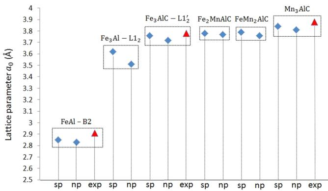  
Figure 6. Te lattice constants for diferent ordered compounds: FeAl-B2, $F e _ { 3 } A l { - } L 1 _ { 2 } , F e _ { 3 } A l C { - } L 1 _ { 2 } , F e _ { 2 } M n A l C ,$ $F e \bar { M } n _ { 2 } A l C ,$ , and $M n _ { 3 } A l C .$ Experimental values are indicated by red triangles.

DFT calculation $\mathbf { i } ^ { 3 4 , 3 5 }$ of the efects of increasing Al on the elastic constants of Fe-Al compounds showed that as the composition changes from FeAl to FeAl and FeAl the $\mathrm { C } _ { 1 1 }$ elastic constant decreases from 294 to 223 and 168.5 (all in GPa) respectively, while the value of $\mathrm { C } _ { 4 4 }$ reduced from 157 to 109.6 and 76.1 GPa when the structure changed from FeAl to FeAl and $\mathrm { F e A l } _ { 3 }$ respectively. On the other hand, for Ni-Al compounds, ab-initio calculations36 showed that $\mathrm { C } _ { 1 1 }$ increased from 221.67 to 375.61 GPa and $\mathrm { C } _ { 4 4 }$ increased from 116.99 to 133.21 GPa by changing the structure from NiAl to $\mathrm { N i } _ { 3 } \mathrm { A l } .$ . From values of elastic constants of the two compounds, Ni-Al compounds have elastic constants with higher values compared to Fe-Al compounds. In addition to that Breuer et $a l . ^ { 3 7 }$ conducted a series of experiments and measured the enthalpy of formation of $\mathrm { { B } 2 \mathrm { - F e _ { 1 \mathrm { - x } } \mathrm { - A l } } }$ and $\mathrm { B } 2 \mathrm { - } \mathrm { ( F e , N i ) _ { 1 - x } \mathrm { - } A l } .$ x at 1073 K. Teir results showed that generally, enthalpy of formation of $\mathrm { B } 2 \mathrm { - } \left( \mathrm { F e } , \mathrm { N i } \right) _ { \mathrm { 1 - x } } \mathrm { - A l _ { x } }$ is of greater magnitude than that of B2- $\cdot \mathrm { F e } _ { \mathrm { 1 - x } } \mathrm { - A l } _ { \mathrm { x } } .$ It was also shown that starting with binary B2- $\mathrm { F e } _ { \mathrm { 1 - x } } { \mathrm { - A l } } _ { \mathrm { x } }$ and replacing Fe with Ni, $\mathrm { B } 2 \mathrm { - } \mathrm { ( F e , N i ) _ { 1 - x } \mathrm { - } A l } .$ while keeping the Al content at a constant value, the enthalpy of formation becomes increasingly more negative37. In other words, increasing the Ni content of B2 can result in the formation of a harder B2 phase. Tis is supported by the experimental results in Table 2 when comparing the composite structures, with Ni vs. without Ni, containing B2 in both austenite and ferrite. Higher annealing temperatures led to an increase in the Ni content of B2 phase. As is obvious from Table 2, the hardness values increased for those B2 particles formed at higher temperatures.

Te ferromagnetic and non-magnetic states of ordered Fe AlC were also investigated. Te ground state was calculated to be 30meV/at in favour of the ferromagnetic state with a magnetic moment $( 1 . 1 \mu _ { B } / a t . F e )$ more than twice smaller than in Fe Al. To study why the magnetic moment decreased compared to the $\mathrm { L } 1 _ { 2 }$ compound, we investigated the role of the lattice parameter on the magnetic moment. A numerical study was performed in which the lattice parameter of $\mathrm { F e } _ { 3 } \mathrm { A l C }$ was imposed to $\mathrm { F e } _ { 3 } \mathrm { A l } .$ . Te results showed that the decrease of the mag netism from $\operatorname { L } 1 _ { 2 }$ to imposed-L1 was not due to the increase in the lattice parameter $( \mu ^ { L 1 _ { 2 } } ( a _ { 0 } = 3 . 7 6 ) \overline { { = } }$ $2 . 3 9 > \mu ^ { L 1 _ { 2 } } ( a _ { 0 } = 3 . 6 2 ) = 2 . 2 4 )$ . It was therefore assumed that the decrease in the magnetism is due to the inter actions between Fe and C atoms.

Te total Density of States (DOS) of the four crystalline  κ-carbides are presented in Fig. 7. Te overall shapes of the four structures were very similar. Te only diference was the so-called ‘rigid band shif’: the shif of the peaks to higher energy or equivalently the shif of the Fermi level to lower energy. Tis was believed to result from two efects: frst Mn has one less electron than Fe, and second, the replacement of Fe by Mn barely produces a change in the electronic states around the Fermi level.

Te vibrational band structures for FeAl, Fe Al and Fe AlC phases were calculated with the SGGA approx imation. In the case of FeAl (Fig. 8a), the high-frequency branches were initiated mainly from the low mass Al atoms whereas the low-frequency bands primarily originated from the high-mass Fe atoms. Tese two bands were separated by an optical gap. Te optical gap (around 0.7 THz) had the same width as that calculated for FeAl-B2 or $\mathrm { D O } 3 ^ { \dot { 3 } 8 }$ , while the results on $\mathbf { \bar { F } e } _ { 3 } \mathbf { A l - } \mathbf { \bar { L } } \bar { 1 } _ { 2 }$ were close to those calculated for $\mathrm { N i } _ { 3 } \mathrm { A l - L } 1 _ { 2 } { } ^ { 3 9 }$ . As for $\mathrm { F e } _ { 3 } \mathrm { A l }$ (Fig. 8b), the result showed that the structure is stable, although it was reported in the literature that within the GGA approximation the L1 structure is not mechanically stable38. Tis anomaly between the present calculation and those reported in the literature showed that the properties are very sensitive to the choice of the functional. Te vibrational band structure for $\mathrm { F e } _ { 3 } \mathrm { A l C }$ was shown in Fig. 8c. In contrast to the previous calculation for $\mathrm { F e } _ { 3 } \mathrm { A l }$ no signifcant diferences were noted between the present calculations (GGA approach) and those reported in the literature (SGGA approach).

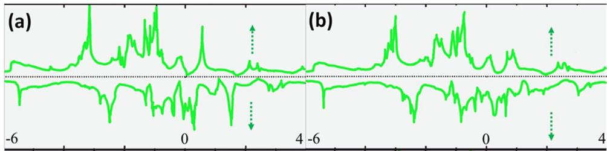

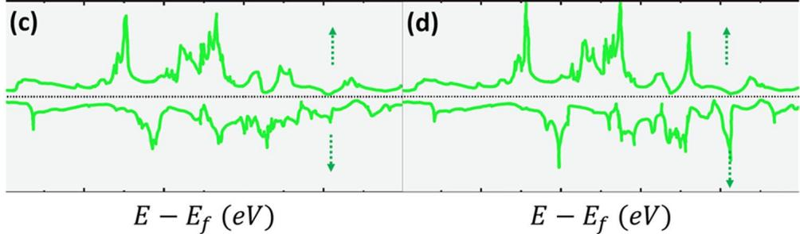  
Figure 7. Total density of states of (a) Fe AlC, (b) Fe MnAlC, (c) ${ \mathrm { F e M n } } _ { 2 } { \mathrm { A l C } } ,$ and (d) $\mathrm { { M n } } _ { 3 } \mathrm { { A l C } } .$

We used two methods to evaluate the elastic constants of diferent compounds under study:

•	 Te elastic constants $C _ { i j }$ were derived from the vibrational acoustic dispersion curves presented above. For the cubic systems, only three elastic constants, namely $C _ { 1 1 } , C _ { 1 2 } ,$ and $C _ { 4 4 } ,$ are independent.

•	 In the second method, a couple of lattice distortions was used to determine the elastic constants40–42.

Te detailed descriptions of both methods are explained in the methods section.

Te calculation results are summarized in Table 3. For $\mathrm { F e } _ { 3 } \mathrm { A l }$ the elastic constants were similar to other Fe-Al ordered phases. Te occupation fo the octahedral interstitial site by C atoms rigidifed the $\mathrm { F e } _ { 3 } \mathrm { A l C }$ in comparison with $F e _ { 3 } A l .$ This is the direct manifestation of the strong Fe-C bonds in the $<$ 100 directions. The calculations revealed that all elastic constants of ${ \mathrm { M n } } _ { 3 } { \mathrm { A l C } }$ are greater than those of $\mathrm { F e } _ { 3 } \mathrm { A l C }$ confrming the experimental hard ness values reported above (the increase in the Mn content of κ-carbide resulted in an increase in the hardness value of the phase). Tis is also a direct consequence of strong Mn-C bonds which are harder than Fe-C bonds. For the tetragonal structures, Fe MnAlC and FeMn AlC, $C _ { 1 1 }$ and $C _ { 3 3 }$ are predominantly greater than the other elastic constants indicating the formation of strong Mn-C bonds in 100 directions

From the calculated set of elastic constants, practical parameters such as bulk modulus $B _ { 0 } ,$ the factor of anisotropy $C _ { a } ,$ , the shear modulus $G ,$ and the Young’s modulus E in two crystallographic directions ([100] and [111]) were calculated (see methods) and listed in Table 4.

Te Fe AlC phase showed a large bulk modulus and also a strong degree of anisotropy $( C _ { a } = 2 . 3 9$ from the frst method and 2.47 from the second method). Tis anisotropy was also showed by phase-feld modelling of κ-carbide9 and also confrmed by experiments11. It is expected in metals, that $C _ { a }$ is smaller than 1 but these calcu lations showed that this value for κ was greater than 1. Tis led $E _ { 1 1 1 }$ to be smaller than $E _ { 1 0 0 } .$ . In addition, the degree of anisotropy for FeAl compound was small $( C _ { a } = 0 . 5 4 )$ from the frst method and 0.53 from the second method). Tis low degree of anisotropy was also in good agreement with the phase-feld simulation of the B2 intermetallic compound11. Again, upon the substitution of Fe atoms by Mn ones, the various properties such as bulk modulus, shear modulus, and Young’s modulus increased confrming the experimentally observed increase in the hardness of the κ phase enriched by Mn atoms. Tis is supported by the experimental results (point 2 in the results section), wherein the κ-ferrite hardness was higher in the structures with higher Mn containing precipitates obtained at 700 °C compared to those obtained at $\mathsf { \Pi } _ { 5 0 0 ^ { \circ } \mathrm { C } } ^ { }$ . In addition, the shear modulus of $\mathrm { F e } _ { 3 } \mathrm { A l } \check { \mathrm { C } }$ was greater than that of FeAl or $\mathrm { F e } _ { 3 } \mathrm { \bar { A l } }$ confrming the un-shearable nature of these precipitates that was observed experimentally.

## Conclusions

Afer annealing at temperatures between 500 and 1050 °C the hardness of micro- and nano-structural features found in Fe-15Mn-10Al-0.8C-5Ni and Fe-15Mn-10Al-0.8 C low-density steels were investigated experimentally through nano-indentation and computationally through ab-initio calculations. Te hardness of micro-structure with B2 precipitates was measured through nano-indentation, whereas the hardness of nano-sized κ phase was evaluated through ab-initio calculations.

Te addition of Ni increased the hardness of the B2 phase due to the replacement of Ni-Al bonds over the Fe-Al bonds. In the presence of Ni in the alloy, the peak hardness increased from 7.2 GPa to 9 GPa. Tis was observed in both the austenite and the ferrite phases.

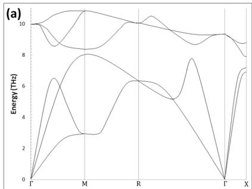

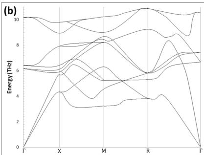

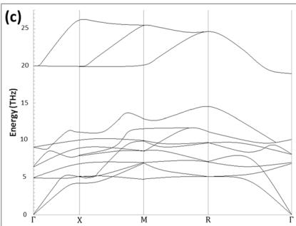  
Figure 8. Vibrational band structures for (a) FeAl, (b) $F e _ { 3 } A l ,$ and (c) $F e _ { 3 } A l C$ compound.

<table><tr><td>Compound</td><td colspan="2"> $C_{11}$ </td><td colspan="2"> $C_{12}$ </td><td colspan="2"> $C_{44}$ </td><td> $C_{13}$ </td><td> $C_{33}$ </td><td> $C_{36}$ </td></tr><tr><td>FeAl</td><td>273</td><td>-293</td><td>110</td><td>-122</td><td>149</td><td>-160</td><td>—</td><td>—</td><td>—</td></tr><tr><td> $Fe_3Al$ </td><td>181</td><td>-184</td><td>139</td><td>-165</td><td>163</td><td>-124</td><td>—</td><td>—</td><td>—</td></tr><tr><td> $Fe_3AlC(sp)$ </td><td>450</td><td>-431</td><td>100</td><td>-94</td><td>73</td><td>-68</td><td>—</td><td>—</td><td>—</td></tr><tr><td> $Fe_2AlC$ </td><td>—</td><td>-427</td><td>—</td><td>-80</td><td>—</td><td>-96</td><td>-97</td><td>-471</td><td>-98</td></tr><tr><td>FeMnAlC</td><td>—</td><td>-470</td><td>—</td><td>-81</td><td>—</td><td>-100</td><td>-143</td><td>-451</td><td>-101</td></tr><tr><td> $Mn_3AlC$ </td><td>—</td><td>-448</td><td>—</td><td>-98</td><td>—</td><td>-110</td><td>—</td><td>—</td><td>—</td></tr></table>

Table 3. Elastic constants for the compounds under study (in GPa). Te values in parenthesis were calculated using the second method (lattice distortion).

<table><tr><td>Compound</td><td colspan="2"> $B_0$ </td><td colspan="2"> $C_{\alpha}$ </td><td colspan="2">G</td><td colspan="2"> $E_{100}$ </td><td colspan="2"> $E_{111}$ </td></tr><tr><td>FeAl</td><td>164</td><td>-179</td><td>0.54</td><td>-0.53</td><td>81.5</td><td>-85.5</td><td>210</td><td>-221</td><td>333</td><td>-370</td></tr><tr><td> $Fe_3Al$ </td><td>153</td><td>-171</td><td>0.12</td><td>0.08</td><td>21</td><td>-9.5</td><td>60</td><td>-28</td><td>322</td><td>-270</td></tr><tr><td> $Fe_3AlC(sp)$ </td><td>216</td><td>-206</td><td>2.39</td><td>-2.47</td><td>175</td><td>-168.5</td><td>477</td><td>-397</td><td>217</td><td>-227</td></tr><tr><td> $Fe_2AlC$ </td><td>—</td><td>-195</td><td>—</td><td>-1.8</td><td>—</td><td>-173.5</td><td>—</td><td>-402</td><td>—</td><td>-256</td></tr><tr><td>FeMnAlC</td><td>—</td><td>-201</td><td>—</td><td>-1.94</td><td>—</td><td>-195</td><td>—</td><td>-446</td><td>—</td><td>-263</td></tr><tr><td> $Mn_3AlC$ </td><td>—</td><td>-214</td><td>—</td><td>-1.59</td><td>—</td><td>-175</td><td>—</td><td>-412</td><td>—</td><td>-285</td></tr></table>

Table 4. Alternative set of elastic parameters: the bulk modulus $B _ { 0 }$ (in $\mathrm { G P a } )$ , the factor of anisotropy $C _ { a } ,$ the shear modulus G (in GPa), and the Young’s modulus in two crystallographic directions $E _ { 1 0 0 }$ and $E _ { 1 1 1 }$ (in GPa).

•	 Te nano-sized cuboid κ and micron-sized B2 phases obtained in austenite when the Ni containing samples were annealed at $7 0 0 ^ { \circ } \mathrm { C }$ or lower temperature improved the hardness further in the austenite phase. Te γ phase in samples annealed at higher temperatures $\mathsf { \bar { ( 9 0 0 - 1 0 5 0 ^ { \circ } C ) } }$ , resulted in lower hardness due to the instability of nano-sized cuboid κ.

•	 Te ferritic phase obtained in the Ni-containing alloys annealed at 900–1050 °C, produced a hard structure of 10 GPa due to the dispersion of nano-sized discs of B2 phase.

•	 Based on the frst-principles calculations of diferent ordered structures, it was found that the insertion of a C atom only enhances the elastic constant in the κ-phase $( \mathrm { L } 1 _ { 2 } ^ { \prime } )$ whereas it has a lesser efect on the $\mathrm { F e } _ { 3 } \mathrm { A l } -$ L1 phase. However, the presence of Mn atoms in the structure of F $\mathrm { e } _ { 3 } \mathrm { A l C - } \kappa$ increases its elastic constant. Tis was supported by the experimental results.

## Methods

ab-initio calculations. In the frst method, the slope of the acoustic branches in the [100] direction was used to calculate $C _ { 1 1 }$ and $C _ { 4 4 } \mathrm { : }$

$$
\nu_ {l} ^ {[ 1 0 0 ]} = \sqrt {\frac {C _ {1 1}}{\rho}}\tag{1}
$$

$$
\nu_ {t} ^ {[ 1 0 0 ]} = \sqrt {\frac {C _ {4 4}}{\rho}}\tag{2}
$$

where $\nu _ { l } ^ { [ 1 0 0 ] }$ and $\nu _ { t } ^ { [ 1 0 0 ] }$ are the longitudinal and transverse velocity of sound in the compound, respectively. $\rho$ is the density of the compound: for FeAl 5839, for $\mathrm { F e } _ { 3 } \mathrm { A l }$ 6612 and for Fe AlC 6527 (all in kg/m3). [111] direction was used to calculate the value of $C _ { 1 2 } \colon$

$$
\nu_ {l} ^ {[ 1 1 1 ]} = \sqrt {\frac {C _ {1 1} + 2 C _ {1 2} + 4 C _ {4 4}}{3 \rho}}\tag{3}
$$

In the second method, a volume conserving orthorhombic distortion

$$
\epsilon = \left( \begin{array}{c c c} \delta & 0 & 0 \\ 0 & - \delta & 0 \\ 0 & 0 & \frac {\delta^ {2}}{1 - \delta^ {2}} \end{array} \right)\tag{4}
$$

the associated change in total energy can be written as

$$
E (\delta) = E (0) + (C _ {1 1} - C _ {1 2}) V \delta^ {2} + O (\delta^ {4})\tag{5}
$$

where $V$ is the volume of the unit cell. Tis energy was solved to determine $C _ { 1 1 }$ and $C _ { 1 2 } .$ For $C _ { 4 4 } ,$ a monoclinic distortion

$$
\epsilon = \left( \begin{array}{c c c} 0 & \frac {\delta}{2} & 0 \\ \frac {\delta}{2} & 0 & 0 \\ 0 & 0 & \frac {\delta^ {2}}{4 - \delta^ {2}} \end{array} \right)\tag{6}
$$

results in a total energy change as following:

$$
E (\delta) = E (0) + \frac {1}{2} C _ {4 4} V \delta^ {2} + O (\delta^ {4})\tag{7}
$$

For a tetragonal crystal structure, three additional independent elastic constant exists, namely $C _ { 1 3 } , C _ { 3 3 } ,$ and $C _ { 6 6 } .$ Te scheme presented in the $\mathrm { r e f . } ^ { 4 0 }$ was used to determine these elastic constants for $\mathrm { F e } _ { 2 } \mathrm { M n A l C }$ and FeMn AlC phases.

Te practical parameters are calculated according to the following equations40:

$$
B _ {0} = \frac {C _ {1 1} + 2 C _ {1 2}}{3}\tag{8}
$$

$$
C _ {a} = \frac {C _ {1 1} - C _ {1 2}}{2 C _ {4 4}}\tag{9}
$$

$$
G = \frac {C _ {1 1} - C _ {1 2}}{2}\tag{10}
$$

$$
E _ {1 0 0} = \frac {(C _ {1 1} + 2 C _ {1 2}) (C _ {1 1} - C _ {1 2})}{C _ {1 1} + C _ {1 2}}\tag{11}
$$

$$
E _ {1 1 1} = \left(\frac {1}{E _ {1 0 0}} + \frac {C _ {1 1} - C _ {1 2} - 2 C _ {4 4}}{3 C _ {4 4} (C _ {1 1} - C _ {1 2})}\right) ^ {- 1}\tag{12}
$$

## References

1. Zuazo, I. et al. Low-Density Steels: Complex Metallurgy for Automotive Applications. JOM 66, 1747–1758 (2014).

2. Rijkenberg, R. A., Blowey, A., Bellina, P. & Wooffindin, C. Advanced High Stretch-Flange Formability Steels for Chassis & Suspension Applications 3. Product concept: tensile properties and microstructure. 4th International Conference on Steels in Car and Trucks, June 15-19, Braunschweig, Germany 426–433 (2014).

3. Springer, H. & Raabe, D. Rapid alloy prototyping: Compositional and thermo-mechanical high throughput bulk combinatorial design of structural materials based on the example of 30Mn-1.2C-xAl triplex steels. Acta Mater. 60, 4950–4959 (2012).

4. Frommeyer, G., Drewes, E. J. & Engl, B. Physical and mechanical properties of iron-aluminium-(Mn, Si) lightweight steels. Rev. Métallurgie–International J. Metall. 97, 1245–1253 (2000)

5. Gutierrez-Urrutia, I. & Raabe, D. High strength and ductile low density austenitic FeMnAlC steels: Simplex and alloys strengthened by nanoscale ordered carbides. Mater. Sci. Technol. 30, 1099–1104 (2014)

6. Gutierrez-Urrutia, I. & Raabe, D. Infuence of Al content and precipitation state on the mechanical behavior of austenitic high-Mn low-density steels. Scr Mater 68. 343-347 (2013).

7. Yao, M. J. et al. Combined atom probe tomography and density functional theory investigation of the Al of-stoichiometry of κ-carbides in an austenitic Fe-Mn-Al-C low density steel. Acta Mater. 106, 229–238 (2016).

8. Park, S. J. et al. Microstructure and tensile behavior of duplex low-density steel containing 5 mass% aluminum. Scr. Mater. 68, 365–369 (2013).

9. Rahnama, A., Dashwood, R. & Sridhar, S. A phase-feld method coupled with CALPHAD for the simulation of ordered ordered k-cabide precipitates in both disorered gamman and alpha phases in low density steel. Comput. Mater. Sci. 126, 152–159 (2017).

10. Rahnama, A., Spooner, S. & Sridhar, S. Control of intermetallic nano-particles through annealing in duplex low density steel. Mater. Lett. 189.13-16 (2017).

11. Rahnama, A., Kotadia, H. & Sridhar, S. Effect of Ni alloving on the microstructural evolution and mechanical properties of two duplex light-weight steels during diferent annealing temperatures: Experiment and phase-feld simulation. Acta Mater. 132, 627-643 (2017)

12. Lin, C. L., Chao, C. G., Juang, J. Y., Yang, J. M. & Liu, T. F. Deformation mechanisms in ultrahigh-strength and high-ductility nanostructured FeMnAlC alloy. J. Alloys Compd. 586, 616–620 (2014)

13. Sohn, S. S., Lee, B. J., Lee, S. & Kwak, J. H. Microstructural analysis of cracking phenomenon occurring during cold rolling of (0.1\~0.7)C-3Mn-5Al lightweight steels. Met. Mater. Int. 21, 43–53 (2015).

14. Kim, S. H., Kim, H. & Kim, N. J. Brittle intermetallic compound makes ultrastrong low-density steel with large ductility. Nature 518, 77–79 (2015).

15. Seol, J. B. et al. Direct evidence for the formation of ordered carbides in a ferrite-based low-density Fe-Mn-Al-C alloy studied by transmission electron microscopy and atom probe tomography. Scr. Mater. 68, 348–353 (2013).

16. Hohenberg, P. & Kohn, W. Inhomogeneous electron gas. Phys. Rev. 136, B864 (1964).

17. Kohn, W. & Sham, L. J. Self-consistent equations including exchange and correlation efects. Phys. Rev. 140, A1133 (1965).

18. Perdew, J. P., Burke, K. & Ernzerhof, M. Generalized gradient approximation made simple. Phys. Rev. Lett. 77, 3865–3868 (1996).

19. Giannozzi, P. et al. QUANTUM ESPRESSO: A modular and open-source sofware project for quantum simulations of materials. J. Phys. Condens. Matter 21 (2009).

20. Giannozzi, P. et al. Advanced capabilities for materials modelling with Quantum ESPRESSO. J. Phys. Condens. Matter 29, 465901 (2017).

21. Vanderbilt, D. Sof self-consistent pseudopotentials in a generalized eigenvalue formalism. Phys. Rev. B 41, 7892–7895 (1990)

22. Rappe, A. M., Rabe, K. M., Kaxiras, E. & Joannopoulos, J. D. Optimized pseudopotentials. Phys. Rev. B 41, 1227–1230 (1990).

23. Monkhorst, H. J. & Pack, J. D. Special points for Brillouin-zone integrations. Phys. Rev. B 13, 5188 (1976).

24. Murnaghan, F. D. Te compressibility of media under extreme pressures. Proc. Natl. Acad. Sci. 30, 244–247 (1944).

25. Orowan, E. Discussion on internal stresses. In Symposium on internal stresses in metals and alloys 451–453 (1948).

26. Hou, X. & Jennett, N. M. Application of a modifed slip-distance theory to the indentation of single-crystal and polycrystalline copper to model the interactions between indentation size and structure size efects. Acta Mater. 60, 4128–4135 (2012).

27. Hou, X. D. & Jennett, N. M. A method to separate and quantify the efects of indentation size, residual stress and plastic damag when mapping properties using instrumented indentation. J. Phys. D. Appl. Phys. 50 (2017)

28. Das, G. P., Rao, B. K., Jena, P. & Deevi, S. C. Electronic structure of substoichiometric Fe-Al intermetallics. Phys. Rev. B - Condens. Matter Mater. Phys. 66, 1–13 (2002).

29. Palm, M. & Inden, G. Experimental determination of phase equilibria in the FeAlC system. Intermetallics 3, 443–454 (1995).

30. Choo, W. K. & Han, K. H. Phase Constitution and Lattice Parameter Relationships in Rapidly Solidifed (Fe 0.65 Mn 0.35)0.83 A 0.17-x C and Fe3AI-xC Pseudo-Binary Alloys. Metall. Trans. A 16, 5–10 (1985).

31. Kimura, Y., Handa, K., Hayashi, K. & Mishima, Y. Microstructure control and ductility improvement of the two-phase γ-Fe/κ-(Fe, Mn)3AlC alloys in the Fe-Mn-Al-C quaternary system. Intermetallics 12, 607–617 (2004).

32. Wen, Y. et al. Lattice, magnetic and electronic transport behaviors of Ge-doped Mn3XC (X = Al, Zn, Ga). J. Alloys Compd. 489, 289–292 (2010).

33. Clementi, E. & Raimondi, D. L. Atomic Screening Constants from SCF Functions. J. Chem. Phys. 38, 2686–2689 (1963).

34. Mubarak, A. A. The elastic, electronic and magnetism structure of the MAl and M3Al (M = Fe and Ni) alloy with and without hydrogen atoms. I Magn. Magn. Mater 401. 816–822 (2016)

35. Liu, Y. H., Chong, X. Y., Jiang, Y. H., Zhou, R. & Feng, J. Mechanical properties and electronic structures of Fe-Al intermetallic. Phys. B Condens. Matter 506, 1–11 (2017).

36. Ponomareva, A. V., Isaev, E. I., Vekilov, Y. K. & Abrikosov, I. A. Site preference and efect of alloying on elastic properties of ternary B 2 NiAl-based alloys. Phys. Rev. B - Condens. Matter Mater. Phys. 85, 1–10 (2012).

37. Breuer, J., Grun, a., Sommer, F. & Mittemeijer, E. J. Enthalpy of Formation of B2-Fe (1-x)Al(x) and B2-(Ni,Fe)(1-x)Al(x). Metall. Trans. B 32, 913–918 (2001)

38. Mever, B., Schott, V. & Fähnle, M. Phonon spectrum of B2-FeAl: Ab initio calculation and comparison with data from inelastio neutron scattering. Phys. Rev. B 58, R14673–R14676 (1998)

39. Isaev, E. I. et al. Ab initio phonon calculations for L12Ni3Al and B2 NiAl. Solid State Commun. 129, 809–814 (2004).

40. Mehl, M. J., Osburn, J. E., Papaconstantopoulos, D. A. & Klein, B. M. intermetallic Structural properties. Phys. Rev. B 41, 311–323 (1990).

41. Mehl, M. J. Pressure dependence of the elastic moduli in aluminum-rich Al-Li compounds. Phys. Rev. B 47, 2493 (1993)

42. Söderlind, P., Eriksson, O., Wills, J. M. & Boring, A. M. Elastic constants of cubic f-electron elements: Teory. Phys. Rev. B 48, 9306 (1993).

## Acknowledgements

Financial assistance from the WMG Centre High-Value Manufacturing Catapult with focus on low C mobility and EPSRC grant No.: EP/L018632/1 are gratefully acknowledged. Technical support on melting and rolling of the material from Tata Steel Europe is acknowledged.

## Author Contributions

A.Rahnama, H.Kotadia, V.Janik and S.Sridhar designed the nano-indentation study. A.Rahnama and S.Sridhar designed the theoretical study. A.Rahnama conducted materials preparation, characterization, nanoindentation and DFT calculations. S.Clark produced the fgures and signifcantly contributed to the analysis of results and writing of manuscript. A.Rahnama, S.Sridhar, gave input to the result interpretation and guided manuscript completion. All Parties contributed to the writing of the manuscript.

## Additional Information

Competing Interests: Te authors declare no competing interests.

Publisher's note: Springer Nature remains neutral with regard to jurisdictional claims in published maps and institutional afliations.

Ccc Open Access This article is licensed under a Creative Commons Attribution 4.0 International BY License, which permits use, sharing, adaptation, distribution and reproduction in any medium or format, as long as you give appropriate credit to the original author(s) and the source, provide a link to the Creative Commons license, and indicate if changes were made. Te images or other third party material in this article are included in the article’s Creative Commons license, unless indicated otherwise in a credit line to the material. If material is not included in the article’s Creative Commons license and your intended use is not permitted by statutory regulation or exceeds the permitted use, you will need to obtain permission directly from the copyright holder. To view a copy of this license, visit http://creativecommons.org/licenses/by/4.0/.

© Te Author(s) 2018