# 实体关系（ER）

```mermaid
erDiagram
    canon_alloy_family }o--|| canon_alloy_family : "parent_key→family_key"
    core_alloy }o--|| canon_alloy_family : "family_key→family_key"
    core_alloy }o--|| core_paper : "paper_id→paper_id"
    core_alloy_element }o--|| core_alloy : "alloy_id→alloy_id, paper_id→paper_id"
    core_characterization }o--|| core_sample : "paper_id→paper_id, sample_id→sample_id"
    core_characterization }o--|| canon_characterization_technique : "technique_key→technique_key"
    core_equation }o--|| core_paper : "paper_id→paper_id"
    core_evidence_block }o--|| core_paper : "paper_id→paper_id"
    core_figure }o--|| core_paper : "paper_id→paper_id"
    core_figure_observation }o--|| core_figure : "figure_id→figure_id, paper_id→paper_id"
    core_figure_panel }o--|| core_figure : "figure_id→figure_id, paper_id→paper_id"
    core_paper }o--|| ops_run : "run_id→run_id"
    core_performance }o--|| core_sample : "paper_id→paper_id, sample_id→sample_id"
    core_phase }o--|| core_sample : "paper_id→paper_id, sample_id→sample_id"
    core_phase }o--|| canon_phase : "phase_key→phase_key"
    core_process }o--|| core_paper : "paper_id→paper_id"
    core_process_edge }o--|| core_process : "child_process_id→process_id, paper_id→paper_id, paper_id→paper_id (+1)"
    core_processing_step }o--|| core_sample : "paper_id→paper_id, sample_id→sample_id"
    core_property_value }o--|| core_sample : "paper_id→paper_id, sample_id→sample_id"
    core_property_value }o--|| ops_run : "run_id→run_id"
    core_sample }o--|| core_alloy : "alloy_id→alloy_id, paper_id→paper_id"
    core_sample }o--|| core_paper : "paper_id→paper_id"
    core_sample }o--|| core_process : "paper_id→paper_id, process_id→process_id"
    core_sample_data }o--|| core_sample : "paper_id→paper_id, sample_id→sample_id"
    core_sample_data }o--|| ops_run : "run_id→run_id"
    core_sample_trace }o--|| core_sample : "paper_id→paper_id, sample_id→sample_id"
    core_sample_trace }o--|| ops_run : "run_id→run_id"
    core_sample_wiki }o--|| core_sample : "paper_id→paper_id, sample_id→sample_id"
    core_sample_wiki }o--|| ops_run : "run_id→run_id"
    core_unmapped_finding }o--|| core_sample : "paper_id→paper_id, sample_id→sample_id"
    lake_object_ref }o--|| lake_object : "object_id→object_id"
    lake_paper_manifest }o--|| ops_run : "run_id→run_id"
    ops_block_id_resolution }o--|| ops_ingest_run : "ingest_id→ingest_id"
    ops_ingest_log }o--|| ops_ingest_run : "ingest_id→ingest_id"
    ops_ingest_log }o--|| ops_run : "run_id→run_id"
    ops_qa_issue }o--|| ops_ingest_run : "ingest_id→ingest_id"
    ops_qa_issue }o--|| ops_qa_rule : "rule_code→rule_code"
```

## 分层说明

- `lake.*` 只有目录，真实字节在对象存储；`core.*` 的事实行通过 `lake.object_ref` 回指原始 JSON。
- `core.sample` 是枢纽：合金 × 工艺 = 样品，性能/相/溯源/词条都挂在它下面。
- `core.sample_data` 与 `core.sample_trace` 通过 `(paper_id, sample_id, path)` 关联，
  这是「科学事实」与「证据溯源」的分离点。
- `search.document` 通过 `doc_type + paper_id + ref_id` 回指具体实体。
