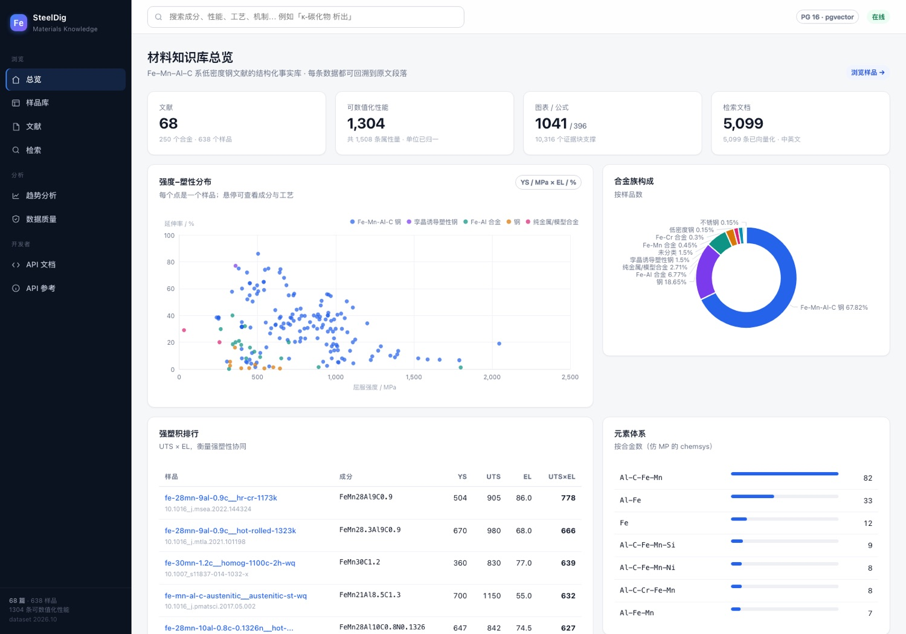
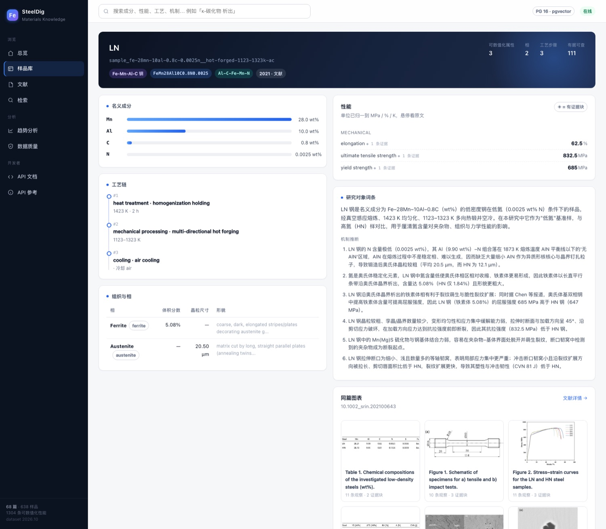
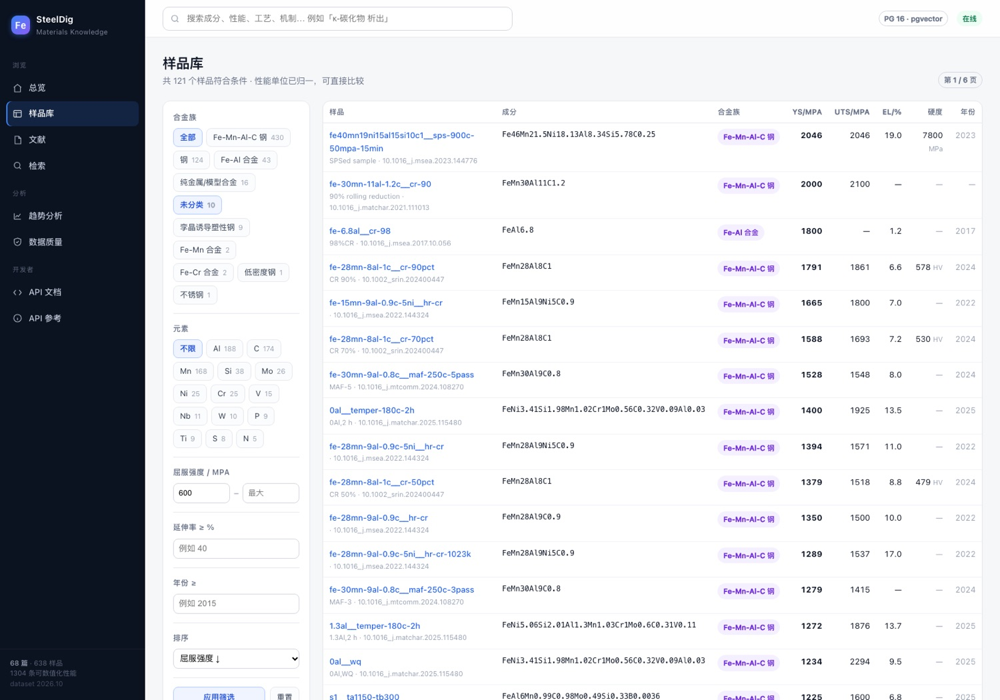
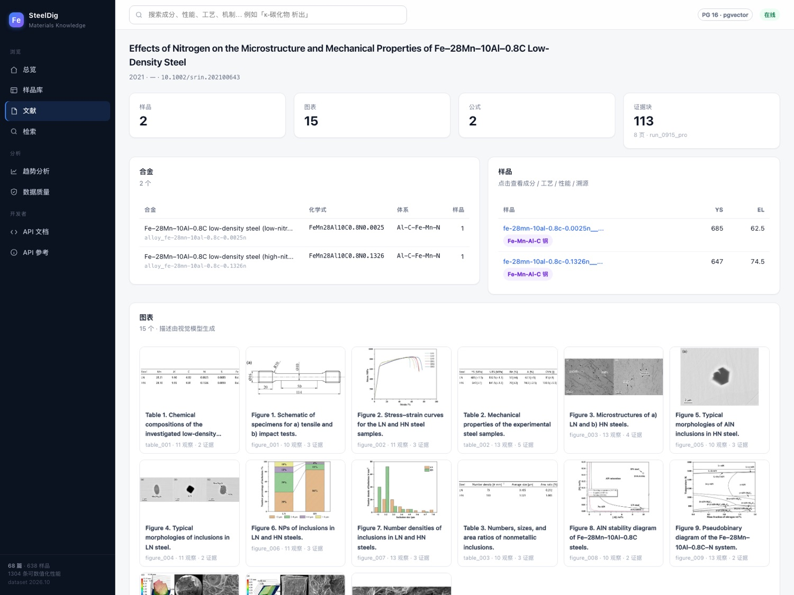
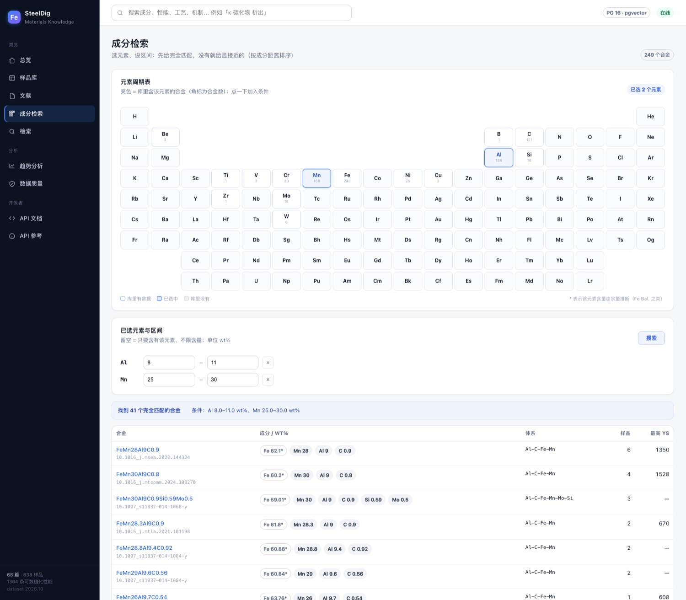
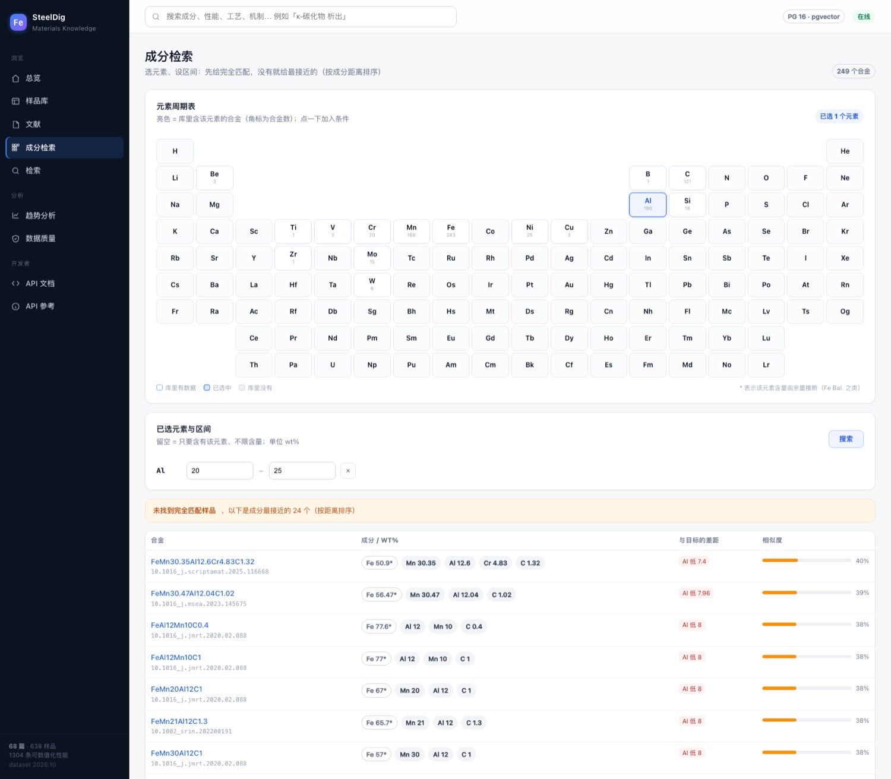
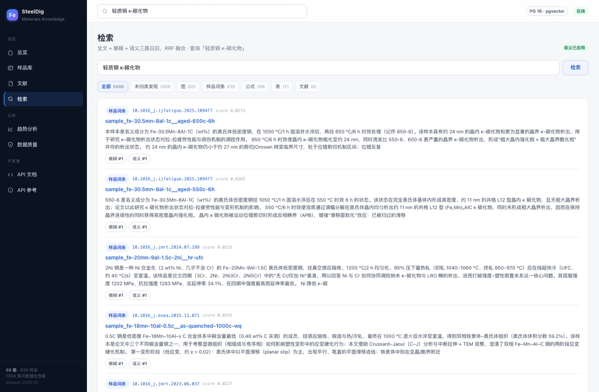
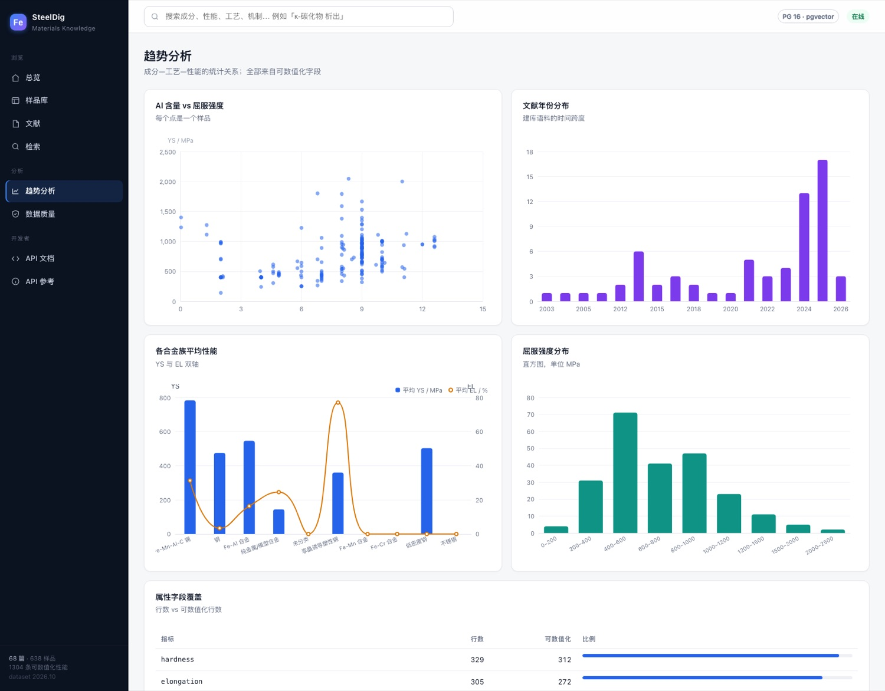

# SteelDig 企业级材料知识库

以 68 篇 Fe–Mn–Al–C 系低密度钢文献为语料，按《数据库建立》的总体架构落地：
**资产湖（不可变）→ PostgreSQL 事实层 → 检索层 → 消费层 API**。

当前状态：**已建成并完成全量入库**，68 篇 / 638 样品 / 1,508 条性能量 / 68,944 条溯源记录，
95 项测试（完整性 + API + 界面 + 校订 + 成分检索）全部通过，`error` 级质量问题为 0。

```
database/
├── 01_raw/mineru_source/     # 资产 A：MinerU 解析，68 篇（PDF + 图 + content_list）
├── 02_extraction/            # 资产 B：LLM 提取，68 篇（preprocess/output/timing）
├── 03_manifests/             # 资产清单、论文主索引、run 归属映射
├── 04_reports/               # 质检与覆盖率报告（自动生成）
├── 05_lake/                  # ★ 资产湖：内容寻址、不可变（sha256 命名）
├── 06_db/                    # ★ 数据库工程：迁移 / ETL / API / 测试 / 编排
├── 07_docs/                  # ★ 架构、数据字典、ER、运维、查询手册
└── scripts/                  # 早期整理脚本
```

---

## 增删改查（CRUD）

**查**通过 SQL、REST、界面三种方式提供；**改 / 增 / 删**通过 `curate.change` 校订层完成。
不直接写 `core.*`，因为事实层可被重跑重建（实测直接 `UPDATE` 会在下次 `ingest` 时被覆盖）。

| 能力 | 方式 | 持久 | 审计 |
|---|---|---|---|
| 查 | SQL / `/api/*` / 界面 | — | — |
| 改 | `POST /api/curate/changes` op=update | ✅ 入库后自动重放 | ✅ 前后值 |
| 增 | 新论文走 ETL；新样品走 op=create | ✅ | ✅ |
| 删 | op=delete（物理删，重跑后再删） | ✅ | ✅ 可撤销 |
| 撤销 | `POST /api/curate/changes/{id}/revert` | — | ✅ |

界面在样品页底部有「人工校订」卡片；命令行 `python -m steeldig_db curate list | apply | revert`。
细节与边界见 [`07_docs/07_CRUD.md`](07_docs/07_CRUD.md)。

---

## 浏览界面（仿 Materials Project）

服务端渲染，无构建步骤、无外部 CDN 依赖（ECharts 已 vendor 到本地），离线可用。
启动同一个服务即可访问：

```
http://127.0.0.1:8011/         总览：KPI + 强度-塑性散点 + 合金族构成 + 强塑积排行
http://127.0.0.1:8011/browse   样品库：合金族/元素/强度/延伸率/年份 多维筛选
http://127.0.0.1:8011/composition 成分检索：元素周期表选元素 + 区间，精确优先、无匹配则给最接近
http://127.0.0.1:8011/papers   文献列表 → 文献详情（图表缩略图直接取自资产湖）
http://127.0.0.1:8011/search   检索：全文 + 模糊 + 语义三路召回
http://127.0.0.1:8011/analytics 趋势分析：成分-性能关系、年份分布、属性覆盖率
http://127.0.0.1:8011/quality   数据质量：门禁状态、block_id 对齐、运行版本
http://127.0.0.1:8011/docs     REST API（统一挂在 /api 前缀下）
```

| 总览 | 样品详情 |
|---|---|
|  |  |

| 样品库 | 文献详情 |
|---|---|
|  |  |

| 成分检索（精确） | 成分检索（无匹配 → 模糊） |
|---|---|
|  |  |

| 检索 | 趋势分析 |
|---|---|
|  |  |

---

## 快速开始

```bash
cd 06_db
cp .env.example .env
docker compose up -d db                 # PostgreSQL 16 + pgvector，端口 5435
python3 -m venv .venv && .venv/bin/pip install -e etl -e api
.venv/bin/python -m steeldig_db migrate # 建 schema（14 个迁移）
.venv/bin/python -m steeldig_db ingest --all   # 全量入库，约 30 秒
.venv/bin/python -m steeldig_db qa      # 质量门禁
.venv/bin/python -m steeldig_db report  # 覆盖率报告
.venv/bin/uvicorn steeldig_api.main:app --port 8011   # 浏览界面 + API
```

打开 <http://127.0.0.1:8011/> 即是浏览界面，`/docs` 是 API 文档。

也可以先看演示视频：[`07_docs/video/v2/SteelDig_演示预览_v2.mp4`](07_docs/video/v2/SteelDig_演示预览_v2.mp4)
（2 分 32 秒，含中文旁白与字幕；成分筛选 → 性能查看 → 原文溯源 → 最近候选 → 检索 → 校订与质量状态）。
或 `make bootstrap` 一把梭。详细步骤见 [`07_docs/03_RUNBOOK.md`](07_docs/03_RUNBOOK.md)。

---

## 文档导航

| 文档 | 内容 |
|---|---|
| [`SteelDig_演示视频_分镜脚本.docx`](SteelDig_演示视频_分镜脚本.docx) | **演示视频脚本与分镜**（9 页，横向）：逐镜脚本、配音稿、录屏命令、验收标准 |
| [`07_docs/video/v2/SteelDig_演示预览_v2.mp4`](07_docs/video/v2/SteelDig_演示预览_v2.mp4) | **演示视频 v2（2分32秒）**：真实浏览器操作，含中文旁白与字幕；[审看入口](07_docs/video/v2/index.html) |
| [`SteelDig_SFT与数据库_优化版_1025.pptx`](SteelDig_SFT与数据库_优化版_1025.pptx) | **最终优化版（41 页）**：SFT 与数据库汇报，可编辑 PPT |
| [`SteelDig_SFT与数据库_优化版_1025.pdf`](SteelDig_SFT与数据库_优化版_1025.pdf) | 最终优化版 PDF |
| [`SteelDig_SFT与数据库_独立讲稿_1025.docx`](SteelDig_SFT与数据库_独立讲稿_1025.docx) | **配套独立讲稿**：[PDF](SteelDig_SFT与数据库_独立讲稿_1025.pdf) / [Markdown](SteelDig_SFT与数据库_独立讲稿_1025.md) |
| [`07_docs/00_ARCHITECTURE.md`](07_docs/00_ARCHITECTURE.md) | **总体架构**：四层逐层对照、五个问题与五组设施、四条设计原则的落地、ADR 决策记录、成本估算 |
| [`07_docs/00_ARCHITECTURE_PLAIN.md`](07_docs/00_ARCHITECTURE_PLAIN.md) | **架构说明书（白话版）**：零基础可读——五个问题、五组设施、列与 JSONB、代价与边界、名词小词典 |
| [`07_docs/01_SCHEMA.md`](07_docs/01_SCHEMA.md) | ER 图（由系统目录自动生成） |
| [`07_docs/02_DATA_DICTIONARY.md`](07_docs/02_DATA_DICTIONARY.md) | 全部 48 个表/视图的字段字典（自动生成） |
| [`07_docs/03_RUNBOOK.md`](07_docs/03_RUNBOOK.md) | 搭建、日常操作、故障排查、备份恢复、权限 |
| [`07_docs/04_QUERY_COOKBOOK.md`](07_docs/04_QUERY_COOKBOOK.md) | 30+ 条实战查询（数值筛选、成分分面、溯源联查、检索、导出） |
| [`07_docs/05_MATERIALS_PROJECT.md`](07_docs/05_MATERIALS_PROJECT.md) | 与 Materials Project 的逐项对照与取舍 |
| [`07_docs/06_QUALITY.md`](07_docs/06_QUALITY.md) | 三级质量模型、当前问题、已知缺陷 |
| [`07_docs/08_TESTDRIVE.md`](07_docs/08_TESTDRIVE.md) | **本地试用指南**：从确认服务到跑通读/写/撤销的完整命令清单 |
| [`07_docs/07_CRUD.md`](07_docs/07_CRUD.md) | **增删改查**：三层写入模型、白名单、API/UI/CLI 用法、边界 |
| [`04_reports/qa_report.md`](04_reports/qa_report.md) | 最新一次的自动质检报告 |

---

## 数据规模

| 指标 | 数值 |
|---|---|
| 论文 | 68 |
| 合金 / 样品 | 250 / 638 |
| 属性量（其中可数值化） | 1,508（1,304，86%） |
| 相记录 / 工艺步骤 | 1,493 / 2,610 |
| 图·表 / 图观察项 | 1,041 / 12,405 |
| 公式 | 396 |
| 证据块 | 10,316 |
| 溯源记录 | 68,944 |
| 检索文档（已全部向量化） | 5,099 |
| 湖对象 | 6,667 个 / 148 MB |

---

## 分层一览

| 层 | 实现 | 关键点 |
|---|---|---|
| 消费层 | 浏览界面（10 个页面）+ REST API（22 个接口，含校订与成分检索） | 只读；`/api/search`、`/api/samples`、`/api/composition/search` 等 |
| 检索层 | `search.document` + GIN + pg_trgm + pgvector(HNSW) | 中英文全文 / 模糊 / 语义，RRF 融合 |
| 事实层 | `core.*`（20 张表）+ `ops.*` + `canon.*` | 列 = 可过滤维度，`payload jsonb` = 原文保真 |
| 资产湖 | `05_lake/objects/sha256/` | 内容寻址、写入即不可变、跨论文去重 |

## 四条设计原则（来自《数据库建立》，已全部落地）

1. **只提升身份/外键/过滤维度为列**，其余 JSONB 保真 —— 避免半空表，也避免全 JSONB 无法过滤。
2. **data / trace 分离** —— `core.sample_data` 与 `core.sample_trace` 靠 `(paper_id, sample_id, path)` 关联，path 是 JSON Pointer，68,944 条全部可命中。
3. **多 run / 多模型内建版本** —— `ops.run` 记录 4 个 run（0915/0917/0919 用 pro，1009 用 flash），事实行带 `run_id` + `is_latest`。
4. **两级身份** —— paper 内用 `(paper_id, entity_id)` 复合键；跨论文用 `canon.*` 受控词表 + 可空 `family_key` / `phase_key`，不强行合并。

---

## 原始资产说明（归集阶段）

两类资产统一以 `<paper_id>`（DOI 转换，`/`→`_`）为目录名，两边 **68 篇一一对应**，可直接按目录名 join。
源目录未做任何修改，全部为复制；MinerU 原始 72 篇中 4 篇无对应提取结果，已从库中删除
（`.mineru_source` 仍完整保留）。

> 提取资产来自 4 个批次，已平铺、不再保留日期/模型层级；来源追溯见
> [`03_manifests/paper_runs.json`](03_manifests/paper_runs.json)。

| 来源 | 篇数 | 模型 |
|---|---|---|
| `out_0915/pro` | 13 | deepseek-v4-pro |
| `out_0917/pro` | 4 | deepseek-v4-pro |
| `out_0919/pro` | 4 | deepseek-v4-pro |
| `out_1009` | 47 | deepseek-flash |

`_monitor/`（agent 会话日志，约 1.1 GB）未入库：它是只增的审计态，
而 `output/` 才是被覆盖的权威当前态。

### 资产 A：MinerU 解析（`01_raw/mineru_source/<paper_id>/`）

`<uuid>_content_list.json`、`_content_list_v2.json`、`_model.json`、`_origin.pdf`、
`layout.json`、`full.md`、`images/`；文件名前缀是逐篇不同的 UUID。

### 资产 B：提取结果（`02_extraction/<paper_id>/`）

`preprocess/`（证据块、图组、公式索引、manifest）、
`output/discover|sample|sample_trace|wiki|figure|equation/`、`timing.json`。

## 清单文件（`03_manifests/`）

| 文件 | 内容 |
|---|---|
| `dataset_summary.json` | 数据集总览（来源路径、论文计数） |
| `mineru_manifest.json` | 68 篇 MinerU 资产：文件映射、UUID、图片列表、体积、标题 |
| `extraction_manifest.json` | 68 篇提取资产：各产物计数、体积 |
| `paper_index.json` / `.csv` | 论文主索引（68 行，横向合并两类资产） |
| `paper_runs.json` | **论文 → (批次, 模型, run_id)** 映射，建库时写入 `ops.run` |

重新生成索引：`python3 scripts/build_manifest.py`

---

## 下一步可做的方向

- [ ] 把 `out_*/flash`、`qwen` 也灌入，做多模型一致性对比（`run_id` 已就位，无需改表）
- [ ] 跨论文 canonical 消解（同一合金/同一相），回填 `canon.*`
- [ ] 公式 latex 归一化后全库去重
- [ ] 湖后端从本地 FS 切到 MinIO/S3（`lake.py` 写路径已按 S3 key 布局设计）


## GitHub 文件范围

仓库保留数据库工程、原始文献与提取结果、资产湖、清单、报告及技术文档。
汇报材料以 `1025` 优化版及配套独立讲稿为当前交付，视频以 `v2` 为当前交付。
旧版汇报、渲染预览、下载的研究资料、虚拟环境、模型缓存和本地 `.env` 由 `.gitignore` 排除，仍保留在本地。
